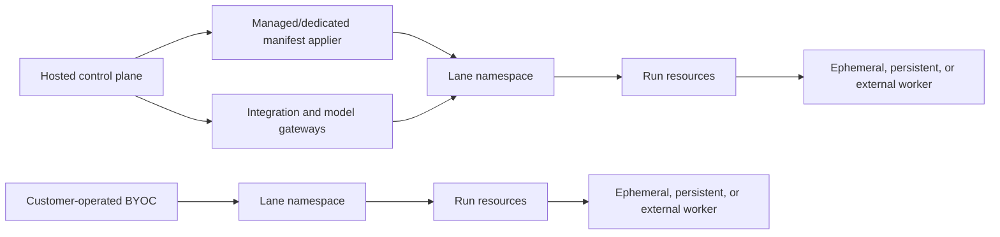

# Symphony Platform Architecture: Deployment-Isolated Lanes

> **Status: superseded.** The implementation authority is
> `symphony-platform-implementation-plan.md`. In particular, launch does not include
> a managed manifest applier, integration or model gateway, run resources, kpt,
> a `SymphonyLane` operator, or a duplicate Symphony control plane. Lane
> self-service is console-driven and `ExternalArtifact`-backed: the console
> accepts complete immutable desired-state revisions and exposes exactly one
> authenticated, cluster-private desired-state `GET`. Its projection-ready lane
> items describe child Flux Kustomizations. The product-release Kustomize base
> statically creates one `DesiredStateSource`, one `ExternalArtifact`, one root
> Flux `Kustomization`, and one digest-pinned product-release `OCIRepository` per
> installation or hosted cluster. A reusable generic OpenAPI-to-KRM controller
> reflects each accepted response into current and recent deterministic Flux
> artifacts and updates only source and artifact status; it observes root and
> child Kustomizations read-only. The root Kustomization owns the projected
> children, each child consumes the fixed lane package from the static OCI
> source and owns its lane inventory, and Flux remains the sole Kubernetes
> writer, pruner, drift detector, inventory owner, and health reporter.
> PostgreSQL retains immutable rollback revisions, so garbage-collected artifact
> bytes are regenerated; artifact receipts are audit evidence only. The
> controller cannot create, delete, or modify binding specifications or mutate
> lane resources, and it does not claim `SourceVerified` without actual source
> signature verification. Missing or altered bindings are restored from the
> signed product release, never recreated by the controller. Signed OCI remains
> the immutable product-release and disconnected-transport format. A future
> read-only OCI frontend is consumed directly through `OCIRepository`; it does
> not emit `ExternalArtifact` YAML or chain through that adapter.
> This document remains only as historical product context where the plan does
> not replace it.

## Summary

Adopt the deployed lane as the permanent isolation and scaling unit:

- One lane owns exactly one Git repository and one tracker scope: Linear project, Jira project, Asana project, GitHub Issues repository, or GitLab project.
- Every lane has its own Kubernetes namespace, scheduler Deployment, identity, secrets, policy, storage, dashboard, quotas, and worker backend.
- Never combine customer lanes inside one Symphony process.
- Build the product in a new monorepo. Keep the existing Symphony and `symphony-k8s` repositories unchanged as the personal reference deployment.
- Deliver in stages: architecture foundation, a narrow managed design-partner release, disconnected BYOC, portable workers, managed SaaS, optional external backends, and dedicated deployments.
- Target 1,000 configured hosted lanes and 500 concurrent runs, initially without an uptime SLA.

## Product Contract

### Product Summary

Symphony Managed turns ready Linear sprint issues into tested GitHub pull requests for small engineering teams. The first product ends at human review and uses customer-provided model access rather than replacing the team’s review, merge, or deployment authority.

### Problem Frame

The product thesis comes from repeated personal use: managing work at the issue level produces more completed issues, less agent supervision, faster cycle time, and work that otherwise would not get done. The first commercial test narrows that experience to a small team with recurring sprint work instead of launching every existing provider combination at once.

### Actors

- A1. The organization Admin connects providers, creates lanes, manages subscription limits, and controls cancellation.
- A2. A team Member prepares sprint issues, observes runs, and reviews the resulting pull requests.
- A3. A Symphony lane claims one ready issue at a time within its configured concurrency and produces a tested pull request or an actionable failure.

### Key Decisions

- **Small-team issue-to-pull-request product** (session-settled: user-directed — chosen over review-through-deployment automation: human review remains the first product’s control point). Governs R1–R3.
- **Linear, GitHub, and customer ChatGPT session as the canonical bundle** (session-settled: user-directed — chosen over broader launch coverage: the first customer path stays narrow). Governs R4–R5.
- **Monthly lane bundles** (session-settled: user-directed — chosen over per-lane and per-seat billing: small teams buy predictable repository-and-project capacity). Governs R6–R9.
- **Free alpha, discounted beta, full-price general availability** (session-settled: user-directed — chosen over remaining free until general availability: beta supplies the first paid-market signal). Governs R7–R8 and R12.
- **Operational readiness gates general availability** (session-settled: user-directed — chosen over recurring-use and reliability outcome gates: the product launches when the technical service contract passes). Governs R13–R14.
- **Free BYOC and contract-priced Dedicated** (session-settled: user-directed — chosen over one commercial model for every deployment mode: self-hosting stays accessible while dedicated operations fund their carrying cost). Governs R10–R11.

### Requirements

**Customer and outcome**

- R1. The first Managed customer is a small engineering team using Linear and GitHub for recurring sprint work.
- R2. The primary paid job is to turn a ready Linear issue into a tested GitHub pull request for human review.
- R3. The first paid outcome does not include autonomous review approval, merge, or deployment.

**Canonical launch bundle**

- R4. The canonical Managed launch bundle is Linear, GitHub, and a customer-provided ChatGPT session.
- R5. A customer-provided API credential must be a supported fallback before Managed reaches general availability.

**Managed commercial contract**

- R6. Monthly list pricing is Starter at $99 for 1 active lane, Team at $199 for 3 active lanes, and Growth at $999 for 10 active lanes.
- R7. Alpha is free, beta is 50% off list price, and general availability uses full list price.
- R8. Alpha measures active worker usage; before beta, the product publishes included compute allowances and overage rates for each tier. Overage billing is disabled by default and requires an Admin-set monthly spend cap.
- R9. Cancellation takes effect at the billing-period boundary. Active runs may finish, then lanes pause and the customer receives a metadata-export window before timed deletion.

**Deployment-mode packaging**

- R10. BYOC launches free, self-supported, and without technical license enforcement; paid support may be introduced later.
- R11. Dedicated is sold later through a custom annual contract with a platform fee plus customer-specific infrastructure costs.

**Release evidence**

- R12. Alpha enrolls three small-team design partners with at least one active lane each. The calendar date that ends alpha and begins beta must be published before alpha enrollment.
- R13. Managed reaches general availability when the Foundation, Design partner, and Managed acceptance criteria pass; product-outcome thresholds do not block launch.
- R14. After launch, the product measures weekly issue-to-pull-request recurrence, manual intervention, time to pull request, supervision time, sprint throughput, lane retention, support burden, billing reconciliation, cancellation, and paid retention.

### Key Flows

- F1. Managed onboarding
  - **Actors:** A1, A3.
  - **Steps:** The Admin connects Linear, GitHub, and a ChatGPT session; maps one repository and Linear project to a lane; validates the lane; and receives a first-run-ready result or a remediation path.
  - **Covered by:** R1, R4–R5.
- F2. Sprint issue to pull request
  - **Actors:** A2, A3.
  - **Steps:** A ready issue is claimed; the lane prepares an isolated workspace; the worker implements and tests the change; Symphony returns a pull request for human review.
  - **Covered by:** R2–R3.
- F3. Subscription expansion and overage
  - **Actors:** A1.
  - **Steps:** The Admin selects a lane bundle, reviews included compute, and may enable overages only with a hard monthly cap.
  - **Covered by:** R6–R8.
- F4. Cancellation
  - **Actors:** A1, A3.
  - **Steps:** The Admin cancels; service continues through the paid period; active work finishes; lanes pause; metadata remains exportable until deletion.
  - **Covered by:** R9.

### Acceptance Examples

- AE1. Covers R2–R3. Given a ready Linear issue in the configured project, when Symphony completes the run, then it returns a tested GitHub pull request in human review without merging or deploying it.
- AE2. Covers R4–R5. Given ChatGPT-session authentication is unavailable, when an Admin configures a supported customer API credential, then the lane can run without platform-funded model access.
- AE3. Covers R8. Given a tier’s included compute is exhausted and overages are disabled, when another run would start, then the product blocks the run and does not add a surprise charge.
- AE4. Covers R8. Given overages are enabled with a monthly cap, when usage reaches that cap, then no new overage-funded runs start until the next period or an Admin changes the cap.
- AE5. Covers R9. Given an Admin cancels during an active run, when the billing period ends, then that run may finish, new runs stop, and metadata remains exportable for the published retention window.

### Success Signals

R14 owns the post-launch measurement set. The primary signal is that teams repeatedly turn ready sprint issues into tested pull requests each week; the remaining measures explain reliability, customer effort, commercial behavior, and support cost without acting as general-availability gates.

### Scope Boundaries

**Deferred for later**

- Review, merge, and deployment automation after the pull-request handoff.
- Other tracker, repository, and model-authentication combinations as canonical onboarding paths.
- Paid BYOC support and technical license enforcement.

**Outside the first product’s identity**

- Per-seat pricing as the primary subscription unit.
- A multi-repository workspace or dynamic repository routing inside one lane.
- Autonomous removal of the team’s human pull-request review authority.

### Dependencies and Assumptions

- The alpha-to-beta calendar date is a commercial schedule decision and does not block technical planning, but it must be published before alpha enrollment.
- Alpha usage must produce enough worker-cost evidence to publish beta allowances and overage rates.
- The customer’s ChatGPT terms must permit the intended session use; R5 prevents that authentication path from becoming a single point of product failure.

## Product and Execution Architecture

- Model tenancy as `Organization → Connections → Lanes → Runs`. Use two roles:
  - `Admin`: billing, credentials, integrations, lanes, deployment, policy, and deletion.
  - `Member`: observe and control runs without managing secrets or billing.
- Support three deployment modes from one manifest contract:
  - Managed: shared clusters with a namespace and sandbox RuntimeClass per lane.
  - Dedicated: SaaS-applied manifests in a customer-specific cluster.
  - BYOC: customers render and apply packages themselves; no operational state or telemetry is sent to the SaaS.
- Use kpt and Kustomize for packaging, validation, and overlays. Use Skaffold for development and integration testing only. Do not use Helm.
- Install lane resources through mode-specific appliers:
  - Customers apply BYOC packages.
  - The hosted service applies managed and dedicated packages using Kubernetes server-side apply.
  - Each managed or dedicated customer uses a separate short-lived applier identity. Limit it to server-side apply and lifecycle operations for approved resource kinds in that customer’s namespaces. Do not grant cluster-admin or Secret-read access. Require rotation, immediate revocation, and an audit event for every applier action.
- Do not add an in-cluster lane operator. Each installed lane reads its own configuration and reconciles only its namespaced runs and workers.
- Keep one scheduler replica using `Recreate` plus a Kubernetes Lease. A fencing generation prevents an old scheduler or worker from mutating a newer run.
- Persist active execution state in Kubernetes:
  - `SymphonyLane` contains the repository, tracker scope, credential references, workflow source, model mode, worker backend, resources, concurrency, storage, and platform-policy reference.
  - `SymphonyRun` contains the tracker identity, attempt, desired state, workspace claim, worker reference, fencing token, phase, timestamps, error category, session metadata, and usage totals.
- Recover by listing Run resources and workers after restart. Reconnect only when a backend proves session continuity; otherwise fence and terminate the stale worker, increment the attempt, and reuse the issue workspace.
- Treat run execution as at-least-once. Route externally visible provider mutations through platform-mediated operations with stable idempotency keys derived from lane, run, and logical operation. A retry must reconcile a prior mutation before attempting it again.
- Create one workspace PVC per active issue. Preserve it across retries and remove it after terminal cleanup. Worker caches remain non-authoritative.
- Define the customer onboarding contract by deployment mode:
  - Create the organization and verify tracker, repository, and model connections.
  - Select a deployment mode, configure the repository-to-tracker mapping, and validate policy, credentials, and capacity.
  - End in a healthy, first-run-ready lane or show a specific remediation path.
  - For disconnected BYOC, produce a package and a local verification command as the explicit installation handoff.
- Provide an organization-level dashboard with lane health and a lane-level surface with run history and run details. Define actions by role and lifecycle state: Members may cancel or retry eligible runs; Admins may also pause or resume lanes, repair connections, change policy, and delete lanes. Every asynchronous action reports pending, success, partial-failure, and terminal states. Destructive actions require confirmation and an impact summary.

## Security, Credentials, and Integrations

- Treat repositories, tickets, prompts, hooks, and tool arguments as untrusted.
- Enforce a non-overridable platform security envelope:
  - Repository `WORKFLOW.md` may define prompts, state routing, required labels, and lifecycle hooks.
  - The platform owns sandbox RuntimeClass, image digest, command allowlist, resources, network policy, secret exposure, storage, and retention.
  - Run hooks inside worker isolation, never in the scheduler container.
- Standard managed isolation includes a dedicated namespace, service account, default-deny network policy, resource quota, PVCs, sandbox RuntimeClass, restricted pod security, immutable images, and workers without Kubernetes API credentials.
- Support OIDC and trusted authenticated-ingress headers for BYOC dashboards. The hosted control plane provides its own organization authentication.
- Support every current tracker adapter: Linear, GitHub Issues, GitLab Issues, Jira Cloud, and Asana. Repository sources support GitHub, GitLab, and explicitly configured Git HTTPS/SSH sources.
- Hosted and dedicated connections use a required integration gateway:
  - Store OAuth and manual-token credentials with envelope encryption.
  - Refresh OAuth centrally, receive webhooks, enforce connection-wide rate limits, and issue short-lived lane-scoped credentials.
  - Verify provider-specific webhook signatures and timestamps, reject events outside the replay window, deduplicate by provider event ID, and rate-limit accepted events.
  - Treat a webhook payload only as a wake signal. Re-fetch current tracker state through the lane-scoped connection before creating or advancing a run.
  - Mint short-lived clone credentials without exposing long-lived source credentials to workers.
  - Proxy provider-native agent tools with lane and tracker-scope authorization.
- Disconnected BYOC accesses providers directly through customer-managed Kubernetes Secret references.
- Support all model authentication modes at managed general availability:
  - Customer API credential.
  - Customer ChatGPT session.
  - Platform-funded model gateway.
- Lease each ChatGPT session to one active worker. Additional concurrency requires separate session credentials.
- Keep raw API credentials and ChatGPT session material outside worker-readable files, environment variables, and process memory. Workers authenticate with non-exportable per-run workload identity to a credential broker that enforces lane scope and run-level quotas. Hosted and dedicated modes use the platform credential broker; disconnected BYOC deploys the broker inside the customer environment. Never persist session material in issue workspace storage.
- BYOC supports API credentials and ChatGPT sessions only; it cannot depend on the SaaS model gateway.
- Define the data boundary separately for transit, processing, and persistence:
  - Hosted and dedicated gateways may receive provider requests and authorized tool payloads in transit and process them in memory. They persist only run metadata and usage receipts. Third-party providers process payloads under the customer’s configured provider agreement.
  - Source code, workspaces, prompts, and transcripts remain in the lane. Raw tool payloads are not retained by the SaaS.
  - Disconnected BYOC sends no operational data to the SaaS and reaches configured providers directly from the customer environment.
  - Any future hosted retention of prompts, source, tool payloads, or transcripts requires an explicit customer opt-in policy.
- Require hosted and BYOC dashboards to meet WCAG 2.2 AA. Include full keyboard operation, visible focus, semantic form and authentication errors, programmatically exposed lane and run status changes, non-color-only state indicators, and automated plus manual accessibility checks.

## SaaS Control Plane and Delivery Roadmap

1. Architecture foundation:
   - Create the new product-monorepo design with logical runtime, Kubernetes packaging, contract, gateway, and control-plane boundaries.
   - Publish the Lane/Run schemas, worker-backend contract, security-envelope contract, threat model, and deployment-mode lifecycle.
   - Defer the hosted control-plane language/framework while keeping its APIs and persistence requirements implementation-neutral.

2. Managed design-partner validation:
   - Enroll three small-team design partners using the Linear, GitHub, and customer ChatGPT-session bundle.
   - Run a free alpha with manual onboarding and publish its calendar end date before enrollment.
   - Begin beta on that date at 50% of the list prices in R6, with included compute and opt-in capped overages derived from alpha usage.
   - Observe onboarding, first successful pull request, recurring lane use, operational burden, and paid retention without making product-outcome thresholds a general-availability gate.

3. BYOC release:
   - Package the existing persistent-worker approach first.
   - Add declarative multi-lane kpt/Kustomize packages, Run resources, scheduler fencing, OIDC dashboard authentication, security-envelope enforcement, and a lane-local credential broker that consumes customer-managed Secret references.
   - Include all current tracker adapters and API/ChatGPT model authentication.
   - Apply no technical license enforcement initially.

4. Portable worker layer:
   - Define one conformance-tested backend interface for workspace preparation, process transport, cancellation, cleanup, health, and recovery.
   - Add ephemeral issue pods as the managed default.
   - Preserve persistent workers for existing installations.

5. Managed SaaS:
   - Add organizations, admin/member authorization, OAuth-plus-token connection onboarding, lane provisioning, integration gateway, platform model gateway, metadata ingestion, usage billing, and managed cluster application.
   - Use provider webhooks to wake lanes while retaining low-frequency polling for reconciliation.
   - Offer the Starter, Team, and Growth lane bundles defined by R6. Bill customer-enabled compute overages only within the Admin’s hard monthly cap.
   - Publish the stable usage-receipt schema with the billing meters, reconciliation rules, and compatibility policy that consume it.
   - Use idempotent signed usage receipts keyed by lane, run, attempt, and sequence.

6. Optional backend expansion:
   - Add external sandbox APIs as a non-gating backend after the Managed SaaS milestone without changing lane or run semantics.

7. Dedicated SaaS:
   - Apply the same packages to customer-specific clusters.
   - Retain hosted onboarding, gateways, billing, and metadata while moving execution, storage, networking, and data residency into the dedicated cluster.
   - Sell Dedicated through a custom annual platform contract with customer-specific infrastructure costs.

Cross-repository work is intentionally excluded. It must be represented as separate tracker work assigned to separate lanes; dynamic repository routing and multi-repository workspaces are not part of this architecture.

## Validation and Acceptance Criteria

- **Foundation:** Prove two lanes cannot read each other’s Secrets, PVCs, APIs, worker processes, or network endpoints.
- **Foundation:** Reject duplicate repository/tracker-scope mappings within one hosted organization and connection boundary. Reject BYOC duplicates within one rendered installation or explicitly named deployment boundary.
- **Foundation:** Prove scheduler restart, stale-worker fencing, retry recovery, terminal cleanup, project removal, and configuration reload without duplicate active execution.
- **Foundation:** Crash runs immediately before and after externally visible provider mutations. Prove recovery reconciles the prior result and does not repeat the logical operation.
- **Design partner:** Complete mode-specific onboarding from organization creation to a healthy, first-run-ready lane, including failed-validation remediation.
- **Design partner:** Enroll three small teams and prove the canonical Linear, GitHub, and customer ChatGPT-session path can produce a tested pull request for each team.
- **BYOC:** Verify API credentials never appear in logs, worker-readable state, or Run resources and ChatGPT sessions cannot be leased concurrently.
- **BYOC:** Prove BYOC operates with all SaaS endpoints blocked.
- **Portable worker:** Run the same backend conformance suite against ephemeral pods and persistent workers.
- **Managed:** Verify OAuth rotation, PAT revocation, short-lived clone credentials, provider-wide rate limiting, and scope enforcement for every tracker tool.
- **Managed:** Verify webhook signatures, replay rejection, provider-event deduplication, and authoritative tracker-state re-fetching.
- **Managed:** Inject duplicate, missing, delayed, and out-of-order usage receipts; reconcile billed totals against authoritative lane and model-gateway usage; verify retry-safe invoice generation; and trace every charge to immutable receipt evidence.
- **Managed:** Prove hosted metadata contains no prompts, source, transcripts, or raw tool payloads.
- **Managed:** Exercise every role- and state-specific dashboard action, including pending, partial-failure, and terminal feedback.
- **Managed:** Verify hosted and BYOC dashboards against WCAG 2.2 AA with automated checks and manual keyboard and assistive-technology testing.
- **Managed:** Load-test 1,000 deployed lane schedulers and 500 concurrent workers, including webhook bursts, provider throttling, worker failures, and cluster rescheduling.
- **Managed:** Verify tier entitlements, 50%-discount beta billing, full-price general-availability billing, opt-in overages, hard spend caps, end-of-period cancellation, metadata export, and timed deletion.
- **Optional backend:** Run the backend conformance suite against an external sandbox test adapter without making this gate a prerequisite for Managed SaaS.
- **Dedicated:** Validate install, upgrade, rollback, and deletion using only kpt, Kustomize, Skaffold test workflows, and standard Kubernetes commands.

### Phase Completion

- A phase is complete only when every criterion labeled for that phase and every earlier phase passes in the target deployment mode.
- Foundation criteria gate every release. Design-partner criteria gate the managed pilot. BYOC, Portable worker, Managed, Optional backend, and Dedicated criteria gate only their named milestones unless a criterion explicitly says otherwise.
- A later-phase criterion may run early for evidence, but it cannot block an earlier milestone unless the roadmap is amended to make that dependency explicit.
- Managed general availability requires all Foundation, Design partner, and Managed criteria. Product success signals in R14 are monitored after launch and do not gate general availability.

## Sources and Research

- The current product framing and operational boundary come from `README.md` and `SPEC.md` in the Symphony reference repository.
- Adjacent pricing context: [GitHub Copilot plans](https://github.com/features/copilot/plans), [Cursor pricing](https://cursor.com/pricing), and [Devin self-serve plans](https://docs.devin.ai/admin/billing/self-serve). The R6 prices are launch hypotheses chosen for Symphony’s lane-based product, not copies of those per-user products.

## Deferred / Open Questions

### Deferred to Planning

#### From 2026-08-10 review

- **Persistent-worker workspace storage contract** — Product and Execution Architecture / SaaS Control Plane and Delivery Roadmap (P1, feasibility, confidence 100)

  Persistent workers cannot receive a different per-issue volume without pod recreation. Choose backend-specific persistence, one issue and volume per persistent worker lifetime, or shared workspace storage.

- **Generic Git credential boundary** — Security, Credentials, and Integrations (P1, feasibility, confidence 100)

  Arbitrary Git servers do not expose a standard temporary-credential API. Choose supported temporary-credential integrations, a Git transport proxy, a customer-side credential broker, or a documented reduced-security exception.
