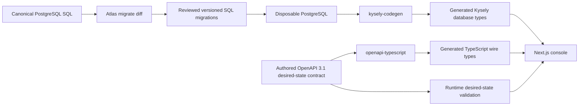
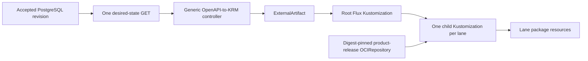

# Symphony Platform Console - Historical Implementation Supplement

## Purpose and Authority

This document preserves the previously accepted Kysely and `openapi-typescript` implementation posture for decision history. It is superseded by `symphony-saas-console-effect-platform.md`, which now owns the selected console framework, persistence, workflow, Server Action, and private wire-contract implementation decisions. The main Product Contract and Key Technical Decisions continue to own customer-visible behavior and system boundaries.

Do not implement from this document. Its Kysely, `kysely-codegen`, `openapi-typescript`, single-package, and no-selected-workflow decisions are historical context only. The authored OpenAPI contract, SQL-first Atlas boundary, explicit Server Actions, Better Auth boundary, Flux ownership, and Symphony ownership continue where the selected Effect supplement preserves them.

This supplement cannot move any Symphony-owned polling, claims, retries, workspaces, tracker normalization, Codex sessions, or run state into the console. It cannot move Kubernetes write authority from Flux into the console or the reusable source controller.

## Accepted Decisions

- `apps/console` is a Next.js App Router application running in the Node.js runtime.
- Better Auth owns human session and identity behavior inside the console.
- PostgreSQL SQL is the sole relational-schema authority.
- Atlas manages the desired SQL schema and generates reviewed, versioned SQL migrations.
- Kysely with the `pg` driver is the console database-access layer.
- `kysely-codegen` generates disposable TypeScript database definitions from a migrated PostgreSQL database.
- Server Components call server-only application services directly for first-party reads, and Server Actions own authenticated human mutations. The console exposes no general or public product API at launch.
- Database-derived generation stops at Kysely persistence types. No tool generates exported Server Actions, generic model CRUD actions, authorization rules, or UI mutations from PostgreSQL metadata.
- Server Actions are hand-authored domain commands over application services and transactions. A small internal wrapper may centralize validation, Better Auth context, authorization, stale-write checks, audit metadata, and error mapping, but it cannot infer or expand the action surface from the database schema.
- Directly authored OpenAPI 3.1 is the sole authority for the versioned, cluster-private desired-state projection API consumed by the reusable controller. `openapi-typescript` converts that document into runtime-free TypeScript declarations.
- `packages/contracts` is the sole initial shared package. It owns the authored OpenAPI document and generated TypeScript wire declarations, but not console persistence, Server Action inputs, or provider-owned protocols.
- Prisma, Prisma Next, ZenStack, Smithy, PgTyped, and `sqlc-gen-typescript` are not launch dependencies.
- No background-job framework is selected by this supplement. A job library is added only when a concrete durable asynchronous workflow cannot remain a transaction, request, Kubernetes Job, or external reconciliation.
- If a future accepted durable-workflow dependency cannot disable its internal migrations, it is permitted only as a named, version-pinned exception: Atlas provisions an isolated PostgreSQL schema and role, and the dependency retains DDL authority only inside that schema. It cannot run DDL in the console-owned `app` or `auth` schemas, and its internal tables never become Atlas desired-schema input.

## Ownership Model

| Concern | Authority | Derived artifacts | Forbidden second authority |
|---|---|---|---|
| Relational structure | `apps/console/db/schema.sql` | Atlas migration files and generated Kysely types | Prisma schema, ZModel, Drizzle schema, application migrations |
| Migration history | `apps/console/db/migrations/` | Atlas checksum and applied revision rows | Better Auth migrations, Kysely migrations, direct production `schema apply` |
| Database query types | Migrated PostgreSQL catalog | `apps/console/src/db/database.generated.ts` | Hand-maintained table interfaces |
| Private desired-state operation and payload | `packages/contracts/openapi/desired-state.openapi.yaml` | TypeScript declarations | Database-row types used as wire DTOs, a second schema language, or a public CRUD API |
| Human UI operations | Hand-authored domain Server Actions and Next.js Server Components in `apps/console` | Server-rendered views and validated action results | Database-generated or generic model CRUD actions, a browser-facing JSON CRUD API, or a client-side HTTP data layer |
| Provider callbacks and webhooks | Better Auth and selected provider protocols | Narrow Route Handlers | Product-owned API contracts that restate provider protocols |
| Authentication behavior | Better Auth configuration | Session types and route behavior | A second authentication framework |
| Lane desired state | Accepted console revision | Authenticated current desired-state projection containing child Flux Kustomizations | Git, runtime OCI tags, direct lane-resource writes by the console |
| A future self-migrating workflow store | Pinned dependency in its isolated schema | Dependency-owned internal tables and migration bookkeeping | Atlas-managed definition of internal tables, or dependency DDL outside its isolated schema |

The design uses one source per architectural boundary. It deliberately rejects one universal schema for storage, APIs, forms, and authorization because those representations have different compatibility and exposure rules.

## Technical Design



The two generation chains do not cross. Database types describe rows and SQL expressions. Wire types describe authenticated operations and serialized payloads. Mapping between them is explicit application code and therefore an auditable security boundary.

The runtime projection path is equally one-way:



The product-release base statically owns the source resource, `ExternalArtifact`, root Kustomization, and product-release `OCIRepository`. The controller updates source and artifact status only and observes root and expected child Kustomizations read-only. The root owns projected children; each child owns its lane inventory. Flux is the only Kubernetes writer.

## Canonical Layout

```text
apps/
└── console/
    ├── db/
    │   ├── atlas.hcl
    │   ├── schema.sql
    │   └── migrations/
    │       ├── atlas.sum
    │       └── <version>_<name>.sql
    ├── src/
    │   ├── app/
    │   │   ├── api/
    │   │   │   ├── auth/[...all]/route.ts
    │   │   │   └── <provider-callbacks>/route.ts
    │   │   └── internal/v1/installations/[installationId]/desired-state/
    │   │       └── route.ts
    │   ├── auth/
    │   ├── db/
    │   │   ├── client.ts
    │   │   ├── database.generated.ts
    │   │   ├── repositories/
    │   │   └── transactions/
    │   ├── lanes/
    │   ├── revisions/
    │   └── desired-state/
    ├── tests/
    ├── Dockerfile
    └── package.json

packages/
└── contracts/
    ├── openapi/
    │   └── desired-state.openapi.yaml
    ├── generated/
    │   └── desired-state-api.generated.d.ts
    ├── src/
    ├── tests/
    └── package.json
```

Persistence stays with the only application that owns it. Infrastructure directories remain outside Turbo workspaces. Shared integration fixtures remain under root `tests/fixtures`; unit-only fixtures remain beside their tests.

## Relational Schema and Atlas Workflow

### Authoring

`apps/console/db/schema.sql` is ordinary PostgreSQL DDL and may use PostgreSQL-native constraints, indexes, enums, domains, JSONB, generated columns, functions, and other selected capabilities. HCL is not the source format.

For each change:

1. Edit `schema.sql`.
2. Run `atlas migrate diff <name>` against a disposable PostgreSQL dev database.
3. Review the generated SQL for locking, destructive operations, expand-contract compatibility, and rollback impact.
4. Commit `schema.sql`, the migration, `atlas.sum`, and regenerated Kysely types together.
5. Apply the migration directory to a clean disposable PostgreSQL database.
6. Verify that the resulting database matches the desired SQL schema.

Atlas's declarative and versioned workflows are intentionally combined. Production and shared environments run `atlas migrate apply` against committed migrations. They do not calculate a fresh declarative diff against the live database.

Atlas Cloud, Atlas Registry, and Atlas Pro are not launch dependencies. Pro-only planning, policy, or lint features may be adopted later, but the root verification contract cannot depend on them without a separate decision.

### Conditional self-migrating dependency boundary

The launch stack selects no durable-workflow framework. If a later accepted dependency, including Effect Workflow, requires runtime DDL for its own persistence, the product uses a bounded dual-authority model rather than hand-copying its DDL into Atlas:

1. Atlas creates the dependency's dedicated schema, role, and grants; it continues to own the database platform plus `app` and `auth`.
2. The dependency's runtime role receives DDL only in that dedicated schema. Its web and console roles receive none.
3. The dependency owns its internal tables, indexes, migration bookkeeping, and compatible upgrades. Atlas does not describe, migrate, infer, rewrite, or drop those objects.
4. The exact dependency version is pinned. CI proves fresh initialization and upgrade against a disposable database and proves the runtime role cannot mutate another schema.
5. Backups and restores include the isolated schema, while product migrations and N-1 compatibility rules remain limited to Atlas-owned schemas.

This exception does not weaken the SQL-first console boundary: it is allowed only for an explicitly selected infrastructure component whose runtime migration behavior cannot be disabled or replaced safely.

### Better Auth schema changes

Better Auth uses its built-in PostgreSQL/Kysely adapter. Its CLI may run in generation-only mode to show the SQL required by the pinned Better Auth configuration and selected plugins. The generated SQL is an input to review, not a migration authority:

1. Pin the Better Auth version and configuration.
2. Run Better Auth schema generation into a temporary file.
3. Reconcile the required tables and columns into `schema.sql`.
4. Let Atlas generate the reviewed migration.
5. Fail CI if the configured Better Auth schema is not represented by the canonical database.

The Better Auth `migrate` command and programmatic migration runner are forbidden in release builds and deployed containers.

## Kysely and Database Type Generation

The console instantiates `Kysely<DB>` with `PostgresDialect` and the `pg` pool. Query code lives in small repositories and transaction modules organized around console operations rather than generic active-record models.

`kysely-codegen` runs only against a disposable database created from the committed migration directory. It does not inspect production. Its output is committed so a clean build does not require a database, and CI regenerates or invokes `--verify` to reject drift.

Rules:

- Generated database types are never manually edited.
- Application code uses Kysely's `Selectable`, `Insertable`, and `Updateable` projections instead of inventing row interfaces.
- Desired-state wire types never re-export generated database row types.
- Type overrides are allowed only for stable PostgreSQL-to-TypeScript mappings and are covered by round-trip tests.
- Raw SQL is allowed through Kysely's parameterized SQL facilities for database features the query builder cannot express; unparameterized interpolation is forbidden.
- Transactions own concurrency-sensitive operations such as accepting a complete installation revision and reserving hosted capacity.
- Generated database types stop at the repository and transaction boundary. They may inform implementation types but never declare which Server Actions exist or which fields an action accepts.

## Server Action Design

Server Actions are application commands, not a generated database façade. Launch actions are named for customer intent, such as accepting an installation revision, pausing or resuming a lane, rolling back to a retained revision, and advancing a resumable provider-onboarding step. They call server-only application services or transaction modules; they do not export Kysely table operations or accept generic `select`, `insert`, `update`, `delete`, filter, ordering, include, or projection arguments.

Every action owns an explicit input validator that is separate from database row types and desired-state wire types. The action independently loads the Better Auth server session, derives organization, tenant, role, installation, and lane scope from stored membership, checks the expected prior revision for stale writes, and executes the minimum domain transaction. Client-supplied identity, role, or scope fields cannot grant authority.

The initial implementation uses native Next.js Server Actions. A repository-local helper may remove repeated validation, session, authorization, audit, and error-envelope plumbing while keeping every exported command explicit and reviewable. `next-safe-action` or another action framework is not a launch dependency; it may be considered later only if measured repetition justifies it and it does not generate actions or become a second contract authority.

The database schema supplies tables, columns, constraints, keys, and generated Kysely types. It cannot determine product commands, field exposure, authorization, transaction boundaries, optimistic concurrency, audit behavior, or cache invalidation. Consequently, database schema changes never create, remove, or broaden a remotely reachable action automatically. If action scaffolding becomes useful, a repository-owned generator may create editable command skeletons only from an explicit domain-command descriptor; the descriptor and resulting source remain subject to normal review and regeneration is never an action authority.

## Private Desired-State Projection Contract

`packages/contracts/openapi/desired-state.openapi.yaml` directly defines the only product-owned machine API. It does not describe Server Actions, Better Auth, provider callbacks, webhooks, database tables, or a public customer API.

The contract defines exactly one operation: `GET /internal/v1/installations/{installationId}/desired-state`. It returns the complete current accepted installation state in one non-paginated response with `schemaVersion`, the stable accepted `revision`, and a deterministically ordered `lanes` collection. It requires controller workload authentication and derives the authorized installation scope from that identity; a path installation outside that scope is denied. The operation supports `ETag` and `If-None-Match`, uses the canonical response digest as its `ETag`, declares an explicit schema version, and enforces the documented payload-size bound.

Each `lanes` item contains only `metadata` and `spec`. Its OpenAPI schema carries `x-kubeprojection-resource` with the fixed output GVK `kustomize.toolkit.fluxcd.io/v1, Kind=Kustomization`. The reusable controller injects that GVK and otherwise performs no Symphony-specific mapping. Items are ordered by stable Kustomization identity derived from the immutable lane ID.

Each projected child Kustomization references the statically installed product-release `OCIRepository` at the exact accepted product-release digest and the fixed lane-package path. It supplies only non-secret lane parameters through `postBuild.substitute`, refers to credentials and secret-provider objects by name, uses the approved lane-applier service account, and sets `prune: true`, `wait: true`, and `deletionPolicy: WaitForTermination`. Secret values, browser session data, provider tokens, and reusable model credentials are forbidden in the response.

### Symphony OpenAPI example

The authored contract includes the following shape. This excerpt demonstrates the Symphony-specific projection boundary; the committed document must fully constrain every shown `metadata` and `spec` field and reject unknown fields.

```yaml
openapi: 3.1.0
info:
  title: Symphony installation desired state
  version: 1.0.0
paths:
  /internal/v1/installations/{installationId}/desired-state:
    get:
      operationId: getInstallationDesiredState
      parameters:
        - in: path
          name: installationId
          required: true
          schema:
            type: string
            minLength: 1
        - in: header
          name: If-None-Match
          required: false
          schema:
            type: string
      responses:
        "200":
          description: Complete current accepted installation state
          headers:
            ETag:
              description: Canonical SHA-256 digest of this response body
              schema:
                type: string
                pattern: '^"sha256:[0-9a-f]{64}"$'
          content:
            application/json:
              schema:
                $ref: '#/components/schemas/InstallationDesiredState'
        "304":
          description: The accepted state matches If-None-Match
components:
  schemas:
    InstallationDesiredState:
      type: object
      additionalProperties: false
      required: [schemaVersion, revision, lanes]
      properties:
        schemaVersion:
          const: symphony.desired-state/v1
        revision:
          type: string
          minLength: 1
          description: Stable identifier of the immutable accepted PostgreSQL revision
        lanes:
          type: array
          description: Child Kustomizations sorted by stable lane-derived metadata.name
          items:
            $ref: '#/components/schemas/LaneKustomization'
    LaneKustomization:
      type: object
      additionalProperties: false
      required: [metadata, spec]
      x-kubeprojection-resource:
        apiVersion: kustomize.toolkit.fluxcd.io/v1
        kind: Kustomization
      properties:
        metadata:
          $ref: '#/components/schemas/LaneKustomizationMetadata'
        spec:
          $ref: '#/components/schemas/LaneKustomizationSpec'
```

The operation returns one complete accepted response. The controller workload identity is bound to `installation-acme`; changing the path to another installation is denied even when the response would otherwise validate.

```json
{
  "schemaVersion": "symphony.desired-state/v1",
  "revision": "accepted-1842",
  "lanes": [
    {
      "metadata": {
        "name": "lane-01j4z7m8r9s0t1v2w3x4y5z6a7",
        "namespace": "symphony-system",
        "labels": {
          "symphony.jasonmorganson.dev/installation-id": "installation-acme",
          "symphony.jasonmorganson.dev/lane-id": "01j4z7m8r9s0t1v2w3x4y5z6a7"
        }
      },
      "spec": {
        "interval": "1m",
        "retryInterval": "15s",
        "timeout": "10m",
        "path": "./base/lane",
        "targetNamespace": "lane-01j4z7m8r9s0t1v2w3x4y5z6a7",
        "prune": true,
        "wait": true,
        "deletionPolicy": "WaitForTermination",
        "serviceAccountName": "symphony-lane-applier",
        "sourceRef": {
          "apiVersion": "source.toolkit.fluxcd.io/v1",
          "kind": "OCIRepository",
          "name": "symphony-product-release"
        },
        "postBuild": {
          "substitute": {
            "LANE_ID": "01j4z7m8r9s0t1v2w3x4y5z6a7",
            "LANE_NAMESPACE": "lane-01j4z7m8r9s0t1v2w3x4y5z6a7",
            "LANE_ENABLED": "true",
            "REPOSITORY_URL": "https://github.com/acme/payments",
            "REPOSITORY_REVISION": "4a8c1d294d9537ee68f1c1968fdb4e7ca4e09017",
            "LINEAR_PROJECT_ID": "9c257d5b-7dd6-4f81-8487-aecf55d24f86",
            "WORKER_TARGET": "ssh-worker.lane-01j4z7m8r9s0t1v2w3x4y5z6a7.svc.cluster.local",
            "LINEAR_SECRET_PROVIDER_CLASS": "lane-01j4z7m8r9s0t1v2w3x4y5z6a7-linear",
            "GITHUB_SECRET_PROVIDER_CLASS": "lane-01j4z7m8r9s0t1v2w3x4y5z6a7-github",
            "MODEL_SECRET_PROVIDER_CLASS": "lane-01j4z7m8r9s0t1v2w3x4y5z6a7-model"
          }
        }
      }
    }
  ]
}
```

The response digest is returned as a quoted `ETag`, for example `"sha256:7a6f..."`. It is distinct from the stable `accepted-1842` revision. A repeated request with that exact `If-None-Match` receives `304`; selecting a prior PostgreSQL revision returns `200` with that revision's complete body and canonical digest, allowing deterministic artifact regeneration.

Create and update include the complete child Kustomization. Pause leaves it reconciling with the lane package's enablement parameter set to disabled; it never uses Flux `spec.suspend`, because suspension would stop drift correction while leaving resources running. Resume restores enablement. Remove omits the child Kustomization so root pruning deletes it and its deletion policy removes its inventory. Rollback selects a prior immutable PostgreSQL revision as current; the endpoint returns that state and the controller deterministically regenerates the corresponding artifact even if prior artifact bytes were garbage-collected.

The supported contract workflow is:

1. Edit the OpenAPI 3.1 document directly and review the operation and schema change together.
2. Generate runtime-free TypeScript declarations with `openapi-typescript`.
3. Validate every desired-state response at its Route Handler boundary against the OpenAPI 3.1 response schema.
4. Commit the authored OpenAPI document and generated TypeScript declarations together.
5. Run compatibility tests against the prior published contract and the external controller's shared fixtures before accepting a breaking change.

The external controller consumes the published OpenAPI document using tooling selected in its own project. Go client generation or implementation remains there; no Go client or controller source is generated or maintained in this monorepo. Generated TypeScript declarations are committed for review and clean-clone consumption, never hand edited, and regenerated by CI to reject drift.

## Next.js and Better Auth Boundaries

- Use Server Components for first-party reads by calling server-only application services directly. Do not add an HTTP round trip from a Server Component back into the console.
- Use Server Actions for authenticated human mutations. Validate every action input and independently derive organization, tenant, role, and lane scope from the validated server session and stored membership.
- Export only hand-authored domain commands. Do not expose database-generated actions, generic table CRUD, Kysely query arguments, or database row mutation types as the Server Action surface.
- Treat every exported Server Action as a reachable HTTP mutation boundary even though Next.js owns its generated endpoint. Never rely on action identifiers, import reachability, or client-side checks for authorization.
- Use Route Handlers only for Better Auth, selected provider OAuth callbacks and webhooks, and the private desired-state projection API. Provider routes implement provider-owned protocols and are not part of the product API contract.
- Mount Better Auth through its required Next.js handler and validate the full server-side session for every protected operation.
- Exclude `/internal/v1/` from public ingress. Restrict it to the controller workload identity and the console-controller network path with NetworkPolicy; a public request must not reach the desired-state operation.
- Proxy or middleware cookie checks may optimize navigation but never authorize a mutation.
- Keep database access server-only. Client components submit Server Actions and use Server Component navigation or refresh for product data; no general client-side HTTP data layer is introduced at launch.
- Better Auth provides identity and sessions; the console remains responsible for the R24 organization and lane permission matrix.
- The external controller project must provide an authenticated read-only condition-observation contract so the console can display source and Flux conditions without Kubernetes credentials. Its transport and Go-side tooling remain prerequisites owned by that project's design and conformance work, not by this supplement.

## Alternatives Rejected for Launch

| Alternative | Why it is not selected |
|---|---|
| Prisma 7 | Its Prisma schema becomes the database and application-model authority, conflicting with SQL-first ownership and Atlas. |
| Prisma Next | Its TypeScript-native and extensible direction is promising, but it remains schema-first and Early Access. Reevaluate after GA only if it can consume SQL without creating a second authority. |
| ZenStack | Its ZModel, policy engine, generated CRUD service, and frontend hooks can remove substantial boilerplate, but adopting them would replace SQL-first ownership with an application-schema platform. Reevaluate only if measured authorization and CRUD complexity justifies that trade. |
| Smithy | It is a service and SDK IDL suited to multi-language and multi-protocol ecosystems; it does not bridge PostgreSQL schema to application queries and adds more machinery than this API needs. |
| PgTyped | Maintenance cadence is insufficient for a new foundational dependency. |
| `sqlc-gen-typescript` | The TypeScript adapter is experimental and insufficiently maintained. |
| Atlas custom code export | Atlas inspection exports SQL or HCL; custom application generation would duplicate `kysely-codegen`. |
| TypeSpec | The launch machine surface is one private `GET` operation. Direct OpenAPI 3.1 is the interoperable wire authority without adding another schema language and compiler. |
| General public or browser CRUD API | Server Components and Server Actions own the first-party UI; provider protocols and the private controller contract use narrowly scoped Route Handlers. |
| Database-schema-to-Server-Action generation | Relational metadata cannot determine domain commands, authorization, exposed fields, transaction boundaries, stale-write behavior, audit events, or cache invalidation. Generation therefore stops at Kysely database types. |
| Generic ORM or query-builder action façade | Exporting generic model arguments would turn internal persistence capabilities into remotely reachable mutations and would bypass the immutable-revision application boundary. |

## Verification Contract

The root tasks must expose these checks:

| Command | Proves |
|---|---|
| `mise run db:diff` | Atlas can derive a reviewable migration from the desired SQL schema. |
| `mise run db:apply` | The committed migration directory applies to disposable PostgreSQL. |
| `mise run db:verify` | Migration replay equals `schema.sql`, Atlas integrity passes, and no second migration authority is present. |
| `mise run db:codegen` | Kysely types regenerate deterministically from migrated PostgreSQL. |
| `mise run contracts:generate` | `openapi-typescript` deterministically derives TypeScript declarations from the authored OpenAPI 3.1 document. |
| `mise run contracts:verify` | Generated declarations are current, the OpenAPI document is valid, response validation passes, and contract compatibility tests pass. |
| `mise run check:data-contracts` | Database and wire-contract checks pass together from a clean clone. |

Required test cases include:

- Clean migration replay from an empty supported PostgreSQL version.
- Upgrade from the prior released migration state.
- N-1 console binary operation after additive migrations and before contraction.
- Detection of direct database drift and edited historical migrations.
- Detection of stale generated Kysely and OpenAPI types.
- Better Auth schema generation agrees with the canonical SQL schema without applying changes itself.
- Tenant-scoped revision acceptance remains atomic under concurrent mutations.
- Server Actions reject unauthenticated, unauthorized, cross-tenant, malformed, and stale mutations and never trust tenant or role fields supplied by the client.
- Database migration and Kysely regeneration do not create or broaden exported Server Actions; action-surface changes require an explicit reviewed source diff and authorization tests.
- Generic table CRUD actions, generic Kysely query arguments, database row mutation inputs, and database-derived action generators are absent from the launch build.
- Database rows with internal fields cannot be serialized as desired-state DTOs accidentally.
- Public ingress cannot route `/internal/v1/`; wrong-controller and cross-installation identities fail at the private API boundary.
- Conditional polling, canonical response-digest `ETag`, projection annotation validation, deterministic lane ordering, schema-version rejection, payload bounds, and OpenAPI response validation pass.
- The Symphony-specific OpenAPI, accepted-response, static-binding, and reflected-child documentation examples are backed by `tests/fixtures/desired-state/symphony-lane/` and validate against the authored contract, pinned Flux CRDs, and controller reflection fixture.
- Every projected child Kustomization references the exact product-release OCI digest and fixed lane-package path, carries only non-secret substitutions and secret references, and uses the required prune, wait, deletion-policy, and service-account settings.
- Pause preserves Flux drift correction while applying disabled lane state; remove prunes the child Kustomization and lane inventory; rollback regenerates the expected artifact after its old bytes are garbage-collected.
- Better Auth, OAuth callback, and webhook Route Handlers are reachable only at their documented paths; provider protocols do not enter the product OpenAPI document.
- No general browser CRUD API or client-side HTTP data layer exists.
- A clean build consumes committed generated artifacts without reaching a database or external schema registry.
- A disconnected installation applies the same committed migrations without Atlas Cloud.

## Definition of Done

- PostgreSQL SQL is the sole relational-schema authority.
- Atlas is the sole schema migration manager and production applies committed versioned SQL migrations.
- Better Auth cannot mutate schema in application startup, release CI, or deployed workloads.
- Kysely is the only console query abstraction and generated DB types match migration replay.
- Database generation stops at Kysely persistence types; every exported Server Action is a hand-authored, validated, authorized domain command.
- Direct OpenAPI 3.1 is the private desired-state projection authority and its TypeScript declarations are reproducible.
- The contract exposes exactly one complete desired-state `GET`; it has no current-pointer or immutable-revision follow-up operation.
- Every projected child Kustomization references the exact product-release OCI digest and fixed lane-package path, contains no secret value, and uses the required service account, prune, wait, and deletion policy.
- Pause preserves Flux drift correction, removal deletes child inventory, and a garbage-collected artifact is reproducibly regenerated from its immutable PostgreSQL revision.
- The console derives source, artifact, root, and expected-child deployment conditions through the controller's authenticated read-only observation contract and has no Kubernetes credentials.
- Database row types and wire types remain separate and require explicit mappings.
- `packages/contracts` remains the only shared workspace package.
- No Prisma, ZenStack, Smithy, PgTyped, `sqlc-gen-typescript`, TypeSpec compiler, database-to-Server-Action generator, generic model action façade, general browser CRUD API, or second migration framework enters the launch dependency graph.
- The console remains free of Git, registry-publish, and Kubernetes credentials and contains no Symphony orchestration behavior.

## Research Basis

- [Atlas declarative and versioned workflows](https://atlasgo.io/concepts/declarative-vs-versioned)
- [Atlas versioned migration generation](https://atlasgo.io/versioned/diff)
- [Atlas database schema export](https://atlasgo.io/inspect/database-to-code)
- [`kysely-codegen`](https://github.com/RobinBlomberg/kysely-codegen)
- [Better Auth database and schema generation](https://better-auth.com/docs/concepts/database)
- [Better Auth Next.js integration](https://better-auth.com/docs/integrations/next)
- [Next.js Server Actions data security](https://nextjs.org/docs/app/guides/data-security)
- [Next.js Route Handlers and backend-for-frontend guidance](https://nextjs.org/docs/app/guides/backend-for-frontend)
- [OpenAPI Specification 3.1](https://spec.openapis.org/oas/v3.1.0)
- [`openapi-typescript`](https://openapi-ts.dev/introduction)
- [Prisma Next](https://www.prisma.io/docs/orm/next)
- [ZenStack](https://zenstack.dev/)
- [Smithy](https://smithy.io/2.0/index.html)
