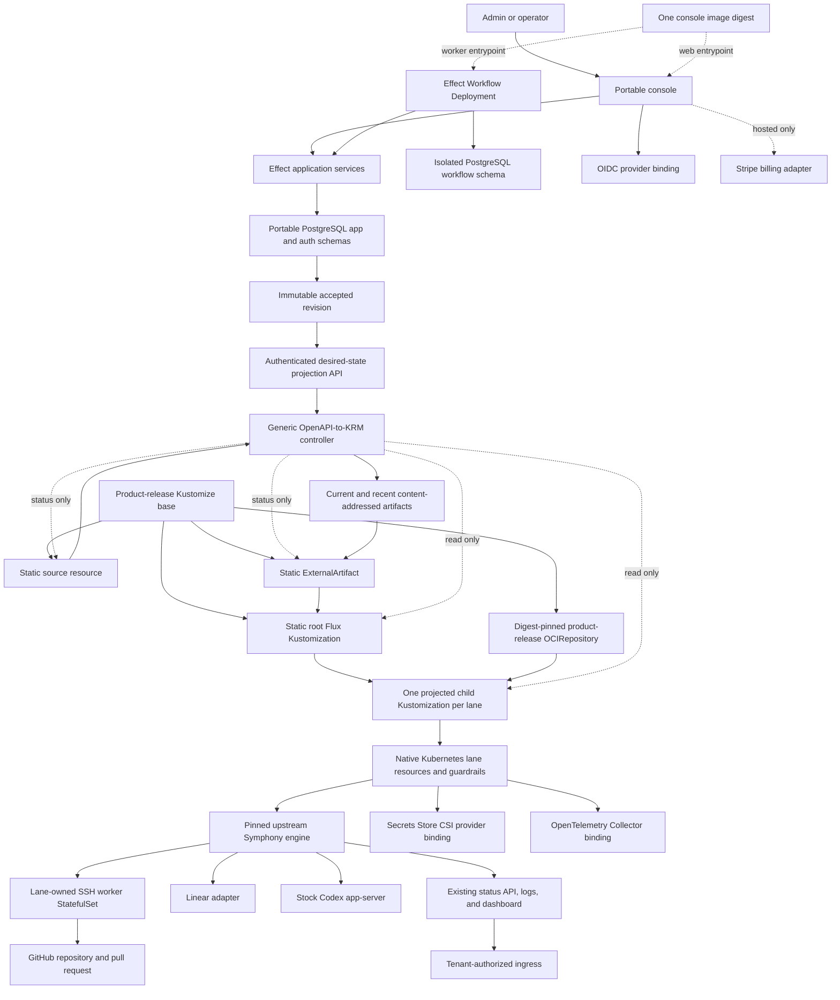

# Symphony Platform - Plan

## Goal Capsule

Build one portable Symphony product around the existing OpenAI Symphony implementation. Use upstream Symphony as the sole issue scheduler, tracker reader, workspace manager, retry authority, and Codex app-server runner. Deploy one lane for one repository and tracker scope. Offer the same product under two operating models: self-hosted by the customer or hosted by the service operator.

The implementation starts from the digest-pinned orchestrator and worker images already produced and deployed by `symphony-k8s`, with `jasonmorganson/symphony` remaining the separate source repository. It does not pull Symphony source into the target monorepo, port Symphony into a new runtime, or reproduce its lifecycle in a control plane. The target monorepo owns product packaging, product-facing configuration, hosted commercial integrations, and operations around the existing engine images.

The authority order is:

1. The Product Contract owns customer-visible behavior.
2. The upstream Symphony specification owns orchestration semantics.
3. Key Technical Decisions own integration and deployment mechanisms.
4. Implementation Units own file scope and sequencing but cannot override the other authorities.
5. The source architecture document supplies context only where this plan does not replace it.

The selected console framework, persistence, workflow, migration, database-access, and wire-contract decisions are defined by the companion [Symphony Platform Console - Effect 4 Platform Supplement](symphony-saas-console-effect-platform.md). That supplement refines KTD11, KTD17, U1, U11, U12, and U16 but cannot change the Product Contract, Symphony ownership, or Flux ownership boundaries in this plan. The older [console implementation supplement](symphony-platform-console-implementation.md) is retained only as superseded decision history.

Execution stops and returns to planning when any of these conditions occurs:

- A proposal reimplements issue polling, claim selection, retries, workspace lifecycle, tracker normalization, or the Codex app-server protocol outside Symphony.
- A required product behavior cannot be achieved with the pinned existing images, an existing public interface, or a small generic change maintained only in the current fork and rebuilt through the existing `symphony-k8s` image path.
- The supported model credential cannot be used by stock Codex under an acceptable hosted isolation and commercial-use contract.
- The persistent SSH-worker topology cannot prevent repository-controlled code and the coding subprocess from reading or exporting reusable model, GitHub, or Linear credentials; until this passes, it is supported only for self-hosted trusted environments.
- Self-hosted and hosted installations require different engine builds, product behavior, or data contracts.
- A reusable customer credential must be exposed to an untrusted worker, workspace, log, prompt, tool result, or crash artifact.
- A custom service is proposed where a Kubernetes resource or an accepted external component meets the same contract with lower ownership cost.
- Hosted billing would claim a hard usage or overage cap without an enforceable pre-dispatch admission point in Symphony.

The implementation tail belongs to the executor until the active milestone passes its Definition of Done or a stop condition fires.

---

## Product Contract

### Summary

Symphony turns ready sprint issues into tested pull requests for small engineering teams using Linear and GitHub. One lane owns one repository and one Linear project. The first product ends at human review and uses customer-funded model access. Customers can operate the product themselves, or pay for the same product to be operated for them.

### Problem Frame

OpenAI Symphony already implements the agent orchestration loop and reports its runtime state. The product gap is portable deployment, safe provider and model configuration, multi-lane operations, customer onboarding, commercial controls for the hosted service, and infrastructure operations. Rebuilding or projecting the Symphony lifecycle would add a second source of truth and disconnect the product from upstream improvements.

### Actors

- A1. The organization Admin connects providers, configures lanes, selects the operating model, and manages hosted subscription settings when applicable.
- A2. A team Member prepares sprint issues, observes lane state, and reviews resulting pull requests.
- A3. Upstream Symphony claims and runs eligible issues according to the repository-owned `WORKFLOW.md` and exposes live state through its existing API, logs, and dashboard.
- A4. The infrastructure operator applies the portable package, manages cluster dependencies, upgrades the product, and responds to failed reconciliation.
- A5. The hosted service operator performs A4 on the customer's behalf and also manages hosted identity, billing, support, and retention obligations.

### Key Decisions

- **One product with two operating models** (session-settled: user-directed — chosen over separate Managed and BYOC products: deployment ownership is the only product distinction). Governs R10-R13 and R15.
- **Upstream Symphony is the orchestration engine** (session-settled: user-directed — chosen over a new runtime port or duplicate controller: the existing implementation already owns the issue-to-agent lifecycle). Governs R1-R5 and R14-R18.
- **Small-team issue-to-pull-request outcome** (session-settled: user-directed — chosen over review-through-deployment automation: human review remains the first product control point). Governs R1-R3.
- **Linear and GitHub are the canonical launch bundle** (session-settled: user-directed — chosen over broad provider onboarding: the first customer path stays narrow even though upstream adapters remain available). Governs R1-R5.
- **Monthly hosted lane bundles** (session-settled: user-directed — chosen over per-seat billing: small teams buy predictable repository-and-project capacity). Governs R6-R9.
- **Free alpha, discounted beta, and full-price general availability** (session-settled: user-directed — chosen over remaining free until general availability: beta supplies the first paid-market signal). Governs R7-R9.

### Requirements

#### Customer outcome

- R1. The first customer is a small engineering team using Linear and GitHub for recurring sprint work.
- R2. A successful Symphony run follows the repository-owned `WORKFLOW.md` from an eligible Linear issue to a GitHub pull request ready for human review. The product does not separately determine, reconstruct, or persist that run outcome.
- R3. The product cannot approve, merge, or deploy a pull request and cannot grant a lane worker those capabilities.
- R4. The launch path supports a customer-created Business or Enterprise Codex access token only when the U2 conformance gate passes; otherwise it uses a customer-owned OpenAI API key.
- R5. Credential-kind changes require Admin selection and validation. The product cannot import browser cookies or silently fall back between customer credentials.

#### Hosted commercial contract

- R6. Monthly list pricing for the hosted service is Starter at $99 for one active lane, Team at $199 for three active lanes, and Growth at $999 for ten active lanes.
- R7. Hosted alpha is free, hosted beta is 50% off list price, and hosted general availability uses full list price.
- R8. Hosted alpha measures worker and model usage. Overage remains disabled unless the unmodified or already-forked Symphony build exposes an existing enforceable admission point that can prove an Admin-set monthly cap before work starts; delayed usage records alone cannot authorize overage.
- R9. Hosted cancellation takes effect at the billing-period boundary by changing the lane's desired deployment state through supported package controls. In-flight and queued work follow the documented behavior of the pinned Symphony build; cancellation does not add claim, drain, or retry controls outside Symphony. Hosted metadata remains exportable for a published retention duration, and deletion produces audit evidence for each hosted data class.

#### One portable product

- R10. Self-hosted and hosted installations consume the same signed OCI product-release configuration artifact, console image, Symphony image digests, Kustomize base, configuration schema, upgrade path, and behavioral acceptance suite.
- R11. A self-hosted customer can install, operate, upgrade, back up, restore, and remove the complete product without a callback to hosted services.
- R12. Hosted-only integrations such as managed identity, Stripe, support tooling, and the operator's vault are adapters selected by configuration, not separate product code paths.
- R13. Self-hosted installation is free, self-supported, and has no technical license enforcement. Paid support or dedicated operations may be sold without changing the deployed product.

#### Upstream preservation and lane behavior

- R14. Upstream Symphony remains the only authority for issue eligibility, polling, claim state, retries, workspaces, tracker normalization, and Codex app-server sessions.
- R15. One lane maps one repository to one tracker project or equivalent tracker scope and has its own namespace, identity, configuration, storage, concurrency, and security policy.
- R16. The launch lane runs the existing persistent SSH-worker topology. Ephemeral per-run Pods are deferred until Symphony exposes a generic execution seam that does not create a second scheduler.
- R17. At launch, Symphony reads `WORKFLOW.md` from the configured Git repository using its default behavior. The product does not store, generate, upload, or override that file and reuses the upstream tracker adapters, status API, logs, dashboard, and release packaging without replacement surfaces.
- R18. Any Symphony fork delta is generic, minimal, tested against the specification, documented by provenance, and maintained only in `jasonmorganson/symphony`. Product releases consume the corresponding digest-pinned images built through the existing `symphony-k8s` image path. This plan never proposes or requires an upstream contribution.

#### Evidence and release

- R19. The product stores desired lane configuration, hosted commercial state, aggregate usage records, exports, and deletion receipts. It does not copy, reconstruct, or cache Symphony's live run or outcome state; users reach that state through Symphony's own authorized surfaces.
- R20. Alpha enrolls up to three small-team design partners and proves the same issue-to-human-review flow in one self-hosted and one hosted installation before beta.
- R21. General availability requires passing portability, upgrade, credential-containment, tenant-boundary, billing-reconciliation, restore, and deletion gates.
- R22. A lane configuration resolves exactly one repository, one tracker scope, one repository revision containing `WORKFLOW.md`, one worker target, one credential set, and one concurrency limit. The console stores draft versions and immutable accepted installation-wide desired-state revisions and exposes the complete current accepted state only through `GET /internal/v1/installations/{installationId}/desired-state` on the authenticated, tenant-bound, cluster-private controller path. The response is unpaginated, size-bounded, schema-versioned, deterministically ordered, and conditionally retrievable with its canonical response digest as the `ETag`. Human reads use Server Components and human mutations use Server Actions; no general or public product API exists at launch. The console reports the separate deployment states `accepted`, `source-syncing`, `artifact-ready`, `reconciling`, `applied`, and `action-required`. Lane CRUD changes only console database revisions. The console has no Git, registry-publish, or Kubernetes credentials, does not create work, and does not interpret Symphony run readiness.
- R23. The console meets WCAG 2.2 AA for authentication, onboarding, remediation, lane status, and hosted commercial interactions.
- R24. Admin, Member, infrastructure-operator, and hosted-support permissions are default-deny, tenant-bound, and enforced server-side. Hosted support access is time-bound and audited.
- R25. Admins provision, update, pause, resume, remove, and roll back lanes through the console without editing Git or Kubernetes resources. Installation-time Kustomize configuration statically provisions one `DesiredStateSource`, one `ExternalArtifact`, one root Flux `Kustomization` consuming that artifact, and one product-release `OCIRepository` pinned to the current signed product-release configuration digest per installation or hosted cluster. The desired-state response contains projection-ready child Flux `Kustomization` objects, one per lane, as `metadata` and `spec` plus an OpenAPI `x-kubeprojection-resource` annotation fixing their API version and kind. The generic controller reflects those objects deterministically into a content-addressed artifact and updates only the status subresources of the pre-created source and `ExternalArtifact`. The root Kustomization exclusively owns the projected child Kustomizations; each child references the static `OCIRepository` and fixed lane-package path and exclusively owns its lane resources and inventory. Flux remains the only Kubernetes writer, pruner, drift detector, inventory owner, and health reporter.

### Key Flows

- F1. Lane onboarding
  - **Actors:** A1, A4 or A5.
  - **Steps:** The installation already contains its statically provisioned `DesiredStateSource`, `ExternalArtifact`, root Flux `Kustomization`, and digest-pinned product-release `OCIRepository`. The Admin connects Linear, authorizes GitHub for one repository, selects a model credential, maps a Linear project to the repository, selects the repository revision containing `WORKFLOW.md`, and requests a lane. The console rejects duplicate mappings and validates provider access, repository access and file presence, worker reachability, capacity, and the pinned engine artifact, then commits a complete immutable installation revision. The reusable controller conditionally retrieves the complete projection-ready state from the authenticated desired-state endpoint, reflects its annotated lane items into child Flux `Kustomization` objects, archives them deterministically, and updates only source and `ExternalArtifact` status. The root Flux Kustomization verifies the artifact and owns the child Kustomizations; each child applies the fixed lane package from the static product-release OCI source and reports its lane inventory and health.
  - **Outcome:** The lane resources are provisioned through self-service and the source-controller and Flux conditions are separately observable. No Git change, operator apply, console Kubernetes write, runtime OCI publication, or Symphony run-readiness report is part of this flow.
  - **Covered by:** R1, R4-R5, R10-R12, R15-R18, R22, R25.
- F3. Self-hosted lifecycle
  - **Actors:** A1, A4.
  - **Steps:** The customer installs the product package, binds its OIDC issuer, secret provider, PostgreSQL service, and observability destination, creates lanes, upgrades or rolls back pinned artifacts, and removes the installation without hosted callbacks.
  - **Outcome:** The customer operates the same product and acceptance suite as the hosted service.
  - **Covered by:** R10-R13, R20-R21.
- F4. Hosted lifecycle
  - **Actors:** A1, A5.
  - **Steps:** The service operator supplies the same base package with hosted identity, vault, GitOps, observability, and Stripe adapters. Subscription state controls lane admission outside the Symphony scheduler and never rewrites live run state.
  - **Outcome:** The customer receives an operated installation with the hosted commercial contract.
  - **Covered by:** R6-R12, R19-R21.
- F5. Upgrade and Symphony image refresh
  - **Actors:** A4, A5.
  - **Steps:** A Symphony source change is completed and tested in `jasonmorganson/symphony`, then the existing `symphony-k8s` image path produces new orchestrator and worker images. The product release records those image digests and their Symphony source revision, runs black-box product conformance, canaries one lane, and supports rollback to the prior digest pair.
  - **Outcome:** Self-hosted and hosted installations advance from the same OCI product-release configuration-artifact digest without behavioral drift.
  - **Covered by:** R10, R14, R17-R18, R21.

### Acceptance Examples

- AE1. **Covers R10, R15, R17, R22, R25.** Given a valid lane request whose selected repository revision contains `WORKFLOW.md` and the installation has its static source, `ExternalArtifact`, root Kustomization, and digest-pinned product-release `OCIRepository`, when the console accepts the next complete installation revision, the reusable controller publishes an artifact containing the projected child Kustomization, and root and child Flux reconciliation complete, then the child applies the fixed lane package from the exact release digest, the console reports source and Flux conditions separately, and no Git change, console Kubernetes write, controller binding CRUD, runtime OCI publication, secret value, separate workflow content, or Symphony run-readiness state exists.
- AE2. **Covers R10-R13, R20.** Given the same signed OCI product-release configuration digest and lane fixture, when a customer installs it self-hosted and the service operator installs it hosted, then both pass the same packaging, provider, repository-workflow, and upstream black-box conformance tests without different product builds.
- AE3. **Covers R14, R17-R18.** Given refreshed `symphony-k8s` images, when the provenance suite runs, then each image is digest-pinned, both identify the expected Symphony source revision, the fork records its own approved delta and test result, and no Symphony source or product policy is copied into the product monorepo.
- AE4. **Covers R4-R5.** Given a supported model credential, when the model-authentication conformance test runs, then stock Codex completes the fixture and the credential is absent from worker-readable files, process metadata, logs, prompts, tool results, and crash artifacts; otherwise the credential mode is disabled.
- AE5. **Covers R15-R16, R21.** Given two tenants with separate lanes, when both run hostile test fixtures, then neither can access the other's namespace, repository, workspace, service account, secrets, network destinations, or status data.
- AE6. **Covers R6-R9, R19.** Given a hosted plan limit and concurrent lane activations, when the limit is reached, then no additional lane is provisioned, existing Symphony work follows the pinned engine's documented behavior, and Stripe remains a reconciled billing projection rather than orchestration authority.
- AE7. **Covers R14, R19, R22.** Given console restarts, duplicate deployment observations, or concurrent operator actions, when Symphony continues operating, then the console performs no Symphony or provider mutation and creates no local representation of claims, retries, attempts, workspaces, or outcomes.
- AE8. **Covers R23-R24.** Given a keyboard or screen-reader user and any product role, when the user completes an allowed flow, then the console exposes semantic errors and status changes, visible focus, non-color-only state, and no mutation outside that role and tenant.

### Success Signals

- Three alpha design partners can reach human review from recurring sprint issues with bounded operator intervention.
- One self-hosted and one hosted installation pass the same signed OCI product-release configuration digest and behavioral suite.
- A refreshed `symphony-k8s` orchestrator-and-worker digest pair can be evaluated, canaried, and rolled back without modifying console behavior or cloning Symphony source.
- No duplicate scheduler, run controller, tracker normalization layer, or model execution loop exists in the monorepo.

### Scope Boundaries

Included:

- The complete portable product, including the console, pinned existing Symphony images, lane packaging, persistent worker, provider configuration, hosted usage records, and operational contracts.
- Hosted identity, billing, support, and retention adapters as configuration of that product.
- Linear and GitHub onboarding for the launch experience while retaining upstream provider compatibility.

Deferred:

- Ephemeral per-run workers, external sandbox backends, provider bundles beyond the launch pair, platform-funded model usage, custom domains, and dedicated-cluster automation.
- Any non-repository `WORKFLOW.md` source or product-level workflow override.
- kpt, `Kptfile`, a `SymphonyLane` or other domain-operator API, any controller that applies lane resources, and any controller that duplicates Flux inventory, pruning, drift, health, or rollback behavior. The reusable source CRD and generic OpenAPI-to-KRM controller are explicitly in scope because they reflect external desired state into a Kubernetes-observable Flux source without reconciling lane resources.
- A read-only OCI Distribution frontend over the reusable revision-and-artifact core. It is a documented future alternative adapter consumed directly by Flux through `OCIRepository`; it never emits `ExternalArtifact` YAML, never feeds the ExternalArtifact adapter, and is not implemented or required at launch.
- Any new release-image, signing, attestation, or publication CI in `jasonmorganson/symphony`; launch reuses the existing images and `symphony-k8s` image-building path.

Outside the product's identity:

- A replacement Symphony scheduler, a general workflow engine, an agent-session UI, automatic pull-request approval or merge, automatic deployment, and a proprietary model gateway.

---

## Planning Contract

### Key Technical Decisions

- KTD1. **Draw a hard boundary around upstream Symphony.** The Elixir release is one engine component with its existing API, dashboard, logs, repository-owned `WORKFLOW.md`, tracker behaviors, workspaces, and worker protocol. Other components integrate through those surfaces and do not import its internal modules. Governs R14, R17-R18.
- KTD2. **Use an unmodified-image-first reuse ladder.** Level 0 pins the existing `symphony-k8s` orchestrator and worker image digests. Level 1 adds product packaging or a wrapper through an existing interface without projecting Symphony-owned state. Level 2 makes a small generic change only in `jasonmorganson/symphony`, tests it there, and rebuilds through the existing `symphony-k8s` image path. Level 3 reimplementation is forbidden, and no level includes proposing changes upstream. Governs R14, R17-R18.
- KTD3. **Keep Symphony source and image construction outside the product monorepo.** The monorepo contains no Symphony checkout, `mise bootstrap repos` entry, subtree, submodule, vendored source, patch queue, worker Dockerfile, or Symphony Dockerfile. `symphony-k8s` continues to publish the runtime-base, orchestrator, and worker images. The product's Kustomize base pins the orchestrator and worker images by digest and records the Symphony revision from which they were built. Governs R10, R18.
- KTD4. **Keep one product and one OCI release artifact.** `deploy/kustomize/base` is the complete self-hostable product. `deploy/kustomize/overlays/hosted` adds only service-operator bindings, and `deploy/kustomize/overlays/local` is disposable development configuration. A signed, digest-addressed OCI artifact containing the tested Kustomize tree is the canonical release unit for every installation. Governs R10-R13.
- KTD5. **Use Kubernetes as the deployment control plane.** Namespaces, Deployments, StatefulSets, Services, PersistentVolumeClaims, ServiceAccounts, RBAC, NetworkPolicies, Pod Security labels, quotas, Secrets Store CSI volumes, Jobs, and Kustomize overlays replace proposed bespoke apps where their reconciliation semantics are sufficient. Governs R10-R16, R21.
- KTD6. **Use Kustomize, Skaffold, product-release OCI, ExternalArtifact, and Flux at their native boundaries.** Kustomize owns declarative base-and-overlay composition, including the statically installed `DesiredStateSource`, `ExternalArtifact`, root Flux `Kustomization`, and product-release `OCIRepository` pinned to the signed configuration-artifact digest. Root `skaffold.yaml` builds only `apps/console`, consumes the external Symphony images, coordinates tests, and renders hydrated manifests; its build-artifacts file and rendered output are ephemeral CI artifacts. Signed OCI stores immutable, versioned product releases for installation, upgrade, rollback, disconnected transport, and the fixed lane package consumed by projected child Kustomizations. Runtime lane desired state stays in PostgreSQL and reaches Flux through the reusable controller and pre-created `ExternalArtifact`, without runtime registry publication, mutable tags, signatures, or registry credentials. The root Kustomization owns child Kustomizations; each child owns its lane resources and inventory. Flux is the only Kubernetes writer. A direct Kustomize apply may bootstrap, repair binding drift, or recover a self-hosted installation, but console self-service requires the controller and Flux. Skaffold is not release storage and Git is not runtime desired state. Governs R10-R12, R15, R21-R22, R25.
- KTD7. **Start with the existing SSH-worker StatefulSet.** One lane owns its persistent worker and workspace storage. The scheduler remains Symphony. Later execution backends require an upstream execution seam and cannot introduce a `SymphonyRun` controller. Governs R14-R16.
- KTD8. **Do not build a model gateway for launch.** Stock Codex and its supported credential path are the baseline. U2 is a disposable conformance fixture and a hard gate. An OpenAI-compatible gateway may be evaluated later for API-key routing, but it cannot replace ChatGPT workspace-token semantics or host another agent loop. Governs R4-R5, R14, R17.
- KTD9. **Reuse provider adapters before building integration services.** Symphony owns tracker reads and normalization. Provider OAuth setup, token refresh, GitHub App installation, and secret projection belong to the console or an external platform only when required for multi-organization onboarding. Provider tools inside the agent remain controlled by `WORKFLOW.md` and upstream credential stripping. Governs R1-R5, R14, R17.
- KTD10. **Store product state, not Symphony projections.** The product database stores organizations, desired lanes, configuration revisions, hosted subscriptions, aggregate usage records, exports, and deletion receipts. It stores no issue claims, attempts, retry timers, workspace state, run outcomes, or reconstructed Symphony status. Governs R14, R19.
- KTD11. **Build one modular console image with explicit web and workflow runtimes.** `apps/console` is the only initial product application and the only image built in this monorepo. Server Components call thin server-only adapters into `packages/backend`; hand-authored Server Actions expose only authenticated domain commands. `packages/backend` owns Effect application services, Effect Schema models, Effect SQL repositories, Effect Workflow definitions, and managed web and worker runtimes. `packages/contracts` owns only the authored OpenAPI 3.1 desired-state contract and reproducibly generated Effect-facing bindings. The web and workflow Deployments use the same image digest but separate commands, service accounts, database roles, secrets, NetworkPolicies, health checks, scaling, and failure domains. The console receives no Git, registry-publish, or Kubernetes credentials, exposes no general public API, and owns no binding lifecycle. Better Auth, provider callbacks, and webhooks remain narrow protocol Route Handlers. A further app or package split requires a proven ownership, scaling, or security boundary. Governs R8-R13, R19-R25.
- KTD12. **Use external components at replaceable boundaries.** Define generic contracts for OIDC, secret delivery, PostgreSQL, telemetry export, and hosted billing. U2 evaluates Secrets Store CSI, OpenTelemetry Collector, Stripe, and other named reference candidates before the selected bindings enter the Kustomize base or hosted overlay. Candidate selection cannot fork product behavior. Governs R6-R13, R19-R21.
- KTD13. **Keep security guardrails outside the namespaced product applier.** A trusted operator owns namespace Pod Security labels, baseline NetworkPolicies, ServiceAccounts and RBAC, quotas, allowed RuntimeClass and StorageClass, and admission policy. Lane workloads cannot modify those resources or mount arbitrary reusable secrets. Governs R15, R21.
- KTD14. **Use a generic OpenAPI-to-KRM ExternalArtifact controller, not a domain operator.** Installation-time Kustomize creates one `DesiredStateSource`, one `ExternalArtifact`, one root Flux `Kustomization`, and one product-release `OCIRepository` per installation or hosted cluster. The controller consumes exactly one pinned OpenAPI `GET` operation and has no Symphony-specific adapter: it conditionally fetches one complete projection-ready response, reflects objects identified by `x-kubeprojection-resource`, canonicalizes filenames and KRM, archives them with the Flux Artifact SDK, and serves current and recent content-addressed artifacts. PostgreSQL immutable revisions—not artifact-byte retention—are rollback authority, so a collected artifact can be regenerated deterministically. Kubernetes RBAC permits status-only writes to the pre-created source and `ExternalArtifact`, read-only access to the bound root and expected child Flux Kustomizations, and no binding CRUD, specification mutation, or lane-resource access. The external project supplies an authenticated read-only observation endpoint for source revision and response digest, artifact digest and `Ready`, root conditions, and expected child conditions and applied revisions. It must not publish `SourceVerified=True` unless the source is actually signature-verified. Missing or altered bindings are installation drift restored by product-release reconciliation or base reapplication; the controller only reports failure. The exact source CRD, project name, storage backend, trigger mechanics, and deployment topology remain external-project decisions and cannot introduce Symphony types, package paths, lifecycle rules, or status vocabulary. Governs R21-R22, R24-R25.
- KTD15. **Treat configuration as desired state, not work intent.** The console may validate, accept, pause, resume, observe, and version lane configuration under R22 and R25. Its desired-state response contains only complete child Flux Kustomization `metadata` and `spec`, never secret values. The controller reflects that complete response into artifact storage and status; the root Kustomization owns child Kustomizations and each child owns its lane inventory. Pause changes the lane package's enablement substitution while leaving the child active so Flux continues drift correction; remove omits the child so root pruning deletes it and `WaitForTermination` removes its inventory. Only Symphony may poll, claim, retry, continue, launch work, or transition an issue. Operator repair can refresh source or Flux reconciliation, reapply the product base to repair binding drift, and select a prior PostgreSQL revision for rollback, but neither the console nor controller can mark success, mutate binding specifications or lane resources, or replay provider mutations. Governs R14, R19, R22, R25.
- KTD16. **Expose upstream runtime surfaces without rebuilding them.** The Symphony API and dashboard remain the only runtime-status surfaces. Customers and operators reach them through a tenant- and lane-authorized ingress or audited administrative path; the console links to them but does not project their run state. Governs R17, R19, R24.
- KTD17. **Use the selected SQL-first Effect platform with contract-specific authorities.** `apps/console` uses Next.js App Router on Node.js and Better Auth; `packages/backend` uses Effect 4, Effect Schema, Effect SQL, and Effect Workflow. Ordinary PostgreSQL SQL under `apps/console/db/` is the sole relational authority for the `app` and `auth` schemas, and Atlas generates reviewed versioned migrations. Effect Workflow owns runtime DDL only inside its Atlas-provisioned `workflow` schema and dedicated role. Better Auth may generate reference SQL but cannot migrate production; its built-in PostgreSQL integration may retain Kysely internally without making Kysely a product persistence authority. Effect SQL exclusively owns product repositories. Exported Server Actions remain explicit domain commands with separately authored validation and server-derived authorization. `packages/contracts` directly authors OpenAPI 3.1 as the sole desired-state wire authority and generates Effect-facing bindings through the validated official Effect tooling. Database models, action inputs, provider protocols, workflow payloads, and desired-state wire types remain separate. Beta dependency pins are allowed, but the full selected composition must pass the blocking gates in the [Effect platform supplement](symphony-saas-console-effect-platform.md) before U1 begins. Governs R10-R12, R19-R25.

### High-Level Technical Design



The product-release Kustomize base creates the source resource, `ExternalArtifact`, root Flux `Kustomization`, and digest-pinned product-release `OCIRepository`; neither the console nor source controller owns their lifecycle. The console never decides which issue runs next and never restates the Symphony-owned workflow. It accepts complete immutable installation revisions and exposes one authenticated, cluster-private desired-state response containing projection-ready child Kustomizations. The generic controller deterministically reflects that response into a current artifact, patches only source and `ExternalArtifact` status, and observes root and child Flux conditions read-only. The root Kustomization owns the child Kustomizations; each child consumes the fixed lane package from the static product-release OCI source and owns its lane inventory. Flux alone applies, prunes, detects drift, and reports health. PostgreSQL retains rollback revisions, so collected artifact bytes are regenerated rather than treated as durable desired-state authority. Symphony reconciles work and exposes its own runtime state.

### Symphony-Specific Flux Example

The product-release base installs the following stable topology. Names and digests are illustrative, but the resource ownership and reference directions are normative. The exact `DesiredStateSource` spec fields come from the pinned reusable-controller release selected by U3.

```yaml
apiVersion: source.toolkit.fluxcd.io/v1
kind: ExternalArtifact
metadata:
  name: symphony-installation-desired-state
  namespace: symphony-system
spec:
  sourceRef:
    apiVersion: projection.example.io/v1alpha1
    kind: DesiredStateSource
    name: symphony-installation-desired-state
---
apiVersion: kustomize.toolkit.fluxcd.io/v1
kind: Kustomization
metadata:
  name: symphony-installation-root
  namespace: symphony-system
spec:
  interval: 1m
  retryInterval: 15s
  path: ./
  prune: true
  wait: true
  serviceAccountName: symphony-root-applier
  sourceRef:
    apiVersion: source.toolkit.fluxcd.io/v1
    kind: ExternalArtifact
    name: symphony-installation-desired-state
---
apiVersion: source.toolkit.fluxcd.io/v1
kind: OCIRepository
metadata:
  name: symphony-product-release
  namespace: symphony-system
spec:
  interval: 10m
  url: oci://ghcr.io/jasonmorganson/symphony-platform-config
  ref:
    digest: sha256:1111111111111111111111111111111111111111111111111111111111111111
  verify:
    provider: cosign
    secretRef:
      name: symphony-release-signing-keys
```

For an accepted lane with immutable ID `01j4z7m8r9s0t1v2w3x4y5z6a7`, the desired-state response carries only the following `metadata` and `spec`. The reusable controller injects the GVK fixed by the OpenAPI annotation and emits this child object unchanged otherwise:

```yaml
apiVersion: kustomize.toolkit.fluxcd.io/v1
kind: Kustomization
metadata:
  name: lane-01j4z7m8r9s0t1v2w3x4y5z6a7
  namespace: symphony-system
  labels:
    symphony.jasonmorganson.dev/installation-id: installation-acme
    symphony.jasonmorganson.dev/lane-id: 01j4z7m8r9s0t1v2w3x4y5z6a7
spec:
  interval: 1m
  retryInterval: 15s
  timeout: 10m
  path: ./base/lane
  targetNamespace: lane-01j4z7m8r9s0t1v2w3x4y5z6a7
  prune: true
  wait: true
  deletionPolicy: WaitForTermination
  serviceAccountName: symphony-lane-applier
  sourceRef:
    apiVersion: source.toolkit.fluxcd.io/v1
    kind: OCIRepository
    name: symphony-product-release
  postBuild:
    substitute:
      LANE_ID: 01j4z7m8r9s0t1v2w3x4y5z6a7
      LANE_NAMESPACE: lane-01j4z7m8r9s0t1v2w3x4y5z6a7
      LANE_ENABLED: "true"
      REPOSITORY_URL: https://github.com/acme/payments
      REPOSITORY_REVISION: 4a8c1d294d9537ee68f1c1968fdb4e7ca4e09017
      LINEAR_PROJECT_ID: 9c257d5b-7dd6-4f81-8487-aecf55d24f86
      WORKER_TARGET: ssh-worker.lane-01j4z7m8r9s0t1v2w3x4y5z6a7.svc.cluster.local
      LINEAR_SECRET_PROVIDER_CLASS: lane-01j4z7m8r9s0t1v2w3x4y5z6a7-linear
      GITHUB_SECRET_PROVIDER_CLASS: lane-01j4z7m8r9s0t1v2w3x4y5z6a7-github
      MODEL_SECRET_PROVIDER_CLASS: lane-01j4z7m8r9s0t1v2w3x4y5z6a7-model
```

No substitution contains a credential value. Secret-provider object names are references resolved by the trusted lane package. The accepted revision changes the child set as follows:

| Console mutation | Projected child behavior |
|---|---|
| Create | Add the complete child Kustomization with `LANE_ENABLED: "true"`. |
| Update | Replace the complete child specification; never patch an artifact incrementally. |
| Pause | Keep the child and set `LANE_ENABLED: "false"`; Flux continues correcting drift. |
| Resume | Keep the child and restore `LANE_ENABLED: "true"`. |
| Remove | Omit the child; root pruning deletes it and `WaitForTermination` removes its inventory. |
| Roll back | Return the complete child set from the selected immutable PostgreSQL revision. |

During implementation, the OpenAPI excerpt, accepted response, static bindings, and reflected child are backed by shared fixtures under `tests/fixtures/desired-state/symphony-lane/`. Documentation verification must fail if a snippet no longer validates against the authored contract, the pinned Flux CRDs, or the controller's deterministic reflection fixture.

### Canonical Repository Layout

```text
symphony-platform/
├── apps/
│   └── console/                 # Only initial product app and locally built image
│       ├── db/
│       │   ├── atlas.hcl
│       │   ├── schema.sql
│       │   └── migrations/
│       ├── src/
│       │   ├── adapters/
│       │   └── runtime/
│       ├── tests/
│       ├── Dockerfile
│       └── package.json
├── packages/
│   ├── backend/                 # Server-only Effect services, SQL, and workflows
│   │   ├── src/
│   │   │   ├── domain/
│   │   │   ├── application/
│   │   │   ├── persistence/
│   │   │   ├── workflows/
│   │   │   └── runtime/
│   │   ├── tests/
│   │   └── package.json
│   └── contracts/               # Private desired-state OpenAPI contract
│       ├── openapi/
│       │   └── desired-state.openapi.yaml
│       ├── generated/
│       ├── tests/
│       └── package.json
├── deploy/
│   └── kustomize/
│       ├── base/                 # Complete self-hostable product
│       │   ├── console/
│       │   ├── source-controller/ # External project manifests, source resource, and binding
│       │   ├── lane/
│       │   ├── policies/
│       │   └── kustomization.yaml
│       └── overlays/
│           ├── hosted/
│           │   └── kustomization.yaml
│           └── local/
│               └── kustomization.yaml
├── tests/
│   ├── fixtures/
│   │   ├── repositories/
│   │   ├── workflows/
│   │   ├── providers/
│   │   └── credentials/
│   ├── provenance/
│   ├── conformance/
│   ├── render/
│   ├── cluster/
│   ├── acceptance/
│   ├── security/
│   ├── scale/
│   └── upgrade/
├── docs/
│   ├── architecture/
│   ├── decisions/
│   ├── install/
│   ├── runbooks/
│   ├── security/
│   └── upstream/
├── skaffold.yaml
├── turbo.json
├── package.json
├── pnpm-workspace.yaml
├── pnpm-lock.yaml
├── mise.toml
└── README.md
```

Turborepo discovers only the shallow `apps/*` and `packages/*` workspaces. Infrastructure directories are not JavaScript workspaces. Shared integration fixtures live under `tests/fixtures`; package- or app-specific unit fixtures remain beside their owning tests. The product monorepo contains no `/release` directory, generated release manifest, committed Skaffold build-artifacts file, committed rendered output, worker image source, or Symphony image source.

### Reuse and Ownership Matrix

| Capability | Launch implementation | Product ownership decision |
|---|---|---|
| Issue polling, eligibility, claims, retries | Upstream Symphony | Reuse unchanged |
| Tracker normalization and Linear reads | Upstream Symphony adapter | Reuse unchanged |
| Workspace lifecycle and path safety | Upstream Symphony | Reuse unchanged |
| Codex app-server protocol and multi-turn loop | Upstream Symphony | Reuse unchanged |
| Runtime state API and operator dashboard | Upstream Symphony Phoenix surfaces | Reuse and link; do not rebuild |
| Persistent remote execution | Existing SSH worker topology | Adapt packaging only |
| Desired-state source projection | Statically bound generic OpenAPI-to-KRM controller plus `ExternalArtifact` | External project; reflection and status only, never a binding owner or lane reconciler |
| Lane installation, pruning, drift, inventory, and health | Root Flux `Kustomization` owns projected child Kustomizations; each child consumes the static product-release `OCIRepository` | Reuse Flux unchanged; sole Kubernetes writer and inventory owner |
| Human identity | Generic OIDC contract | External provider |
| Reusable secret delivery | Secrets Store CSI provider contract | External/native first |
| Telemetry pipeline | OpenTelemetry Collector | External component |
| Product configuration and hosted commerce | Modular console | Custom code under KTD15 |
| Symphony run and outcome state | Existing Symphony API and dashboard | Reuse through authorized access; do not project |
| Hosted usage, export, and deletion records | Console module or Kubernetes Job | Custom commercial and operational records only |
| Model routing | Stock Codex direct path | No custom gateway at launch |

### Implementation Code and Language Decisions

| Area | Code needed | Language posture | Selection gate |
|---|---|---|---|
| Symphony engine | No product-monorepo implementation | Elixir remains owned by `jasonmorganson/symphony` | Consume the existing `symphony-k8s` orchestrator image by digest; change source only in the fork when necessary |
| Console and private API | Yes, as one modular image with web and worker Deployments | TypeScript with Next.js App Router, Better Auth, and the selected Effect 4 platform | Fixed by KTD17 and the Effect platform supplement; no general public API or Kubernetes credentials enter the console |
| Product web UI | Yes, inside `apps/console` | React through Next.js; no separate frontend application | Split only after an independently deployable UI boundary is proven |
| Provider onboarding and token refresh | Maybe; external-first and then a console module | TypeScript inside `apps/console` when selected | Build only what Linear OAuth, GitHub App, or selected identity platform cannot supply |
| Short-lived Git credential helper | Maybe | Open question for U2 | Add only if stock tools cannot consume installation tokens without reusable worker secrets |
| Console relational schema and migrations | Yes | PostgreSQL SQL plus Atlas-generated versioned SQL migrations | `apps/console/db/schema.sql` is authoritative; no Prisma schema, ZModel, Better Auth migration runner, or second migration framework |
| Console database queries and runtime models | Yes | Effect SQL repositories plus Effect Schema boundary models in `packages/backend` | Atlas and catalog conformance remain physical database authority; desired-state DTOs cannot reuse persistence models |
| Private desired-state projection contract | Yes, in `packages/contracts` | Directly authored OpenAPI 3.1 plus generated Effect-facing schemas and bindings | One complete projection-ready `GET` is the wire authority; TypeSpec, `openapi-typescript`, Smithy, generated Go clients in this monorepo, and a general public API are not launch dependencies |
| Durable console workflows | Yes | Effect Workflow worker from the console image, with isolated `workflow` schema | First required consumer is hosted export and deletion receipts; never Symphony scheduling or Flux reconciliation |
| Hosted usage and retention records | Yes | Effect application services and Effect SQL repositories | Split only when a proven security or scaling boundary requires it |
| ExternalArtifact source controller | External reusable project; no implementation in this monorepo | Go is the initial posture because the Flux Artifact SDK and controller-runtime are Go-native | Final choice follows separate Compound Engineering ideation, brainstorming, and planning; controller can read bindings and update status only and cannot apply lane resources |
| Domain operator or cluster applier | No launch code planned | Not applicable | Reopen only for a written requirement that cannot be met by the source adapter plus Flux |
| Packaging and release tooling | Kustomize, Skaffold, product-release Flux OCI, and CI glue only | Declarative configuration plus small scripts | Kustomize is source, Skaffold builds/tests/renders, signed OCI distributes product releases, and `ExternalArtifact` carries runtime desired state |
| Model gateway | No launch code planned | Not applicable | Reopen only for a documented API-key routing requirement, never to replace Symphony or Codex |

The console and contract language and framework decisions are settled by KTD17 and the Effect platform supplement. U1 cannot begin until the exact selected composition passes its blocking validation and its pins and topology are recorded. Conditional external-component decisions remain owned by their conformance units. No choice may move orchestration behavior across the KTD1 boundary.

### System-Wide Impact

- **State:** PostgreSQL owns immutable accepted revisions and rollback selection. Installation-time Kustomize owns the source, `ExternalArtifact`, root `Kustomization`, and product-release `OCIRepository` specifications. The reusable controller owns deterministic projection into current and recent artifact bytes plus source and `ExternalArtifact` status; retained receipt metadata is audit evidence only. The root Flux Kustomization owns projected children, each child owns its lane inventory, and Flux owns all Kubernetes apply, pruning, drift, and health. Symphony owns live orchestration. Provider APIs own pull-request and tracker facts. Product database connections require authenticated TLS; storage and backups require encryption with separately managed keys.
- **Authentication:** Human access uses OIDC and the R24 permission matrix with server-derived tenant and role. Every Server Action validates input and independently derives organization, tenant, role, and lane scope from the full server session. Workloads use namespace-scoped service accounts and, if conformance justifies it, SPIFFE-compatible identity. Desired-state access derives the authorized installation from the controller workload identity rather than path fields. Hosted support access is time-bound and audited.
- **Secrets:** Reusable customer credentials remain in the selected vault and are mounted only into trusted components through Secrets Store CSI. Kubernetes Secret synchronization is disabled for those credentials.
- **Network:** Hosted lane namespaces default to gateway- and provider-allowlisted egress, block metadata and private ranges, use controlled DNS, and record any customer-approved exception that weakens source-confidentiality guarantees. Public ingress exposes the console UI, Better Auth, and selected provider callbacks or webhooks only; `/internal/v1/` remains cluster-private and NetworkPolicy permits only the controller-to-console desired-state path.
- **Storage:** Lane volumes use an allowlisted encrypted StorageClass, tenant-bound ownership, explicit reclaim and snapshot policy, and deletion evidence. `ReadWriteOncePod` controls attachment but is not treated as data isolation.
- **Observability:** OTel exports allowlisted attributes and disables body capture. Symphony remains authoritative for its runtime state; audit, billing, and deletion records remain durable even if telemetry is unavailable.
- **Agent boundary:** Agent tools may edit code, run verification, and create or update the work branch and pull request. They cannot approve, merge, deploy, change billing, rotate reusable credentials, or delete product data.

### Sequencing and Milestone Gates

1. **Selected-stack entry gate:** Validate the full selected Effect composition, record exact pins and deployment/database topology, and update every affected unit and verification command. Beta pins are allowed. U1 cannot begin while a load-bearing result is failed or inconclusive.
2. **Foundation:** U1 establishes the Effect workspaces, SQL and contract authorities, root tooling, and provenance. U2 proves credentials, providers, the Flux feature gate, and controller-independent trust prerequisites.
3. **Reusable source dependency:** U3 completes the external controller design sequence, selects its release and contracts, and then runs controller-specific compatibility, condition, artifact, and permission tests.
4. **Portable lane:** U6, U4, and U7 deliver one reproducible lane using the pinned existing image pair, reusable source controller, feature-gated Flux version, and persistent worker.
5. **Product vertical slice:** U11 delivers the minimal console and lane-provisioning experience around that lane.
6. **Alpha:** U12 proves the same OCI product release and Effect web/worker topology in self-hosted and hosted installations with design partners.
7. **Commercial and GA:** U15 supplies the first required Effect Workflow for hosted export and deletion receipts; U16 completes the operational gates.

---

## Implementation Units

### U1. Establish the Turbo monorepo, Effect platform, data contracts, and artifact provenance contract

- **Goal:** Create the canonical shallow Turbo workspace, selected Effect console stack, SQL-first data-contract workflow, root Skaffold pipeline, Kustomize package skeleton, provenance checks, and short architecture decision records.
- **Requirements:** R10, R12, R14, R18.
- **Dependencies:** The complete selected Effect composition has passed the implementation-entry gates in the Effect platform supplement, and its exact pins, database topology, contract generator, workflow topology, and migration behavior are recorded.
- **Files:** Root `package.json`, `pnpm-workspace.yaml`, `pnpm-lock.yaml`, `turbo.json`, `skaffold.yaml`, `mise.toml`, `README.md`, `apps/console/`, `apps/console/db/schema.sql`, `apps/console/db/migrations/`, `apps/console/db/atlas.hcl`, `packages/backend/`, `packages/contracts/`, `deploy/kustomize/`, `docs/architecture/`, `docs/security/threat-model.md`, and `tests/provenance/`.
- **Approach:** Use only `apps/*` and `packages/*` as workspace globs. Create `apps/console` as the sole app and image context using Next.js and Better Auth. Create `packages/backend` for Effect services, Effect Schema models, Effect SQL repositories, Effect Workflow definitions, and managed runtimes. Keep PostgreSQL SQL, Atlas configuration, and versioned migrations inside the console workspace; runtime schemas cannot become DDL authority. Create `packages/contracts` for the authored OpenAPI document, generated Effect-facing bindings, fixtures, and contract tests. The contract contains exactly one pinned desired-state `GET` and annotates the lane collection with `x-kubeprojection-resource`. Do not add TypeSpec, `openapi-typescript`, direct product Kysely or `kysely-codegen`, emitted duplicate schemas, or a generated Go client. Better Auth may retain its internal Kysely adapter. Implement the selected generation, replay, drift, and clean-clone checks from the [Effect platform supplement](symphony-saas-console-effect-platform.md). Seed immutable Symphony image pins from `symphony-k8s`; Root Skaffold builds only the console image. Add negative checks for nested workspaces, a second database authority, Better Auth runtime migrations, database-generated Server Actions, generic CRUD, public product APIs, committed render output, local Symphony or worker image source, kpt, domain operators, and resource-applying controllers. Record the selected tenant topology, assets, trust boundaries, exploit paths, mitigations, owners, and tests in the threat model.
- **Test scenarios:** A clean clone installs the shallow workspaces and resolves external images without cloning Symphony; disposable PostgreSQL replays Atlas migrations to the canonical SQL schema; Effect repository and boundary-model conformance detects catalog drift; official Effect tooling regenerates the desired-state bindings deterministically; Client Components cannot import server Effect runtimes; Better Auth operates through its internal adapter with no runtime DDL; a second schema authority, mutable image tag, forbidden source, committed output, domain operator, or lane-resource applier fails validation.
- **Verification:** `mise run check:provenance` proves workspace, image, source, and Kustomize ownership; `mise run check:data-contracts` proves Atlas replay, catalog and runtime-model conformance, authored OpenAPI validity, deterministic Effect binding generation, and absence of a second authority.

### U2. Prove credential, provider, and external-component boundaries

- **Goal:** Build disposable conformance fixtures, not permanent apps, that decide which stock and external capabilities satisfy the launch contracts.
- **Requirements:** R1, R4-R5, R10-R12, R17-R18, R21.
- **Dependencies:** U1.
- **Files:** `tests/fixtures/`, `tests/conformance/model-auth/`, `tests/conformance/linear/`, `tests/conformance/github/`, `tests/conformance/secrets/`, `tests/conformance/gitops/`, and `docs/decisions/`.
- **Approach:** Run the pinned existing `symphony-k8s` images against a fixture repository and tracker without adding lifecycle code. Test supported model credentials separately, confirm hosted third-party terms, and test Linear OAuth, a minimum-permission GitHub App, Secrets Store CSI delivery, and the pinned Flux version with the opt-in `ExternalArtifact` feature gate. At this stage prove only controller-independent prerequisites: Flux can consume a conforming ExternalArtifact, installation workload identity can be tenant-bound, static binding ownership can be enforced, the console can be denied Kubernetes writes, and Flux remains the sole applier, pruner, inventory owner, drift detector, and health reporter. Do not assert a selected controller's CRD, conditions, retention behavior, generated archive, or exact RBAC until U3 selects that contract. Determine only whether existing Symphony surfaces support a hard pre-dispatch commercial limit; otherwise keep overage disabled. Update the threat model and delete unselected prototypes.
- **Test scenarios:** A stock successful run using repository-owned `WORKFLOW.md`; token expiry and revocation; hostile repository commands cannot export reusable credentials; wrong-tenant provider binding; replayed webhook; GitHub installation removal; forbidden worker capabilities; Flux feature-gate acceptance of a conforming fixture artifact; generic identity and cross-installation denial; static binding and console-write denial; CSI rotation; existing-surface overage admission or a recorded disabled-overage result; and proof that a generic AI gateway cannot substitute for a Codex workspace token.
- **Verification:** `mise run test:conformance` produces signed decision evidence and disables any credential or component mode that fails.

### U3. Select the reusable OpenAPI-to-KRM controller contract

- **Goal:** Establish the external reusable project and a versioned integration contract without implementing a domain operator in the product monorepo.
- **Requirements:** R21-R22, R24-R25.
- **Dependencies:** U1, U2's controller-independent Flux and trust-boundary results, and completion of the separate controller ideation, brainstorming, and planning sessions.
- **Files:** `packages/contracts/`, `deploy/kustomize/base/source-controller/`, `tests/conformance/external-artifact/`, `docs/decisions/external-artifact-controller.md`, and `docs/security/threat-model.md`; controller source remains in its own project.
- **Approach:** Select the external project's release, source CRD, OpenAPI compatibility, authenticated observation contract, revision semantics, deterministic reflection and archive rules, artifact retention, receipt metadata, conditions, Flux version, and upgrade policy after the external design sequence completes. Then run the controller-specific conformance that U2 intentionally deferred. The controller consumes exactly one pinned `GET`, reflects annotated projection-ready objects without arbitrary mapping, writes only source and `ExternalArtifact` status, reads the bound root and expected child Kustomizations, and exposes observations without Symphony vocabulary. `SourceVerified=True` is forbidden unless signature verification is real. Preserve a sibling future OCI adapter boundary. The monorepo consumes a pinned external artifact and manifests; it does not vendor a competing controller.
- **Test scenarios:** Contract fixtures round-trip; incompatible versions fail before reconciliation; identical responses create byte-identical filenames, KRM, archives, and digests; authenticated installation scoping, conditional polling, payload bounds, and malformed-response denial pass; selected `Ready` and failure conditions are correct; last valid artifacts survive source, projection, storage, root, and child failures; collected historical bytes regenerate from PostgreSQL; installation-time configuration creates the static source, `ExternalArtifact`, root Kustomization, and product-release OCI source; controller attempts to create or delete bindings, update specifications, or mutate lane resources fail; observation reports source, artifact, root, and expected-child conditions; and no selected API contains Symphony scheduling or Flux reconciliation verbs.
- **Verification:** The decision record links the approved ideation, brainstorming, and plan artifacts, pins the selected external-project version and Flux compatibility range, and `mise run test:conformance` passes the shared contract fixtures.

### U6. Adopt and preserve the existing Symphony images

- **Goal:** Adopt the existing digest-pinned `symphony-k8s` orchestrator and worker images as the only engine artifacts without copying or rebuilding Symphony source in the product monorepo.
- **Requirements:** R14, R17-R18.
- **Dependencies:** U1 and the applicable U2 engine-conformance results.
- **Files:** `deploy/kustomize/base/kustomization.yaml`, `tests/conformance/upstream/`, and `docs/upstream/`.
- **Approach:** Consume the orchestrator and worker digests pinned by the Kustomize base and retain their existing repository-based `WORKFLOW.md` loading, tracker adapters, workspace rules, Codex app-server runner, status API, dashboard, logs, and SSH topology. Validate those surfaces only through black-box tests. Do not add lifecycle records, outcome projections, commercial admission, drain behavior, product policy, source builds, or patch application to the product monorepo. If a failing conformance test requires a source change, stop this unit, make the generic change separately in `jasonmorganson/symphony`, rebuild through the existing `symphony-k8s` path, and resume only with new image digests; additional fork CI remains deferred.
- **Test scenarios:** Default loading of `WORKFLOW.md` from the fixture repository; SSH worker execution; private status API and dashboard reachability; source-revision and image-pair provenance; packaging compatibility; clean operation without any Symphony source checkout.
- **Verification:** `mise run check:upstream` passes the black-box product compatibility suite and emits the exact orchestrator digest, worker digest, and recorded Symphony source revision.

### U4. Build the portable Kubernetes lane package

- **Goal:** Build one Kustomize base that is the complete self-hostable product, plus hosted and local overlays.
- **Requirements:** R10-R13, R15-R16, R21.
- **Dependencies:** U1, the applicable U2 conformance results, U3, U6.
- **Files:** `deploy/kustomize/base/`, `deploy/kustomize/overlays/hosted/`, `deploy/kustomize/overlays/local/`, `tests/render/`, and `tests/cluster/`.
- **Approach:** Import the pinned lane, SSH-worker, safe scale-down, and policy resources from `symphony-k8s`, then change only gaps demonstrated by U2 or cluster conformance. The base statically creates the console, reusable controller deployment, its chosen source CRD, one `DesiredStateSource`, one `ExternalArtifact`, artifact storage and server, one root Flux `Kustomization` whose `sourceRef.kind` is `ExternalArtifact`, and one product-release `OCIRepository` pinned by digest, together with the pinned Flux version and required feature gate, network policies, minimal service accounts and RBAC, lane-package resources, and guardrails; it requires no self-hosted overlay. The controller can read the pre-created source and `ExternalArtifact`, update only their status subresources, call the single cluster-private desired-state operation, read root and expected child Kustomizations, and write and serve current and recent content-addressed artifacts. It cannot create, delete, or modify binding specifications, and Flux alone can apply lane resources. Each projected child Kustomization references the static product-release OCI source, fixed lane-package path, approved lane-applier service account, non-secret `postBuild.substitute` values, `prune: true`, `wait: true`, and `deletionPolicy: WaitForTermination`. In hosted installations, the parent product-release Flux Kustomization restores missing or altered static bindings. A manually operated self-hosted installation repairs them by reapplying the same product-release Kustomize base; the controller only reports failure. The hosted overlay changes only operator bindings and isolation policy; the local overlay is disposable. Define the projection-ready desired-state model in `packages/contracts`; consume the selected source CRD schema from the external project without duplicating it. Do not add kpt, a `Kptfile`, a `SymphonyLane` CRD, a domain operator, or a controller that applies lane resources.
- **Test scenarios:** Deterministic base, hosted, and local renders; base installation without an overlay; initial static source, `ExternalArtifact`, root Kustomization, product-release `OCIRepository`, feature-gated Flux, and source-controller bootstrap; exact child source digest and path; non-secret substitutions and secret-reference names only; pause through package enablement without `spec.suspend`; removal through root pruning and child `WaitForTermination`; status-only `ExternalArtifact` reconciliation; server-side dry run; console Kubernetes-write denial; controller create, delete, specification-update, and lane-resource-write denial; missing and altered binding detection; hosted restoration by product-release Flux; self-hosted restoration by reapplying the product-release base; source API and artifact-server network confinement; namespace guardrail mutation denial; alternate service account denial; arbitrary Secret mount denial; cross-installation source and artifact denial; cross-lane network and volume denial; storage cleanup failure; source, projection, artifact-server, root, or child failure preserving the last applied state; old artifact collection followed by deterministic rollback regeneration; and base-versus-hosted behavioral equivalence.
- **Verification:** `mise run test:render` passes, then `mise run test:cluster` proves the positive and negative resource contracts on a disposable conforming cluster.

### U7. Harden the persistent lane worker and workspace lifecycle

- **Goal:** Productionize the existing one-lane SSH-worker StatefulSet without changing Symphony scheduling semantics.
- **Requirements:** R3, R15-R16, R21.
- **Dependencies:** U2, U4, U6.
- **Files:** `deploy/kustomize/base/lane/`, `tests/cluster/worker/`, and `docs/runbooks/workspaces.md`; no worker image source is added.
- **Approach:** Pin worker images, enforce the approved RuntimeClass and node pool, mount lane-owned encrypted storage, restrict egress, deliver only short-lived run credentials where proven, and make scale-down consult Symphony's existing state API. Verify lane-scoped SSH host identity with pinned or CA-signed keys, fail closed on unknown keys, and document rotation and revocation. Preserve workspace paths and cleanup behavior expected by upstream.
- **Test scenarios:** Pod and node reschedule; SSH reconnect; worker impersonation; stale host key and rekey during recovery; retry after worker loss; stale workspace locator; cross-tenant attach or read attempt; recycled volume and snapshot denial; DNS tunnel, metadata, redirect, registry-upload, and internal-service exfiltration; safe scale-down while work is active.
- **Verification:** `mise run test:worker-e2e` passes on the disposable cluster and leaves deletion or retention evidence for every workspace fixture.

### U11. Deliver the minimal lane-provisioning vertical slice

- **Goal:** Add one modular console for onboarding and lane provisioning without restating or taking authority from Symphony.
- **Requirements:** R1-R3, R8-R12, R19-R20, R22-R24.
- **Dependencies:** U3, U4, U6, U7.
- **Files:** `apps/console/`, `apps/console/db/`, `packages/backend/`, `packages/contracts/`, `deploy/kustomize/base/console/`, `tests/fixtures/`, `tests/render/`, `tests/acceptance/console/`, and `tests/acceptance/lane-provisioning/`.
- **Approach:** Implement the console using the [Effect platform supplement](symphony-saas-console-effect-platform.md): Next.js App Router and Better Auth in `apps/console`, Effect application services, schemas, SQL repositories, workflows, and runtimes in `packages/backend`, PostgreSQL SQL and Atlas as relational authority, and authored OpenAPI 3.1 with generated Effect-facing bindings in `packages/contracts`. Better Auth retains its internal Kysely adapter only inside auth. Use Server Components through thin server-only adapters and hand-authored Server Actions with explicit validation and server-derived authorization. Route Handlers remain limited to Better Auth, provider protocols, and the private desired-state `GET`. Generated bindings require workload authentication and installation scoping before application execution. Implement organizations, complete immutable revisions, onboarding, release selection, separate source and Flux observations, and alpha usage records. Select and test the hosted database isolation topology. The launch console hierarchy is organization landing, lane inventory, staged onboarding, accepted-revision review, lane deployment detail, remediation, and a separate authorized Symphony runtime link. Derive the six documented deployment states through the precedence table in the Effect supplement while preserving raw observations. Child Kustomizations retain exact digest, package path, non-secret substitution, secret references, service account, prune, wait, and termination policy. The console never renders artifacts or writes Git, registries, or Kubernetes and never projects Symphony run state.
- **Test scenarios:** Atlas migrations replay and preserve N-1 compatibility; Effect repository and boundary models conform to the catalog; Better Auth has no runtime DDL and its private Kysely adapter cannot become product persistence; Client Components cannot import Effect server runtimes; Server Actions reject unauthenticated, unauthorized, cross-tenant, malformed, stale, and cross-origin mutations; session fixation, cookie scope, revocation, OAuth state, PKCE, and redirect tests pass; shared-table RLS or the selected physical tenant boundary rejects omitted-predicate and pooled-connection attacks; generated private handlers reject browser credentials and path-to-identity mismatch before application execution; telemetry canaries never enter logs, traces, SQL diagnostics, workflow state, or crashes; the desired-state response and projected children meet the existing deterministic and non-secret contract; all six deployment states map deterministically to source and Flux observations with correct role-specific guidance; onboarding is resumable after every boundary failure; create, update, pause, resume, remove, and rollback converge without console Kubernetes writes; and authorized Symphony access remains separate from deployment state.
- **Verification:** `mise run check:data-contracts`, `mise run test:product`, and `mise run test:e2e` prove schema ownership, migration replay, generated contracts, lane provisioning, deployment-state observation, and authorized reuse of Symphony's runtime surface without product-owned orchestration or run state.

### U12. Prove one product in self-hosted and hosted alpha

- **Goal:** Operate the same release for one self-hosted installation and up to three hosted design partners.
- **Requirements:** R10-R13, R20-R21.
- **Dependencies:** U11.
- **Files:** `skaffold.yaml`, `deploy/kustomize/`, `tests/acceptance/`, `tests/fixtures/`, `docs/install/`, and `docs/runbooks/alpha.md`.
- **Approach:** Skaffold builds one console image with independently deployed web and Effect Workflow entrypoints and emits ephemeral build artifacts. CI stages the Kustomize tree, injects the tested digest, renders both operating models, and publishes that exact signed configuration artifact. Bind self-hosted and hosted dependencies through the existing base and overlay contracts. Apply Atlas migrations through a pre-upgrade Job before advancing web or worker Deployments; Workflow initializes and upgrades only its isolated schema through its dedicated role. Use N-1-compatible product migrations, pin the Workflow version, and never mount migration or workflow-owner credentials into the web Pod. Do not commit staged output or a parallel release manifest.
- **Test scenarios:** Fresh and disconnected startup of web and workflow Deployments; hosted multi-installation isolation; alternate-entrypoint privilege denial; Workflow-schema initialization, interrupted migration, forward upgrade, and image rollback without database restore; additive product migration and delayed contraction; provider and secret rotation; backup and restore of every included data class; deletion non-resurrection; full uninstall; no hosted callback from self-hosted operation; and equivalent deployment states under both operating models.
- **Verification:** `mise run accept:self-hosted` and `mise run accept:hosted` pass against the same artifact digests and produce a parity report with no behavioral exceptions.

### U15. Add hosted billing, cancellation, and retention adapters

- **Goal:** Add the hosted commercial contract as modules and external bindings around the portable product.
- **Requirements:** R6-R9, R12, R19, R21.
- **Dependencies:** U11, U12.
- **Files:** `apps/console/`, `packages/backend/`, `packages/contracts/`, `deploy/kustomize/overlays/hosted/`, `tests/acceptance/billing/`, `docs/runbooks/billing.md`, and `docs/runbooks/deletion.md`.
- **Approach:** Keep the append-only usage and reservation ledger authoritative only for commercial admission. Reconcile stable usage IDs to Stripe and map cancellation into desired lane state without Symphony lifecycle controls. Implement hosted export and per-data-class deletion receipt collection as the first required Effect Workflow. Its server-created records bind tenant, installation, immutable revision, and purpose; activities rehydrate system authority from committed state, use stable idempotency keys, and never carry reusable credentials or source bodies. Define retention, cancellation, purge or tombstone behavior, receipts, backup treatment, and restore non-resurrection for outbox and Workflow storage. Keep hosted adapters disabled in self-hosted configuration.
- **Test scenarios:** Concurrent reservation; duplicate Stripe events; workflow enrollment crash and outbox recovery; corrupted, replayed, revoked-actor, and cross-tenant workflow payload denial; failed export and retry; cancellation during active work; two-tenant deletion isolation; per-data-class receipts; backup restore without deleted-data resurrection; post-adoption workflow drain; and self-hosted operation with no Stripe traffic.
- **Verification:** `mise run test:billing` and `mise run test:retention` prove reconciliation, caps, cancellation, export, and deletion contracts.

### U16. Complete security, scale, upgrade, and GA validation

- **Goal:** Prove the portable product can be operated safely at hosted launch scale without growing a duplicate control plane.
- **Requirements:** R18, R20-R21.
- **Dependencies:** U12, U15.
- **Files:** `tests/security/`, `tests/scale/`, `tests/upgrade/`, `docs/runbooks/incident-response.md`, and `docs/security/ga-evidence.md`.
- **Approach:** Run tenant, session, generated-handler, credential-canary, provider, workload-identity, entrypoint-isolation, telemetry-redaction, egress, storage, restore, upgrade, Workflow rollback and reversal, billing, binding-ownership, and deletion suites against the signed release and runtime ExternalArtifact path. Test current and previous release digests, Flux versions, PostgreSQL product revisions, pinned Effect and Workflow versions, deterministic artifact regeneration, and root/child reconciliation. Scale web, workflow, source, artifact, and Flux components to the published target. Audit for console Kubernetes credentials, controller binding mutation, duplicate scheduling or Flux ownership, workflow payload secrets, cross-runtime credentials, and unintended Kysely product persistence while allowing Better Auth's internal adapter.
- **Test scenarios:** Cross-origin Server Action, session fixation and revocation, OAuth callback mix-up, generated-handler path mismatch, direct-SQL omitted tenant predicate, pooled-connection tenant leak, alternate-entrypoint execution, telemetry and crash canaries, cross-tenant workflow payload, credential export, hosted lane scale, current-to-next upgrade and previous-image rollback after Workflow schema upgrade, backup restore after acknowledged deletion, post-adoption drain, console outage while Symphony continues, and absence of abandoned dependencies.
- **Verification:** `mise run release:validate` passes and the GA evidence maps every R-ID, AE-ID, KTD, and unit to immutable test output or an approved external contract.

---

## Verification Contract

### Root Commands

| Command | Applies after | Proves |
|---|---|---|
| `pnpm turbo run check` | U1 | Formatting, static checks, and unit tests across the console, backend, and contracts workspaces |
| `skaffold build --file-output=.artifacts/skaffold-build.json` | U1 | Only the console is built locally and its immutable image reference is captured outside tracked source |
| `skaffold render --build-artifacts=.artifacts/skaffold-build.json --output=.artifacts/rendered.yaml` | U4 | The staged Kustomize package hydrates with the built console and pinned external images |
| `mise run check:provenance` | U1 | Immutable orchestrator and worker digests, their Symphony source revision, and absence of monorepo source integration |
| `mise run check:data-contracts` | U1, U11 | Canonical SQL ownership, Atlas migration replay and desired-schema equivalence, Effect SQL catalog conformance, authored OpenAPI 3.1 validity, generated Effect-facing bindings, response validation, and contract compatibility |
| `mise run test:workflow` | U11, U15 | Durable enrollment, tenant-bound authority, idempotency, Workflow-schema isolation, upgrade, rollback, reversal, retention, deletion, and restore non-resurrection |
| `mise run check:upstream` | U6 | Black-box compatibility of the pinned existing images and their recorded source revision |
| `mise run test:conformance` | U2-U3 | Credential, provider, CSI, `ExternalArtifact`, source-controller, Flux feature-gate, and shared-contract selection gates |
| `mise run test:render` | U4 | Deterministic self-hosted and hosted resource rendering |
| `mise run test:cluster` | U4 | Kubernetes positive and negative security contracts |
| `mise run test:worker-e2e` | U7 | Persistent worker, workspace, network, storage, and recovery behavior |
| `mise run test:product` | U11 | Console modules without duplicate orchestration |
| `mise run test:e2e` | U11 | Lane provisioning, deployment-state observation, and authorized access to Symphony-owned runtime status |
| `mise run accept:self-hosted` | U12 | Complete disconnected customer-operated lifecycle |
| `mise run accept:hosted` | U12 | Same product operated with hosted bindings |
| `mise run test:billing` | U15 | Hosted admission, usage ledger, Stripe reconciliation, and cancellation |
| `mise run test:retention` | U15 | Export, backup classification, deletion, and receipts |
| `mise run release:validate` | U16 | Full GA contract, scale, security, upgrade, and artifact parity |

### Release Protocol

1. Root Skaffold builds only `apps/console` and writes its resolved image digest to an ephemeral build-artifacts file.
2. CI copies `deploy/kustomize` to an ephemeral staging directory and injects the resolved console digest into that copy using Kustomize image configuration; the external orchestrator and worker digests are already pinned in the base.
3. Skaffold renders the staged base and hosted overlay. Run provenance, black-box Symphony compatibility, render, cluster, self-hosted, hosted, security, product-schema migration, Workflow initialization and upgrade, image rollback, and post-adoption reversal gates against that exact staged tree and its hydrated output.
4. Tag the tested Git commit with the semantic product version.
5. Publish the tested staged Kustomize tree as `ghcr.io/jasonmorganson/symphony-platform-config:<version>` with Git source and revision annotations, then sign it and record its resolved OCI digest in the GitHub Release.
6. Install the self-hosted acceptance environment from that OCI digest by pulling and applying its Kustomize base. Canary the same digest in hosted through a verifying Flux `OCIRepository` and `Kustomization`.
7. Promote or roll back by changing only the configuration-artifact digest. Retain the preceding digest and its provenance, compatibility, parity, security, and migration evidence.
8. For disconnected delivery, export the product-release configuration artifact and every referenced image into one transport bundle, import them into the disconnected registry, rewrite registry hosts through an installation overlay without changing versions, and rerun render and acceptance checks without GitHub access. After bootstrap, the local console, PostgreSQL, source controller, artifact server, and Flux operate without GitHub or an external runtime registry; imported product-release configuration and images are the only registry requirement.

### Installation Desired-State Protocol

1. The product-release Kustomize base statically creates one `DesiredStateSource`, one `ExternalArtifact`, one feature-gated root Flux `Kustomization`, and one product-release `OCIRepository` pinned to the signed configuration-artifact digest for the installation or hosted cluster. Their specifications are installation state, not lane desired state.
2. The console serializes and accepts an authorized lane mutation as a complete immutable installation revision; partial lane fragments are never accepted independently and lane CRUD changes only the console database.
3. The reusable controller conditionally polls `GET /internal/v1/installations/{installationId}/desired-state` over the cluster-private, workload-authenticated path. The unpaginated response contains `schemaVersion`, the stable accepted `revision`, and deterministically ordered projection-ready lane objects; its canonical response digest is the `ETag`, and cross-installation access is denied.
4. The generic controller reflects each annotated lane item into one stable child Flux Kustomization file, canonicalizes the KRM, filenames, archive, and digest, and retains current and recent content-addressed tarballs with the Flux Artifact SDK. It contains no Symphony templates, package paths, lifecycle rules, or arbitrary mapping.
5. The controller patches only the status subresources of the pre-created source and `ExternalArtifact` with the observed revision, response and artifact digests, URL, `Ready`, and documented failure conditions. It does not publish `SourceVerified=True` unless it actually verifies a source signature. Source, projection, or storage failure leaves the preceding valid artifact available.
6. The root Flux Kustomization verifies and reconciles the artifact and owns the projected child Kustomizations. Each child references the static product-release `OCIRepository` and fixed lane-package path, applies non-secret substitutions through the approved lane-applier service account, and owns and prunes its lane inventory with `wait: true` and `deletionPolicy: WaitForTermination`.
7. Create and update include the complete child. Pause leaves the child active and changes the package enablement substitution so drift correction continues. Resume restores enablement. Remove omits the child so root pruning deletes it and child deletion removes the lane inventory.
8. Through the controller project's authenticated read-only observation endpoint, the console obtains the observed source revision and response digest, artifact digest and `Ready`, root revision and conditions, and expected child conditions and applied revisions. It derives `accepted`, `source-syncing`, `artifact-ready`, `reconciling`, `applied`, and `action-required` without Kubernetes credentials and never invents success.
9. A missing or altered source, `ExternalArtifact`, root Kustomization, or product-release `OCIRepository` binding is installation drift. The controller reports failure without recreating it. In hosted installations, parent product-release reconciliation restores the signed specification; a manually operated self-hosted installation reapplies the same product-release Kustomize base.
10. Rollback selects a prior immutable PostgreSQL revision. If its artifact bytes were collected, the same endpoint response deterministically regenerates them; Flux then performs the rollback through the normal root-and-child path. Receipt metadata may remain for audit but is never desired-state authority.

### Behavioral and Security Evaluation

- Assert that only Symphony polls, claims, retries, and owns workspaces.
- Assert that the console does not copy or infer Symphony state when the engine is unavailable or changes between reads.
- Assert that duplicate webhooks, stale deployment observations, console restarts, and concurrent operator actions cannot cause a claim, retry, worker launch, tracker transition, provider mutation, or local run-state record.
- Assert that every accepted console lane mutation produces one immutable PostgreSQL revision and deterministic response, KRM, archive, and receipt digests; controller retries are idempotent; Flux is the only Kubernetes writer; and cross-installation, incomplete, stale, oversized, malformed, digest-mismatched, or unreadable desired-state artifacts cannot be applied.
- Assert that the console has no Git, registry-publish, or Kubernetes credentials and that the controller cannot create or delete bindings, update their specifications, or mutate lane resources.
- Assert that missing or altered bindings become `action-required`, are never recreated by the controller, and are restored only by the parent product-release Flux `Kustomization` in hosted installations or by reapplying the signed product-release base in a manually operated self-hosted installation.
- Assert that duplicate notifications, controller restarts, concurrent revisions, source outages, projection failures, artifact-server outages, root failures, child failures, and Flux retries cannot prune or replace the last successfully applied state until a newer valid artifact is ready.
- Assert that every child references the exact product-release OCI digest and fixed lane-package path, contains no secret value, remains active during pause, and is pruned with its inventory on removal.
- Assert that an old artifact may be garbage-collected, its receipt metadata remains auditable, and selecting its PostgreSQL revision regenerates byte-identical content for rollback; the reusable artifact core does not assume `ExternalArtifact` is its only possible delivery frontend.
- Exercise every agent capability and prove the human-only approval, merge, deployment, billing, credential, and deletion boundaries.
- Seed canary credentials and source markers and prove they cannot leave approved provider paths or appear in artifacts.
- Run cross-tenant tests at HTTP, database, Kubernetes, network, storage, provider-webhook, and workload-identity boundaries.
- Restore each durable data class and prove excluded credentials and workspaces are not resurrected.
- Assert that Server Actions derive authority from the current Better Auth server session, reject untrusted origins and stale or revoked sessions, and cannot reuse client-supplied tenant or role claims.
- Assert that generated private handlers authenticate controller workload identity and bind it to the installation path before application execution; browser credentials and cross-installation identities are rejected.
- Assert that the selected shared-table RLS or physical tenant boundary survives omitted predicates, direct SQL, pooled-connection reuse, cross-tenant transactions, and role escalation.
- Assert that the web and Workflow entrypoints in the shared console image receive distinct identities, database roles, credentials, NetworkPolicies, and health/scaling policy; invoking the alternate command does not acquire the other runtime's authority.
- Assert that workflow enrollment is transactionally recoverable, workflow and outbox rows carry immutable tenant and purpose bindings, activity effects are idempotent, payloads contain no reusable credentials or source bodies, and rollback or reversal cannot duplicate an external effect.
- Seed session, credential, source, tenant, and workflow canaries and prove they remain absent from application logs, traces, SQL diagnostics, workflow records, provider failures, crash reports, exports, and deletion receipts.

---

## Definition of Done

### Global

- The target monorepo contains one product whose Kustomize base is directly self-hostable and whose hosted overlay changes only operator bindings.
- The console uses the selected KTD17 composition: Next.js App Router on Node.js, Better Auth, Effect 4 application services and Schema, Effect SQL, Effect Workflow, PostgreSQL SQL, Atlas, and directly authored OpenAPI 3.1 with generated Effect-facing bindings. Exact beta versions are allowed when pinned and proven by the complete selected-stack gate.
- PostgreSQL SQL and Atlas are the sole relational-schema and production migration authority for console-owned `app` and `auth` schemas; Better Auth cannot migrate at startup or deployment. Effect Workflow is the only runtime-DDL exception, confined to an Atlas-provisioned `workflow` schema and dedicated role with no authority over console-owned schemas. Runtime models, database catalogs, workflow payloads, and desired-state wire types remain separate and reproducibly checked.
- Effect SQL exclusively owns product repositories. Better Auth may retain its pinned internal Kysely-backed PostgreSQL adapter inside the authentication boundary, but no direct product Kysely or `kysely-codegen` dependency ships.
- Human-facing product reads use Server Components and human mutations use hand-authored, validated, authorized domain Server Actions. Database generation and inspection cannot create or broaden actions; no database-generated or generic model CRUD action surface, general public product API, browser CRUD API, or client-side product HTTP data layer ships at launch.
- Better Auth and selected provider callbacks or webhooks use only their documented Route Handlers. The single versioned desired-state `GET` operation is excluded from public ingress and accepts only the installation-bound controller workload identity.
- The digest-pinned existing `symphony-k8s` orchestrator image is the only scheduler and passes the product black-box compatibility suite with its paired worker image.
- Symphony source remains exclusively in `jasonmorganson/symphony`; the product monorepo contains no checkout, subtree, submodule, vendored source, or patch queue.
- A provisioned lane passes the upstream Symphony black-box fixture without any product component implementing or recording the issue-to-pull-request flow.
- The lane configuration contract stores only desired versions, lane CRUD changes only immutable console database revisions, R22 observations derive from their owning controllers, and no configuration action creates a synthetic run.
- One signed OCI product-release configuration-artifact digest passes self-hosted, hosted, disconnected, upgrade, rollback, backup, restore, and uninstall gates.
- Admins can create, update, pause, resume, remove, and roll back lanes through the console without Git changes, runtime OCI publication, or console Kubernetes writes; each accepted mutation is traceable from PostgreSQL revision through response, artifact receipt, `ExternalArtifact`, root Kustomization, child Kustomization, and lane inventory. Artifact bytes may be collected and deterministically regenerated without changing rollback authority.
- The signed product-release base statically owns one source resource, one `ExternalArtifact`, one root Flux `Kustomization`, and one digest-pinned product-release `OCIRepository` per installation or hosted cluster. The source controller can read them, read expected child Kustomizations, and update source and `ExternalArtifact` status subresources only; it cannot create, delete, or change specifications or mutate lane resources.
- Every projected child Kustomization has a stable lane-derived name, exact product-release OCI digest, fixed lane-package path, approved lane-applier service account, non-secret substitutions, named secret references, `prune: true`, `wait: true`, and `deletionPolicy: WaitForTermination`. Pause does not use Flux suspension.
- Missing or altered bindings are repaired by product-release reconciliation or reapplication, never by the source controller.
- Every permanent custom service has a documented reason that a Kubernetes resource, console module, or accepted external component could not own its behavior.
- No custom scheduler, run controller, tracker-normalization service, or model gateway ships under this plan. A need for one triggers replanning.
- No kpt package, `Kptfile`, `SymphonyLane` or other domain-operator API, controller that applies lane resources, custom cluster applier, duplicate Flux reconciler, or custom observability pipeline ships under this plan. The selected reusable source CRD and generic OpenAPI-to-KRM controller are the only launch exception and have no lane-resource permissions.
- Credentials, source, prompts, logs, traces, workspaces, and backups satisfy the containment and retention contracts.
- Hosted pricing, usage, cancellation, export, billing reconciliation, and deletion pass their acceptance cases.
- Hosted export and per-data-class deletion receipt collection run through Effect Workflow with recoverable enrollment, stable idempotency, tenant-bound system authority, defined retention and purge behavior, backup classification, restore non-resurrection, versioned payloads, and tested image rollback and post-adoption reversal.
- The console image exposes independent web and Workflow entrypoints whose Deployments have distinct service accounts, database roles, credentials, NetworkPolicies, resources, health checks, and scaling; neither entrypoint can acquire the other's authority.
- The six console deployment states preserve raw source and Flux evidence, follow the documented precedence, present role-appropriate remediation, and keep Symphony runtime status visibly separate.
- All abandoned prototypes and dead-end code are removed from release artifacts and the final diff.

### Per Unit

- U1 is done when the shallow Turbo workspace, full selected Effect composition, SQL-first schema and Atlas migration workflow, Effect SQL catalog-conformance checks, direct OpenAPI-to-Effect contract workflow, root Skaffold pipeline, Kustomize topology, image provenance, forbidden-content checks, and root tasks are reproducible from a clean clone without cloning Symphony or reaching a schema registry.
- U2 is done when every component and credential choice has executable positive and negative evidence and failed prototypes have been removed.
- U3 is done when the reusable external project's ideation, brainstorming, and planning are approved; exactly one pinned OpenAPI `GET`, annotation reflection, deterministic canonicalization, status-only writes, read-only root and child observation, current-and-recent retention, rollback regeneration, Flux compatibility, and the future direct OCI adapter are pinned; and shared fixtures pass without controller source or Symphony knowledge entering this monorepo.
- U4 is done when the base statically installs the controller, source CRD, one source resource, one `ExternalArtifact`, root feature-gated Flux `Kustomization`, digest-pinned product-release `OCIRepository`, fixed lane package, storage, network policy, and minimal status-only/read-only RBAC; root and child lifecycle, hosted and self-hosted binding restoration, rollback regeneration, deterministic overlays, and cluster guardrails pass.
- U6 is done when the pinned existing orchestrator and worker images pass the black-box compatibility suite and resolve to the recorded Symphony source revision.
- U7 is done when the persistent worker survives failure and cannot escape its lane's network, storage, identity, or credential boundary.
- U11 is done when the accessible console provisions lanes, reports deployment reconciliation, and routes authorized users to Symphony's own runtime surface without storing workflow content or run state.
- U11 also requires proving that the console accepts complete immutable installation revisions, exposes only the single authenticated tenant-bound desired-state operation on the cluster-private controller path, emits projection-ready child Kustomizations with no secrets, and cannot write Git, runtime OCI, or Kubernetes resources while the source controller only writes artifact bytes and status and Flux alone reconciles root, child, and lane resources.
- U11 also requires clean Atlas migration replay and upgrade, Effect SQL catalog conformance, deterministic OpenAPI-to-Effect generation, Better Auth schema conformance without Better Auth migration authority, explicit database-to-action and database-to-wire mappings, proof that database evolution cannot expand the action surface, Server Action and session-security tests, selected tenant-isolation proof, private-ingress enforcement, generated-handler authorization, telemetry redaction, and rejection of invalid or cross-tenant desired-state payloads.
- U12 is done when self-hosted and hosted installations pass the same signed OCI product-release configuration digest and acceptance suite, including a fully local disconnected `ExternalArtifact` path plus fresh Workflow initialization, upgrade, backup, restore, image rollback, shared-image entrypoint isolation, and uninstall.
- U15 is done when hosted commerce changes lane admission and lifecycle through desired state without taking run authority and the required export and deletion Workflow proves recoverable enrollment, idempotency, tenant authorization, retention, receipts, deletion, and restore non-resurrection.
- U16 is done when release validation passes at the published scale and all GA evidence is retained.

---

## Risks and Dependencies

| Risk or dependency | Treatment |
|---|---|
| The upstream Elixir implementation is labeled a prototype | Treat the specification as authority, require fork-owned tests before an image rebuild, pin the existing images by digest, canary upgrades, and keep any hardening generic and isolated to `jasonmorganson/symphony` |
| Stock Codex may not isolate a reusable access token from execution | Make U2 a hard stop gate; use the documented customer API-key path if the access-token contract fails |
| A console may grow into a duplicate scheduler | Enforce KTD10 in architecture tests and fail when console code polls eligibility, claims issues, creates retry timers, or owns workspaces |
| Relational schema, runtime models, repository assumptions, and wire contracts could drift | Keep console-owned SQL and Atlas migrations as physical authority, Effect Schema and Effect SQL models as explicit runtime boundaries, and directly authored OpenAPI as wire authority; replay migrations against disposable PostgreSQL, compare the resulting catalog to repository models, validate responses, and regenerate Effect-facing bindings in CI. Pin Effect Workflow and prove fresh initialization, upgrade, backup, image rollback, and DDL confinement to its isolated schema; fail on a second authority for console-owned schemas |
| The selected Effect 4 composition includes beta dependencies | Pin exact versions and lockfiles, record source references, run the complete composition gate before U1, test current and prior release images through database and Workflow upgrades, and return to planning on a load-bearing failure; beta status alone is not a rejection criterion |
| Effect Workflow state could retain tenant data or outlive authorization | Bind workflow and outbox rows to immutable tenant, installation, revision, and purpose; rehydrate current server authority before every effect; prohibit credentials and source bodies in payloads; define export, retention, purge, receipts, backup treatment, and restore non-resurrection; and test actor revocation and two-tenant deletion |
| One image could blur web, worker, and migration authority | Use distinct web and Workflow entrypoints, Deployments, service accounts, database roles, secrets, NetworkPolicies, health checks, resources, and scaling; give Atlas credentials only to the migration Job and prove alternate-entrypoint invocation cannot acquire another runtime's authority |
| A schema-first ORM could re-enter as a convenience dependency | Reject Prisma, Prisma Next, ZenStack, and their generators unless a new decision explicitly replaces SQL-first ownership; do not combine their schema or migration systems with Atlas |
| External components add operational weight | Select them through U2 tests, bind through narrow contracts, pin supported versions, and omit any component that does not reduce owned code |
| Kubernetes namespace isolation is not a complete sandbox | Use restricted Pods, dedicated or sandboxed worker nodes, default-deny egress, storage controls, and the negative tests in U4 and U7 |
| Persistent workspaces retain source | Use tenant-bound encryption, explicit retention, backup exclusions, cleanup evidence, and no cross-tenant volume reuse |
| Upstream interfaces may be insufficient for a desired product view | Use the existing logs, status API, and dashboard as-is; if they are insufficient, omit that view or return to planning rather than creating a parallel run model |
| Hosted and self-hosted behavior can drift | Use one Kustomize base, one signed OCI product-release artifact, one desired-state projection contract, identical fixtures, digest comparison, and parity as release gates |
| `ExternalArtifact` consumption is currently feature-gated | Pin and publish the supported Flux version, enable the gate in the product base, run compatibility tests against that version and the next supported version, and block upgrades that remove or change the required contract |
| The reusable controller could grow into a binding owner, domain operator, renderer, or Flux replacement | Pin one OpenAPI GET and projection annotation; limit the controller to generic reflection, deterministic archive handling, artifact serving, status updates, and read-only Kustomization observation; deny templates, Symphony adapters, binding CRUD/specification and lane-resource RBAC; and test that Flux alone applies, prunes, inventories, detects drift, and reports health |
| A source, ExternalArtifact, root Kustomization, or product-release OCIRepository binding could be deleted or altered | Report `action-required` without controller recreation, preserve the last valid artifact and applied state, restore hosted bindings through parent product-release reconciliation, and repair manually operated self-hosted installations by reapplying the same signed Kustomize base |
| Source retrieval or artifact serving could fail after a revision is accepted | Keep the last verified artifact and last applied Flux state, make retries idempotent, expose source and Flux conditions separately, and never publish a failed render as ready |
| Cross-installation artifact access could leak configuration | Bind source identity to installation identity, authenticate desired-state retrieval, isolate artifact paths and service accounts, verify digests, and run hostile cross-installation tests |
| Artifact bytes could be collected before an old revision is selected for rollback | Keep immutable revisions in PostgreSQL for the published rollback window, retain receipt metadata for audit, make rendering a deterministic pure projection, and prove garbage-collection followed by byte-identical regeneration and successful Flux rollback |
| Child Kustomization lifecycle could leave workloads running or disable drift correction | Keep pause as a lane-package enablement substitution rather than Flux suspension; use stable child names, root pruning, `WaitForTermination`, exact OCI digest/path checks, and create/update/pause/resume/remove acceptance tests |
| Pricing inputs and included compute remain incomplete | Measure during alpha and require published allowances before beta charging |

---

## Documentation and Operational Notes

- Document the upstream source, approved delta, license, update cadence, canary, rollback, and security-response path.
- Publish self-hosted installation contracts for Kubernetes conformance, OIDC, secret provider, PostgreSQL, object storage when selected, DNS, and telemetry.
- Maintain the [Symphony Platform Console - Effect 4 Platform Supplement](symphony-saas-console-effect-platform.md) as the selected console framework, persistence, workflow, and contract-generation authority. The older [console implementation supplement](symphony-platform-console-implementation.md) remains superseded history only.
- Publish the exact supported Flux version and required `ExternalArtifact` feature gate as installation prerequisites, together with the supported upgrade path to the next tested Flux version.
- Keep the upstream Symphony dashboard available through authorized ingress for runtime diagnosis. Product UI documentation must distinguish product-owned deployment state from Symphony-owned runtime state and must not describe a local runtime projection.
- Publish lane, workspace, provider, credential, billing, backup, restore, export, cancellation, and deletion runbooks before the related milestone.
- Record hosted support access and source-code handling boundaries. Operators must be able to diagnose infrastructure without routine access to customer source or reusable credentials.

---

## Sources and Research

- [OpenAI Symphony specification](https://github.com/openai/symphony/blob/main/SPEC.md) defines the scheduler, tracker, workspace, workflow, Codex, retry, and status contracts that KTD1 preserves.
- [OpenAI Symphony Elixir implementation](https://github.com/openai/symphony/blob/main/elixir/README.md) supplies the current engine, provider adapters, SSH worker support, API, and dashboard.
- The existing `jasonmorganson/symphony` fork remains the sole home for any Symphony source changes. `symphony-k8s/environments/production/desired-state.yaml` supplies the launch image-pair and `built_from_symphony_revision` contract, while the rest of `symphony-k8s` supplies the current image-building, Kustomize, SSH-worker, safe scale-down, and provenance patterns. The product monorepo consumes those artifacts and patterns without introducing new fork CI.
- [Turborepo repository structure](https://turborepo.dev/docs/crafting-your-repository/structuring-a-repository) supplies the shallow `apps/*` and `packages/*` workspace convention.
- [Kubernetes Kustomize bases and overlays](https://kubernetes.io/docs/tasks/manage-kubernetes-objects/kustomization/#bases-and-overlays) supplies the portable base-and-overlay layout.
- [Skaffold pipeline configuration](https://skaffold.dev/docs/design/config/) defines the root build, test, render, and Kustomize coordination boundary.
- [Flux OCI artifacts](https://fluxcd.io/flux/cheatsheets/oci-artifacts/) defines the signed product-release configuration publication, signature verification, digest selection, and reconciliation path; runtime lane desired state does not use this path.
- [Flux ExternalArtifact SDK](https://fluxcd.io/flux/gitops-toolkit/external-artifact-sdk/), [ExternalArtifact API](https://fluxcd.io/flux/components/source/externalartifacts/), and [RFC-0012](https://github.com/fluxcd/flux2/tree/main/rfcs/0012-external-artifact) define the reusable source-controller, artifact-serving, digest, conditions, and feature-gated Flux-consumption boundary.
- [Flux Kustomization](https://fluxcd.io/flux/components/kustomize/kustomizations/) and [Flux multi-tenancy lockdown](https://fluxcd.io/flux/installation/configuration/multitenancy/) inform the sole-writer reconciliation and multi-installation conformance gates.
- [Secrets Store CSI Driver](https://secrets-store-csi-driver.sigs.k8s.io/) informs the reusable-secret delivery contract.
- [OpenTelemetry Collector on Kubernetes](https://opentelemetry.io/docs/collector/install/kubernetes/) informs the portable telemetry boundary.
- [Codex access tokens](https://learn.chatgpt.com/docs/enterprise/access-tokens) and [Codex app-server](https://learn.chatgpt.com/docs/app-server) make U2 a hard feasibility gate rather than a permanent gateway app.
- [Stripe meter events](https://docs.stripe.com/billing/subscriptions/usage-based/recording-usage-api) inform the hosted usage reconciliation contract.
- [CloudNativePG backup guidance](https://cloudnative-pg.io/documentation/current/backup/) supplies the supported self-hosted PostgreSQL recovery option without making it the only compatible database operator.
- [Atlas declarative and versioned workflows](https://atlasgo.io/concepts/declarative-vs-versioned), [Atlas migration generation](https://atlasgo.io/versioned/diff), and [Atlas schema export](https://atlasgo.io/inspect/database-to-code) define the SQL-first desired-schema, reviewed-migration, and inspection boundaries.
- [Better Auth database guidance](https://better-auth.com/docs/concepts/database) and [Next.js integration](https://better-auth.com/docs/integrations/next) define the generation-only auth-schema input and server-validated session integration.
- [Next.js Server Action data security](https://nextjs.org/docs/app/guides/data-security) defines the authorization posture for framework-generated mutation endpoints, and [Next.js backend-for-frontend guidance](https://nextjs.org/docs/app/guides/backend-for-frontend) defines the narrow Route Handler boundary for callbacks and webhooks.
- [Effect documentation](https://effect.website/docs/), [Effect SQL](https://effect.website/docs/sql/introduction/), and [Effect Workflow](https://effect.website/docs/workflow/introduction/) define the selected application-service, repository, and durable-workflow platform that the blocking validation gate must prove.
- [OpenAPI Specification 3.1](https://spec.openapis.org/oas/v3.1.0) defines the private desired-state projection contract; the Effect supplement selects and validates the exact official Effect generation path without introducing a second wire authority.

---

## Appendix

### Deferred Implementation Decisions

- Exact beta dependency pins, the supported official Effect OpenAPI generator, and the hosted PostgreSQL tenant-isolation topology are recorded by the blocking selected-stack validation. The platform composition itself is selected and is not a deferred comparison.
- Any replacement for the existing `symphony-k8s` image-building path, including new CI in `jasonmorganson/symphony`, remains deferred until the existing images fail a written product requirement.
- SPIFFE-compatible workload identity and any provider-onboarding platform remain conditional on U2 conformance and operational-footprint evidence. The reusable source controller plus `ExternalArtifact` is selected for lane self-service in both operating models. A self-hosted operator may use direct Kustomize apply only for bootstrap, recovery, or a deliberately manual installation; console-driven lane provisioning requires the bundled source-controller and Flux reconciliation path.
- The external project's exact source CRD, API schema, project name, storage backend, deployment topology, and language are deferred to its Compound Engineering ideation, brainstorming, and planning sequence. Go is only the initial posture because the Flux Artifact SDK and controller-runtime ecosystem are Go-native.
- A read-only OCI Distribution frontend over the reusable immutable revision-and-artifact core is a future alternative adapter. It is outside launch scope and acceptance tests, is consumed directly through Flux `OCIRepository`, never emits `ExternalArtifact` YAML, never chains into the ExternalArtifact adapter, and the launch core must not assume `ExternalArtifact` is its only possible delivery frontend.
- Included hosted compute, overage rates, cancellation timing, retention duration, and initial hosted lane scale are measured or settled before their owning release gate.
