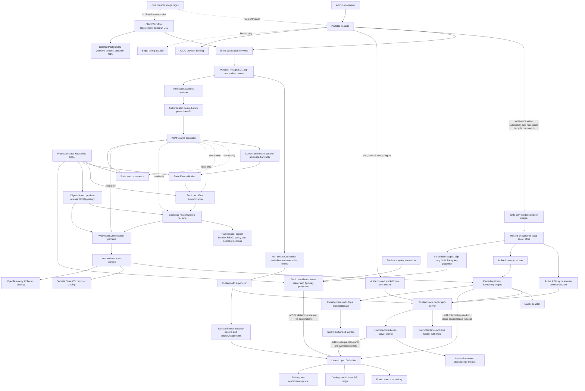

# Symphony Platform - Plan

> **Deferred reference plan.** This document preserves a reviewed design for
> possible future implementation. No implementation is currently scheduled.
> Revalidate external dependencies, provider behavior, security assumptions,
> product commitments, and all recorded conformance gates before execution.

## Goal Capsule

Build one portable Symphony product around the existing OpenAI Symphony implementation. Use upstream Symphony as the sole issue scheduler, tracker reader, workspace manager, retry authority, and Codex app-server runner. Deploy one lane for one repository and tracker scope. Offer the same product under two operating models: self-hosted by the customer or hosted by the service operator.

The implementation starts from the digest-pinned orchestrator and worker images already produced and deployed by `symphony-k8s`, with `jasonmorganson/symphony` remaining the separate source repository. It does not pull Symphony source into the target monorepo, port Symphony into a new runtime, or reproduce its lifecycle in a control plane. The target monorepo owns product packaging, product-facing configuration, hosted commercial integrations, and operations around the existing engine images.

The authority order is:

1. The Product Contract owns customer-visible behavior.
2. The upstream Symphony specification owns orchestration semantics.
3. Key Technical Decisions own integration and deployment mechanisms.
4. Implementation Units own file scope and sequencing but cannot override the other authorities.
5. The source architecture document supplies context only where this plan does not replace it.

The selected console framework, persistence, workflow, migration, database-access, and wire-contract decisions are defined by the companion [Symphony Platform Console - Effect 4 Platform Supplement](symphony-saas-console-effect-platform.md). That supplement refines KTD11, KTD17, U1, U11A, U11B, U12, and U16 but cannot change the Product Contract, Symphony ownership, or Flux ownership boundaries in this plan. The selected trusted Git and stock-Codex authentication boundary is recorded by [ADR 0003](decisions/0003-trusted-lane-access-boundary.md) and realized by KTD18 and U17. The Connection administration, credential-custody, OAuth, rotation, and revocation contract is recorded by [ADR 0004](decisions/0004-connection-credential-custody.md) and realized by KTD19. The older [console implementation supplement](symphony-platform-console-implementation.md) is retained only as superseded decision history.

Execution stops and returns to planning when any of these conditions occurs:

- A proposal reimplements issue polling, claim selection, retries, workspace lifecycle, tracker normalization, or the Codex app-server protocol outside Symphony.
- A required product behavior cannot be achieved with the pinned existing images, an existing public interface, or a small generic change maintained only in the current fork and rebuilt through the existing `symphony-k8s` image path.
- The exact pinned stock-Codex app-server and remote exec-server seam cannot keep model authentication in the trusted orchestrator while every repository-controlled process executes only in the uncredentialed worker environment.
- The lane-scoped Git broker cannot provide clone, fetch, scoped work-ref push, and pull-request create or update without exposing a GitHub credential or a broader provider capability to the worker.
- The dedicated PR-origin fork cannot prove that agent-controlled refs have no deployment credentials, environments, privileged Actions triggers, or other indirect deployment path.
- Self-hosted and hosted installations require different engine builds, product behavior, or data contracts.
- A reusable customer credential must be exposed to an untrusted worker, workspace, log, prompt, tool result, or crash artifact.
- A credential-store binding cannot support write-without-read application authority, or stock Codex cannot keep managed ChatGPT authorization inside a lane-exclusive encrypted auth store.
- A custom service is proposed where a Kubernetes resource or an accepted external component meets the same contract with lower ownership cost.
- Hosted billing would claim a hard usage or overage cap without an enforceable pre-dispatch admission point in Symphony.

The implementation tail belongs to the executor until the active milestone passes its Definition of Done or a stop condition fires.

---

## Product Contract

### Summary

Symphony turns ready sprint issues into tested pull requests for small engineering teams using Linear and GitHub. One lane owns one repository and one Linear project. The first product ends at human review and uses customer-funded model access. Customers can operate the product themselves, or pay for the same product to be operated for them.

### Problem Frame

OpenAI Symphony already implements the agent orchestration loop and reports its runtime state. The product gap is portable deployment, safe provider and model configuration, multi-lane operations, customer onboarding, commercial controls for the hosted service, and infrastructure operations. Rebuilding or projecting the Symphony lifecycle would add a second source of truth and disconnect the product from upstream improvements.

### Actors

- A1. The organization Admin creates and manages provider Connections, configures lanes, selects the operating model, and manages hosted subscription settings when applicable.
- A2. A team Member prepares sprint issues, observes lane state, and reviews resulting pull requests.
- A3. Upstream Symphony claims and runs eligible issues according to the repository-owned `WORKFLOW.md` and exposes live state through its existing API, logs, and dashboard.
- A4. The infrastructure operator applies the portable package, manages cluster dependencies, upgrades the product, and responds to failed reconciliation.
- A5. The hosted service operator performs A4 on the customer's behalf and also manages hosted identity, billing, support, and retention obligations.

### Key Decisions

- **One product with two operating models** (session-settled: user-directed — chosen over separate Managed and BYOC products: deployment ownership is the only product distinction). Governs R10-R13 and R15.
- **Upstream Symphony is the orchestration engine** (session-settled: user-directed — chosen over a new runtime port or duplicate controller: the existing implementation already owns the issue-to-agent lifecycle). Governs R1-R5 and R14-R18.
- **Small-team issue-to-pull-request outcome** (session-settled: user-directed — chosen over review-through-deployment automation: human review remains the first product control point). Governs R1-R3.
- **Linear and GitHub are the canonical launch bundle** (session-settled: user-directed — chosen over broad provider onboarding: the first customer path stays narrow even though upstream adapters remain available). Governs R1-R5.
- **Connections are Admin-managed trust objects** (session-settled: user-approved — chosen over storing credentials in lane configuration or giving agents credential-management access: people explicitly authorize and manage credentials while lanes consume only validated references). Governs R4-R5, R22, R24, R27-R29.
- **Monthly hosted lane bundles** (session-settled: user-directed — chosen over per-seat billing: small teams buy predictable repository-and-project capacity). Governs R6-R9.
- **Free alpha, discounted beta, and full-price general availability** (session-settled: user-directed — chosen over remaining free until general availability: beta supplies the first paid-market signal). Governs R7-R9.

### Requirements

#### Customer outcome

- R1. The first customer is a small engineering team using Linear and GitHub for recurring sprint work that can supply a dedicated PR-origin fork and satisfy the no-deploy repository prerequisites in R26. Alpha enrollment discloses those prerequisites before credential authorization, records rejection reasons, and measures conversion only among eligible teams.
- R2. A successful Symphony run follows the repository-owned `WORKFLOW.md` from an eligible Linear issue to a GitHub pull request ready for human review. The product does not separately determine, reconstruct, or persist that run outcome.
- R3. The product cannot approve, merge, or deploy a pull request and cannot grant a lane worker those capabilities.
- R4. The launch path offers three explicit model-authentication kinds: a customer-owned OpenAI API key billed through the customer's Platform organization; a Business or Enterprise Codex access token representing its creating user and workspace for trusted non-interactive operation; and stock-Codex-managed ChatGPT OAuth, preferably through device code for the hosted console, so an eligible user can use subscription access. Each kind has an independent U2 enablement gate. A validated API-key path may launch while the access-token or managed-ChatGPT path remains disabled; failure of one optional kind cannot block or silently substitute for another. Repository-controlled execution always occurs through the uncredentialed remote exec-server worker.
- R5. Creating, selecting, reauthorizing, rotating, changing kind, expanding scope, disconnecting, or revoking a Connection requires authenticated Admin intent and validation. The product cannot import browser cookies or `auth.json`, accept externally managed ChatGPT tokens, infer authority from client-supplied tenant or provider IDs, or silently fall back to another credential, version, account, workspace, or authentication kind.

#### Hosted commercial contract

- R6. Monthly list pricing for the hosted service is Starter at $99 for one active lane, Team at $199 for three active lanes, and Growth at $999 for ten active lanes. A lane bundle grants product capacity only; it never grants, pools, or implies an OpenAI subscription entitlement. Every lane must independently resolve an eligible model Connection, and every managed-ChatGPT lane requires its own eligible user authorization and isolated auth store.
- R7. Hosted alpha is free, hosted beta is 50% off list price, and hosted general availability uses full list price.
- R8. Hosted alpha measures worker and model usage. Overage remains disabled unless the unmodified or already-forked Symphony build exposes an existing enforceable admission point that can prove an Admin-set monthly cap before work starts; delayed usage records alone cannot authorize overage.
- R9. Hosted cancellation takes effect at the billing-period boundary by changing the lane's desired deployment state through supported package controls. In-flight and queued work follow the documented behavior of the pinned Symphony build; cancellation does not add claim, drain, or retry controls outside Symphony. Hosted metadata remains exportable for a published retention duration, and deletion produces audit evidence for each hosted data class.

#### One portable product

- R10. Self-hosted and hosted installations consume the same signed OCI product-release configuration artifact, console and Git-broker images, Symphony image digests, Kustomize base, Connection metadata and lifecycle contract, configuration schema, upgrade path, and behavioral acceptance suite.
- R11. A self-hosted customer can install, operate, upgrade, back up, restore, and remove the complete product without a callback to hosted services.
- R12. Hosted-only integrations such as managed identity, Stripe, support tooling, and the operator's vault are adapters selected by configuration, not separate product code paths. Self-hosted installations bind the same credential-writer and runtime-projection contracts to a customer-local secret store or to operator-provisioned selectable references without a hosted callback.
- R13. Self-hosted installation is free, self-supported, and has no technical license enforcement. Paid support or dedicated operations may be sold without changing the deployed product.

#### Upstream preservation and lane behavior

- R14. Upstream Symphony remains the only authority for issue eligibility, polling, claim state, retries, workspaces, tracker normalization, and Codex app-server sessions.
- R15. One lane maps one repository to one tracker project or equivalent tracker scope and has its own namespace, identity, configuration, storage, concurrency, and security policy.
- R16. The launch lane runs the existing persistent SSH-worker topology. Ephemeral per-run Pods are deferred until Symphony exposes a generic execution seam that does not create a second scheduler.
- R17. `WORKFLOW.md` remains Symphony-owned startup input. The product stores only the bound source repository, immutable revision, and fixed workflow path; it does not store, generate, upload, render, or override the file contents. U2 must prove a bootstrap-safe generic Symphony seam that retrieves the exact file through the trusted Git boundary before polling begins. Because the pinned build accepts only a local workflow path, U6 owns any minimal generic repository-backed loading change in `jasonmorganson/symphony` and the corresponding `symphony-k8s` image refresh. Failure stops lane provisioning; it cannot fall back to console rendering or a product-owned workflow store.
- R18. Any Symphony fork delta is generic, minimal, tested against the specification, documented by provenance, and maintained only in `jasonmorganson/symphony`. Product releases consume the corresponding digest-pinned images built through the existing `symphony-k8s` image path. This plan never proposes or requires an upstream contribution.

#### Evidence and release

- R19. The product stores desired lane configuration, hosted commercial state, aggregate usage records, exports, and deletion receipts. It does not copy, reconstruct, or cache Symphony's live run or outcome state; users reach that state through Symphony's own authorized surfaces.
- R20. Alpha enrolls up to three small-team design partners and proves the same issue-to-human-review flow in one self-hosted and one hosted installation before beta.
- R21. General availability requires passing portability, upgrade, credential-containment, tenant-boundary, billing-reconciliation, restore, and deletion gates.
- R22. A lane configuration resolves exactly one source repository, one dedicated PR-origin fork in that source repository's GitHub fork network, one tracker scope, one source revision containing `WORKFLOW.md`, one worker target, one validated typed Connection reference for each required provider role, and one concurrency limit. The console stores draft versions and immutable accepted installation-wide desired-state revisions and exposes the complete current accepted state only through `GET /internal/v1/installations/{installationId}/desired-state` on the authenticated, tenant-bound, cluster-private controller path. The response is unpaginated, schema-versioned, deterministically ordered, and conditionally retrievable with its canonical response digest as the `ETag`; lane-count and canonical-byte bounds are independently enforced. Before U3 freezes those protocol bounds, U1 records the initial hosted target and measured per-lane payload: 100 hosted installations and 1,000 active lanes per hosted cluster, with at most ten active lanes per customer installation under the launch plans. The existing 2,048-lane and 8-MiB values are validation ceilings, not an unexamined scale promise, and U3 must confirm or revise them from the target, controller memory ceiling, and fetch-to-ready SLO. Human reads use Server Components and human mutations use Server Actions; no general or public product API exists at launch. The console reports the separate deployment states `accepted`, `source-syncing`, `artifact-ready`, `reconciling`, `applied`, and `action-required`. Lane CRUD changes only console database revisions. The console has no Git, registry-publish, or Kubernetes credentials, does not create work, and does not interpret Symphony run readiness. Accepted revisions contain only Connection IDs, provider roles, non-secret repository identities, and deterministic target names, never credential values, secret-store paths, or mutable version aliases; rollback cannot restore revoked authority or an inactive secret version.
- R23. The console meets WCAG 2.2 AA for authentication, onboarding, remediation, lane status, and hosted commercial interactions, including narrow-screen reflow, 400% zoom, keyboard and visible-focus operation, programmatic error association, usable diff and evidence disclosures, and pointer-target sizing. Two-dimensional scrolling is limited to intrinsically tabular content.
- R24. Admin, Member, infrastructure-operator, and hosted-support permissions are default-deny, tenant-bound, and enforced server-side. Only Admins may mutate Connections. Members see lane-relevant normalized status and remediation ownership; time-bound hosted support may see approved non-secret status but no reusable credential, detailed unrelated scope, or mutation authority.
- R25. Admins provision, update, pause, resume, remove, and roll back lanes through the console without editing Git or Kubernetes resources. Installation-time Kustomize configuration statically provisions one installation-bound `DesiredStateSource`, one `ExternalArtifact`, one root Flux `Kustomization` consuming that artifact, one restricted root-applier identity, one distinct restricted bootstrap-applier identity, one installation-scoped GitHub token issuer with its sign-only App-key projection, and one product-release `OCIRepository` pinned to the current signed product-release configuration digest for every installation, including every hosted installation. A hosted cluster may share release bytes only through an explicitly authorized read-only OCI source; desired-state bindings, controller identity, artifacts, inventory, and observations remain installation-scoped. Each lane in the desired-state response contains two projection-ready Flux `Kustomization` objects as `metadata` and `spec`, both fixed by OpenAPI `x-kubeprojection-resource` annotations: a bootstrap child using the fixed `./base/lane-bootstrap` package and the restricted bootstrap applier, and a workload child using the fixed `./base/lane` package and its lane-specific applier. The bootstrap child owns the lane Namespace, lane-applier ServiceAccount and RBAC, quotas, baseline policies, and approved secret-projection specifications. The workload child depends on the bootstrap child, exclusively owns the lane workloads and storage, and cannot alter bootstrap resources. The generic controller reflects both objects deterministically into a content-addressed artifact and updates only the status subresources of the pre-created source and `ExternalArtifact`. The root Kustomization owns both projected children. Installation tooling or parent product-release Flux owns the static bindings; Flux remains the sole writer, pruner, drift detector, inventory owner, and health reporter for bootstrap children, workload children, and lane resources.
- R26. Each lane has a dedicated, deployment-isolated PR-origin fork in the bound source repository's GitHub fork network and a lane-scoped Git broker. Onboarding verifies private-fork and organization/enterprise policy eligibility and binds the verified fork-network identity into the lane policy. The installation token issuer alone can use the GitHub App key; it mints distinct one-hour-or-shorter installation tokens for distinct GitHub App installation identities: a source token restricted to source-read and the minimum base-repository pull-request operations, and a PR-origin token restricted to leased-ref contents read/write in the fork. No token or installation identity spans both repositories. Before either token is minted, a fresh installation-bound no-deploy attestation must cover the repository pair and every relevant Action, App, webhook, environment, integration, and automated rule. An App-wide private key, organization-wide token, or other credential capable of minting authority for unrelated repositories cannot be mounted in a lane broker. The untrusted worker clones, fetches, and pushes through broker-issued Git remotes rather than raw provider URLs. It can read the bound source, push only its opaque-leased work-ref namespace in the PR-origin fork, read the corresponding pull-request state, and create or update that pull request through the broker. Provider repository URLs remain trusted broker metadata and never become a worker bypass route. Pull-request creation is bound to the immutable leased head ref and SHA plus an onboarding-approved base ref; updates may change only title and body, never head, base, state, reviews, merge settings, deployment fields, or an unlisted provider property. The worker receives no raw GitHub credential or generic provider API, cannot address another repository or ref namespace, and cannot approve, merge, deploy, administer repositories or lanes, rotate credentials, or invoke billing or deletion operations. The PR-origin fork has no deployment secrets or environments, has agent-triggered Actions disabled, and is rejected during onboarding if any privileged path can execute or deploy agent-controlled content. Relevant repository configuration changes invalidate the attestation and fail closed before bootstrap authorization, run-lease issuance, or token minting.
- R27. A Connection is an organization-scoped, non-secret trust record containing provider, authentication kind, external account, workspace or installation identity, approved scopes, lifecycle status, validation and rotation timestamps, dependent lanes, audit history, and opaque secret-store and runtime-projection references. API-key, access-token, Linear, and GitHub Connections may be reused by authorized lanes. A managed-ChatGPT Connection remains visible and manageable in the organization inventory but is exclusive to one lane and one encrypted lane-owned stock-Codex auth store; it cannot be attached to a second lane or copied into another store. PostgreSQL, accepted revisions, desired-state responses, artifacts, and ordinary reads never contain reusable credentials, OAuth access or refresh tokens, device codes, authorization headers, or Codex auth files.
- R28. Manual API keys and access tokens may cross one Admin-only TLS Server Action into a dedicated write-only credential-store adapter, but the console cannot subsequently read, list, display, replay, export, log, back up, or enqueue the submitted value. Before submission and again in the result state, the console tells the Admin that the value is write-only, cannot be revealed, copied, or exported, and can only be replaced or rotated. GitHub and Linear OAuth callbacks remain provider-owned protocol handlers. For ChatGPT-managed authentication, the exact pinned stock Codex app-server in the selected lane alone performs `chatgpt` browser OAuth or `chatgptDeviceCode`, persists and refreshes tokens in that lane's encrypted orchestrator-only auth store, and reports only documented non-secret status through an authenticated control channel. An Admin authorizes managed ChatGPT separately for every lane that uses subscription access; the product does not copy or share the resulting auth state. `apiKey` uses the documented app-server login operation from the current active projection into an ephemeral credential store that is discarded on restart, replacement, rotation, or revocation; persistent encrypted per-lane Codex auth storage is reserved for managed ChatGPT. A Business or Enterprise access token is supplied through the separately documented stock-Codex personal-access-token path, not invented as a fourth login RPC. Internal `chatgptAuthTokens`, imported browser cookies, imported `auth.json`, and a shared mutable Codex auth volume are forbidden.
- R29. Connection activation is staged and fail-closed: create an inactive metadata record, write an immutable secret version or complete stock-Codex authorization, validate it through the owning trusted runtime, require explicit resolution of any expected-versus-observed identity mismatch, and atomically promote the reference. Rotation validates and promotes the replacement before retiring the prior version; runtime-projected credentials advance only their deterministic `active` aliases. Emergency revocation installs a monotonic local denial fence and advances affected broker authority epochs before provider cleanup, immediately blocks every product-mediated new activation, lease issuance or use, refresh request, and provider operation, and marks dependent lanes `action-required`. The trusted auth supervisor terminates affected stock-Codex processes, remote environments, broker streams, and leases and collects acknowledgements before local containment is reported complete. Stock-Codex logout and remote provider revocation then proceed asynchronously; the product reports their observed or uncertain completion and claims termination of an already-issued refresh capability only when U2 proves the pinned mechanism. Ordinary disconnect requires every dependent lane to be paused or reassigned to a validated replacement first. Emergency forced disconnect is a separate destructive action that leaves affected lanes `action-required` and shows cleanup uncertainty and remediation. A historical lane revision can restore only currently valid Connection references and cannot resurrect a revoked grant, old authority epoch, or retired secret version.

Product Contract preservation: changed R4-R5, R10, R12, R22, and R24-R26 and added R27-R29 to capture the user-directed credential kinds, custody boundary, permissions, portable lane topology, and lifecycle; the remaining Product Contract is unchanged.

### Key Flows

- F1. Lane onboarding
  - **Actors:** A1, A4 or A5.
  - **Steps:** The installation already contains its installation-scoped `DesiredStateSource`, `ExternalArtifact`, root Flux `Kustomization`, restricted bootstrap applier, digest-pinned product-release `OCIRepository`, and installation-scoped GitHub token issuer. Before lane creation, the console presents a role-aware Connections checklist for the required Linear, GitHub, and model roles, with progress and remediation; completing a Connection returns the Admin to the saved lane draft. The Admin creates or selects a validated Linear Connection, authorizes a GitHub App installation for one source repository and a dedicated fork in its GitHub fork network, and explicitly selects an enabled model Connection. For ChatGPT-managed auth, the lane draft reserves a lane-exclusive encrypted auth store, and the console starts that lane's stock-Codex device-code ceremony while showing its verification URL, user code, expiry, workspace context, and cancellation state; stock Codex owns token exchange and refresh. The Admin maps the Linear project to the source repository, selects the repository revision containing `WORKFLOW.md`, and reviews an impact-first diff grouped into added, changed, paused, resumed, and removed lanes. Connection-authority changes require separate acknowledgement; the operator-owned product-release digest is displayed read-only and is not part of the accepted lane revision. Unchanged lanes are collapsed but the complete diff remains searchable. The console rejects duplicate mappings and validates Connection kind and status, lane exclusivity for managed ChatGPT, provider access, repository and file presence, fork-network identity and policy eligibility, every PR-event-triggered execution or deployment integration, worker reachability, capacity, and the pinned engine artifact, then commits a complete immutable installation revision. The reusable controller conditionally retrieves the complete projection-ready state from the authenticated desired-state endpoint, reflects each lane's annotated bootstrap and workload Kustomizations, archives them deterministically, and updates only source and `ExternalArtifact` status. The root Flux Kustomization verifies the artifact and owns both children; bootstrap creates lane prerequisites and workload depends on it and reports lane inventory and health.
  - **Outcome:** The lane resources are provisioned through self-service and the source-controller and Flux conditions are separately observable. No Git change, operator apply, console Kubernetes write, runtime OCI publication, or Symphony run-readiness report is part of this flow.
  - **Covered by:** R1, R3-R5, R10-R12, R15-R18, R22, R25-R29.
- F2. Sprint issue to human review
  - **Actors:** A2, A3.
  - **Steps:** Symphony retrieves the exact repository-owned `WORKFLOW.md` through its qualified generic loading seam, polls Linear, claims an eligible issue, and runs stock Codex app-server in the trusted orchestrator. Every repository-controlled command runs in the uncredentialed remote worker. The broker authorizes source fetch, the leased fast-forward work-ref update in the PR-origin fork, and idempotent creation or update of the corresponding pull request. Symphony performs its configured tracker transition.
  - **Outcome:** Provider facts show one pull request at the reported work-ref head and the Linear issue in the configured human-review state, or Symphony exposes an actionable failure. The product records no duplicate run or outcome state.
  - **Covered by:** R2-R5, R14, R17-R20, R26.
- F3. Self-hosted lifecycle
  - **Actors:** A1, A4.
  - **Steps:** The customer installs the product package, binds its OIDC issuer, local credential writer and runtime secret projection, PostgreSQL service, and observability destination, creates lanes, upgrades or rolls back pinned artifacts, and removes the installation without hosted callbacks. The infrastructure operator may pre-provision opaque secret references, but the Admin-facing validation, status, audit, rotation, revocation, and no-retrieval rules remain identical.
  - **Outcome:** The customer operates the same product and acceptance suite as the hosted service.
  - **Covered by:** R10-R13, R20-R21.
- F4. Hosted lifecycle
  - **Actors:** A1, A5.
  - **Steps:** The service operator supplies the same base package with hosted identity, credential-writer and vault projections, GitOps, observability, and Stripe adapters. Subscription state controls lane admission outside the Symphony scheduler and never rewrites live run state.
  - **Outcome:** The customer receives an operated installation with the hosted commercial contract.
  - **Covered by:** R6-R12, R19-R21.
- F5. Upgrade and Symphony image refresh
  - **Actors:** A4, A5.
  - **Steps:** A Symphony source change is completed and tested in `jasonmorganson/symphony`, then the existing `symphony-k8s` image path produces new orchestrator and worker images. The product release records those image digests and their Symphony source revision, runs black-box product conformance, canaries one lane, and supports rollback to the prior digest pair.
  - **Outcome:** Self-hosted and hosted installations advance from the same OCI product-release configuration-artifact digest without behavioral drift.
  - **Covered by:** R10, R14, R17-R18, R21.

### Acceptance Examples

- AE1. **Covers R10, R15, R17, R22, R25.** Given a valid lane request whose selected repository revision contains `WORKFLOW.md` and the installation has its static source, `ExternalArtifact`, root Kustomization, restricted bootstrap applier, and digest-pinned product-release `OCIRepository`, when the console accepts the next complete installation revision, the reusable controller publishes an artifact containing the lane's projected bootstrap/workload pair, and root plus both child reconciliations complete, then bootstrap creates the lane boundary, workload applies the fixed lane package from the exact release digest with its lane-specific applier, the console reports source and Flux conditions separately, and no Git change, console Kubernetes write, controller binding CRUD, runtime OCI publication, secret value, separate workflow content, or Symphony run-readiness state exists.
- AE2. **Covers R10-R13, R20.** Given the same signed OCI product-release configuration digest and lane fixture, when a customer installs it self-hosted and the service operator installs it hosted, then both pass the same packaging, provider, repository-workflow, and upstream black-box conformance tests without different product builds.
- AE3. **Covers R14, R17-R18.** Given refreshed `symphony-k8s` images, when the provenance suite runs, then each image is digest-pinned, both identify the expected Symphony source revision, the fork records its own approved delta and test result, and no Symphony source or product policy is copied into the product monorepo.
- AE4. **Covers R3-R5, R26-R29.** Given each supported model-auth kind, a validated Linear Connection, a GitHub App Connection, and a hostile repository fixture, when stock Codex completes the lane flow, then model and Linear authentication remain only in the trusted orchestrator, the App key remains only in the installation issuer, the lane broker keeps only an ephemeral repository-scoped GitHub token, ChatGPT refresh material remains only in that lane's isolated stock-Codex auth store, and the uncredentialed worker can clone, fetch, push only its leased PR-origin work ref, and create or update the corresponding pull request. The broker accepts its opaque lease only with the correct lane workload identity, and restart, cancellation, expiry, or authority-epoch advance revokes it. No reusable credential appears in PostgreSQL, desired state, artifacts, Workflow data, worker files, environment, process metadata, logs, prompts, tool results, network captures, backups, exports, or crash artifacts. Approval, merge, deployment, generic provider access, another repository or ref, credential extraction, and reuse after expiry or revocation all fail without switching authentication kind.
- AE5. **Covers R15-R16, R21.** Given two tenants with separate lanes, when both run hostile test fixtures, then neither can access the other's namespace, repository, workspace, service account, secrets, network destinations, or status data.
- AE6. **Covers R6-R9, R19.** Given a hosted plan limit and concurrent lane activations, when the limit is reached, then no additional lane is provisioned, existing Symphony work follows the pinned engine's documented behavior, and Stripe remains a reconciled billing projection rather than orchestration authority.
- AE7. **Covers R14, R19, R22.** Given console restarts, duplicate deployment observations, or concurrent operator actions, when Symphony continues operating, then the console performs no Symphony or provider mutation and creates no local representation of claims, retries, attempts, workspaces, or outcomes.
- AE8. **Covers R23-R24.** Given a keyboard or screen-reader user, a narrow viewport or 400% zoom, and any product role, when the user completes an allowed flow, then the console reflows without two-dimensional scrolling except intrinsic tables, exposes semantic errors and status changes, visible focus, non-color-only state, usable diff and evidence disclosures, and adequate pointer targets, and permits no mutation outside that role and tenant.
- AE9. **Covers R5, R10-R12, R22, R24, R27-R29.** Given a Connection used by one or more lanes, when an Admin creates, authorizes, rotates, reauthorizes, changes kind, disconnects, emergency-revokes, or rolls back a dependent lane revision, then the operation is tenant-bound, idempotent, validated, audited without secret material, and visible through non-secret status. Rotation promotes only a validated replacement; revocation blocks new use before provider cleanup; dependent lanes become `action-required`; rollback cannot reactivate revoked authority; Members and hosted support cannot mutate or retrieve credentials; and hosted and self-hosted installations behave identically through different configured secret-store adapters.

### Success Signals

- Three alpha design partners can reach human review from recurring sprint issues with bounded operator intervention.
- Alpha reports eligibility separately from conversion, including how many teams cannot supply the dedicated fork or no-deploy prerequisites and why.
- One self-hosted and one hosted installation pass the same signed OCI product-release configuration digest and behavioral suite.
- Admins can manage every launch Connection kind through the same metadata and lifecycle contract without a credential value becoming readable by the product, a worker, or another tenant.
- A refreshed `symphony-k8s` orchestrator-and-worker digest pair can be evaluated, canaried, and rolled back without modifying console behavior or cloning Symphony source.
- No duplicate scheduler, run controller, tracker normalization layer, or model execution loop exists in the monorepo.

### Scope Boundaries

Included:

- The complete portable product, including the console, installation GitHub token issuer, lane-scoped Git broker, qualified digest-pinned Symphony images, bootstrap and workload lane packages, persistent uncredentialed worker, provider configuration, hosted usage records, and operational contracts.
- Organization-level Connection management for reusable GitHub App, Linear OAuth or API key, OpenAI API key, and Business or Enterprise Codex access-token Connections plus lane-exclusive gated stock-Codex ChatGPT device-code authorization.
- Hosted identity, billing, support, and retention adapters as configuration of that product.
- Linear and GitHub onboarding for the launch experience while retaining upstream provider compatibility.

Deferred:

- Ephemeral per-run workers, external sandbox backends, provider bundles beyond the launch pair, platform-funded model usage, custom domains, and dedicated-cluster automation.
- Any non-repository `WORKFLOW.md` source or product-level workflow override.
- kpt, `Kptfile`, a `SymphonyLane` or other domain-operator API, any controller that applies lane resources, and any controller that duplicates Flux inventory, pruning, drift, health, or rollback behavior. The reusable source CRD and generic OpenAPI-to-KRM controller are explicitly in scope because they reflect external desired state into a Kubernetes-observable Flux source without reconciling lane resources.
- A read-only OCI Distribution frontend over the reusable revision-and-artifact core. It is a documented future alternative adapter consumed directly by Flux through `OCIRepository`; it never emits `ExternalArtifact` YAML, never feeds the ExternalArtifact adapter, and is not implemented or required at launch.
- Any new release-image, signing, attestation, or publication CI in `jasonmorganson/symphony`; launch reuses the existing images and `symphony-k8s` image-building path.
- Other forges, multiple source repositories per lane, private submodules or Git LFS that cannot traverse the broker contract, and generalized repository-operation plugins.

Outside the product's identity:

- A replacement Symphony scheduler, a general workflow engine, an agent-session UI, automatic pull-request approval or merge, automatic deployment, and a proprietary model gateway.

---

## Planning Contract

### Key Technical Decisions

- KTD1. **Draw a hard boundary around upstream Symphony.** The Elixir release is one engine component with its existing API, dashboard, logs, repository-owned `WORKFLOW.md`, tracker behaviors, workspaces, and worker protocol. Other components integrate through those surfaces and do not import its internal modules. Governs R14, R17-R18.
- KTD2. **Use an unmodified-image-first reuse ladder.** Level 0 pins the existing `symphony-k8s` orchestrator and worker image digests. Level 1 adds product packaging or a wrapper through an existing interface without projecting Symphony-owned state. Level 2 makes a small generic change only in `jasonmorganson/symphony`, tests it there, and rebuilds through the existing `symphony-k8s` image path. Level 3 reimplementation is forbidden, and no level includes proposing changes upstream. Governs R14, R17-R18.
- KTD3. **Keep Symphony source and image construction outside the product monorepo.** The monorepo contains no Symphony checkout, `mise bootstrap repos` entry, subtree, submodule, vendored source, patch queue, worker Dockerfile, or Symphony Dockerfile. `symphony-k8s` continues to publish the runtime-base, orchestrator, and worker images. The product's Kustomize base pins the orchestrator and worker images by digest and records the Symphony revision from which they were built. Governs R10, R18.
- KTD4. **Keep one product and one OCI release artifact.** `deploy/kustomize/base` is the complete self-hostable product. `deploy/kustomize/overlays/hosted` adds only service-operator bindings, and `deploy/kustomize/overlays/local` is disposable development configuration. A signed, digest-addressed OCI artifact containing the tested Kustomize tree is the canonical release unit for every installation. Governs R10-R13.
- KTD5. **Use Kubernetes as the deployment control plane.** Namespaces, Deployments, StatefulSets, Services, PersistentVolumeClaims, ServiceAccounts, RBAC, NetworkPolicies, Pod Security labels, quotas, Secrets Store CSI volumes, Jobs, and Kustomize overlays replace proposed bespoke apps where their reconciliation semantics are sufficient. Governs R10-R16, R21.
- KTD6. **Use Kustomize, Skaffold, product-release OCI, ExternalArtifact, and Flux at their native boundaries.** Kustomize owns declarative base-and-overlay composition, including the statically installed `DesiredStateSource`, `ExternalArtifact`, root Flux `Kustomization`, restricted bootstrap-applier, installation token issuer, and product-release `OCIRepository` pinned to the signed configuration-artifact digest. Root `skaffold.yaml` builds `apps/console` and `apps/git-broker`, consumes the external Symphony images, coordinates tests, and renders hydrated manifests; its build-artifacts file and rendered output are ephemeral CI artifacts. Signed OCI stores immutable, versioned product releases for installation, upgrade, rollback, disconnected transport, and the fixed bootstrap/workload lane packages consumed by projected child Kustomizations. Runtime lane desired state stays in PostgreSQL and reaches Flux through the reusable controller and pre-created `ExternalArtifact`, without runtime registry publication, mutable tags, signatures, or registry credentials. Installation tooling or parent product-release Flux owns static binding specifications. The root Kustomization owns a bootstrap/workload pair per lane; each layer owns only its defined inventory, and Flux is their sole writer and reconciler. A direct Kustomize apply may bootstrap, repair binding drift, or recover a self-hosted installation, but console self-service requires the controller and Flux. Skaffold is not release storage and Git is not runtime desired state. Governs R10-R12, R15, R21-R22, R25-R26.
- KTD7. **Keep the persistent worker but make it an uncredentialed execution environment.** One lane owns its SSH-worker StatefulSet, Codex exec-server, workspace storage, identity, and security policy. Stock Codex app-server remains under Symphony in the trusted orchestrator and selects only the remote exec-server environment for repository-controlled processes. The scheduler remains Symphony, and this separation does not introduce a `SymphonyRun` controller or another agent loop. Governs R3-R5, R14-R16, R26.
- KTD8. **Use stock Codex directly from the trusted orchestrator, not a model gateway.** The Admin explicitly selects API-key, managed-ChatGPT, or Business/Enterprise access-token authentication under R4. Stock Codex app-server authenticates and conducts the model session inside the trusted Symphony orchestrator; API keys use the exact pinned `apiKey` login contract, access tokens enter as `personalAccessToken` through the pinned external token path rather than a fictional login RPC, and managed ChatGPT uses stock `chatgptDeviceCode` by default because the browser flow's loopback callback is not naturally reachable inside a Pod. Stock Codex alone owns OAuth exchange, persistence, refresh, account notifications, and logout. API-key lanes start Codex with an empty ephemeral credential store, perform `apiKey` login from the currently active secret projection on every orchestrator start, and discard that store when the process ends. Replacement, rotation, or revocation terminates the affected Codex process, clears the ephemeral state, and permits a new login only from the then-current active projection. Persistent encrypted per-lane Codex auth storage is reserved for managed ChatGPT. Because the pinned app-server persists one mutable primary authentication state to disk, managed ChatGPT is lane-exclusive: every using lane has its own encrypted auth store and its own Admin authorization ceremony, and no store is shared, cloned, or mounted across lanes. API-key and access-token Connections remain reusable because their owner-controlled secret versions can be projected independently into authorized orchestrators. A narrow authenticated console-to-orchestrator control channel may start, cancel, read, and log out the lane account and relay only documented non-secret ceremony and account metadata; its transport credential is distinct from model auth. The pinned experimental remote-environment seam delegates filesystem and subprocess operations to the uncredentialed worker exec-server. No product component accepts model prompts, parses managed ChatGPT tokens, injects `chatgptAuthTokens`, or proxies model requests, and failure cannot fall back to another kind, local execution, worker-mounted auth, or another lane's authorization. U2 pins the exact Codex version and generated schema and proves every enabled mode before the image pair is qualified. Governs R4-R5, R14, R17, R26-R29.
- KTD9. **Reuse the Symphony tracker adapter and isolate GitHub operations behind an installation issuer and lane broker.** Symphony owns Linear reads, normalization, and the issue-scoped commands in KTD20 and keeps Linear OAuth or API-key material in the orchestrator. The console owns the human authorization ceremony and non-secret Connection metadata; provider callbacks may transiently handle protocol tokens only long enough to store or project them through the selected credential boundary. GitHub App installation metadata belongs to the console. An installation-scoped issuer Deployment from the `apps/git-broker` image alone holds sign-only access to the App key, validates the Flux-projected lane-to-installation/repository policy and the fresh KTD24 attestation, and mints distinct one-hour-or-shorter source and PR-origin installation tokens for distinct installation identities and minimum permissions. No token spans the repository pair. A lane broker authenticates to that issuer with its workload identity, retains the returned tokens only in memory, and uses them for their separate Git smart transport and structured pull-request roles. An App-wide private key or organization-wide minting credential cannot be mounted in a lane broker. Repository IDs and minimum permissions are always explicit, installation tokens are opaque, and the worker uses separate broker-issued source-read and PR-origin-write remotes rather than provider URLs. The worker has no provider credential, direct GitHub or Linear egress, raw Linear GraphQL, or generic provider API. Provider webhooks verify the raw-body signature before parsing, enforce bounded timestamp and replay protection, bind account or installation identity to tenant and environment, and keep signing secrets in the write-only custody and rotation boundary. Governs R1-R5, R14, R17, R26-R29.
- KTD10. **Store product state, not Symphony projections.** The product database stores organizations, desired lanes, configuration revisions, hosted subscriptions, aggregate usage records, exports, and deletion receipts. It stores no issue claims, attempts, retry timers, workspace state, run outcomes, or reconstructed Symphony status. Governs R14, R19.
- KTD11. **Build the console and Git boundary as separate trust domains.** `apps/console` initially deploys only its web entrypoint. Server Components call thin server-only adapters into `packages/backend`; hand-authored Server Actions expose only authenticated domain commands, including the Admin-only write-once credential submission and Connection lifecycle commands in KTD19. `packages/backend` owns Effect application services, Effect Schema models, and Effect SQL repositories. Effect Workflow remains an exact-pinned selected dependency and compatibility gate, but U15 adds the first production Workflow definitions, isolated runtime entrypoint, schema, and Deployment only when hosted export and deletion need durable execution. `packages/contracts` owns the authoritative desired-state Effect HttpApi definition and its generated OpenAPI artifact. `apps/git-broker` is a second, minimal image with separate installation-issuer and lane-broker entrypoints and Deployments. Neither has console database or human-session authority: the issuer owns only repository-scoped installation-token minting under KTD9, and the broker owns only opaque leases, lane-scoped Git transport, and pull-request primitives under KTD18. The console receives no Git, registry-publish, or Kubernetes credentials, exposes no general public API, and owns no binding lifecycle. Its web identity may hold narrowly scoped secret-store create-version, promote, revoke, receipt-lookup, and non-secret status authority through KTD19 but has no secret read, list, export, or runtime-mount authority. Better Auth, provider callbacks, and webhooks remain narrow Route Handlers; callbacks and webhooks enforce their provider protocols before application execution, and the desired-state Route Handler is a thin adapter over the authoritative HttpApi. Any further app or package split requires a proven ownership, scaling, or security boundary. Governs R8-R13, R19-R29.
- KTD12. **Use external components at replaceable boundaries and make Flux own projection specifications.** Define generic contracts for OIDC, credential writing, runtime secret projection, PostgreSQL, telemetry export, and hosted billing. The credential writer is distinct from Secrets Store CSI: it creates immutable versions, atomically advances a deterministic installation/lane/role-scoped `active` alias, and installs revocation fences but exposes no application-level secret read. The fixed `./base/lane-bootstrap` package owns every per-lane `SecretProviderClass` specification and derives its provider, object path, and Kubernetes name only from release-owned templates plus installation ID, immutable lane ID, Connection ID, and provider role; arbitrary object paths are not desired-state inputs. The bootstrap Flux child applies those specifications and admission policy rejects another tenant, provider, path pattern, or secret synchronization. The workload child only refers to the deterministic names. Managed ChatGPT bypasses CSI and stays in its lane-owned stock-Codex auth store. The installation-scoped GitHub issuer receives the App key through a static operator-owned projection; lane brokers receive only distinct ephemeral source and PR-origin installation tokens after attestation. U2 evaluates these contracts, Secrets Store CSI, OpenTelemetry Collector, Stripe, and other named reference candidates before the selected bindings enter the Kustomize base or hosted overlay. Candidate selection cannot fork product behavior. Governs R6-R13, R19-R21, R27-R29.
- KTD13. **Keep security guardrails outside the namespaced workload applier.** Installation tooling owns cluster-wide admission policy, allowed RuntimeClass and StorageClass, the root and restricted bootstrap-applier identities, and installation-scoped issuer bindings. For each accepted lane, the Flux bootstrap child owns the Namespace, Pod Security labels, baseline NetworkPolicies, quotas, deterministic secret-projection specifications, a lane-specific ServiceAccount in the Flux system namespace, and the Role/RoleBinding that confines it to the target lane namespace. The workload child impersonates that lane-specific identity and cannot modify bootstrap resources, widen its RBAC, or mount arbitrary reusable secrets. Governs R15, R21, R25.
- KTD14. **Use KRM Source as the generic OpenAPI-to-KRM ExternalArtifact controller, not a domain operator.** Installation-time Kustomize creates one installation-bound `DesiredStateSource` in `projection.krm-source.jasonmorganson.github.io/v1alpha1`, one `ExternalArtifact`, one root Flux `Kustomization`, and one authorized product-release `OCIRepository` for every installation, including hosted installations. The signed digest-pinned `jasonmorganson/krm-source` release consumes exactly one pinned OpenAPI `GET` operation and has no Symphony-specific adapter: it conditionally fetches one complete projection-ready response, enforces the U3-approved lane-count and canonical-response bounds, reflects objects identified by `x-kubeprojection-resource`, canonicalizes filenames and KRM, archives them with the Flux Artifact SDK, and serves current and recent content-addressed artifacts. PostgreSQL immutable revisions—not artifact-byte retention—are rollback authority, so a collected artifact can be regenerated deterministically. Kubernetes RBAC permits status-only writes to the pre-created source and `ExternalArtifact`, read-only access to the installation's bound root and expected child Flux Kustomizations, and no binding CRUD, specification mutation, or lane-resource access. KRM Source supplies an authenticated read-only observation endpoint for source revision and response digest, artifact digest and `Ready`, root conditions, and expected child conditions and applied revisions. It must not publish `SourceVerified=True` unless the source is actually signature-verified. Missing or altered bindings are installation drift restored by product-release reconciliation or base reapplication; the controller only reports failure. U3 derives the protocol bounds from the R22 launch target and measured payload, records the controller memory ceiling and fetch-to-ready latency budget, and rejects the controller if boundary tests exceed either budget. KRM Source's storage backend, trigger mechanics, and deployment topology remain external-project implementation details and cannot introduce Symphony types, package paths, lifecycle rules, or status vocabulary. Governs R21-R22, R24-R25.
- KTD15. **Treat configuration as desired state, not work intent.** The console may validate, accept, pause, resume, observe, and version lane configuration under R22 and R25. Its desired-state response contains only complete bootstrap and workload Flux Kustomization `metadata` and `spec`, never secret values or arbitrary secret-store paths. The controller reflects that complete response into artifact storage and status; the root Kustomization owns both projected children, the bootstrap child owns lane prerequisites and projection specifications, and the workload child depends on bootstrap and owns its workload inventory. Pause uses KTD22's release-owned zero-replica substitutions while leaving both children active so Flux continues drift correction. Removal first omits only workload, then emits a separate system-authored revision omitting bootstrap only after the observation contract proves workload and inventory termination; sibling prune ordering is never assumed. U4 must prove this two-phase lifecycle while the lane-applier identity remains usable; a failure returns to planning rather than adding an imperative cluster applier. Only Symphony may poll, claim, retry, continue, launch work, or transition an issue. Operator repair can refresh source or Flux reconciliation, reapply the product base to repair binding drift, and select a prior PostgreSQL revision for rollback, but neither the console nor controller can mark success, mutate binding specifications or lane resources, or replay provider mutations. Governs R14, R19, R22, R25.
- KTD16. **Expose upstream runtime surfaces without rebuilding them.** The Symphony API and dashboard remain the only runtime-status surfaces. Customers and operators reach them through a tenant- and lane-authorized ingress or audited administrative path; the console links to them but does not project their run state. Governs R17, R19, R24.
- KTD17. **Make Effect HttpApi the private wire authority and generate OpenAPI from it.** (session-settled: user-directed — chosen over authored OpenAPI with generated Effect schemas: the application contract should be executable and type-safe at its source while still publishing a language-neutral controller artifact.) `apps/console` uses Next.js App Router on Node.js and Better Auth; `packages/backend` uses Effect 4, Effect Schema, Effect SQL, and Effect Workflow. Ordinary PostgreSQL SQL under `apps/console/db/` is the sole relational authority for the `app` and `auth` schemas, and Atlas generates reviewed versioned migrations. Effect Workflow owns runtime DDL only inside its Atlas-provisioned `workflow` schema and dedicated role. Better Auth may generate reference SQL but cannot migrate production; its built-in PostgreSQL integration may retain Kysely internally without making Kysely a product persistence authority. Effect SQL exclusively owns product repositories. Exported Server Actions remain explicit domain commands with separately authored validation and server-derived authorization. `packages/contracts` owns the Effect Schema models, HttpApi endpoint, authentication middleware, route metadata, projection extension metadata, and deterministic OpenAPI 3.1 generation for the single desired-state operation. Each lane contains one bootstrap object and one workload object, and their named schema components carry the required `x-kubeprojection-resource` annotations. TypeScript declarations are inferred from the authoritative schemas; the generated OpenAPI is committed for external-controller consumption and drift-checked, never edited directly. Official Effect OpenAPI override or transform annotations carry the projection and response-bound metadata. The Next.js Route Handler only bridges a handler built from the same HttpApi and cannot restate request, response, authentication, or error semantics. No general HTTP client, public API, TypeSpec, or reverse OpenAPI-to-Effect generator is required. Database models, action inputs, provider protocols, workflow payloads, and desired-state wire types remain separate. Beta dependency pins are allowed. The previously selected base composition passed its blocking feasibility gates; the KTD17 direction change reopens only the HttpApi/OpenAPI row, which must pass before U1 is complete. Product-specific integration acceptance remains blocking in its owning units. Governs R10-R12, R19-R25.
- KTD18. **Place Git transport and stock-Codex authentication behind trusted lane boundaries.** (session-settled: user-directed — chosen over worker-readable credentials plus repository policy: literal R3 requires capability denial at the worker boundary.) The trusted Symphony orchestrator retains the model credential and runs stock Codex app-server; the persistent worker exposes only the pinned exec-server process and filesystem surface. A separate lane-scoped Git broker obtains ephemeral GitHub installation tokens from KTD9's installation issuer, proxies Git smart HTTP for the bound source and PR-origin fork, validates every receive-pack ref command, and exposes only idempotent pull-request read, create, and limited presentation-field update primitives. Before polling, the orchestrator authenticates with its installation-and-lane-bound workload identity and uses a distinct bootstrap authorization that can read only the fixed `WORKFLOW.md` path at the bound immutable revision. That bootstrap authorization carries no issue, head, ref-write, pull-request, or worker-consumable claims, expires when startup loading completes, and never becomes a run lease. After Symphony selects a run, the broker issues that run an opaque, cryptographically random, short-lived lease by intersecting its lane, issue, repository pair, approved base, PR-origin head and SHA, work-ref namespace, and operation set with Flux-projected lane policy. It stores only a token hash and bounded claims in memory; the worker must present both the opaque lease and its lane workload identity. There is no lease-signing key or portable JWT. Broker restart invalidates every lease. A narrow fence-only control identity may monotonically advance a persisted lane authority epoch before Connection or repository cleanup; the broker drops older leases and refuses older issuance contexts. Orchestrator cancellation may revoke an individual lease. The orchestrator-to-broker, worker-to-broker, and broker-to-issuer links require mutually authenticated TLS with installation-and-lane-bound identities, pinned trust roots, exact service SAN validation, certificate rotation, and no plaintext, redirect, or protocol-downgrade fallback. Broker-issued Git remotes are HTTPS URLs only. Repository input cannot expand any claim. The broker permits source clone and fetch, writes only the leased PR-origin work-ref namespace, and never exposes raw credentials or generic REST/GraphQL access. Pull-request updates can change only title and body; head, base, state, reviews, merge settings, deployment fields, and unlisted provider properties are immutable or forbidden. The PR-origin fork has no Actions execution, secrets, environments, deployment keys, or direct deployment path; onboarding and configuration revalidation reject any base-repository workflow, App, webhook, environment, integration, or automated rule that can execute or deploy agent-controlled pull-request content with privileged authority. Disconnect, epoch advance, expiry, credential rotation, App removal, or repository-configuration drift revokes new operations. The broker classifies operation failures but never schedules a task retry, decides completion, stores prompts, calls models, reads Linear, or owns Symphony run state. Governs R3-R5, R14-R18, R21, R26-R29.
- KTD19. **Separate Connection metadata from credential material.** (session-settled: user-approved — chosen over PostgreSQL credential custody or worker-managed credentials: the console needs one portable administration model without gaining a reusable secret-read path.) `app` tables store non-secret Connection and lifecycle metadata plus opaque versioned references. A dedicated writer port exposes idempotent create-version, validate-through-owner, promote, revoke, receipt lookup, and non-secret status operations but no application-level read-secret method; hosted vaults and customer-local stores implement the same contract. Activation is a staged saga rather than a false cross-system transaction: reserve inactive metadata and an idempotency key, write a new immutable secret version or complete stock-Codex authorization, validate through the trusted consumer, compare-and-swap the active reference, then retire the prior version and collect unreachable versions. `validation-failed` is terminal and inactive: it records an allowlisted redacted reason, retires or schedules cleanup of the failed candidate, and offers only **Replace credential**, which starts a new candidate with a new idempotency key. A transport timeout after submission becomes `outcome-unknown`: the browser clears the value and recovers only through the original idempotency key and non-secret receipt/status; replacement and re-entry remain blocked until reconciliation proves that no candidate version was stored. A monotonic revocation fence outside rollbackable desired state blocks new product-mediated operations before provider revocation. Optimistic version checks prevent concurrent rotation, reauthorization, kind change, disconnect, or lane acceptance from overwriting newer authority. Historical revisions resolve current Connection status at execution and fail `action-required` rather than restoring invalid authority. Server Actions, callbacks, device ceremonies, provider failures, audits, telemetry, workflows, backups, exports, and errors use allowlisted metadata and never serialize credential material. Governs R4-R5, R10-R12, R22, R24, R27-R29.
- KTD20. **Expose issue-scoped Linear commands, never raw GraphQL.** Symphony remains the tracker authority, but the coding session cannot receive `linear_graphql`, a reusable Linear token, or a generic provider client. U2 defines the minimum launch command set from the repository-owned `WORKFLOW.md` contract, including read-current-issue and explicitly allowlisted comment or transition operations bound to Symphony's already selected issue and configured review state. Any missing command is implemented as a small generic adapter in `jasonmorganson/symphony`, tested there, and adopted through U6's external image path without an upstream proposal. Command arguments cannot choose another issue, project, workspace, team, mutation type, or raw query; the worker has no Linear egress. Governs R1-R5, R14, R17-R18, R26.
- KTD21. **Version desired-state projection and canonicalization as rollback inputs.** Every immutable accepted revision records the desired-state schema version, product projection version, and KRM canonicalization/archive-format version that produced it. The current endpoint returns those versions with the stable revision and digest. `krm-source` and the console pin a compatibility matrix; unsupported versions fail before artifact publication. The console retains versioned projectors and deterministic migration functions for the published rollback window, so selecting an older revision either regenerates its original bytes with its recorded versions or creates an explicit reviewed migrated revision—never silently reinterprets it under current code. Product-release digest remains operator-owned and is not added to the revision. Governs R10-R12, R19, R22, R25.
- KTD22. **Make pause concrete and lane removal two-phase.** Pause keeps both Flux children active but sets release-owned `SYMPHONY_ORCHESTRATOR_REPLICAS=0` and `SYMPHONY_WORKER_REPLICAS=0` substitutions; PVCs, identities, policies, and Flux drift correction remain. The console describes pause as disruptive deployment scale-down rather than Symphony drain and reports pinned-build termination/recovery behavior honestly. Resume restores the release-owned replica values. Remove first accepts a `removing-workload` revision that omits only the workload child while retaining bootstrap identity and policy. After the authenticated observation contract proves that child and its inventory terminated, an idempotent system-authored `removing-bootstrap` revision omits the bootstrap child. Failure remains `action-required`; no imperative applier or single-revision sibling-prune ordering is assumed. Governs R9, R15-R16, R22, R25.
- KTD23. **Give broker fences a durable isolated authority.** `apps/git-broker` owns an isolated PostgreSQL `broker_security` schema and narrowly scoped roles, separate from console `app` and `auth` schemas. It stores only lane authority epochs, instance acknowledgements, and non-secret drain receipts—never leases, provider tokens, prompts, or run state. A broker loads the current epoch before becoming ready, checks it transactionally before bootstrap authorization and run-lease issuance or use, and subscribes to changes while periodically resynchronizing. The fence-only control path atomically advances the epoch, causes every instance to terminate affected streams and leases, and reports local containment complete only after required acknowledgements. Restore reconciles the maximum known fences from credential and audit receipts before any broker becomes ready; rollback cannot lower an epoch. Governs R3-R5, R21, R26-R29.
- KTD24. **Separate source and PR-origin Git authority and require a fresh no-deploy attestation.** The source repository and PR-origin fork use distinct GitHub App installation identities and distinct installation tokens. The source token has contents-read plus only the minimum base-repository pull-request permission needed by the structured PR primitive; the PR-origin token has contents read/write only for the leased work-ref namespace and no Actions, environment, administration, or pull-request mutation authority. No token spans both repositories. Before bootstrap authorization, run-lease issuance, or token minting, the issuer must possess a fresh, installation-bound no-deploy attestation covering the repository pair, fork-network identity, workflows, Apps, webhooks, environments, rules, and other launch policy inputs. The issuer produces and refreshes the non-secret attestation through its own read-only validation path; relevant webhooks invalidate it. Missing, expired, mismatched, provider-unreachable, or drifted evidence fails closed and makes the lane `action-required`. Governs R3, R17, R21-R22, R26-R29.
- KTD25. **Make revocation terminate live stock-Codex authority before local completion.** A trusted lane auth supervisor—not the console or worker—observes monotonic Connection and broker fences, prevents new app-server sessions, terminates the affected stock-Codex process and remote environment, clears API-key ephemeral auth or invokes managed-ChatGPT logout, and waits for the local process and broker-stream acknowledgements. The product may report provider cleanup separately, but it cannot mark local containment complete while an affected Codex process, broker stream, or lease remains live. Timeout or ambiguous termination remains `action-required` with cleanup uncertainty; it never re-enables the lane or claims remote token revocation. The supervisor has no issue polling, retry, tracker, workspace, or model-proxy behavior. Governs R3-R5, R14, R26-R29.
- KTD26. **Route worker dependency egress through controlled mirrors.** The worker has no direct general internet or package-registry egress. The product package accepts installation-owned HTTPS mirror or authenticated egress-proxy bindings for approved dependency ecosystems, pins their trust roots and hostnames, and exposes only non-secret mirror configuration to the worker. Hosted installations operate allowlisted caching mirrors; self-hosted installations bind compatible local mirrors or explicitly record a narrowed exception. Metadata-only access logs and source-confidentiality boundaries are published. Redirects, alternate registries, direct IPs, private networks, credential forwarding, and unapproved destinations fail closed. Governs R3, R11, R15-R16, R21, R26.

### High-Level Technical Design



The product-release Kustomize base creates installation-scoped KRM Source, `ExternalArtifact`, root Flux `Kustomization`, restricted bootstrap-applier, product-release `OCIRepository`, and GitHub token-issuer bindings; neither the console nor KRM Source owns their lifecycle. The console never decides which issue runs next and never restates the Symphony-owned workflow. It accepts complete immutable installation revisions with recorded schema, projection, and canonicalization versions and exposes one authenticated, cluster-private desired-state response containing two projection-ready Kustomizations per lane. KRM Source deterministically reflects that response into a current artifact, patches only source and `ExternalArtifact` status, and observes that installation's root and projected Flux conditions read-only. The root owns both children. The bootstrap child creates the Namespace, lane-specific applier identity and target-namespace RBAC, guardrails, and deterministic secret-projection specifications. The workload child depends on bootstrap and owns only workloads and storage. Installation tooling or parent product-release Flux owns static bindings; Flux alone applies, prunes, detects drift, and reports health. PostgreSQL retains rollback revisions, so collected artifact bytes are regenerated under the recorded versions rather than treated as durable desired-state authority. PostgreSQL also owns non-secret Connection metadata and monotonic revocation fences; the isolated `broker_security` schema owns durable epochs and containment acknowledgements. Credential values reside only in the selected secret store or a lane-exclusive stock-Codex auth store. A manual value crosses one Admin-only write path and cannot be read back; ambiguous submissions recover through non-secret receipts. API-key Codex authentication is recreated from the current projection in an ephemeral store on each orchestrator start; only managed ChatGPT receives a persistent encrypted lane-owned auth store. An Admin separately authorizes every managed-ChatGPT lane, and stock Codex executes and refreshes that authorization without sharing its store. Symphony reconciles work and exposes its own runtime state. Inside each lane, the trusted orchestrator runs stock Codex app-server with model authentication while every repository-controlled command and filesystem operation runs through the worker's uncredentialed exec-server. A bootstrap-only broker authorization retrieves the fixed `WORKFLOW.md` before polling and never becomes a run lease. After Symphony selects work, the lane broker issues an opaque in-memory run lease to the authenticated orchestrator and accepts it only with the worker's lane identity. The trusted auth supervisor and brokers acknowledge fence-driven process, stream, and lease termination before local containment completes. The orchestrator, worker, broker, and issuer use mTLS with installation-and-lane-bound identities and pinned trust roots; broker-issued Git remotes use HTTPS. The issuer validates a fresh no-deploy attestation and mints separate non-overlapping source and PR-origin tokens; only it can use the statically projected App key. Worker dependency egress terminates at installation-owned controlled mirrors. Effect Workflow remains selected and pinned but does not enter the deployed topology until U15 adds the durable hosted export and deletion consumer.

### Symphony-Specific Flux Example

The product-release base installs the following stable topology. Names and digests are illustrative, but the resource ownership and reference directions are normative. The exact `DesiredStateSource` spec fields come from the signed KRM Source release pinned by U3.

```yaml
apiVersion: source.toolkit.fluxcd.io/v1
kind: ExternalArtifact
metadata:
  name: symphony-installation-desired-state
  namespace: symphony-system
spec:
  sourceRef:
    apiVersion: projection.krm-source.jasonmorganson.github.io/v1alpha1
    kind: DesiredStateSource
    name: symphony-installation-desired-state
---
apiVersion: kustomize.toolkit.fluxcd.io/v1
kind: Kustomization
metadata:
  name: symphony-installation-root
  namespace: symphony-system
spec:
  interval: 1m
  retryInterval: 15s
  path: ./
  prune: true
  wait: true
  serviceAccountName: symphony-root-applier
  sourceRef:
    apiVersion: source.toolkit.fluxcd.io/v1
    kind: ExternalArtifact
    name: symphony-installation-desired-state
---
apiVersion: source.toolkit.fluxcd.io/v1
kind: OCIRepository
metadata:
  name: symphony-product-release
  namespace: symphony-system
spec:
  interval: 10m
  url: oci://ghcr.io/jasonmorganson/symphony-platform-config
  ref:
    digest: sha256:1111111111111111111111111111111111111111111111111111111111111111
  verify:
    provider: cosign
    secretRef:
      name: symphony-release-signing-keys
```

For an accepted lane with immutable ID `01j4z7m8r9s0t1v2w3x4y5z6a7`, the desired-state response carries the following two `metadata` and `spec` objects. The reusable controller injects the GVK fixed by the OpenAPI annotations and emits both child objects unchanged otherwise:

```yaml
apiVersion: kustomize.toolkit.fluxcd.io/v1
kind: Kustomization
metadata:
  name: lane-01j4z7m8r9s0t1v2w3x4y5z6a7-bootstrap
  namespace: symphony-system
  labels:
    symphony.jasonmorganson.dev/installation-id: installation-acme
    symphony.jasonmorganson.dev/lane-id: 01j4z7m8r9s0t1v2w3x4y5z6a7
spec:
  interval: 1m
  retryInterval: 15s
  timeout: 10m
  path: ./base/lane-bootstrap
  prune: true
  wait: true
  deletionPolicy: WaitForTermination
  serviceAccountName: symphony-lane-bootstrap-applier
  sourceRef:
    apiVersion: source.toolkit.fluxcd.io/v1
    kind: OCIRepository
    name: symphony-product-release
  postBuild:
    substitute:
      INSTALLATION_ID: installation-acme
      LANE_ID: 01j4z7m8r9s0t1v2w3x4y5z6a7
      LANE_NAMESPACE: lane-01j4z7m8r9s0t1v2w3x4y5z6a7
      LINEAR_CONNECTION_ID: connection-linear-01
      GITHUB_CONNECTION_ID: connection-github-01
      GITHUB_INSTALLATION_ID: "12345678"
      SOURCE_REPOSITORY_ID: "23456789"
      PR_ORIGIN_REPOSITORY_ID: "34567890"
      MODEL_CONNECTION_ID: connection-openai-01
      MODEL_AUTH_KIND: apiKey
---
apiVersion: kustomize.toolkit.fluxcd.io/v1
kind: Kustomization
metadata:
  name: lane-01j4z7m8r9s0t1v2w3x4y5z6a7-workload
  namespace: symphony-system
  labels:
    symphony.jasonmorganson.dev/installation-id: installation-acme
    symphony.jasonmorganson.dev/lane-id: 01j4z7m8r9s0t1v2w3x4y5z6a7
spec:
  dependsOn:
    - name: lane-01j4z7m8r9s0t1v2w3x4y5z6a7-bootstrap
  interval: 1m
  retryInterval: 15s
  timeout: 10m
  path: ./base/lane
  targetNamespace: lane-01j4z7m8r9s0t1v2w3x4y5z6a7
  prune: true
  wait: true
  deletionPolicy: WaitForTermination
  serviceAccountName: lane-01j4z7m8r9s0t1v2w3x4y5z6a7-applier
  sourceRef:
    apiVersion: source.toolkit.fluxcd.io/v1
    kind: OCIRepository
    name: symphony-product-release
  postBuild:
    substitute:
      LANE_ID: 01j4z7m8r9s0t1v2w3x4y5z6a7
      LANE_NAMESPACE: lane-01j4z7m8r9s0t1v2w3x4y5z6a7
      SYMPHONY_ORCHESTRATOR_REPLICAS: "1"
      SYMPHONY_WORKER_REPLICAS: "1"
      SOURCE_GIT_REMOTE: https://git-broker.lane-01j4z7m8r9s0t1v2w3x4y5z6a7.svc.cluster.local/git/source
      PR_ORIGIN_GIT_REMOTE: https://git-broker.lane-01j4z7m8r9s0t1v2w3x4y5z6a7.svc.cluster.local/git/origin
      REPOSITORY_REVISION: 4a8c1d294d9537ee68f1c1968fdb4e7ca4e09017
      LINEAR_PROJECT_ID: 9c257d5b-7dd6-4f81-8487-aecf55d24f86
      WORKER_TARGET: ssh-worker.lane-01j4z7m8r9s0t1v2w3x4y5z6a7.svc.cluster.local
      GIT_BROKER_URL: https://git-broker.lane-01j4z7m8r9s0t1v2w3x4y5z6a7.svc.cluster.local
      LINEAR_SECRET_PROVIDER_CLASS: lane-01j4z7m8r9s0t1v2w3x4y5z6a7-linear
      MODEL_SECRET_PROVIDER_CLASS: lane-01j4z7m8r9s0t1v2w3x4y5z6a7-model
```

No substitution contains a credential value, secret-store path, or raw provider Git URL. The source and origin values are HTTPS broker remotes; distinct bound GitHub installation and repository IDs become non-secret issuer policy unavailable as a worker bypass. The bootstrap package deterministically derives the lane-applier name, cross-namespace RoleBindings, and runtime-projection object names from installation ID, immutable lane ID, Connection ID, and provider role. It owns those specifications, while the credential writer alone advances each matching `active` alias after validate-before-promote. The Linear and manual-model projections mount only into the trusted orchestrator. The GitHub App private key is a static installation-scoped, sign-only projection into the token issuer; the lane broker receives separate short-lived source and PR-origin installation tokens in memory only after the fresh no-deploy attestation passes. Managed ChatGPT state uses a separate encrypted lane-exclusive stock-Codex auth store instead of CSI. None mounts into the worker or console. Before use, every trusted consumer enforces current Connection status and its monotonic revocation fence; selecting an older desired-state revision cannot restore retired or revoked authority. The accepted revision changes the child set as follows:

| Console mutation | Projected child behavior |
|---|---|
| Create | Add the complete bootstrap and workload children with the release-owned replica counts set to their enabled defaults; the workload waits for a healthy bootstrap child. |
| Update | Replace both complete child specifications; never patch an artifact incrementally. |
| Pause | Keep both children and set `SYMPHONY_ORCHESTRATOR_REPLICAS` and `SYMPHONY_WORKER_REPLICAS` to `"0"`; Flux continues correcting prerequisites and workload drift while PVCs remain. |
| Resume | Keep both children and restore the release-owned replica defaults. |
| Remove | First accept `removing-workload` and omit only workload. After authenticated observation proves workload and inventory termination, accept a separately audited system-authored `removing-bootstrap` revision that omits bootstrap. |
| Roll back | Create a new complete current revision that restores the selected historical lane state while retaining every other current lane; require Admin review of the full installation diff before acceptance. |

During implementation, the generated OpenAPI excerpt, accepted response, static bindings, and reflected bootstrap/workload pair are backed by shared fixtures under `tests/fixtures/desired-state/symphony-lane/`. Documentation verification must fail if a snippet no longer validates against the authoritative Effect HttpApi and generated OpenAPI, the pinned Flux CRDs, or the controller's deterministic reflection fixture.

### Canonical Repository Layout

```text
symphony-platform/
├── apps/
│   ├── console/                 # Human administration and desired-state app
│   │   ├── db/
│   │   │   ├── atlas.hcl
│   │   │   ├── schema.sql
│   │   │   └── migrations/
│   │   ├── src/
│   │   │   ├── adapters/
│   │   │   └── runtime/
│   │   ├── tests/
│   │   ├── Dockerfile
│   │   └── package.json
│   └── git-broker/              # Lane-scoped trusted Git and PR boundary
│       ├── src/
│       │   ├── issuer/           # Installation-scoped GitHub token issuer entrypoint
│       │   └── lane/             # Lane broker, opaque leases, Git transport, and PR operations
│       ├── tests/
│       ├── Dockerfile
│       └── package.json
├── packages/
│   ├── backend/                 # Server-only Effect services, SQL, and workflows
│   │   ├── src/
│   │   │   ├── domain/
│   │   │   ├── application/
│   │   │   ├── persistence/
│   │   │   ├── workflows/
│   │   │   └── runtime/
│   │   ├── tests/
│   │   └── package.json
│   └── contracts/               # Authoritative desired-state Effect HttpApi
│       ├── src/
│       │   └── desired-state/
│       ├── openapi/
│       │   └── desired-state.openapi.yaml # Generated, committed controller artifact
│       ├── scripts/
│       ├── tests/
│       └── package.json
├── deploy/
│   └── kustomize/
│       ├── base/                 # Complete self-hostable product
│       │   ├── console/
│       │   ├── source-controller/ # External project manifests, source resource, and binding
│       │   ├── git-issuer/        # Installation issuer, sign-only App-key projection, and trust roots
│       │   ├── lane-bootstrap/    # Namespace, lane applier, policy, and projection specifications
│       │   ├── lane/
│       │   ├── policies/
│       │   └── kustomization.yaml
│       └── overlays/
│           ├── hosted/
│           │   └── kustomization.yaml
│           └── local/
│               └── kustomization.yaml
├── tests/
│   ├── fixtures/
│   │   ├── repositories/
│   │   ├── workflows/
│   │   ├── providers/
│   │   ├── credentials/
│   │   └── desired-state/
│   ├── provenance/
│   ├── conformance/
│   ├── render/
│   ├── cluster/
│   ├── acceptance/
│   ├── security/
│   ├── scale/
│   └── upgrade/
├── docs/
│   ├── architecture/
│   ├── decisions/
│   ├── install/
│   ├── runbooks/
│   ├── security/
│   ├── validation/
│   └── upstream/
├── skaffold.yaml
├── turbo.json
├── package.json
├── pnpm-workspace.yaml
├── pnpm-lock.yaml
├── mise.toml
└── README.md
```

Turborepo discovers only the shallow `apps/*` and `packages/*` workspaces. Infrastructure directories are not JavaScript workspaces. Shared integration fixtures live under `tests/fixtures`; package- or app-specific unit fixtures remain beside their owning tests. `apps/console` and `apps/git-broker` are the only launch applications and images built in this monorepo. The product monorepo contains no `/release` directory, generated release manifest, committed Skaffold build-artifacts file, committed rendered output, worker image source, or Symphony image source.

### Reuse and Ownership Matrix

| Capability | Launch implementation | Product ownership decision |
|---|---|---|
| Issue polling, eligibility, claims, retries | Upstream Symphony | Reuse unchanged |
| Tracker normalization and Linear reads | Upstream Symphony adapter | Reuse unchanged |
| Workspace lifecycle and path safety | Upstream Symphony | Reuse unchanged |
| Codex app-server protocol and multi-turn loop | Upstream Symphony | Reuse unchanged |
| Runtime state API and operator dashboard | Upstream Symphony Phoenix surfaces | Reuse and link; do not rebuild |
| Persistent remote execution | Existing SSH worker plus pinned stock Codex exec-server | Keep the worker uncredentialed; adapt the fork and packaging only where U2 proves necessary |
| Model session and authentication | Stock Codex app-server in the trusted Symphony orchestrator | Reuse stock Codex; no model gateway and no worker credential |
| Git object transport and pull-request mutation | Installation token issuer plus lane-scoped Git broker and deployment-isolated PR origin | Custom least-authority boundary under KTD9/KTD18; only the issuer can use the App key, and the worker receives neither provider credential nor generic provider proxy |
| Desired-state source projection | Statically bound generic OpenAPI-to-KRM controller plus `ExternalArtifact` | External project; reflection and status only, never a binding owner or lane reconciler |
| Lane installation, pruning, drift, inventory, and health | Root Flux `Kustomization` owns a bootstrap/workload child pair per lane; both consume the static product-release `OCIRepository` | Reuse Flux unchanged; bootstrap owns prerequisites, workload owns lane runtime, and Flux is sole writer and inventory owner |
| Human identity | Generic OIDC contract | External provider |
| Connection metadata, lifecycle, and authorization fences | Console PostgreSQL plus Effect application services | Custom non-secret state; rollback cannot restore revoked authority |
| Manual credential creation and rotation | Write-only credential-store adapter bound to a hosted or customer-local store | Custom port with create/version/promote/revoke/status only; no application read/list/export method |
| Managed ChatGPT authorization | Exact pinned stock Codex app-server and one encrypted auth store per lane | Reuse stock login, refresh, logout, and notifications; authorization is lane-exclusive and tokens are never imported, copied, or brokered |
| Reusable secret projection | Bootstrap-child-owned `SecretProviderClass` specifications plus credential-writer-owned deterministic active aliases | External/native consumer-side projection; desired state cannot choose an arbitrary path, and projection never becomes credential creation or authority |
| Telemetry pipeline | OpenTelemetry Collector | External component |
| Product configuration and hosted commerce | Modular console | Custom code under KTD15 |
| Symphony run and outcome state | Existing Symphony API and dashboard | Reuse through authorized access; do not project |
| Hosted usage, export, and deletion records | Console module or Kubernetes Job | Custom commercial and operational records only |
| Model routing | Stock Codex direct path from the trusted orchestrator | No custom gateway at launch |

### Implementation Code and Language Decisions

| Area | Code needed | Language posture | Selection gate |
|---|---|---|---|
| Symphony engine | No product-monorepo implementation | Elixir remains owned by `jasonmorganson/symphony` | Consume the existing `symphony-k8s` orchestrator image by digest; change source only in the fork when necessary |
| Console and private API | Yes, as one modular image with web and worker Deployments | TypeScript with Next.js App Router, Better Auth, and the selected Effect 4 platform | Fixed by KTD17 and the Effect platform supplement; no general public API or Kubernetes credentials enter the console |
| GitHub token issuer and lane Git broker | Yes, as two entrypoints and Deployments from one separate minimal app and image | TypeScript on Node.js with Effect Schema for typed internal boundaries and native streaming HTTP for Git smart transport | Fixed by KTD9/KTD18; only the issuer gets sign-only App-key access, while neither entrypoint gets Next.js, console database, human session, model call, scheduler, or a generic GitHub API surface |
| Product web UI | Yes, inside `apps/console` | React through Next.js; no separate frontend application | Split only after an independently deployable UI boundary is proven |
| Provider onboarding and Connection lifecycle | Yes, as explicit console commands and narrow provider routes | TypeScript and Effect services in the console; stock Codex remains the owner of ChatGPT token exchange and refresh | Implement metadata, validation, rotation, revocation, and non-secret status once; bind hosted and self-hosted credential stores through KTD19 |
| Console relational schema and migrations | Yes | PostgreSQL SQL plus Atlas-generated versioned SQL migrations | `apps/console/db/schema.sql` is authoritative; no Prisma schema, ZModel, Better Auth migration runner, or second migration framework |
| Console database queries and runtime models | Yes | Effect SQL repositories plus Effect Schema boundary models in `packages/backend` | Atlas and catalog conformance remain physical database authority; desired-state DTOs cannot reuse persistence models |
| Private desired-state projection contract | Yes, in `packages/contracts` | Authoritative Effect Schema and HttpApi with generated OpenAPI 3.1 | One complete projection-ready `GET` is the executable wire authority; OpenAPI is generated for the external controller, and TypeSpec, `openapi-typescript`, Smithy, reverse OpenAPI-to-Effect generation, generated Go clients in this monorepo, and a general public API are not launch dependencies |
| Durable console workflows | Yes, beginning in U15 | Effect Workflow worker from the console image, with isolated `workflow` schema | First required consumer is hosted export and deletion receipts; U1 pins compatibility but does not deploy it, and it never owns Symphony scheduling or Flux reconciliation |
| Hosted usage and retention records | Yes | Effect application services and Effect SQL repositories | Split only when a proven security or scaling boundary requires it |
| ExternalArtifact source controller | Signed digest-pinned `jasonmorganson/krm-source` release; no implementation in this monorepo | Go, owned by the external project | U3 pins the `v0.1.0` image, bundle, CRD hash, provenance, and Flux compatibility; controller can read bindings and update status only and cannot apply lane resources |
| Domain operator or cluster applier | No launch code planned | Not applicable | Reopen only for a written requirement that cannot be met by the source adapter plus Flux |
| Packaging and release tooling | Kustomize, Skaffold, product-release Flux OCI, and CI glue only | Declarative configuration plus small scripts | Kustomize is source, Skaffold builds/tests/renders, signed OCI distributes product releases, and `ExternalArtifact` carries runtime desired state |
| Model gateway | No launch code planned | Not applicable | Reopen only for a documented API-key routing requirement, never to replace Symphony or Codex |

The console and contract language and framework decisions are settled by KTD17 and the Effect platform supplement. U1 cannot complete until its reopened HttpApi-to-OpenAPI gate passes and the selected composition's pins and topology are recorded. Conditional external-component decisions remain owned by their conformance units. No choice may move orchestration behavior across the KTD1 boundary.

### System-Wide Impact

- **State:** PostgreSQL owns immutable accepted revisions and rollback selection plus non-secret Connection metadata, idempotency records, validation evidence, dependent-lane indexes, monotonic revocation fences, and each lane broker's monotonic authority epoch. It stores only opaque credential-version and runtime-projection references. Installation-time Kustomize owns the source, `ExternalArtifact`, root `Kustomization`, restricted bootstrap-applier, product-release `OCIRepository`, and installation GitHub-token issuer bindings. The reusable controller owns deterministic projection into current and recent artifact bytes plus source and `ExternalArtifact` status; retained receipt metadata is audit evidence only. The root Flux Kustomization owns one bootstrap/workload pair per lane. The bootstrap child owns prerequisites and the workload child owns runtime inventory; Flux owns all Kubernetes apply, pruning, drift, and health. Symphony owns live orchestration. Provider APIs own external authorization, pull-request, and tracker facts. Product database connections require authenticated TLS; storage and backups require encryption with separately managed keys.
- **Authentication:** Human access uses OIDC and the R24 permission matrix with server-derived tenant and role. Every Server Action validates input and independently derives organization, tenant, role, installation, Connection, and lane scope from the current server session. Credential kind, scope, rotation, revocation, disconnect, OAuth consent, and device-code completion are human-only ceremonies. Workloads use namespace-scoped service accounts and, if conformance justifies it, SPIFFE-compatible identity. Desired-state access derives the authorized installation from the controller workload identity rather than path fields. Hosted support access is time-bound, audited, and limited to non-secret status.
- **Secrets:** A manual API key or access token crosses one Admin-only TLS Server Action directly into the selected write-only adapter; it cannot be read back by application code, and ambiguous transport results reconcile through a non-secret receipt. GitHub and Linear OAuth callbacks exchange and store tokens through their provider adapter, while stock Codex exclusively owns each lane's ChatGPT browser OAuth or device-code exchange, persistence, refresh, logout, and token-bearing notifications inside that lane's encrypted auth store. API-key Codex login uses an empty ephemeral store populated from the current active projection on each orchestrator start and discarded on exit, replacement, rotation, or revocation. The product explicitly configures Codex credential storage and forbids a plaintext `auth.json` fallback, exported `codex-login.log`, or shared auth store. The bootstrap package owns deterministic per-lane Linear and manual-model projection specifications, and the credential writer alone advances their installation/lane/role-scoped `active` aliases. The GitHub App key is statically projected with sign-only access into the installation token issuer; lane brokers receive distinct non-overlapping source and PR-origin installation tokens in memory after attestation. The worker receives none of these, and Kubernetes Secret synchronization is disabled for reusable credentials.
- **Network:** Hosted lane namespaces default to allowlisted egress, block metadata and private ranges, and use controlled DNS. The worker can reach the lane Git broker and trusted Codex control path but cannot reach GitHub, OpenAI, Linear, metadata, private networks, or arbitrary registries directly. The orchestrator-to-broker, worker-to-broker, and broker-to-issuer paths require mTLS with installation-and-lane-bound identities, exact SAN validation, and pinned trust roots; broker-issued Git remotes use HTTPS, and plaintext, redirect, expired-certificate, wrong-SAN, cross-installation, and downgrade attempts fail closed. The lane broker can reach only the installation token issuer and bound GitHub endpoints; the issuer can reach only GitHub App token endpoints; and the orchestrator can reach only selected tracker and model endpoints. Public ingress exposes the console UI, Better Auth, and selected provider callbacks or webhooks only; `/internal/v1/` remains cluster-private and NetworkPolicy permits only the controller-to-console desired-state path.
- **Storage:** Lane volumes use an allowlisted encrypted StorageClass, tenant-bound ownership, explicit reclaim and snapshot policy, and deletion evidence. Only managed ChatGPT receives a persistent stock-Codex auth store, with a separate encrypted volume, identity, backup classification, and deletion receipt; API-key lanes use ephemeral auth storage. No worker mount or restore path can expose either form. `ReadWriteOncePod` controls attachment but is not treated as data isolation.
- **Observability:** OTel exports allowlisted attributes and disables body capture. Connection observations are normalized to non-secret states such as `valid`, `expiring`, `expired`, `revoked`, `rate-limited`, `scope-mismatch`, `identity-changed`, and `unreachable`; user codes, device codes, tokens, headers, and provider payload bodies are redacted before any sink. Symphony remains authoritative for its runtime state; audit, billing, and deletion records remain durable even if telemetry is unavailable.
- **Agent boundary:** Agent tools retain action parity for source clone and fetch, workspace edits, verification, scoped work-ref push, and pull-request read, create, and update. After authenticating Symphony and intersecting immutable lane, issue, repository pair, approved base, PR-origin head/SHA, ref namespace, and operation claims with Flux-projected policy, the lane broker issues a cryptographically random, short-lived opaque lease. It keeps only the lease hash and claims in memory, and accepts use only when the worker also presents the correct lane workload identity. Broker restart, individual cancellation, expiry, or an authority-epoch advance invalidates the lease without signing-key rotation. Repository input cannot select broader authority. The worker uses only broker-issued Git remotes. Coding agents receive only broker/orchestrator operations and normalized failures, never Connection inventory, OAuth ceremonies, credential values, provider URLs, or management commands. Tools cannot approve, merge, deploy, access generic provider APIs, change billing, rotate reusable credentials, administer lanes, or delete product data. Operation identifiers and retryability may be returned, but task-level retry and completion remain Symphony-owned.

### Sequencing and Milestone Gates

1. **Selected-stack entry gate:** Preserve the completed representative Effect composition evidence, record exact pins and deployment/database topology, and update every affected unit and verification command. Beta pins are allowed. U1 starts with the reopened KTD17 contract migration and cannot complete while that HttpApi-to-OpenAPI result is failed or inconclusive; product-specific residuals remain blocking in their owning units.
2. **Bootstrap and load-bearing seams:** U1A first establishes the smallest installable workspace, exact dependency and external-image pins, provenance task, fixture runner, and contract-test harness. As soon as that checkpoint passes, U2 runs disposable protocol probes for the pinned Codex remote environment, repository-backed workflow loading, lane-scoped Git boundary, required API-key custody, issue-scoped Linear commands, and no-deploy fork seams before the remainder of the platform foundation can create momentum behind an invalid topology. U2 produces no production broker, issuer, supervisor, or Symphony integration code. Optional access-token and managed-ChatGPT failures disable only those modes.
3. **Foundation:** U1 completes the Effect web application, SQL and contract authorities, Connection metadata and credential-writer ports, root tooling, and Kustomize skeleton while U2 completes provider, credential-store, Flux feature-gate, and controller-independent trust prerequisites.
4. **Reusable source dependency:** U3 consumes the KRM Source `v0.1.0` signed image and installation bundle, pins its CRD and Flux compatibility contracts, and runs controller-specific compatibility, condition, artifact, provenance, and permission tests.
5. **Trusted lane:** U17 is the first production implementation of the issuer, broker, durable fence store, no-deploy attestation, and auth-supervisor boundary after U2 proves the disposable contracts. U6 then owns the fork and `symphony-k8s` changes needed to integrate that exact production boundary and qualifies the resulting image pair. U4 packages the trust domains, and U7 proves the hostile worker cannot escape them.
6. **Product vertical slice:** U11A delivers the required API-key console and lane-provisioning path. U11B adds only the optional Business/Enterprise access-token and managed-ChatGPT authorization modes that passed U2; it cannot delay U11A.
7. **Alpha:** U12 proves the same OCI product release and web topology in self-hosted and hosted installations with eligible design partners. It requires U11B only for optional modes enabled in that release.
8. **Commercial and GA:** U15 adds the first production Effect Workflow runtime for hosted export and deletion receipts; U16 completes the operational gates.

---

## Implementation Units

### U1. Establish the Turbo monorepo, Effect platform, data contracts, and artifact provenance contract

#### U1A. Bootstrap checkpoint

- **Goal:** Establish the smallest independently verifiable repository foundation needed to run the load-bearing U2 probes before the rest of the application stack exists.
- **Files:** Root `package.json`, `pnpm-workspace.yaml`, `pnpm-lock.yaml`, `turbo.json`, `mise.toml`, the initial `skaffold.yaml`, immutable external-image pins, `tests/fixtures/`, `tests/conformance/harness/`, and `tests/provenance/`.
- **Approach:** Create only the shallow `apps/*` and `packages/*` workspace contract, exact dependency and external-image pins, provenance checks, the shared contract-fixture runner, and a disposable conformance harness. This checkpoint cannot create production broker, issuer, controller, Workflow, or Symphony integration code and cannot require the unfinished console application to boot.
- **Test scenarios:** A clean clone resolves the exact lockfile and external image digests without cloning Symphony; the fixture runner executes a representative authenticated contract fixture; the disposable harness can launch an isolated U2 probe; mutable tags, nested workspaces, local Symphony source, committed render output, and production trust-boundary placeholders fail validation.
- **Verification:** `mise run check:bootstrap` is the sole entry gate for U2 and passes independently of the remaining U1 application work.

#### U1B. Complete the platform foundation

- **Goal:** Create the canonical shallow Turbo workspace, selected Effect console stack, SQL-first data-contract workflow, root Skaffold pipeline, Kustomize package skeleton, provenance checks, and short architecture decision records.
- **Requirements:** R10, R12, R14, R18, R27-R29.
- **Dependencies:** U1A, plus the representative Effect composition outside the superseded contract direction has passed the foundation feasibility gates in the Effect platform supplement, and its exact pins, database topology, workflow topology, migration behavior, bounded exceptions, and later-unit residuals are recorded. Replacing the historical reverse contract pipeline with KTD17 is the first blocking U1B migration and must pass the reopened HttpApi/OpenAPI gate before U1 is complete.
- **Files:** Root `package.json`, `pnpm-workspace.yaml`, `pnpm-lock.yaml`, `turbo.json`, `skaffold.yaml`, `mise.toml`, `README.md`, `apps/console/`, `apps/console/db/schema.sql`, `apps/console/db/migrations/`, `apps/console/db/atlas.hcl`, `packages/backend/`, `packages/contracts/`, `deploy/kustomize/`, `docs/architecture/`, `docs/decisions/0004-connection-credential-custody.md`, `docs/security/threat-model.md`, and `tests/provenance/`.
- **Approach:** Continue from the passing U1A checkpoint. Use only `apps/*` and `packages/*` as workspace globs. Create `apps/console` with Next.js and Better Auth; do not create an empty `apps/git-broker` placeholder, because U17 adds that real workspace and its Skaffold artifact only when implementation begins. Create `packages/backend` for Effect services, Effect Schema models, Effect SQL repositories, and the managed web runtime. Pin Effect Workflow and retain only its compatibility fixtures before U15. As the first U1B cleanup, remove the premature product Workflow definition, runtime entrypoint, and Deployment currently represented by `packages/backend/src/workflows/contracts.ts`, `packages/backend/src/runtime/workflow.ts`, and `deploy/kustomize/base/console/workflow-deployment.yaml`; no production render may contain them before U15. Define Connection metadata, lifecycle transitions, optimistic versions, idempotency records, opaque credential-version references, non-secret submission receipts, managed-ChatGPT `exclusiveLane`, and monotonic Connection and broker authority fences in the `app` schema with no credential-bearing columns. Define replaceable credential-writer and runtime-projection ports whose application surface cannot read, list, or export values; keep Server Actions explicit and prevent schema generation from creating a credential CRUD surface. Keep PostgreSQL SQL, Atlas configuration, and versioned migrations inside the console workspace; runtime schemas cannot become DDL authority. Create `packages/contracts` for authoritative Effect Schema and HttpApi source, co-located route and projection metadata, generated OpenAPI 3.1, fixtures, and contract tests. The HttpApi contains exactly one desired-state `GET`; each lane's generated bootstrap and workload schema components carry `x-kubeprojection-resource`, and the private Next.js Route Handler is only a framework bridge to the same handler definition. Generate OpenAPI deterministically with the pinned official Effect API and fail on drift, missing component transforms, or a directly edited artifact. Do not add TypeSpec, `openapi-typescript`, reverse OpenAPI-to-Effect generation, direct product Kysely or `kysely-codegen`, duplicate schemas, a generated general HTTP client, or a generated Go client. Better Auth may retain its internal Kysely adapter. Implement the selected generation, replay, drift, and clean-clone checks from the [Effect platform supplement](symphony-saas-console-effect-platform.md). Record the R22 hosted target and measured per-lane payload before U3 freezes the wire bounds. Seed immutable Symphony image pins from `symphony-k8s`; root Skaffold builds the console in U1 and U17 extends the same pipeline with the Git-boundary image. Add negative checks for nested or placeholder workspaces, a second database or wire authority, Better Auth runtime migrations, database-generated Server Actions, generic CRUD, public product APIs, credential columns or read APIs, committed render output, pre-U15 product Workflow definitions or Deployment, local Symphony or worker image source, kpt, domain operators, and resource-applying controllers. Record the selected tenant, lane, Connection, bootstrap/workload, issuer/broker, and managed-auth trust topologies, assets, exploit paths, mitigations, owners, and tests in the threat model.
- **Test scenarios:** A clean clone installs the shallow workspaces and resolves external images without cloning Symphony; disposable PostgreSQL replays Atlas migrations to the canonical SQL schema; Connection tables reject secret-like fields and stale optimistic versions; Effect repository and boundary-model conformance detects catalog drift; official Effect tooling generates byte-identical OpenAPI 3.1 from the HttpApi with the required route, ETag, 304 response, bounds, and projection extension; TypeScript types derive from the same schemas; the Next route bridge cannot change the method, path, authentication order, statuses, headers, or body; Client Components cannot import server Effect runtimes; Better Auth operates through its internal adapter with no runtime DDL; the Workflow compatibility fixture remains runnable while product Workflow definitions, runtime entrypoints, schema, and Deployments are absent from source and rendered production artifacts; a second schema or wire authority, mutable image tag, forbidden source, credential read/list/export port, committed render, domain operator, or lane-resource applier fails validation.
- **Verification:** `mise run check:provenance` proves workspace, image, source, and Kustomize ownership; `mise run check:data-contracts` proves Atlas replay, catalog and runtime-model conformance, authoritative HttpApi behavior, deterministic OpenAPI generation, and absence of a second authority.

### U2. Prove credential, provider, and external-component boundaries

- **Goal:** Build disposable conformance fixtures, not permanent apps, that decide which stock and external capabilities satisfy the launch contracts.
- **Requirements:** R1, R3-R5, R10-R12, R17-R18, R21, R26-R29.
- **Dependencies:** The U1 bootstrap checkpoint. U2's load-bearing seam fixtures run before and may proceed in parallel with the remainder of U1.
- **Files:** `tests/fixtures/`, `tests/conformance/model-auth/`, `tests/conformance/connections/`, `tests/conformance/linear/`, `tests/conformance/github/`, `tests/conformance/secrets/`, `tests/conformance/gitops/`, and `docs/decisions/`.
- **Approach:** Build disposable fixtures for KTD18 and KTD19 before any real credential enters the worker. Pin the exact stock-Codex version and generated app-server schema. Test only its documented authentication shapes: `apiKey`, `chatgpt`, and `chatgptDeviceCode` through app-server login, plus the separately documented Business or Enterprise personal-access-token path. Reject internal `chatgptAuthTokens`; do not infer eligibility from `planType`, and do not treat account rate-limit observations as universal commercial admission authority. Prefer device code for hosted Pods, but keep browser OAuth selectable when its callback and deployment topology pass. Prove the app-server control channel can start, cancel, observe, and log out a lane-exclusive managed authorization without exposing tokens; reject attaching the Connection or encrypted auth store to another lane; and prove the exact workspace/seat/role permission with a real stock-Codex run. Prove API-key login starts from an empty ephemeral store, uses only the current active projection, repeats on every orchestrator start, and clears state on exit, replacement, rotation, and revocation. Prove persistent encrypted credential storage only for managed ChatGPT, no plaintext `auth.json` fallback, no shared store, and redaction or suppression of `codex-login.log`. Prove that Symphony can retain app-server and model auth in the trusted orchestrator while selecting only the remote exec-server environment for every repository-controlled filesystem, process, skill, and tool action. Exercise the credential-writer contract against hosted and customer-local candidates, including write-without-read authority, immutable versions, deterministic installation/lane/role `active` aliases, receipt-based ambiguous-write recovery, owner-side validation, compare-and-swap promotion, monotonic local revocation fences, runtime reload, cleanup, and non-secret observations. Prove a bootstrap-safe, read-only Symphony workflow-source seam that retrieves only `WORKFLOW.md` at the bound repository, immutable revision, and fixed path through the broker before polling; the current local-path-only behavior is not accepted as repository-backed loading, and the bootstrap authorization cannot become a worker or run lease. Prototype the installation-scoped token issuer, opaque in-memory lane leases, Git smart HTTP, and structured pull-request operations through separate broker-issued HTTPS source-read and PR-origin-write remotes; never return a token through a helper or expose a provider URL to the worker. Validate that only the issuer has sign-only App-key access; its installation tokens are explicit-repository, minimum-permission, and one-hour-or-shorter; lane brokers hold them only in memory; and an App-wide key cannot enter a lane Pod. Prove mTLS on orchestrator-to-broker, worker-to-broker, and broker-to-issuer paths; lease issuance only after orchestrator authentication and policy intersection; dual presentation with worker workload identity; hash-only in-memory storage; restart invalidation; individual cancellation; expiry; replay denial; and monotonic authority-epoch revocation. Validate GitHub fork-network and private-fork policy eligibility, the complete PR-event no-deploy prerequisite, Linear's existing orchestrator-side adapter seam, OAuth state/PKCE/issuer/redirect/tenant binding, webhook raw-body signatures, bounded replay, tenant/account and test/live environment binding, rotation and revocation, and hosted commercial-use terms. Also test Secrets Store CSI as projection rather than writer, bootstrap-owned projection specifications, arbitrary-path and cross-tenant alias denial, and the pinned Flux version with the opt-in `ExternalArtifact` feature gate. Prove only controller-independent Flux prerequisites here; U3 owns the selected controller contract. Determine only whether existing Symphony surfaces support a hard pre-dispatch commercial limit; otherwise keep overage disabled. Failure of required API-key custody, workflow-source, Codex isolation, Git transport, fork-network, or no-deploy prerequisites stops lane units. Failure of the Business/Enterprise access-token or managed-ChatGPT gate disables only that authentication kind. No failure may fall back to worker secrets, imported tokens, console workflow rendering, local Codex execution, repository policy alone, or another authentication kind.
- **Production-boundary rule:** Every issuer, broker, supervisor, tracker-command, and Symphony integration created in U2 is a disposable probe under `tests/conformance/`; it is deleted or retained only as a non-production fixture. U17 owns the first production Git, fence, attestation, and supervisor implementation. U6 owns every required generic Symphony change and the qualified external image pair. U2 also proves KTD20's issue-scoped Linear command shapes and rejects raw GraphQL, arbitrary issue IDs, generic mutations, token exposure, and worker Linear egress.
- **Test scenarios:** Each enabled model-authentication kind completes a real stock-Codex fixture under its documented protocol, while an ineligible workspace, seat, role, scope, second-lane attachment of managed ChatGPT, shared or copied auth store, expired device code, denied consent, reused device code, duplicate callback, stale flow, wrong issuer, wrong redirect, wrong installation, imported cookie, imported `auth.json`, external ChatGPT token, internal token object, or silent kind/account fallback fails. Device polling honors every protocol state, interval, `slow_down`, expiry, cancellation, terminal restart, and user-code secrecy. API-key restart, replacement, rotation, revocation, and Pod reschedule prove ephemeral store clearing and login only from the current projection; managed ChatGPT proves persistent encrypted lane-exclusive storage. Stock Codex completes a hostile fixture while its reusable auth is absent from the worker filesystem, environment, `/proc`, inherited descriptors, process metadata, logs, tool results, network captures, and crash artifacts; direct OpenAI access from the worker fails; an omitted or extra remote environment fails closed. Manual credential submission proves one write, no application read/list/export path, idempotent retry, validation-failed replacement, outcome-unknown blocking, no audit/log/workflow/backup copy, validate-before-promote alias rotation, wrong-tenant/provider/path alias denial, cleanup remediation, monotonic fence-before-provider-revocation, runtime reload, and rollback non-resurrection. The orchestrator retrieves only the exact bound `WORKFLOW.md` before polling, its bootstrap authorization cannot perform a run operation or be used by the worker, and a wrong repository, revision, path, or identity fails; clone and fetch of the bound source pass; only the leased fast-forward PR-origin work ref can be created or updated. Issuer key extraction, issuer-to-unlisted-repository minting, direct broker App-key access, plaintext or downgraded transport, redirected or HTTP Git remote, wrong trust root, wrong or expired SAN, cross-installation identity, wrong-lane workload identity, forged/replayed/cancelled/expired/pre-epoch/restart-surviving lease, unrelated repository outside the GitHub fork network, forbidden private-fork policy, tags, deletes, force pushes, encoded ref bypasses, another host, generic GitHub API, head/base/state mutation, review approval, merge, and deployment fail; broker retries do not duplicate a pull request; GitHub App removal, authority-epoch advance, and credential rotation revoke new operations; agent-controlled pull-request events cannot trigger privileged Actions, Apps, webhooks, environments, integrations, automated merge, or deployment; Linear auth remains orchestrator-side; wrong-tenant provider binding and replayed webhooks fail; Flux consumes a conforming fixture artifact; static binding and console-write denial pass; and a generic AI gateway cannot substitute for stock Codex auth.
- **Verification:** `mise run test:conformance` produces signed decision evidence and disables any credential or component mode that fails.

### U3. Integrate the reusable KRM Source controller release

- **Goal:** Consume a signed immutable release of the existing reusable [`jasonmorganson/krm-source`](https://github.com/jasonmorganson/krm-source) project and freeze its versioned integration contract without implementing a domain operator in the product monorepo.
- **Requirements:** R21-R22, R24-R25.
- **Dependencies:** U1, U2's controller-independent Flux and trust-boundary results, and the KRM Source `v0.1.0` delivery milestone publishing the first supported immutable controller and installation artifacts.
- **Files:** `packages/contracts/`, `deploy/kustomize/base/source-controller/`, `tests/conformance/external-artifact/`, `docs/decisions/external-artifact-controller.md`, and `docs/security/threat-model.md`; controller source remains in its own project.
- **Approach:** Treat KRM Source—not an unnamed future project—as the external dependency. Its `v0.1.0` delivery milestone must publish a signed Linux AMD64/ARM64 controller image such as `ghcr.io/jasonmorganson/krm-source-controller@sha256:<digest>`, a versioned Kustomize installation bundle and CRD for `projection.krm-source.jasonmorganson.github.io/v1alpha1`, source revision, SBOM, build provenance, signature, and compatibility metadata. The current implementation commit `00d0a52` is the provisional source baseline, not a product release pin; U3 cannot complete until an immutable release artifact replaces it. Record the exact Git commit, image and bundle digests, CRD/API schema hash, and tested Flux 2.9.3 configuration with `ExternalArtifact=true`, then run the controller-specific conformance that U2 intentionally deferred. The controller consumes exactly one pinned `GET`, derives and enforces its lane-count and canonical-byte bounds from the R22 hosted target, measured payload, memory ceiling, and fetch-to-artifact-ready SLO, reflects annotated projection-ready objects without arbitrary mapping, writes only source and `ExternalArtifact` status, reads the installation-bound root and expected child Kustomizations, and exposes observations without Symphony vocabulary. Confirm or revise the provisional 2,048-lane and 8-MiB validation ceilings before approving the release. `SourceVerified=True` is forbidden unless signature verification is real. The monorepo consumes the pinned external image and installation bundle; it does not vendor controller source or build a competing controller. The documented future OCI frontend is not a launch conformance requirement.
- **Test scenarios:** Contract fixtures round-trip; incompatible versions fail before reconciliation; identical responses create byte-identical filenames, KRM, archives, and digests; authenticated installation scoping, conditional polling, exact-bound and over-limit lane counts and serialized bytes, recorded memory and latency budgets, and malformed-response denial pass; selected `Ready` and failure conditions are correct; last valid artifacts survive source, projection, storage, root, and child failures; collected historical bytes regenerate from PostgreSQL; installation-time configuration creates the static source, `ExternalArtifact`, root Kustomization, and product-release OCI source; controller attempts to create or delete bindings, update specifications, or mutate lane resources fail; observation reports source, artifact, root, and expected-child conditions; and no selected API contains Symphony scheduling or Flux reconciliation verbs.
- **Verification:** The decision record pins the KRM Source Git commit, signed controller-image digest, Kustomize/CRD artifact digest and schema hash, Flux 2.9.3 feature-gated compatibility, and supported upgrade range; signature and provenance verification plus `mise run test:conformance` pass before U3 is complete.

### U6. Adopt and preserve the qualified Symphony images

- **Goal:** Adopt the U2-qualified digest-pinned `symphony-k8s` orchestrator and worker images as the only engine artifacts without copying or rebuilding Symphony source in the product monorepo.
- **Requirements:** R3-R5, R14, R17-R18, R26.
- **Dependencies:** U1, passing U2 stock-Codex and protocol probes, and the production U17 boundary contract.
- **Files:** `deploy/kustomize/base/kustomization.yaml`, `tests/conformance/upstream/`, and `docs/upstream/`.
- **Approach:** Consume the orchestrator and worker digests pinned by the Kustomize base and retain tracker adapters, workspace rules, status API, dashboard, logs, and SSH topology. Integrate the exact production U17 broker contract rather than a U2 probe. The qualified pair must add or expose the generic workflow-source seam so Symphony retrieves the exact repository-owned `WORKFLOW.md` with bootstrap-only authorization before polling, creates run leases only after issue selection, uses KTD20's issue-scoped Linear commands instead of raw GraphQL, and honors KTD25 fence-driven Codex termination. The product never materializes workflow contents or tracker credentials. The pair must also run stock Codex app-server in the trusted orchestrator, register the lane's remote exec-server, and select only that environment for repository-controlled execution. Validate those surfaces through black-box tests. Do not add lifecycle records, outcome projections, commercial admission, drain behavior, product policy, source builds, or patch application to the product monorepo. Make any required minimal generic Symphony seam only in `jasonmorganson/symphony` and packaging change only in `symphony-k8s`, rebuild through the existing image path, and resume only with new digests; never propose it upstream or add Symphony source here.
- **Test scenarios:** Bootstrap-safe loading of the exact bound `WORKFLOW.md` through the production broker before polling, including wrong repository/revision/path denial and source-unavailable failure without stale fallback; post-selection run-lease creation; issue-scoped Linear reads and allowlisted mutations with raw GraphQL and cross-issue operations absent; trusted stock-Codex app-server plus remote exec-server execution; fence-triggered session termination; refusal of local or unregistered environments; tracker-secret stripping; private status API and dashboard reachability; source-revision and image-pair provenance; packaging compatibility; clean operation without any Symphony source checkout.
- **Verification:** `mise run check:upstream` passes the black-box product compatibility suite and emits the exact orchestrator digest, worker digest, and recorded Symphony source revision.

### U4. Build the portable Kubernetes lane package

- **Goal:** Build one Kustomize base that is the complete self-hostable product, plus hosted and local overlays.
- **Requirements:** R3-R5, R10-R13, R15-R16, R21, R26-R29.
- **Dependencies:** U1, the applicable U2 conformance results, U3, U6, U17.
- **Files:** `deploy/kustomize/base/`, `deploy/kustomize/overlays/hosted/`, `deploy/kustomize/overlays/local/`, `tests/render/`, and `tests/cluster/`.
- **Approach:** Import the pinned lane, SSH-worker, safe scale-down, and policy resources from `symphony-k8s`, then change only gaps demonstrated by conformance. In addition to the static ExternalArtifact and Flux topology, the base deploys `deploy/kustomize/base/git-issuer/`, the lane broker, trusted orchestrator/Codex host, uncredentialed worker, selected credential-store writer/projection binding, API-key ephemeral Codex storage, and lane-exclusive encrypted managed-ChatGPT auth storage as distinct identities and network domains. The product-release base owns the restricted bootstrap-applier and static sign-only App-key projection into the issuer. Each desired-state lane projects a bootstrap child using `./base/lane-bootstrap` and a workload child using `./base/lane`; bootstrap creates the lane Namespace, a lane-specific ServiceAccount in the Flux system namespace, target-namespace Role/RoleBinding, quotas, baseline policies, deterministic `SecretProviderClass` specifications, and non-secret issuer policy, while workload declares `dependsOn` bootstrap and can mutate only its lane workloads and storage. Manual model and tracker aliases mount only into the orchestrator; the issuer mints explicit-repository, minimum-permission GitHub installation tokens for authenticated lane brokers; managed ChatGPT state mounts only into its lane's stock Codex; the worker and console mount none and have no direct provider or model egress. The web identity receives create/version/promote/revoke/status permissions only for its installation-scoped credential path; it receives no value read, list, export, or runtime-mount permission. The base owns broker/issuer service discovery, mTLS trust roots and installation/lane identities, HTTPS broker remotes, opaque-lease and authority-epoch control paths, auth-store and credential-store storage, default-deny policies, and approved source/PR-origin parameters. The controller can read the pre-created source and `ExternalArtifact`, update only their status subresources, call the single cluster-private desired-state operation, read root and expected child Kustomizations, and write and serve current and recent content-addressed artifacts. It cannot create, delete, or modify binding specifications, and Flux alone can apply lane resources. Both child Kustomizations reference the static product-release OCI source, their fixed package paths, approved applier identities, non-secret `postBuild.substitute` values, `prune: true`, `wait: true`, and `deletionPolicy: WaitForTermination`. In hosted installations, parent Flux restores binding drift; self-hosted operators reapply the same base. Define the projection-ready pair in `packages/contracts`; consume the external source CRD without duplicating it. Do not add kpt, a `Kptfile`, a `SymphonyLane` CRD, a domain operator, or a controller that applies lane resources.
- **Trust-boundary packaging:** Package the isolated `broker_security` migration Job and runtime roles, trusted auth supervisor, distinct source/fork installation bindings, no-deploy attestation policy and freshness settings, and controlled dependency-mirror trust roots without giving the console or worker broader authority. The lane package exposes release-owned orchestrator and worker replica substitutions for KTD22 pause and keeps bootstrap resources present through workload deletion. The root desired-state protocol accepts the idempotent second removal revision only after the controller observation proves workload termination.
- **Test scenarios:** Deterministic base, hosted, and local renders; base installation without an overlay; initial static source, `ExternalArtifact`, root Kustomization, restricted bootstrap applier, product-release `OCIRepository`, feature-gated Flux, source-controller bootstrap, and issuer bootstrap; exact bootstrap/workload source digest and fixed paths; workload `dependsOn` bootstrap; creation from an absent lane Namespace; lane-specific applier confinement; non-secret substitutions and deterministic secret-reference names only; arbitrary or cross-tenant provider/path/alias denial; pause through the two release-owned zero-replica substitutions without `spec.suspend`; two-phase removal that observes workload inventory termination before a separate revision removes bootstrap and lane-applier authority; status-only `ExternalArtifact` reconciliation; server-side dry run; console Kubernetes-write denial; controller create, delete, specification-update, and lane-resource-write denial; missing and altered binding detection; hosted restoration by product-release Flux; self-hosted restoration by reapplying the product-release base; source API and artifact-server network confinement; namespace guardrail mutation denial; alternate service account denial; arbitrary Secret mount denial; issuer key denial from lane Pods; cross-installation source, issuer, and artifact denial; cross-lane network and volume denial; storage cleanup failure; source, projection, artifact-server, root, bootstrap, or workload failure preserving the last applied state; old artifact collection followed by deterministic rollback regeneration; and base-versus-hosted behavioral equivalence. Failure to prove the staged lane deletion contract returns to planning instead of adding an imperative applier.
- **Additional package tests:** Pause renders both workload replica counts as zero while Flux reconciliation and PVC ownership remain active; resume restores the release defaults. Removal first prunes and observes workload inventory, then creates a separately audited bootstrap-removal revision; a failed or missing observation cannot advance the phase. Broker instances fail readiness before epoch load, the migration role cannot read console schemas, the console cannot write broker state, source and fork installations are distinct, and attestation freshness gates every credentialed path. Workers can resolve dependencies only through configured HTTPS mirrors or proxies; direct registries, alternate hosts, redirects, private addresses, and forwarded reusable credentials fail.
- **Verification:** `mise run test:render` passes, then `mise run test:cluster` proves the positive and negative resource contracts on a disposable conforming cluster.

### U17. Build the trusted lane access boundary

- **Goal:** Implement the permanent KTD9/KTD18 installation issuer, lane Git broker, and operation-lease boundary after U2 proves the exact seams, without adding orchestration or exposing a reusable credential.
- **Requirements:** R3-R5, R14-R18, R21, R26-R29.
- **Dependencies:** U1 and passing U2 boundary conformance.
- **Files:** `apps/git-broker/`, `apps/git-broker/db/schema.sql`, `apps/git-broker/db/migrations/`, `deploy/kustomize/base/git-issuer/`, `deploy/kustomize/base/lane/`, `tests/fixtures/repositories/`, `tests/conformance/git-transport/`, `tests/conformance/github/`, `tests/security/lane-access/`, `docs/decisions/0003-trusted-lane-access-boundary.md`, and `docs/runbooks/lane-access.md`; any Symphony or worker source change remains in its owning repository.
- **Approach:** Implement one dedicated image with two independently deployed entrypoints and no console database, browser session, Kubernetes write, prompt, model, tracker, scheduler, or workspace authority. The installation issuer and its sign-only App-key projection are owned by `deploy/kustomize/base/git-issuer/`. The issuer authenticates a lane broker through workload identity, validates its Flux-projected lane-to-installation/repository policy and fresh no-deploy attestation, and mints separate one-hour-or-shorter source and PR-origin GitHub installation tokens for distinct installation identities, explicit repository IDs, and non-overlapping minimum permissions. It never returns an App key or organization-wide authority, and no token spans both repositories. The lane broker requests each token only for its role and keeps it only in memory. Before Symphony polls, a distinct bootstrap operation authenticates the trusted orchestrator and authorizes only one read of the fixed `WORKFLOW.md` path at the bound immutable revision. It has no issue, head, ref-write, pull-request, or worker claims, cannot be presented by the worker, and expires when startup loading completes. Only after Symphony selects work does the broker intersect requested lane, issue, source/PR-origin pair, approved base, head/SHA, ref namespace, and operations with its Flux-projected policy and create a cryptographically random short-lived run lease. It stores only the lease hash and claims in memory and requires the worker to present both that lease and its lane workload identity. It has no signing key: restart invalidates all leases, cancellation removes one lease, expiry removes stale leases, and a narrow fence-only control identity advances a persisted monotonic lane authority epoch before Connection or repository cleanup so older leases and issuance contexts fail. Workload-identity rotation is independent. Orchestrator-to-broker, worker-to-broker, and broker-to-issuer transport uses mTLS with installation-and-lane-bound certificates, pinned trust roots, and exact SAN checks. The broker issues separate HTTPS source-read and PR-origin-write Git remotes to the worker and rejects plaintext, redirected, downgraded, raw GitHub, or alternate upstreams. It parses and validates every receive-pack ref update before injecting the role-specific repository token upstream. Expose structured current-PR read, create bound to the immutable head/base tuple, and title/body-only update operations. Return stable repository, ref, commit, pull-request, provider-request, and retryability fields without secrets. Bound concurrent streams, request and idle duration, pack and request bytes, per-lease rate, upstream cancellation, and lane resources to the supported repository envelope; backpressure is mandatory and exceeding a bound fails closed without a partial ref. Fail closed on broker or issuer outage, identity mismatch, stale attestation, wrong SAN, expired certificate, App removal, expiry, cancellation, restart, authority-epoch change, rotation, ref mismatch, fork-network or repository-policy drift, or provider scope loss, with no `.netrc`, `gh` auth, token-returning helper, alternate provider endpoint, or task retry. Audit operation kind, bound identities, target ref/SHA, attestation digest, provider request ID, and outcome without storing a bootstrap credential, lease value, or Symphony run state.
- **Durable authority and revocation rule:** Add the KTD23 `broker_security` schema, migration job, broker and fence-only roles, startup/readiness gate, transactional epoch checks, change subscription plus periodic resynchronization, per-instance acknowledgement, and restore reconciliation. Add the KTD25 trusted auth supervisor beside the orchestrator control boundary. A fence advance first blocks new authorization, then causes all broker instances to terminate affected streams and leases and the supervisor to terminate stock Codex and clear or log out auth; local containment is not complete until both boundaries acknowledge. Neither component gains console `app`/`auth` access or orchestration behavior.
- **Git identity and attestation rule:** Bind distinct source and PR-origin GitHub App installation IDs. Mint and cache separate tokens with non-overlapping repository and permission sets; no request or token may span both. The issuer owns the KTD24 read-only policy check and content-addressed no-deploy attestation, invalidates it on relevant webhook or configuration change, and refuses bootstrap authorization, run-lease issuance, and token minting unless the attestation is fresh and matches the complete bound policy tuple.
- **Scoped tracker rule:** U17 does not implement Linear commands; their production implementation belongs to `jasonmorganson/symphony` and U6. The broker exposes no generic provider or tracker transport.
- **Test scenarios:** The trusted orchestrator retrieves only the exact bound workflow file through a bootstrap-only authorization, and that authorization cannot perform a run operation or be used by the worker; clone and fetch through the broker-issued HTTPS source remote, push through the broker-issued HTTPS PR-origin remote, and create or update one pull request succeed under a hostile fixture; concurrent and replayed requests produce one PR and consistent ref state. The issuer can mint only the projected installation/repository/permission tuple; the lane broker cannot read its App key; returned installation tokens expire within the bound and never reach the worker, disk, logs, or audit. Opaque-run-lease issuance rejects forged orchestrator context, pre-poll bootstrap contexts, policy expansion, wrong-lane worker identity, and replay; cancellation, expiry, broker restart, and authority-epoch advance revoke use; the database stores only the epoch and never the lease. Valid mTLS identities work on the orchestrator-to-broker, worker-to-broker, and broker-to-issuer links; plaintext, HTTP Git remotes, cross-host redirects, protocol downgrade, wrong trust root, wrong installation or lane, wrong SAN, and expired certificate fail. Interrupted, oversized, over-duration, rate-limited, and excessive-concurrency streams honor backpressure, cancel upstream work, remain lane-scoped, and do not create a partial or unauthorized ref. A raw provider remote, App-wide private key in a lane Pod, organization-wide token, unrelated repository outside the fork network, ineligible private-fork policy, alternate repositories, refs, tags, deletes, force pushes, generic REST or GraphQL, base/head/state mutation, approval reviews, merge, deployment, credential extraction, and direct provider egress fail. The PR-origin fork has no secrets, environments, Actions execution, or deploy key; privileged base Actions, Apps, webhooks, environments, integrations, or automated rules reachable from PR events block onboarding or revoke new operations after drift; and broker or issuer failure surfaces to Symphony without scheduling work or retries.
- **Additional authority tests:** A source token cannot write the PR-origin fork, an origin token cannot address the source repository or mutate pull requests, and no token spans both installations. Missing, expired, provider-unreachable, webhook-invalidated, or tuple-mismatched no-deploy attestations block bootstrap reads, run leases, and token minting. A broker cannot become ready before loading the durable epoch; rollback or restore cannot lower it; stale caches converge through notification and resync; every lease use rechecks it; and local containment waits for all required broker and Codex-supervisor acknowledgements. Forced process-termination failure remains `action-required` and never reports containment complete.
- **Verification:** `mise run test:lane-access` proves positive action parity, negative capability denial, credential containment, lease lifecycle, provider idempotency, and absence of orchestration behavior.

### U7. Harden the persistent lane worker and workspace lifecycle

- **Goal:** Productionize the existing one-lane SSH-worker StatefulSet without changing Symphony scheduling semantics.
- **Requirements:** R3-R5, R15-R16, R21, R26.
- **Dependencies:** U2, U4, U6, U17.
- **Files:** `deploy/kustomize/base/lane/`, `tests/cluster/worker/`, and `docs/runbooks/workspaces.md`; no worker image source is added.
- **Approach:** Pin worker images, enforce the approved RuntimeClass and node pool, mount lane-owned encrypted storage, and run only the stock exec-server and required SSH compatibility surface. The worker receives no reusable or short-lived provider/model credential and can reach only the trusted Codex control path, lane broker, controlled DNS, and installation-owned HTTPS dependency mirrors or authenticated egress proxies selected by KTD26. It receives only non-secret mirror URLs and pinned trust roots, never mirror credentials capable of another tenant or upstream write. Scale-down consults Symphony's existing state API. Verify lane-scoped SSH and exec-server identity, fail closed on unknown or stale identities, and preserve workspace paths and cleanup behavior expected by upstream.
- **Test scenarios:** Pod and node reschedule; exec-server reconnect; SSH compatibility reconnect; worker impersonation; stale identity and rotation during recovery; retry after worker loss; stale workspace locator; approved dependency fetch through hosted and self-hosted mirrors; mirror outage and cache miss; attempts to inspect orchestrator or broker process namespaces, auth files, environment, descriptors, logs, and crashes; direct GitHub, OpenAI, Linear, package-registry, metadata, DNS-tunnel, redirect, registry-upload, mirror-credential forwarding, and internal-service exfiltration; cross-tenant attach or read; recycled volume and snapshot denial; safe scale-down while work is active.
- **Verification:** `mise run test:worker-e2e` passes on the disposable cluster and leaves deletion or retention evidence for every workspace fixture.

### U11A. Deliver the required API-key lane-provisioning vertical slice

- **Goal:** Deliver the smallest launchable console path from Admin authentication through one validated customer-owned OpenAI API-key Connection and one provisioned lane, without waiting for optional stock-Codex subscription authentication.
- **Requirements:** R1-R5, R8-R12, R19-R20, R22-R29 for the required API-key mode.
- **Dependencies:** U3, U4, U6, U7, U17, and the passing U2 API-key, Linear, GitHub, workflow-source, Git-boundary, and no-deploy gates.
- **Files:** `apps/console/`, `apps/console/db/`, `packages/backend/`, `packages/contracts/`, `deploy/kustomize/base/console/`, `tests/fixtures/`, `tests/render/`, `tests/acceptance/console/`, and `tests/acceptance/lane-provisioning/`.
- **Approach:** Implement the shared Next.js, Better Auth, Effect, SQL/Atlas, private desired-state HttpApi, immutable revision, deployment-observation, Connection inventory, lane onboarding, GitHub/Linear authorization, and credential-writer foundations. Implement the customer-owned OpenAI API-key path end to end with write-only custody, owner-side validation, ephemeral stock-Codex login, rotation, revocation, identity checks, and rollback non-resurrection. Keep Business/Enterprise access-token and managed-ChatGPT UI, routes, storage, and ceremonies absent or visibly unavailable; their optional gates and implementation belong exclusively to U11B. Hand-author Server Actions as domain commands and keep the console free of Git, registry, and Kubernetes credentials.
- **Test scenarios:** An Admin creates and validates the required Linear, GitHub, and API-key Connections; cross-tenant, Member, malformed, stale, and ambiguous writes fail closed; the API key never survives the write boundary or appears in product state or artifacts; one lane provisions through the desired-state controller and Flux; stock Codex reconstructs API-key login from the current projection in an empty ephemeral store; rotate, revoke, pause, resume, staged remove, and rollback preserve authority fences; optional access-token and managed-ChatGPT routes and storage are absent or disabled.
- **Verification:** `mise run test:connections -- --mode=api-key`, `mise run test:product`, and `mise run test:e2e` pass without enabling either optional model-authentication mode.

### U11B. Add optional model-authentication and Connection breadth

- **Goal:** Extend the proven U11A console with only the Business/Enterprise access-token and managed-ChatGPT authorization kinds that passed their independent U2 gates, while preserving the same Connection and lane contracts.
- **Requirements:** R1-R5, R8-R12, R19-R20, R22-R29.
- **Dependencies:** U11A and the passing U2 gate for each optional authentication kind included in the release. A failed optional gate disables only that mode and does not reopen or delay U11A.
- **Files:** `apps/console/`, `apps/console/db/`, `packages/backend/`, `packages/contracts/`, `deploy/kustomize/base/console/`, `tests/fixtures/`, `tests/render/`, `tests/acceptance/console/`, and `tests/acceptance/lane-provisioning/`.
- **Approach:** Implement the console using the [Effect platform supplement](symphony-saas-console-effect-platform.md): Next.js App Router and Better Auth in `apps/console`, Effect application services, schemas, SQL repositories, and the managed web runtime in `packages/backend`, PostgreSQL SQL and Atlas as relational authority, and the authoritative desired-state Effect HttpApi with generated OpenAPI in `packages/contracts`. Production Effect Workflow definitions and the worker runtime remain deferred to U15. Better Auth retains its internal Kysely adapter only inside auth. Use Server Components through thin server-only adapters and hand-authored Server Actions with explicit validation and server-derived authorization. Route Handlers remain limited to Better Auth, GitHub/Linear OAuth callbacks, provider or Stripe webhooks, and the thin private desired-state HttpApi bridge. OAuth callbacks and webhooks verify their provider-owned protocols before parsing or application execution, including raw-body signatures, bounded timestamp and replay checks, tenant/account or installation binding, test/live environment binding, and signing-secret rotation. Implement an organization-level Connections area before lane onboarding: a required role-aware checklist shows Linear, GitHub, and model readiness, progress, remediation, and a return target to the saved lane draft. Admins choose an explicit provider and authentication kind, install or select GitHub repositories, authorize Linear or submit its API-key fallback, and choose OpenAI API key, Business/Enterprise access token, or stock-Codex managed OAuth/device-code only where U2 has enabled that specific kind. API-key and access-token Connections may be reused by authorized lanes. A managed-ChatGPT Connection is displayed in organization inventory as `exclusiveLane`, is reserved to the lane draft before its ceremony begins, and is rejected if attached to another lane or store. Before manual submission and again after it, the UI says the value is write-only, will never be revealed, copied, or exported, and can only be replaced or rotated. Submission moves through `submitting`, `stored-and-validating`, `validation-failed`, `outcome-unknown`, and `active`. `validation-failed` is terminal and inactive, displays only an allowlisted redacted reason, retires or schedules cleanup of the failed candidate, and offers **Replace credential**, which starts a new candidate with a new idempotency key. `outcome-unknown` blocks replacement and re-entry until receipt reconciliation proves no candidate exists. The field clears after every submission. The console displays only account/workspace identity, scopes, active version, validation time, dependents, exclusivity, normalized health, remediation, and an allowlisted audit history containing actor, action, timestamp, outcome, and opaque receipt or provider request references. The lane-specific managed Codex ceremony exposes only the verification URL, one-time user code, expiry, progress, cancellation, resulting account/workspace identity, and logout; refresh/back/restart resume from non-secret flow state without moving auth state to the console. Its normative states are `pending`, `slow_down`, `completed`, `expired`, `denied`, `cancelled`, and `failed`: polling continues only for `pending` and `slow_down`, with the latter adopting the provider backoff; the one-time code is visible only while authorization is actionable; every transition is visibly labeled and announced to assistive technology; and every terminal state except `completed` requires an explicit new authorization. OAuth consent, device completion, kind changes, scope expansion, rotation, revoke, disconnect, and dependent-lane reassignment remain Admin-only. Ordinary disconnect presents every dependent lane and requires a validated reassignment or pause; forced emergency disconnect is separately labeled destructive and preserves cleanup uncertainty and remediation. Implement organizations, complete immutable revisions, source and verified PR-origin-fork onboarding, complete PR-event no-deploy validation, separate source and Flux observations, and alpha usage records. The current operator-owned product-release digest is shown read-only on revision and deployment pages; the console has no command, revision field, or acknowledgement that can select, promote, roll back, or mutate it. Select and test the hosted database isolation topology. The launch console hierarchy is organization landing, Connections inventory and detail, lane inventory, staged onboarding, accepted-revision review, lane deployment detail, remediation, and a separate authorized Symphony runtime link. The staged onboarding contract persists each completed stage, preserves entered non-secret data across back/resume and boundary failures, shows loading and failure at the owning stage, and on a stale accepted revision presents the intervening diff and requires an explicit rebase-and-resubmit. Revision review leads with impact, groups added, changed, paused, resumed, and removed lanes, highlights Connection-authority changes with separate acknowledgement, collapses unchanged lanes, and keeps the complete view searchable. The role matrix and normative six-state presentation contract live in the Effect supplement and are acceptance authority. Lane rollback restores one historical lane into a new complete current installation revision only after the Admin reviews that impact-first installation diff and current Connection status. Each lane emits a bootstrap/workload child pair retaining the exact operator-owned digest, fixed package paths, dependency, broker-issued HTTPS Git remotes, non-secret exec-server targets and Connection IDs, deterministic trusted-component projection references, applier identities, prune, wait, and termination policy. Outside the bounded write-once Admin request and bounded provider-owned OAuth callback handling, the console never receives credential material; each route transfers it immediately into the custody boundary and neither retains nor retrieves it. The console never renders artifacts, writes Git, registries, or Kubernetes, or projects Symphony run state.
- **Test scenarios:** Atlas migrations replay and preserve N-1 compatibility; Effect repository and boundary models conform to the catalog; Better Auth has no runtime DDL and its private Kysely adapter cannot become product persistence; Client Components cannot import Effect server runtimes; Server Actions reject unauthenticated, unauthorized, Member, support, cross-tenant, malformed, stale, and cross-origin Connection mutations; no secret value survives the action result, form state, browser history, cache, database, outbox, audit, trace, log, error, crash, export, backup, or accepted revision; pre- and post-submit copy states clearly state the no-reveal/no-copy/no-export contract; duplicate and transport-ambiguous submissions converge through one idempotent receipt without asking for the value again until absence is proven; `validation-failed` remains inactive, redacts its reason, retires or queues cleanup of the candidate, and replacement uses a new idempotency key, while `outcome-unknown` blocks replacement until reconciliation; non-secret Connection audit history is tenant- and role-bound, complete for lifecycle commands, and free of credential material; a stale optimistic version loses; rotate-versus-disconnect and reauthorize-versus-revoke converge fail-closed; OAuth state, PKCE, issuer, redirect, session, tenant, replay, and duplicate callback tests pass; device-code tests cover `pending`, provider-directed `slow_down`, `completed`, `expired`, `denied`, `cancelled`, and `failed`, exact polling and terminal behavior, actionable-only code visibility, live status announcements, and explicit restart after every non-completed terminal state; a managed-ChatGPT ceremony is bound to one lane, and second-lane attachment, store sharing, or copying fails without affecting reusable API-key/access-token Connections; webhook tests reject forged signatures, altered bodies, stale timestamps, replays, wrong tenant/account or installation, and test/live environment crossover before application execution; session fixation, cookie scope, and revocation pass; shared-table RLS or the selected physical tenant boundary rejects omitted-predicate and pooled-connection attacks; the private HttpApi authenticates before application execution, rejects browser credentials and path-to-identity mismatch, and the Next bridge matches the generated OpenAPI; telemetry canaries never enter logs, traces, SQL diagnostics, or crashes; desired state contains exactly one bootstrap/workload pair per lane with trusted target, Connection, role, and deterministic reference names but no secret values, arbitrary paths, or mutable version aliases; source and PR-origin onboarding rejects an unrelated fork, ineligible organization policy, or any PR-event deployment path; the required Connection checklist gates lane creation and returns to the saved draft; all six deployment states, Connection and submission states, stale-observation behavior, role-specific affordances, and remediation actions map deterministically; onboarding retains and resumes its non-secret draft after every boundary failure; ordinary disconnect cannot strand a dependent lane, while emergency disconnect is explicit and actionable; stale rebase-and-resubmit and lane-only rollback show the impact-first, authority-aware, complete searchable diff; the operator-owned product-release digest is read-only and absent from accepted revision inputs and all console mutation surfaces; narrow-screen reflow, 400% zoom, keyboard focus, error association, live announcements, disclosure usability, and pointer targets pass; create, update, pause, resume, remove, and rollback converge without console Kubernetes writes; and authorized Symphony access remains separate from deployment state.
- **Verification:** `mise run check:data-contracts`, `mise run test:product`, and `mise run test:e2e` prove schema ownership, migration replay, generated contracts, lane provisioning, deployment-state observation, and authorized reuse of Symphony's runtime surface without product-owned orchestration or run state.

### U12. Prove one product in self-hosted and hosted alpha

- **Goal:** Operate the same release for one self-hosted installation and up to three hosted design partners.
- **Requirements:** R2-R5, R10-R13, R20-R21, R26-R29.
- **Dependencies:** U11A. Any optional authentication kind advertised or enabled in the alpha release additionally requires its completed U11B implementation and acceptance evidence.
- **Files:** `skaffold.yaml`, `deploy/kustomize/`, `tests/acceptance/`, `tests/fixtures/`, `docs/install/`, and `docs/runbooks/alpha.md`.
- **Approach:** Skaffold builds the console and Git-boundary images, records both resolved digests as ephemeral build artifacts, stages the Kustomize tree, and publishes the exact tested signed configuration artifact. Alpha deploys the console web entrypoint and the Git image's installation-issuer and lane-broker entrypoints as separate Deployments, identities, secret domains, and network domains. Bind self-hosted and hosted dependencies through the existing base and overlay contracts. Apply Atlas migrations through a pre-upgrade Job before advancing the web Deployment. Use N-1-compatible product migrations, retain the exact Workflow compatibility pin for U15, pin the Codex experimental seam, and never mount migration, App-key, tracker, model, lane-exclusive Codex auth, or broker-token material into the wrong Pod. Do not commit staged output or a parallel release manifest.
- **Test scenarios:** Fresh startup of the web Deployment with an assertion that no product Workflow definition, runtime entrypoint, schema, or Deployment exists in the rendered self-hosted or hosted artifact before U15; hosted multi-installation isolation; additive product migration and delayed contraction; hosted-vault and customer-local-store parity for create, successful validation, validation failure, ambiguous write reconciliation, rotate, revoke, disconnect, restore, and uninstall; parity for device-code pending, `slow_down`, completion, expiry, denial, cancellation, failure, identity mismatch, explicit reauthorization, authentication-kind or scope change, ordinary dependent-lane remediation, forced disconnect, and cleanup uncertainty; selected runtime projection reloads the promoted version without Pod credential leakage; API-key lanes re-create stock-Codex login from the current projection in an empty ephemeral store on every start and clear it on replacement, rotation, revocation, and process exit; managed-ChatGPT auth-store backup, restore, logout, deletion, and non-resurrection follow their published classification; one eligible Linear issue is claimed by Symphony, runs through trusted stock Codex and the uncredentialed worker, creates or updates exactly one leased PR-origin pull request through the broker, and reaches the configured human-review state in each operating model using provider facts rather than console run projections; backup and restore of every included data class; full uninstall; equivalent deployment, Connection, audit, recovery, and remediation states under both operating models; and disconnected artifact import, signature and provenance verification, render, bootstrap, local reconciliation, upgrade, rollback, backup, restore, and uninstall through in-cluster provider fixtures without claiming unavailable external-provider operation.
- **Bundle acceptance:** Exercise Starter with one lane, Team with three lanes, and Growth with ten lanes. For every enabled managed-ChatGPT lane, use a distinct eligible user ceremony and encrypted auth store; prove no token, store, account assumption, or refresh capability is shared. Revoking, expiring, or reauthorizing one lane must not affect another, and insufficient eligible seats or authorization failures must block only the affected lane with an honest remediation state. Bundle capacity never substitutes for model entitlement.
- **Verification:** `mise run accept:issue-to-review`, `mise run accept:self-hosted`, and `mise run accept:hosted` pass against the same artifact digests and produce a parity report with no behavioral exceptions.

### U15. Add hosted billing, cancellation, and retention adapters

- **Goal:** Add the hosted commercial contract as modules and external bindings around the portable product.
- **Requirements:** R6-R9, R12, R19, R21, R27-R29.
- **Dependencies:** U11A, U12.
- **Files:** `apps/console/`, `packages/backend/`, `packages/contracts/`, `deploy/kustomize/overlays/hosted/`, `tests/acceptance/billing/`, `docs/runbooks/billing.md`, and `docs/runbooks/deletion.md`.
- **Approach:** Keep the append-only usage and reservation ledger authoritative only for commercial admission. Reconcile stable usage IDs to Stripe and map cancellation into desired lane state without Symphony lifecycle controls. Add the console image's first production Effect Workflow entrypoint, its isolated `workflow` schema and runtime role, and a separately deployed worker with its own service account, credentials, NetworkPolicy, resources, health, and scaling. Implement hosted export and per-data-class deletion receipt collection as the first required Effect Workflow. Its server-created records bind tenant, installation, immutable revision, and purpose; activities rehydrate system authority from committed state, use stable idempotency keys, and never carry reusable credentials or source bodies. Connection deletion operates on references, fences, provider cleanup results, stock-Codex logout status, and per-store deletion receipts without copying credential material into Workflow. Define retention, cancellation, purge or tombstone behavior, receipts, backup treatment, restore non-resurrection, supported-version upgrade, and previous-image rollback for outbox, Workflow storage, Connection metadata, credential versions, and the stock-Codex auth store. Keep hosted adapters and the Workflow Deployment disabled in self-hosted configuration unless a self-hosted export or deletion operation explicitly enables it.
- **Test scenarios:** Fresh Workflow-schema initialization; web/worker alternate-entrypoint privilege denial; interrupted migration; supported-version forward upgrade and previous-image rollback without database restore; concurrent reservation; duplicate Stripe events; workflow enrollment crash and outbox recovery; corrupted, replayed, revoked-actor, and cross-tenant workflow payload denial; failed export and retry; cancellation during active work; two-tenant deletion isolation; per-data-class receipts; backup restore without deleted-data resurrection; and self-hosted operation with no Stripe traffic or idle Workflow Deployment.
- **Bundle acceptance:** Commercial admission enforces exactly one, three, and ten active lanes for Starter, Team, and Growth under concurrency, but evaluates every lane's independent model Connection after capacity admission. Stripe or plan state cannot manufacture an eligible managed-ChatGPT seat, share an auth store, or turn one user authorization into organization-wide model authority.
- **Verification:** `mise run test:billing` and `mise run test:retention` prove reconciliation, caps, cancellation, export, and deletion contracts.

### U16. Complete security, scale, upgrade, and GA validation

- **Goal:** Prove the portable product can be operated safely at hosted launch scale without growing a duplicate control plane.
- **Requirements:** R3-R5, R18, R20-R21, R26-R29.
- **Dependencies:** U12, U15.
- **Files:** `tests/security/`, `tests/scale/`, `tests/upgrade/`, `docs/runbooks/incident-response.md`, and `docs/security/ga-evidence.md`.
- **Approach:** Run tenant, session, private-handler, credential-writer, OAuth/device-code, webhook, credential-canary, provider, workload-identity, entrypoint-isolation, Git-issuer/broker capability, PR-origin no-deploy, stock-Codex remote-execution and lane-exclusive auth-store, telemetry-redaction, egress, storage, restore, upgrade, supported Workflow upgrade and previous-image rollback, billing, binding-ownership, and deletion suites against the verified signed release and runtime ExternalArtifact path. Test current and previous release digests, Flux versions, PostgreSQL product revisions, pinned Effect, Workflow and Codex versions, deterministic artifact regeneration, root/bootstrap/workload reconciliation, Connection rotation and revocation, alias rotation, broker lease cancellation/restart/authority-epoch revocation, and external Symphony image rollback. Scale web, workflow, issuer, broker, source, artifact, and Flux components to the published R22 target. Audit for console secret-read authority or stored secret values, console Kubernetes credentials, controller binding mutation, duplicate scheduling or Flux ownership, workflow payload secrets, shared managed-auth stores, cross-runtime credentials, issuer or broker capability expansion, worker provider access, indirect deployment, and unintended Kysely product persistence while allowing Better Auth's internal adapter.
- **Test scenarios:** Cross-origin Server Action, session fixation and revocation, OAuth callback mix-up, webhook signature/replay/environment mismatch, private-handler path mismatch, direct-SQL omitted tenant predicate, pooled-connection tenant leak, alternate-entrypoint execution, telemetry and crash canaries, cross-tenant workflow payload, worker and broker credential export, forbidden Git and GitHub operations, privileged PR-origin workflow execution, local Codex fallback, hosted lane scale, current-to-next upgrade and previous-image rollback after Workflow schema or Codex seam changes, backup restore after acknowledged deletion, console outage while Symphony continues, and absence of abandoned dependencies.
- **Bundle acceptance:** At the published hosted scale, run concurrent Team and Growth fixtures with three and ten independent managed-ChatGPT authorizations where that optional mode is enabled. Prove lane-local revoke, expiry, identity drift, reauthorization, auth-store loss, and user ineligibility cannot cross lanes or tenants and that every blocked lane reports the responsible Admin action without exceeding its commercial bundle.
- **Verification:** `mise run release:validate` passes and the GA evidence maps every R-ID, AE-ID, KTD, and unit to immutable test output or an approved external contract.

---

## Verification Contract

### Root Commands

| Command | Applies after | Proves |
|---|---|---|
| `mise run check:bootstrap` | U1A | Shallow workspace, exact dependency and external-image pins, provenance, shared fixture runner, and disposable U2 harness without requiring the console to boot |
| `pnpm turbo run check` | U1 and later workspaces | Formatting, static checks, and unit tests across every real workspace present; the Git broker joins this gate in U17 |
| `skaffold build --file-output=.artifacts/skaffold-build.json` | U1, extended by U17 | The console is built from U1; U17 adds the Git broker, and immutable image references are captured outside tracked source |
| `skaffold render --build-artifacts=.artifacts/skaffold-build.json --output=.artifacts/rendered.yaml` | U4 | The staged Kustomize package hydrates with the built console and broker plus pinned external Symphony images |
| `mise run check:provenance` | U1 | Immutable orchestrator and worker digests, their Symphony source revision, and absence of monorepo source integration |
| `mise run check:data-contracts` | U1, U11A-U11B | Canonical SQL ownership, Atlas migration replay and desired-schema equivalence, Effect SQL catalog conformance, authoritative Effect HttpApi behavior, deterministic OpenAPI 3.1 generation, and contract compatibility |
| `mise run test:workflow` | U15 | Durable enrollment, tenant-bound authority, idempotency, Workflow-schema isolation, supported-version upgrade, previous-image rollback, retention, deletion, and restore non-resurrection |
| `mise run check:upstream` | U6 | Black-box compatibility of the U2-qualified Symphony images and their recorded source revision |
| `mise run test:conformance` | U2-U3 | Credential, provider, CSI, `ExternalArtifact`, source-controller, Flux feature-gate, and shared-contract selection gates |
| `mise run test:connections` | U2, U11A-U12 | Connection authorization, write-only messaging and custody, safe validation and ambiguity recovery, identity mismatch, non-secret audit history, required API-key and enabled optional-kind behavior, complete device-code lifecycle where enabled, rotation, revocation, projection reload, operating-model parity, and rollback non-resurrection |
| `mise run test:lane-access` | U17 | Bootstrap-versus-run authorization separation, mTLS and HTTPS transport, Git and PR action parity, lease lifecycle, no-deploy origin, provider and model credential containment, and forbidden-capability denial |
| `mise run test:render` | U4 | Deterministic self-hosted and hosted resource rendering |
| `mise run test:cluster` | U4 | Kubernetes positive and negative security contracts |
| `mise run test:worker-e2e` | U7 | Persistent worker, workspace, network, storage, and recovery behavior |
| `mise run test:product` | U11A, extended by U11B | Console modules without duplicate orchestration; optional authentication modules join only after their independent gate passes |
| `mise run test:e2e` | U11A, extended by U11B | Required API-key lane provisioning, deployment-state observation, and authorized access to Symphony-owned runtime status, plus each enabled optional authentication mode |
| `mise run accept:issue-to-review` | U12 | Eligible Linear issue through Symphony, trusted Codex/worker execution, brokered PR-origin pull request, and configured human-review state in both operating models |
| `mise run accept:self-hosted` | U12 | Complete disconnected customer-operated lifecycle |
| `mise run accept:hosted` | U12 | Same product operated with hosted bindings |
| `mise run test:billing` | U15 | Hosted admission, usage ledger, Stripe reconciliation, and cancellation |
| `mise run test:retention` | U15 | Export, backup classification, deletion, and receipts |
| `mise run release:validate` | U16 | Full GA contract, scale, security, upgrade, and artifact parity |

### Release Protocol

1. Root Skaffold builds `apps/console` and `apps/git-broker` and writes their resolved image digests to an ephemeral build-artifacts file.
2. CI copies `deploy/kustomize` to an ephemeral staging directory and injects the resolved console and Git-broker digests into that copy using Kustomize image configuration; the external orchestrator and worker digests are already pinned in the base. Provenance and render gates fail if either Skaffold artifact is missing or the hydrated digest differs from the tested build output.
3. Skaffold renders the staged base and hosted overlay. Run provenance, black-box Symphony compatibility, render, cluster, self-hosted, hosted, security, product-schema migration, Workflow initialization and supported-version upgrade, and previous-image rollback gates against that exact staged tree and its hydrated output.
4. Tag the tested Git commit with the semantic product version.
5. Publish the tested staged Kustomize tree as `ghcr.io/jasonmorganson/symphony-platform-config:<version>` with Git source and revision annotations, then sign it and record its resolved OCI digest in the GitHub Release.
6. Resolve the published OCI digest and verify its signature, source and build provenance, signer identity, and referenced image digests against the pinned installation trust policy before extracting or applying any content. Install the self-hosted acceptance environment from that verified digest by pulling and applying its Kustomize base. Canary the same digest in hosted through a verifying Flux `OCIRepository` and `Kustomization`. Unsigned, wrong-signer, altered, or digest-mismatched artifacts fail before apply, including in disconnected import.
7. Promote or roll back by changing only the configuration-artifact digest. Retain the preceding digest and its provenance, compatibility, parity, security, and migration evidence.
8. For disconnected delivery, export the product-release configuration artifact and every referenced image into one transport bundle, import them into the disconnected registry, rewrite registry hosts through an installation overlay without changing versions, and rerun artifact import, render, bootstrap, local desired-state reconciliation, upgrade, rollback, backup, restore, and uninstall acceptance with explicit in-cluster provider fixtures and no GitHub access. After bootstrap, the local console, PostgreSQL, source controller, artifact server, and Flux operate without GitHub or an external runtime registry; imported product-release configuration and images are the only registry requirement. Production issue-to-review operation requires the configured GitHub, Linear, and OpenAI endpoints to be reachable and is not claimed during an air-gapped provider outage.

### Installation Desired-State Protocol

1. The product-release Kustomize base statically creates one installation-bound `DesiredStateSource`, one `ExternalArtifact`, one feature-gated root Flux `Kustomization`, one restricted bootstrap-applier identity, and one authorized product-release `OCIRepository` pinned to the signed configuration-artifact digest for every installation, including hosted installations. Their specifications and identities are installation state, not lane desired state. A hosted cluster may share verified release bytes only through an explicitly authorized read-only source; desired-state identity, artifact paths, root inventory, and observations are never cluster-shared.
2. The console serializes and accepts an authorized lane mutation as a complete immutable installation revision; partial lane fragments are never accepted independently and lane CRUD changes only the console database. The revision persists its desired-state schema version, product projection version, and KRM canonicalization/archive-format version as rollback inputs; it never persists the operator-owned product-release digest.
3. The reusable controller conditionally polls `GET /internal/v1/installations/{installationId}/desired-state` over the cluster-private, workload-authenticated path. The unpaginated response contains the recorded version tuple, stable accepted `revision`, and deterministically ordered projection-ready lane objects; its canonical response digest is the `ETag`, and cross-installation access is denied. Unsupported version tuples fail before artifact publication rather than being silently reinterpreted.
4. The generic controller reflects each lane's two annotated items into stable bootstrap and workload Flux Kustomization files, canonicalizes the KRM, filenames, archive, and digest, and retains current and recent content-addressed tarballs with the Flux Artifact SDK. It contains no Symphony templates, package paths, lifecycle rules, or arbitrary mapping.
5. The controller patches only the status subresources of the pre-created source and `ExternalArtifact` with the observed revision, response and artifact digests, URL, `Ready`, and documented failure conditions. It does not publish `SourceVerified=True` unless it actually verifies a source signature. Source, projection, or storage failure leaves the preceding valid artifact available.
6. The root Flux Kustomization verifies and reconciles the artifact and owns each bootstrap/workload pair. Bootstrap references `./base/lane-bootstrap`, runs through the restricted bootstrap applier, and owns the lane Namespace, lane-specific applier identity and target-namespace RBAC, guardrails, deterministic secret-projection specifications, and non-secret issuer policy. Workload declares `dependsOn` bootstrap, references `./base/lane`, runs as the lane-specific applier from the Flux system namespace, and owns only lane workloads and storage. Both reference the static product-release `OCIRepository`, use non-secret substitutions, and set `prune: true`, `wait: true`, and `deletionPolicy: WaitForTermination`.
7. Create and update include the complete pair. Pause leaves both children active and sets the release-owned `SYMPHONY_ORCHESTRATOR_REPLICAS=0` and `SYMPHONY_WORKER_REPLICAS=0` workload substitutions; Flux continues drift correction while PVCs and the bootstrap boundary remain. Resume restores the release-owned replica values. Remove is two-phase: an accepted `removing-workload` revision omits only the workload child, and only after authenticated observation proves that child and its inventory terminated does an idempotent system-authored `removing-bootstrap` revision omit bootstrap. Any uncertainty remains `action-required`; the console and controller never perform imperative cleanup.
8. Through the controller project's authenticated read-only observation endpoint, the console obtains the observed source revision and response digest, artifact digest and `Ready`, root revision and conditions, and expected child conditions and applied revisions. It derives `accepted`, `source-syncing`, `artifact-ready`, `reconciling`, `applied`, and `action-required` without Kubernetes credentials and never invents success.
9. A missing or altered source, `ExternalArtifact`, root Kustomization, or product-release `OCIRepository` binding is installation drift. The controller reports failure without recreating it. In hosted installations, parent product-release reconciliation restores the signed specification; a manually operated self-hosted installation reapplies the same product-release Kustomize base.
10. Installation rollback selects a prior complete immutable PostgreSQL revision and its recorded version tuple. Lane rollback creates a new complete installation revision from current state with only the selected lane restored from its chosen historical version; the console presents the full before-and-after installation diff and requires Admin confirmation. The versioned projector either regenerates the original canonical bytes or requires an explicit reviewed migration into a new revision. If required artifact bytes were collected, the endpoint deterministically regenerates them; Flux then performs the rollback through the normal root-and-child path. Receipt metadata may remain for audit but is never desired-state authority.

### Normative Connection Lifecycle and Health

Connection lifecycle and provider health are independent. Lifecycle records product authority; health records the most recent normalized provider observation. A lane is dispatch-eligible only when every required Connection is lifecycle `active`, its current identity and scopes match the accepted binding, its revocation fence is current, and health is `valid` or `expiring`. `expiring` remains eligible only until its recorded deadline and must show the owning Admin action. No other state permits lane acceptance, bootstrap authorization, run-lease issuance, refresh, or provider mutation.

| Lifecycle state | Meaning | Dispatch | Required UI or operator behavior |
|---|---|---|---|
| `draft` | Non-secret intent exists; no credential candidate is authoritative. | Deny | Complete authorization or delete the draft. |
| `authorizing` | OAuth, device code, or manual submission is in progress. | Deny | Show protocol progress, expiry, cancellation, and resume behavior without token material. |
| `stored-and-validating` | An immutable candidate or managed authorization exists but has not passed owner-side validation. | Deny | Show validation progress and the non-secret candidate receipt. |
| `active` | The validated candidate is atomically promoted and identity, scope, and fence checks pass. | Allow only with eligible health | Show active version, identity, scopes, validation time, dependents, and health. |
| `validation-failed` | Validation failed with an allowlisted redacted reason; the candidate is inactive and retired or queued for cleanup. | Deny | Offer replacement with a new idempotency key. |
| `outcome-unknown` | Credential-store transport was ambiguous and reconciliation has not proved whether a candidate exists. | Deny | Block re-entry and replacement until the original receipt resolves. |
| `rotating` | A replacement is being validated while the prior active version remains current. | Allow only through the prior active version and its eligible health | Never expose or fall back to the candidate; promote with compare-and-swap or return to `active` on safe failure. |
| `revoking` | The local fence is committed and remote cleanup is incomplete or uncertain. | Deny | Show local containment separately from provider cleanup and require acknowledgement from every trusted consumer. |
| `disconnected` | No active product authority remains. | Deny | Offer new authorization; never restore a historical credential through rollback. |
| `action-required` | Identity, scope, cleanup, observation, or custody state cannot be resolved automatically. | Deny | Name the responsible Admin or operator and the exact reauthorization, reassignment, cleanup, or support action. |

| Health | Meaning and transition rule | Admin action |
|---|---|---|
| `valid` | Owner-side validation succeeded for the bound identity and scopes. | None. |
| `expiring` | Provider evidence gives a bounded future expiry; eligibility ends at that instant. | Rotate or reauthorize before the deadline. |
| `expired` | The active grant can no longer authorize the required operation. | Reauthorize or replace. |
| `revoked` | Provider or local authority reports revocation. | Reauthorize; rollback cannot reactivate it. |
| `rate-limited` | Provider rejects the validation or operation for a documented retry interval. | Wait for the displayed provider window or choose another explicitly authorized Connection; no silent fallback. |
| `scope-mismatch` | Required scopes, repository, project, workspace, or installation no longer match. | Explicitly reauthorize the required scope or reassign dependents. |
| `identity-changed` | Observed account, workspace, installation, or organization differs from the accepted identity. | Accept the observed non-secret identity through the mismatch ceremony and revalidate, or start a new authorization. |
| `unreachable` | The provider or trusted validator cannot be reached, so validity is unknown. | Restore connectivity and revalidate; cached success does not authorize new dispatch past its freshness bound. |

### Connection and Credential Protocol

1. An authenticated organization Admin creates a non-secret Connection draft with an explicit provider, authentication kind, intended workspace or installation, requested scopes, and idempotency key. The console derives organization and role from the current Better Auth session and rejects client-supplied authority, stale optimistic versions, kind changes without confirmation, and unsupported kinds before accepting credential input.
2. For a manual API key or access token, the form states before submission that the value is write-only, will never be revealed, copied, or exported, and can only be replaced or rotated. One TLS Server Action streams the value to the installation-bound write-only credential-store adapter and receives only an opaque immutable version reference and non-secret receipt. The action does not echo the field, preserve it in form state, enqueue it, or make it available to application reads; its result repeats the write-only contract. It reports `submitting`, `stored-and-validating`, `validation-failed`, `outcome-unknown`, or `active`. `validation-failed` is terminal and inactive, shows only an allowlisted redacted reason, retires or schedules cleanup of the candidate, and offers **Replace credential** with a new idempotency key. An ambiguous response clears the value and enters `outcome-unknown`; replacement and re-entry stay blocked while reconciliation uses the original idempotency key and receipt, and become available only after the store proves no candidate exists. For GitHub or Linear OAuth, the provider protocol handler performs a state-, PKCE-, issuer-, redirect-, session-, organization-, and Connection-bound exchange into the same custody boundary.
3. For managed ChatGPT authorization, the lane draft reserves one encrypted auth store and an `exclusiveLane` Connection before the console invokes that lane's exact pinned stock-Codex app-server control channel. The console may start `chatgpt` browser OAuth or `chatgptDeviceCode`, read non-secret progress, cancel, and log out. The user completes consent with OpenAI separately for each subscribing lane; stock Codex alone receives, stores, refreshes, and deletes tokens. The console persists only the owning lane ID, opaque ceremony identifier, expiry, terminal status, and resulting non-secret account/workspace identity. It rejects second-lane attachment, store copying, and shared mounts. Device authorization uses the explicit states `pending`, `slow_down`, `completed`, `expired`, `denied`, `cancelled`, and `failed`. Polling continues only in `pending` or `slow_down` and adopts the provider-directed backoff; the one-time code remains visible only while the ceremony is actionable; status transitions are visibly labeled and announced to assistive technology; and every terminal state except `completed` requires an explicit new authorization. Business or Enterprise access tokens use the documented reusable personal-access-token input path and are never mislabeled as an app-server OAuth operation.
4. The owning trusted consumer validates the candidate version by performing the least-authority provider operation required for its role. Success records external account/workspace or installation identity, approved scopes, validation evidence, and normalized status. If the first observed identity differs from the Admin's non-secret expectation, activation stops: the console shows the expected and observed allowlisted identities and requires the Admin either to accept the observed identity and rerun validation or to discard the candidate and start a new authorization. It never silently overwrites the expectation. If an already-active Connection later reports a different identity, the product advances its local fence, changes lifecycle to `action-required` and health to `identity-changed`, blocks dependent lanes, and requires explicit reauthorization or reassignment. Every choice and observation is audited without credential material. Workspace, installation, repository, identity, or scope changes otherwise invalidate validation and require explicit Admin confirmation before dependent lane acceptance.
5. A compare-and-swap transition promotes the candidate reference to active only if the Connection version and revocation fence are unchanged. For runtime-projected manual credentials, the writer advances only the deterministic installation/lane/role `active` alias after validation; the bootstrap package owns the matching `SecretProviderClass` specification, and desired state cannot supply its store path. Accepted revisions record Connection IDs and provider roles, but every trusted use rechecks current active status and the monotonic fence. No cross-database-and-vault atomicity is claimed.
6. Rotation creates and validates a replacement before promotion, then retires the old version. There is no automatic fallback to the old version, another account, or another authentication kind. Cleanup failure leaves a non-secret remediation record and cannot reactivate the previous authority. Runtime consumers must prove they reload or remount the promoted version without exposing it to the worker or console. For API-key lanes, the orchestrator terminates the affected Codex process, discards its ephemeral credential store, and logs in again only from the current promoted projection; revocation clears the store without re-login. Persistent encrypted per-lane auth storage remains exclusive to managed ChatGPT.
7. Emergency revocation commits a monotonic local denial fence and advances the affected lane broker's persisted authority epoch before remote cleanup, blocking new lane acceptance, lease issuance or use, product-mediated refresh requests, managed-auth operations, and provider calls. The fence-only control identity cannot mint leases or perform Git operations. The trusted auth supervisor then terminates every affected stock-Codex process and broker stream or lease and records per-instance acknowledgement before local revocation may report complete; missing acknowledgement or termination uncertainty remains `action-required`. Provider revocation or lane-specific stock-Codex logout follows as idempotent cleanup whose observed or uncertain result is reported honestly; an already-issued remote refresh capability is not claimed terminated unless U2 proves it for the pinned mechanism. Ordinary disconnect lists every dependent lane and requires pause or validated reassignment before completion. Forced emergency disconnect is a separate destructive action that makes affected lanes `action-required` and preserves cleanup uncertainty and remediation.
8. Rollback selects historical desired configuration, not historical authority. A revoked, retired, disconnected, identity-changed, or scope-invalid Connection remains unusable regardless of the selected revision. Restore and disaster recovery replay fences and metadata before enabling dispatch, do not resurrect deleted credential material, and reconcile deletion receipts for the selected store and stock-Codex auth volume.

### Behavioral and Security Evaluation

- Assert that only Symphony polls, claims, retries, and owns workspaces.
- Assert that the console does not copy or infer Symphony state when the engine is unavailable or changes between reads.
- Assert that duplicate webhooks, stale deployment observations, console restarts, and concurrent operator actions cannot cause a claim, retry, worker launch, tracker transition, provider mutation, or local run-state record.
- Assert that provider webhooks authenticate the exact raw bytes before parsing, reject invalid signatures, stale timestamps, replayed event IDs, cross-tenant account or installation identities, and test/live environment mismatch, and rotate signing secrets without widening read authority.
- Assert that every accepted console lane mutation produces one immutable PostgreSQL revision and deterministic response, KRM, archive, and receipt digests; controller retries are idempotent; installation tooling or parent product-release Flux owns static bindings while Flux is the sole writer of projected children and lane resources; and cross-installation, incomplete, stale, oversized, malformed, digest-mismatched, or unreadable desired-state artifacts cannot be applied.
- Assert that the console has no Git, registry-publish, or Kubernetes credentials and that the controller cannot create or delete bindings, update their specifications, or mutate lane resources.
- Assert that only Admins can create, reauthorize, rotate, change kind or scope, disconnect, or revoke a Connection; Members, support users, coding agents, browser clients with stale sessions, and cross-tenant actors cannot reach the credential writer or stock-Codex auth control.
- Assert that credential submission exposes the documented non-secret state machine; `validation-failed` is inactive, redacted, candidate-retiring, and replaceable only with a new idempotency key, while `outcome-unknown` clears the browser value, resolves through one receipt, and blocks duplicate storage or premature re-entry.
- Assert that manual values cross one TLS action and cannot be retrieved through application code, databases, caches, action results, browser state, outboxes, workflows, desired state, artifacts, logs, traces, errors, crashes, exports, or backups; verify the credential-store policy has no value-read/list/export grant for the console identity and the UI states that contract before and after submission.
- Assert that stock Codex—not the console—owns managed ChatGPT token exchange, storage, refresh, and logout; each authorization and encrypted store belongs to exactly one lane, second-lane attachment and copying fail, and the control channel exposes only documented non-secret status, exact pinned protocol shapes, and an installation-bound authenticated transport. Assert every device-code state, polling rule, code-visibility rule, live announcement, and explicit restart transition in the protocol.
- Assert that API-key lanes start from an empty ephemeral Codex credential store, log in from the current active projection, and clear the store on process exit, replacement, rotation, or revocation; only managed ChatGPT can mount persistent encrypted Codex auth storage.
- Assert that Connection detail exposes complete tenant-bound non-secret lifecycle audit history without credential values or secret-store paths.
- Assert that the operator-owned product-release digest is read-only in the console, absent from accepted revision inputs, and mutable only through the product-release promotion and rollback path.
- Assert that the bootstrap `WORKFLOW.md` read uses a non-worker, read-only startup authorization and cannot be reused as a run lease; every run lease is created only after Symphony selects work.
- Assert mTLS with pinned trust roots and installation-and-lane-bound identities on orchestrator-to-broker, worker-to-broker, and broker-to-issuer links; require HTTPS Git remotes and reject plaintext, redirect, downgrade, wrong-SAN, wrong-root, expired-certificate, and cross-installation attempts.
- Assert staged Connection activation, optimistic concurrency, validate-before-promote rotation, no fallback, revocation-fence ordering, dependent-lane handling, runtime projection reload, cleanup remediation, and rollback/restore non-resurrection in both operating models.
- Assert that missing or altered bindings become `action-required`, are never recreated by the controller, and are restored only by the parent product-release Flux `Kustomization` in hosted installations or by reapplying the signed product-release base in a manually operated self-hosted installation.
- Assert that duplicate notifications, controller restarts, concurrent revisions, source outages, projection failures, artifact-server outages, root failures, child failures, and Flux retries cannot prune or replace the last successfully applied state until a newer valid artifact is ready.
- Assert that every lane produces exactly one bootstrap/workload pair at the exact product-release OCI digest and fixed package paths; workload depends on bootstrap, both contain no secret value, both remain active during pause with orchestrator and worker replicas set to zero, and removal cannot advance from `removing-workload` to the separately audited `removing-bootstrap` revision until authenticated observation proves workload inventory termination.
- Assert that an old artifact may be garbage-collected, its receipt metadata remains auditable, and selecting its PostgreSQL revision regenerates byte-identical content for rollback.
- Exercise every agent capability and prove the human-only approval, merge, deployment, billing, credential, and deletion boundaries.
- Seed canary credentials and source markers and prove they cannot leave approved provider paths or appear in artifacts.
- Run cross-tenant tests at HTTP, database, Kubernetes, network, storage, provider-webhook, and workload-identity boundaries.
- Restore each durable data class and prove excluded credentials and workspaces are not resurrected.
- Assert that Server Actions derive authority from the current Better Auth server session, reject untrusted origins and stale or revoked sessions, and cannot reuse client-supplied tenant or role claims.
- Assert that the authoritative Effect HttpApi authenticates controller workload identity and binds it to the installation path before application execution; the thin Next route bridge matches the generated OpenAPI path, method, statuses, headers, bounds, and schemas, and browser or cross-installation identities are rejected.
- Assert that model authentication exists only in the trusted lane stock-Codex app-server host, the GitHub App key exists only in the installation issuer, repository-scoped GitHub installation tokens exist only in lane-broker memory, Linear authentication exists only in the Symphony orchestrator, and the worker receives none of them or direct provider/model egress.
- Assert that source and PR-origin operations use distinct GitHub App installation identities and tokens with non-overlapping permissions, and that a fresh installation-bound no-deploy attestation gates bootstrap authorization, run leases, and every token mint.
- Assert that coding sessions receive only issue-scoped Linear commands bound to Symphony's selected issue; raw GraphQL, generic tracker mutation, reusable Linear credentials, cross-issue identifiers, and worker Linear egress are absent.
- Assert that worker dependency resolution uses only approved HTTPS mirrors or authenticated egress proxies with pinned roots and cannot forward a reusable credential, follow a redirect, or reach an alternate registry, private address, or direct upstream.
- Assert that every accepted revision persists its schema, projection, and KRM canonicalization/archive versions; unsupported tuples fail before publication, and rollback either regenerates the recorded bytes or creates an explicitly reviewed migrated revision.
- Exercise allowed agent actions through hostile fixtures and prove source clone/fetch, scoped PR-origin push, and pull-request read/create/update preserve stable identifiers and failure categories while another repository/ref, issuer or token extraction, generic provider API, approve, merge, deploy, wrong-lane identity, forged/replayed lease, and use after expiry, cancellation, broker restart, or authority-epoch advance fail.
- Assert that every worker Git operation uses the broker-issued source-read or PR-origin-write remote, raw provider URLs are rejected, and no lane broker contains an App-wide private key or other credential able to mint unrelated repository authority.
- Assert that the selected shared-table RLS or physical tenant boundary survives omitted predicates, direct SQL, pooled-connection reuse, cross-tenant transactions, and role escalation.
- From U15 onward, assert that the web and Workflow entrypoints in the shared console image receive distinct identities, database roles, credentials, NetworkPolicies, and health/scaling policy; invoking the alternate command does not acquire the other runtime's authority.
- From U15 onward, assert that workflow enrollment is transactionally recoverable, workflow and outbox rows carry immutable tenant and purpose bindings, activity effects are idempotent, payloads contain no reusable credentials or source bodies, and supported-version upgrade or previous-image rollback cannot duplicate an external effect.
- Assert WCAG 2.2 AA through narrow-screen reflow, 400% zoom, keyboard and visible-focus operation, programmatic error association, usable diff/evidence disclosures, and pointer-target tests; only intrinsically tabular content may require two-dimensional scrolling.
- Seed session, credential, source, tenant, and workflow canaries and prove they remain absent from application logs, traces, SQL diagnostics, workflow records, provider failures, crash reports, exports, and deletion receipts.

---

## Definition of Done

### Global

- The target monorepo contains one product whose Kustomize base is directly self-hostable and whose hosted overlay changes only operator bindings.
- The console uses the selected KTD17 composition: Next.js App Router on Node.js, Better Auth, Effect 4 application services and Schema, Effect SQL, Effect Workflow, PostgreSQL SQL, Atlas, and authoritative Effect HttpApi source with deterministic generated OpenAPI 3.1 plus one thin private Next.js bridge. Exact beta versions are allowed when pinned and proven by the complete representative selected-stack feasibility gate.
- The trusted lane implements KTD9/KTD18/KTD20/KTD23-KTD26: stock Codex app-server and model authentication remain in the lane orchestrator, the worker is an uncredentialed remote exec-server environment, the installation issuer alone holds sign-only App-key access, source and PR-origin authority use distinct installation identities and tokens, a fresh no-deploy attestation gates every credentialed path, and the lane broker grants only opaque-leased source-read, PR-origin work-ref write, and pull-request read/create/update operations. Bootstrap `WORKFLOW.md` read authority is distinct from run leases, coding sessions receive only issue-scoped Linear commands, worker dependencies use controlled mirrors, durable authority epochs and supervisor acknowledgements fence live authority, and every orchestrator/broker/worker/issuer link uses pinned-trust-root mTLS with installation-and-lane-bound identities while generated Git remotes use HTTPS.
- Agent-controlled refs live in a deployment-isolated PR-origin fork with no secrets, environments, Actions execution, deploy keys, or privileged base workflow that executes origin code; approval, merge, and deployment remain unavailable even when the workspace is hostile.
- PostgreSQL SQL and Atlas are the sole relational-schema and production migration authority for console-owned `app` and `auth` schemas; Better Auth cannot migrate at startup or deployment. Effect Workflow is the only runtime-DDL exception, confined to an Atlas-provisioned `workflow` schema and dedicated role with no authority over console-owned schemas. Runtime models, database catalogs, workflow payloads, and desired-state wire types remain separate and reproducibly checked.
- Effect SQL exclusively owns product repositories. Better Auth may retain its pinned internal Kysely-backed PostgreSQL adapter inside the authentication boundary, but no direct product Kysely or `kysely-codegen` dependency ships.
- Human-facing product reads use Server Components and human mutations use hand-authored, validated, authorized domain Server Actions. Database generation and inspection cannot create or broaden actions; no database-generated or generic model CRUD action surface, general public product API, browser CRUD API, or client-side product HTTP data layer ships at launch.
- Better Auth and selected provider callbacks or webhooks use only their documented Route Handlers. The single versioned desired-state `GET` operation is excluded from public ingress and accepts only the installation-bound controller workload identity.
- Connections are organization-scoped non-secret trust objects. The product database, desired-state contract, artifacts, Workflow payloads, audit records, exports, and ordinary reads contain only metadata and opaque version/projection references. A manual value has one Admin-only write path and no application read-back path, and the UI communicates that before and after submission. The normative lifecycle and health tables govern dispatch eligibility, remediation, and audit. `validation-failed` is terminal and replaceable only through a new candidate; `outcome-unknown` blocks replacement until reconciled; identity mismatch never silently overwrites expected identity and active identity drift fences dependent lanes until explicit Admin acceptance, reauthorization, or reassignment. The complete device-code state and recovery contract is visible and accessible. API-key Codex login uses only an ephemeral store recreated from the current active projection, while stock Codex exclusively owns managed ChatGPT authorization state in an encrypted lane-exclusive store; every using lane requires its own eligible Admin ceremony, and no authorization or store can be shared or copied.
- The three candidate launch model-authentication kinds are explicit and never interchangeable: customer OpenAI API key, Business or Enterprise Codex access token through the documented personal-access-token path, and pinned stock-Codex-managed ChatGPT OAuth/device code. The API-key path is required; each optional kind is enabled independently only with exact-version, eligibility, containment, revocation, and commercial-use evidence, and a failed kind is disabled rather than blocking another or falling back.
- The qualified digest-pinned `symphony-k8s` orchestrator image is the only scheduler and passes the product black-box compatibility suite with its paired worker image.
- Symphony source remains exclusively in `jasonmorganson/symphony`; the product monorepo contains no checkout, subtree, submodule, vendored source, or patch queue.
- A provisioned lane passes the upstream Symphony black-box fixture without any product component implementing or recording the issue-to-pull-request flow.
- The lane configuration contract stores only desired versions, lane CRUD changes only immutable console database revisions, R22 observations derive from their owning controllers, and no configuration action creates a synthetic run.
- One signed OCI product-release configuration-artifact digest passes self-hosted, hosted, disconnected, upgrade, rollback, backup, restore, and uninstall gates. Every install verifies its resolved digest, signature, signer identity, source/build provenance, and referenced image digests against the pinned trust policy before extraction or apply.
- Admins can create, update, pause, resume, remove, and roll back lanes through the console without Git changes, runtime OCI publication, or console Kubernetes writes; each accepted mutation is traceable from a PostgreSQL revision and its schema/projection/canonicalization version tuple through response, artifact receipt, `ExternalArtifact`, root Kustomization, bootstrap/workload child pair, and their inventories. Artifact bytes may be collected and deterministically regenerated under the recorded versions without changing rollback authority. Product-release selection, promotion, and rollback remain operator-owned: the console displays the current digest read-only and cannot include or mutate it in an accepted revision.
- The signed product-release base statically owns one installation-bound KRM Source `DesiredStateSource`, one `ExternalArtifact`, one root Flux `Kustomization`, one restricted bootstrap-applier identity, one installation GitHub token issuer and sign-only App-key projection, and one authorized digest-pinned product-release `OCIRepository` for every installation, including hosted installations. The exact signed KRM Source controller-image and installation-bundle digests, source revision, CRD schema hash, provenance, signature, and Flux compatibility are release inputs. The controller can read that installation's bindings and expected child Kustomizations and update source and `ExternalArtifact` status subresources only; it cannot create, delete, or change specifications or mutate lane resources.
- Every lane projects a stable bootstrap/workload Kustomization pair. Bootstrap uses `./base/lane-bootstrap` and owns the Namespace, lane-specific applier identity and target-namespace RBAC, guardrails, deterministic secret-projection specifications, and issuer policy. Workload depends on bootstrap, uses `./base/lane`, and owns only lane workloads and storage. Both reference the exact product-release OCI digest, carry only non-secret substitutions or deterministic reference names, and set `prune: true`, `wait: true`, and `deletionPolicy: WaitForTermination`. Pause does not use Flux suspension: it keeps both children and scales orchestrator and worker replicas to zero. Removal requires an observation-gated workload-removal revision followed by a separate bootstrap-removal revision.
- The credential writer alone advances deterministic installation/lane/role `active` aliases after validation. Desired state cannot choose secret-store paths, the worker cannot access any runtime projection, and the lane broker cannot access the App key. Broker leases are opaque CSPRNG values stored only as hashes and claims in memory; expiry, cancellation, broker restart, or monotonic authority-epoch advance invalidates them. Durable epochs load before broker readiness and cannot decrease on restore; local revocation completes only after the trusted auth supervisor and every broker instance acknowledge live-process, stream, and lease termination.
- Missing or altered bindings are repaired by product-release reconciliation or reapplication, never by the source controller.
- Every permanent custom service has a documented reason that a Kubernetes resource, console module, or accepted external component could not own its behavior.
- No custom scheduler, run controller, tracker-normalization service, or model gateway ships under this plan. A need for one triggers replanning.
- No kpt package, `Kptfile`, `SymphonyLane` or other domain-operator API, controller that applies lane resources, custom cluster applier, duplicate Flux reconciler, or custom observability pipeline ships under this plan. The selected reusable source CRD and generic OpenAPI-to-KRM controller are the only launch exception and have no lane-resource permissions.
- Credentials, source, prompts, logs, traces, workspaces, and backups satisfy the containment and retention contracts.
- Hosted pricing, usage, cancellation, export, billing reconciliation, and deletion pass their acceptance cases.
- Starter, Team, and Growth acceptance proves one, three, and ten lanes respectively without treating bundle capacity as model entitlement. Every enabled managed-ChatGPT lane has an independent eligible authorization and encrypted auth store, and lane-local revoke, expiry, identity drift, or reauthorization cannot affect another lane or tenant.
- Hosted export and per-data-class deletion receipt collection run through the U15 Effect Workflow runtime with recoverable enrollment, stable idempotency, tenant-bound system authority, defined retention and purge behavior, backup classification, restore non-resurrection, versioned payloads, supported-version upgrades, and tested previous-image rollback.
- U15 adds independent web and Workflow entrypoints to the same console image; their Deployments have distinct service accounts, database roles, credentials, NetworkPolicies, resources, health checks, and scaling, and neither entrypoint can acquire the other's authority. No production Workflow Deployment is required before U15.
- The six console deployment states preserve raw source and Flux evidence, follow the documented precedence, present role-appropriate remediation, and keep Symphony runtime status visibly separate.
- All abandoned prototypes and dead-end code are removed from release artifacts and the final diff.

### Per Unit

- U1A is done when `mise run check:bootstrap` independently proves the shallow workspace, exact dependency and external-image pins, provenance, shared fixture runner, and disposable conformance harness without booting the console or creating production boundary code. U1B—and therefore U1—is done when the selected Effect web composition, exact Workflow compatibility pin, SQL-first schema and Atlas migration workflow, Effect SQL catalog-conformance checks, authoritative Effect HttpApi-to-OpenAPI workflow, root Skaffold pipeline, Kustomize topology, image provenance, hosted scale target and payload measurements, forbidden-content checks, and root tasks are reproducible from a clean clone without cloning Symphony or reaching a schema registry. The premature Workflow definition, runtime entrypoint, and Deployment named by U1 have been removed from source and rendered artifacts while compatibility fixtures remain; no product Workflow definition, schema, worker entrypoint, or Deployment returns before U15.
- U2 is done when every required component and each enabled credential kind has executable positive and negative evidence, failed prototypes have been removed, and any failing optional authentication kind is explicitly disabled without blocking the validated API-key path.
- U3 is done when the `jasonmorganson/krm-source` Git commit, signed multi-platform controller-image digest, signed Kustomize/CRD bundle digest, CRD schema hash, SBOM, provenance, and Flux 2.9.3 feature-gated compatibility are pinned; exactly one OpenAPI `GET`, annotation reflection, deterministic canonicalization, status-only writes, installation-bound root and child observation, current-and-recent retention, rollback regeneration, and protocol limits derived from the R22 target and measured SLOs pass shared fixtures without controller source or Symphony knowledge entering this monorepo. The provisional source commit alone is not a release artifact, and the future direct OCI adapter is not a launch acceptance condition.
- U4 is done when the base statically installs the pinned KRM Source release, source CRD, one source resource, one `ExternalArtifact`, root feature-gated Flux `Kustomization`, restricted bootstrap applier, installation token issuer, digest-pinned product-release `OCIRepository`, fixed bootstrap and workload lane packages, storage, network policy, and minimal status-only/read-only controller RBAC; creation from an absent namespace, workload dependency, applier confinement, zero-replica pause, observation-gated two-phase deletion, hosted and self-hosted binding restoration, rollback regeneration, deterministic overlays, and cluster guardrails pass.
- U6 is done when the U2-qualified orchestrator and worker image digests pass the black-box compatibility suite and resolve to the recorded Symphony source revision.
- U7 is done when the persistent worker survives failure and cannot escape its lane's network, storage, identity, or credential boundary.
- U17 is done when `deploy/kustomize/base/git-issuer/` owns the installation issuer and sign-only App-key projection; distinct source and PR-origin installation identities receive non-overlapping minimum-permission bounded tokens; a fresh no-deploy attestation gates bootstrap, lease, and token operations; the lane broker separates bootstrap-only `WORKFLOW.md` read authorization from post-selection run leases, provides the complete allowed Git and PR action set over HTTPS, stores only ephemeral installation tokens and opaque-lease hashes in memory, rejects every broader capability, enforces pinned-root mTLS identity plus lease expiry, cancellation, restart invalidation, durable authority-epoch revocation, and supervisor acknowledgements, and contains no scheduler, task retry, model proxy, tracker, prompt, workspace, or run-state behavior.
- U11A is done when the accessible console manages the required GitHub, Linear, and customer API-key Connections under the normative lifecycle/health, write-only custody, identity-mismatch, validation, rotation, revocation, and audit contracts; accepts complete immutable versioned installation revisions; exposes only the single authenticated tenant-bound desired-state operation; provisions and observes a lane through Flux; shows the operator-owned release digest read-only; and routes authorized users to Symphony without workflow content, run state, release mutation, Git, registry, or Kubernetes authority. Clean Atlas replay, Effect SQL catalog conformance, deterministic HttpApi-to-OpenAPI generation, Better Auth conformance, hand-authored action authorization, tenant isolation, private ingress, telemetry redaction, and the required API-key end-to-end fixture pass while optional model-auth routes remain absent or disabled.
- U11B is done independently for each enabled optional model-authentication kind when its U2 gate remains valid and the console adds the complete personal-access-token or managed-ChatGPT ceremony, lifecycle, identity, revocation, and recovery behavior without changing U11A. Managed ChatGPT additionally proves lane-exclusive authorization and storage; a failed optional mode remains disabled and cannot block the U11A release.
- U12 is done when self-hosted and hosted installations pass the same verified signed OCI product-release configuration digest and acceptance suite, including identical success, failure, ambiguity, enabled optional-kind, identity-mismatch, reauthorization, kind/scope-change, disconnect, cleanup-uncertainty, audit, and dependent-lane-remediation semantics over hosted and customer-local credential-store bindings; Starter, Team, and Growth lane/auth isolation fixtures; a fully local disconnected `ExternalArtifact` path; backup, restore, image rollback, and uninstall; and an explicit assertion that no production Workflow definition, runtime entrypoint, schema, or Deployment ships before U15.
- U15 is done when hosted commerce changes lane admission and lifecycle through desired state without taking run authority and the first production Workflow runtime proves schema and entrypoint isolation, recoverable enrollment, idempotency, tenant authorization, retention, receipts, deletion, restore non-resurrection, supported-version upgrade, and previous-image rollback.
- U16 is done when release validation passes at the published scale and all GA evidence is retained.

---

## Risks and Dependencies

| Risk or dependency | Treatment |
|---|---|
| The upstream Elixir implementation is labeled a prototype | Treat the specification as authority, require fork-owned tests before an image rebuild, pin the existing images by digest, canary upgrades, and keep any hardening generic and isolated to `jasonmorganson/symphony` |
| The pinned stock-Codex remote environment APIs are experimental and may not isolate app-server auth from exec-server children | Pin Codex and its generated schema, select only the remote environment, block local execution and worker model egress, run the complete credential-canary suite on every version change, and return to planning if the seam fails; switching credential kind does not waive containment |
| Stock-Codex authentication protocols or subscription eligibility may drift | Pin the exact Codex version and app-server schema; treat `apiKey`, `chatgpt`, `chatgptDeviceCode`, and the separate personal-access-token path according to their documented shapes; prove a real authorized run for account, workspace, seat, role, and permission; reject internal `chatgptAuthTokens`; and disable a mode rather than infer eligibility or fall back |
| A mutable stock-Codex primary auth store could persist an API key or be shared across lanes | Give API-key lanes only an ephemeral store recreated from the current active projection on every start and cleared on exit, replacement, rotation, or revocation. Reserve persistent encrypted storage for managed ChatGPT, make every managed-ChatGPT Connection and store lane-exclusive, require a separate Admin ceremony per using lane, reject second-lane attachment or copied stores, and test independent logout, backup, deletion, and restore non-resurrection |
| A credential-store partial failure could leave an orphaned, stale, or unexpectedly active version | Use staged inactive metadata, idempotency keys, immutable secret versions, owner-side validation, compare-and-swap promotion, explicit cleanup receipts, and a reconciler for unreachable versions; make `validation-failed` terminal and candidate-retiring with replacement under a new idempotency key; keep `outcome-unknown` blocked until receipt reconciliation; never claim a cross-store transaction |
| Rotation, disconnect, rollback, and revocation can race | Guard every mutation with optimistic Connection versions, commit a monotonic denial fence before remote cleanup, check current status at every trusted use, and make historical desired-state revisions incapable of restoring retired or revoked authority |
| A manual credential submission can succeed after the browser sees a timeout | Tell the Admin before and after submission that values are write-only and never revealable, clear the browser value, mark the operation `outcome-unknown`, reconcile by idempotency key and non-secret receipt, and permit replacement or re-entry only after the writer proves no candidate version exists |
| Device authorization can be phished, replayed, abandoned, or over-polled | Display the exact verification host, warn users not to share the one-time code, bind the ceremony to installation, Connection, Admin session, issuer, expiry, and nonce, implement explicit `pending`, `slow_down`, `completed`, `expired`, `denied`, `cancelled`, and `failed` states, poll only actionable states, hide expired codes, announce transitions, require a new authorization after non-completed terminal states, and persist no device or access token |
| A forged or replayed provider webhook could cross tenants or environments | Verify signatures over the raw body before parsing, enforce timestamp and event-ID replay bounds, bind provider account or installation identity to tenant and test/live environment, rotate signing secrets through the custody boundary, and reject before application execution |
| A secret value could leak through application observability or recovery | Make credential-bearing request types non-serializable outside the writer call, allowlist every audit and status field, disable request-body capture, redact provider failures and Codex login logs before export, classify auth-store backups separately, seed canaries across every sink, and fail release validation on any occurrence |
| A Git smart-transport broker could miss an encoded ref, protocol capability, or streaming failure | Parse and validate receive-pack commands before upstream credential injection, bind the repository pair and ref namespace to a trusted lease, reject deletes, tags, force pushes, unknown capabilities and hosts, fuzz protocol framing, keep repository rules as defense in depth, and fail closed on ambiguity |
| A trusted lane link could be intercepted, redirected, downgraded, or confused across installations | Require mTLS with pinned trust roots, exact service SAN checks, and installation-and-lane-bound identities on orchestrator-to-broker, worker-to-broker, and broker-to-issuer paths; generate HTTPS Git remotes only; reject plaintext, redirects, downgrade, wrong root or SAN, expired certificates, and cross-installation identities in conformance and release tests |
| A GitHub App key or token could let a compromised lane broker span source and PR-origin authority | Mount the key only in a separate installation issuer with sign-only access, authenticate lane brokers by workload identity, require distinct source and PR-origin installation identities, mint non-overlapping explicit-repository minimum-permission tokens for at most one hour only after a fresh no-deploy attestation, retain them only in broker memory, and deny issuer/key access from lane Pods |
| An opaque broker lease could be forged, replayed, or survive revocation | Generate it with a CSPRNG only after orchestrator authentication and policy intersection, store only its hash and bounded claims in broker memory, require the matching worker workload identity, and invalidate it on cancellation, expiry, broker restart, or persisted authority-epoch advance; use no portable JWT or signing key |
| A stale broker epoch or partial revocation could leave a live Codex process, stream, or lease authorized | Keep epochs and acknowledgements in the isolated `broker_security` schema, load and transactionally check the current epoch before readiness and every credentialed operation, resynchronize after notifications, reconcile the maximum known epoch on restore, and require trusted-supervisor plus broker-instance acknowledgements before local containment completes |
| Provider identity may differ from the Admin's expectation or drift after activation | Never overwrite expected identity silently. Show allowlisted expected and observed identity, require explicit acceptance and revalidation or a new authorization, fence an active Connection on drift, block dependents, and audit the reauthorization or reassignment decision |
| A stale or attacker-selected secret projection could redirect a trusted workload | Let the fixed bootstrap package own each `SecretProviderClass`, derive names and paths only from installation/lane/Connection/role inputs, let only the credential writer advance a deterministic `active` alias after validation, reject arbitrary paths and cross-tenant/provider aliases, and disable Kubernetes Secret synchronization |
| Agent-controlled refs could trigger deployment indirectly | Use a dedicated PR-origin fork with no Actions execution, secrets, environments, deploy keys, or deployment integration; inspect base workflows and reject onboarding when a privileged trigger executes origin code; rerun this prerequisite on repository configuration changes |
| Repository deployment policy could drift after onboarding | Content-address and expire the complete no-deploy attestation, invalidate it on relevant webhooks or configuration observations, and fail bootstrap authorization, run-lease issuance, and source/fork token minting when evidence is missing, stale, mismatched, or unreachable |
| Raw tracker access could let repository instructions mutate another issue or workspace | Expose only KTD20 issue-scoped Linear commands implemented in Symphony, bind them to the already selected issue and configured review state, remove raw GraphQL and generic provider clients, keep the token in the orchestrator, and deny worker Linear egress |
| A console may grow into a duplicate scheduler | Enforce KTD10 in architecture tests and fail when console code polls eligibility, claims issues, creates retry timers, or owns workspaces |
| Relational schema, runtime models, repository assumptions, and wire contracts could drift | Keep console-owned SQL and Atlas migrations as physical authority, Effect Schema and Effect SQL models as explicit runtime boundaries, and Effect HttpApi as wire authority; replay migrations against disposable PostgreSQL, compare the resulting catalog to repository models, validate responses, and generate OpenAPI deterministically in CI. Pin Effect Workflow and prove fresh initialization, upgrade, backup, image rollback, and DDL confinement to its isolated schema; fail on a second authority for console-owned schemas or the wire contract |
| The selected Effect 4 composition includes beta dependencies | Pin exact versions and lockfiles, record source references, run the complete composition gate before U1, test current and prior release images through database and Workflow upgrades, and return to planning on a load-bearing failure; beta status alone is not a rejection criterion |
| Effect Workflow state could retain tenant data or outlive authorization | Bind workflow and outbox rows to immutable tenant, installation, revision, and purpose; rehydrate current server authority before every effect; prohibit credentials and source bodies in payloads; define export, retention, purge, receipts, backup treatment, and restore non-resurrection; and test actor revocation and two-tenant deletion |
| One image could blur web, worker, and migration authority | Use distinct web and Workflow entrypoints, Deployments, service accounts, database roles, secrets, NetworkPolicies, health checks, resources, and scaling; give Atlas credentials only to the migration Job and prove alternate-entrypoint invocation cannot acquire another runtime's authority |
| A schema-first ORM could re-enter as a convenience dependency | Reject Prisma, Prisma Next, ZenStack, and their generators unless a new decision explicitly replaces SQL-first ownership; do not combine their schema or migration systems with Atlas |
| External components add operational weight | Select them through U2 tests, bind through narrow contracts, pin supported versions, and omit any component that does not reduce owned code |
| Kubernetes namespace isolation is not a complete sandbox | Use restricted Pods, dedicated or sandboxed worker nodes, default-deny egress, storage controls, and the negative tests in U4 and U7 |
| Persistent workspaces retain source | Use tenant-bound encryption, explicit retention, backup exclusions, cleanup evidence, and no cross-tenant volume reuse |
| Worker dependency installation could reopen general internet or credential egress | Require installation-owned HTTPS mirrors or authenticated egress proxies with pinned roots and allowlisted hosts, expose only non-secret mirror configuration, reject redirects, alternate registries, direct IPs, private networks, and reusable credential forwarding, and document any self-hosted exception explicitly |
| Upstream interfaces may be insufficient for a desired product view | Use the existing logs, status API, and dashboard as-is; if they are insufficient, omit that view or return to planning rather than creating a parallel run model |
| Hosted and self-hosted behavior can drift | Use one Kustomize base, one signed OCI product-release artifact, one desired-state projection contract, identical fixtures, digest comparison, and parity as release gates |
| A self-hosted or disconnected operator could apply an untrusted release artifact | Verify the resolved digest, signature, signer identity, source/build provenance, and referenced image digests against the pinned trust policy before extraction or apply; reject unsigned, wrong-signer, altered, and digest-mismatched bundles |
| `ExternalArtifact` consumption is currently feature-gated | Pin and publish the supported Flux version, enable the gate in the product base, run compatibility tests against that version and the next supported version, and block upgrades that remove or change the required contract |
| KRM Source could be consumed from an unverifiable commit or mutable image | Do not complete U3 from source alone; require a signed multi-platform image and Kustomize/CRD bundle pinned by digest with source revision, API schema hash, SBOM, provenance, signer identity, and the tested Flux 2.9.3 feature-gate contract |
| The reusable controller could grow into a binding owner, domain operator, renderer, or Flux replacement | Pin one OpenAPI GET and projection annotation; limit the controller to generic reflection, deterministic archive handling, artifact serving, status updates, and read-only Kustomization observation; deny templates, Symphony adapters, binding CRUD/specification and lane-resource RBAC; and test that Flux alone applies, prunes, inventories, detects drift, and reports health |
| A source, ExternalArtifact, root Kustomization, or product-release OCIRepository binding could be deleted or altered | Report `action-required` without controller recreation, preserve the last valid artifact and applied state, restore hosted bindings through parent product-release reconciliation, and repair manually operated self-hosted installations by reapplying the same signed Kustomize base |
| Source retrieval or artifact serving could fail after a revision is accepted | Keep the last verified artifact and last applied Flux state, make retries idempotent, expose source and Flux conditions separately, and never publish a failed render as ready |
| Cross-installation artifact access could leak configuration | Bind source identity to installation identity, authenticate desired-state retrieval, isolate artifact paths and service accounts, verify digests, and run hostile cross-installation tests |
| Artifact bytes could be collected before an old revision is selected for rollback | Keep immutable revisions in PostgreSQL for the published rollback window, retain receipt metadata for audit, make rendering a deterministic pure projection, and prove garbage-collection followed by byte-identical regeneration and successful Flux rollback |
| Projector or archive changes could make historical desired state ambiguous | Persist schema, product-projection, and KRM canonicalization/archive versions on every accepted revision; maintain versioned projectors for the rollback window; reject unsupported tuples; and require an explicit reviewed migrated revision instead of silently reinterpreting history |
| Bootstrap/workload child lifecycle could remove lane authority before workload cleanup or disable drift correction | Keep both children active during pause and set the two release-owned replica substitutions to zero. Remove workload in one accepted revision, wait for authenticated observation of inventory termination, and only then create a separately audited bootstrap-removal revision; return to planning if the staged contract fails |
| A hosted bundle could be mistaken for pooled OpenAI subscription entitlement | Treat Starter, Team, and Growth as lane-capacity admission only; validate every lane's model Connection independently, require a separate eligible managed-ChatGPT authorization and store per lane, and test three- and ten-lane isolation plus lane-local revoke and reauthorization |
| Pricing inputs and included compute remain incomplete | Measure during alpha and require published allowances before beta charging |

---

## Documentation and Operational Notes

- Document the upstream source, approved delta, license, update cadence, canary, rollback, and security-response path.
- Publish self-hosted installation contracts for Kubernetes conformance, OIDC, secret provider, PostgreSQL, object storage when selected, DNS, and telemetry.
- Maintain the [Symphony Platform Console - Effect 4 Platform Supplement](symphony-saas-console-effect-platform.md) as the selected console framework, persistence, workflow, and contract-generation authority. The older [console implementation supplement](symphony-platform-console-implementation.md) remains superseded history only.
- Maintain [ADR 0003](decisions/0003-trusted-lane-access-boundary.md) and the lane-access runbook as the authority for model/Git credential placement, broker leases, PR-origin prerequisites, rotation, revocation, and incident response.
- Maintain [ADR 0004](decisions/0004-connection-credential-custody.md) and the Connection runbook as the authority for Admin ceremonies, non-secret metadata, manual write-only custody, stock-Codex managed OAuth, provider callbacks, activation, rotation, revocation, disconnect, backup classification, and restore non-resurrection.
- Publish the exact supported Flux version and required `ExternalArtifact` feature gate as installation prerequisites, together with the supported upgrade path to the next tested Flux version.
- Publish the exact KRM Source image and installation-bundle digests, source revision, CRD/API schema hash, SBOM, signature, provenance, and Flux compatibility with every product release that consumes it.
- Keep the upstream Symphony dashboard available through authorized ingress for runtime diagnosis. Product UI documentation must distinguish product-owned deployment state from Symphony-owned runtime state and must not describe a local runtime projection.
- Publish lane, workspace, Connection, provider, credential, stock-Codex authorization, billing, backup, restore, export, cancellation, and deletion runbooks before the related milestone.
- Record hosted support access and source-code handling boundaries. Operators must be able to diagnose infrastructure without routine access to customer source or reusable credentials.

---

## Sources and Research

- [OpenAI Symphony specification](https://github.com/openai/symphony/blob/main/SPEC.md) defines the scheduler, tracker, workspace, workflow, Codex, retry, and status contracts that KTD1 preserves.
- [OpenAI Symphony Elixir implementation](https://github.com/openai/symphony/blob/main/elixir/README.md) supplies the current engine, provider adapters, SSH worker support, API, and dashboard.
- The existing `jasonmorganson/symphony` fork remains the sole home for any Symphony source changes. `symphony-k8s/environments/production/desired-state.yaml` supplies the launch image-pair and `built_from_symphony_revision` contract, while the rest of `symphony-k8s` supplies the current image-building, Kustomize, SSH-worker, safe scale-down, and provenance patterns. The product monorepo consumes those artifacts and patterns without introducing new fork CI.
- [Turborepo repository structure](https://turborepo.dev/docs/crafting-your-repository/structuring-a-repository) supplies the shallow `apps/*` and `packages/*` workspace convention.
- [Kubernetes Kustomize bases and overlays](https://kubernetes.io/docs/tasks/manage-kubernetes-objects/kustomization/#bases-and-overlays) supplies the portable base-and-overlay layout.
- [Skaffold pipeline configuration](https://skaffold.dev/docs/design/config/) defines the root build, test, render, and Kustomize coordination boundary.
- [Flux OCI artifacts](https://fluxcd.io/flux/cheatsheets/oci-artifacts/) defines the signed product-release configuration publication, signature verification, digest selection, and reconciliation path; runtime lane desired state does not use this path.
- [Flux ExternalArtifact SDK](https://fluxcd.io/flux/gitops-toolkit/external-artifact-sdk/), [ExternalArtifact API](https://fluxcd.io/flux/components/source/externalartifacts/), and [RFC-0012](https://github.com/fluxcd/flux2/tree/main/rfcs/0012-external-artifact) define the reusable source-controller, artifact-serving, digest, conditions, and feature-gated Flux-consumption boundary.
- [`jasonmorganson/krm-source`](https://github.com/jasonmorganson/krm-source) is the selected reusable controller project. Its `DesiredStateSource` API, deterministic artifact core, status-only ownership, observation endpoint, and tested Flux 2.9.3 contract are external release inputs consumed by U3.
- [Flux Kustomization](https://fluxcd.io/flux/components/kustomize/kustomizations/) and [Flux multi-tenancy lockdown](https://fluxcd.io/flux/installation/configuration/multitenancy/) inform the sole-writer reconciliation and multi-installation conformance gates.
- [Secrets Store CSI Driver](https://secrets-store-csi-driver.sigs.k8s.io/) informs the reusable-secret delivery contract.
- The [Secrets Store CSI rotation contract](https://secrets-store-csi-driver.sigs.k8s.io/topics/secret-auto-rotation) defines runtime projection and rotation behavior; it is not a credential writer or desired-state authority.
- [OpenTelemetry Collector on Kubernetes](https://opentelemetry.io/docs/collector/install/kubernetes/) informs the portable telemetry boundary.
- [Codex authentication](https://developers.openai.com/codex/auth), [Codex access tokens](https://learn.chatgpt.com/docs/enterprise/access-tokens), the [Codex app-server authentication endpoints](https://learn.chatgpt.com/docs/app-server#auth-endpoints), the [Codex app-server protocol](https://github.com/openai/codex/blob/main/codex-rs/app-server/README.md), and the [Codex exec-server protocol](https://github.com/openai/codex/blob/main/codex-rs/exec-server/README.md) ground the explicit API-key, managed ChatGPT, personal-access-token, trusted app-server, and uncredentialed remote-execution contracts. The pinned app-server and environment APIs are version-sensitive, so U2 pins and revalidates them rather than building a gateway or importing tokens.
- [Git smart HTTP](https://git-scm.com/docs/http-protocol) defines the upload-pack and receive-pack transport the lane broker must proxy and validate.
- [GitHub App permissions](https://docs.github.com/en/apps/creating-github-apps/registering-a-github-app/choosing-permissions-for-a-github-app), [installation access tokens](https://docs.github.com/en/apps/creating-github-apps/authenticating-with-a-github-app/generating-an-installation-access-token-for-a-github-app), [GitHub App key best practices](https://docs.github.com/en/apps/creating-github-apps/about-creating-github-apps/best-practices-for-creating-a-github-app), and [private-key management](https://docs.github.com/en/apps/creating-github-apps/authenticating-with-a-github-app/managing-private-keys-for-github-apps) define the installation issuer's sign-only App-key custody and the distinct minimum-permission source and PR-origin token boundaries. [GitHub's pull-request workflow security guidance](https://docs.github.com/en/actions/reference/security/securely-using-pull_request_target) makes deployment-isolated PR origins, fresh no-deploy attestation, and rejection of privileged origin-code execution explicit launch prerequisites.
- [GitHub token expiration and revocation](https://docs.github.com/en/authentication/keeping-your-account-and-data-secure/token-expiration-and-revocation) requires treating provider tokens as opaque and reconciling revocation rather than depending on token shape.
- [Linear OAuth 2.0](https://linear.app/developers/oauth-2-0-authentication) defines the provider-owned authorization-code, scope, refresh, and revocation boundary; the product pins its integration contract rather than inferring refresh semantics.
- [OAuth 2.0 Security Best Current Practice](https://www.rfc-editor.org/rfc/rfc9700), [OAuth 2.0 Device Authorization Grant](https://www.rfc-editor.org/rfc/rfc8628), and [OAuth 2.0 Token Revocation](https://www.rfc-editor.org/rfc/rfc7009) define state/PKCE/issuer binding, device polling and one-time-code handling, and the limits of remote revocation evidence.
- The [OWASP Secrets Management Cheat Sheet](https://cheatsheetseries.owasp.org/cheatsheets/Secrets_Management_Cheat_Sheet.html) and [OWASP Logging Cheat Sheet](https://cheatsheetseries.owasp.org/cheatsheets/Logging_Cheat_Sheet.html) inform write-only custody, rotation, least privilege, audit allowlists, and credential redaction.
- [Stripe meter events](https://docs.stripe.com/billing/subscriptions/usage-based/recording-usage-api) inform the hosted usage reconciliation contract.
- [CloudNativePG backup guidance](https://cloudnative-pg.io/documentation/current/backup/) supplies the supported self-hosted PostgreSQL recovery option without making it the only compatible database operator.
- [Atlas declarative and versioned workflows](https://atlasgo.io/concepts/declarative-vs-versioned), [Atlas migration generation](https://atlasgo.io/versioned/diff), and [Atlas schema export](https://atlasgo.io/inspect/database-to-code) define the SQL-first desired-schema, reviewed-migration, and inspection boundaries.
- [Better Auth database guidance](https://better-auth.com/docs/concepts/database) and [Next.js integration](https://better-auth.com/docs/integrations/next) define the generation-only auth-schema input and server-validated session integration.
- [Next.js Server Action data security](https://nextjs.org/docs/app/guides/data-security) defines the authorization posture for framework-generated mutation endpoints, and [Next.js backend-for-frontend guidance](https://nextjs.org/docs/app/guides/backend-for-frontend) defines the narrow Route Handler boundary for callbacks and webhooks.
- [Effect documentation](https://effect.website/docs/), [Effect SQL](https://effect.website/docs/sql/introduction/), [Effect Workflow](https://effect.website/docs/workflow/introduction/), and the pinned Effect `HttpApi` and `OpenApi` sources define the selected application-service, repository, durable-workflow, executable private-contract, and OpenAPI-generation platform that the blocking validation gate must prove.
- [OpenAPI Specification 3.1](https://spec.openapis.org/oas/v3.1.0) defines the generated controller-facing representation of the private desired-state projection contract; Effect HttpApi remains its authority.

---

## Appendix

### Deferred Implementation Decisions

- Exact beta dependency pins, the supported Effect HttpApi-to-OpenAPI generator, and the hosted PostgreSQL tenant-isolation topology are recorded by the blocking selected-stack validation. The platform composition itself is selected and is not a deferred comparison.
- Other Git forges, multiple source repositories, private submodules, Git LFS, and generalized repository-operation plugins remain deferred until the lane broker passes the launch GitHub contract without expanding its primitive surface.
- Any replacement for the existing `symphony-k8s` image-building path, including new CI in `jasonmorganson/symphony`, remains deferred until the existing images fail a written product requirement.
- SPIFFE-compatible workload identity and any provider-onboarding platform remain conditional on U2 conformance and operational-footprint evidence. The reusable source controller plus `ExternalArtifact` is selected for lane self-service in both operating models. A self-hosted operator may use direct Kustomize apply only for bootstrap, recovery, or a deliberately manual installation; console-driven lane provisioning requires the bundled source-controller and Flux reconciliation path.
- KRM Source's implementation language, project identity, launch CRD group, and ExternalArtifact topology are settled externally. Only its later storage-backend, trigger, and deployment-topology evolution remains an external-project concern; Symphony Platform consumes a compatible signed release and does not redesign those choices here.
- A read-only OCI Distribution frontend over the reusable immutable revision-and-artifact core is a future alternative adapter. It is outside launch scope and acceptance tests, is consumed directly through Flux `OCIRepository`, never emits `ExternalArtifact` YAML, and never chains into the ExternalArtifact adapter. Its later design must reuse or extend the retained revision-and-artifact model without adding a launch requirement to the ExternalArtifact controller.
- Included hosted compute, overage rates, cancellation timing, and retention duration are measured or settled before their owning release gate.

### Resolved Review Decisions

- **Lane bootstrap ownership:** Every lane projects a bootstrap/workload Flux Kustomization pair. The restricted installation bootstrap applier creates the Namespace, lane-specific Flux service account and target-namespace RBAC, guardrails, projection specifications, and issuer policy through `./base/lane-bootstrap`; the workload child depends on it and owns only `./base/lane` runtime resources. Flux remains the only writer. Pause scales workload replicas to zero without suspending Flux, and removal uses observation-gated workload and bootstrap revisions rather than sibling-prune ordering.
- **Managed ChatGPT cardinality:** A managed-ChatGPT Connection is organization-visible but lane-exclusive. Each using lane receives a separate encrypted stock-Codex auth store and separate Admin OAuth/device-code ceremony; sharing, copying, or second-lane attachment is forbidden. Reusable API-key and access-token Connections remain independent alternatives.
- **Secret-projection ownership:** The fixed bootstrap package owns `SecretProviderClass` specifications and deterministic installation/lane/role names. The credential writer owns immutable secret versions and advances only the matching `active` alias after validation. Desired state carries Connection IDs and roles, never secret values or arbitrary paths.
- **GitHub credential and lease boundary:** A separate installation issuer alone has sign-only App-key access and mints distinct bounded source and PR-origin installation tokens with non-overlapping authority after validating a fresh no-deploy attestation. Each broker authenticates Symphony, intersects claims with Flux-projected policy, issues an opaque CSPRNG lease stored only as a hash and claims in memory, and requires the matching worker identity. Cancellation, expiry, broker restart, or monotonic durable authority-epoch advance revokes use; local containment waits for broker and stock-Codex supervisor acknowledgement, and there is no JWT or lease-signing key.
