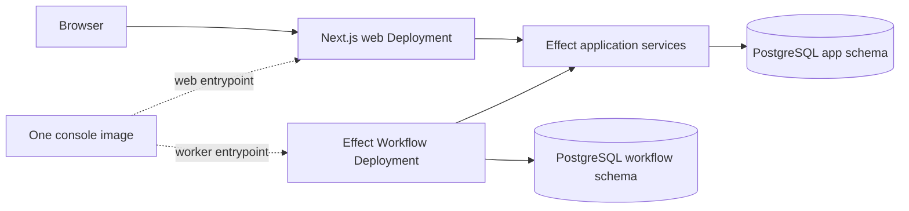

# Symphony Platform Console - Effect 4 Platform Supplement

> **Deferred reference supplement.** This records the selected console posture
> for a possible future implementation. The pins and validation evidence are
> historical and must be refreshed before use.

## Purpose and Authority

This document fixes the selected Effect 4 implementation posture for the Symphony Platform console and supersedes the server-platform choices in `symphony-platform-console-implementation.md`. The Product Contract and the Symphony and Flux ownership boundaries in `symphony-platform-implementation-plan.md` remain authoritative.

Effect Schema, Effect SQL, Effect Workflow, and the Effect application-service model are selected. The disposable validation described below is a blocking pre-U1 feasibility gate for the exact selected composition, not a comparison or partial-adoption exercise. It proves that the selected mechanisms compose under representative production boundaries before permanent scaffolding begins; it cannot prove product integrations that do not exist until later implementation units. Beta dependencies are permitted when pinned and proven by the complete feasibility gate. A failed or inconclusive load-bearing feasibility result stops implementation and returns the stack to planning; it does not silently restore Kysely, remove Effect Workflow, or assemble an untested hybrid. Product-specific identity, provider, controller, packaging, console, release, and hosted-workflow acceptance remains blocking in its owning U2-U16 unit.

This selected supplement cannot move Symphony-owned polling, claims, retries, workspaces, tracker normalization, Codex sessions, or run state into the console. It cannot give the console Kubernetes credentials or move Kubernetes write authority from Flux into the console or the reusable source controller. It does not change the single private desired-state operation, ExternalArtifact topology, product-release OCI contract, or Symphony image ownership.

## Selected Decision Capsule

- `apps/console` remains ordinary Next.js App Router code: React UI, Server Components, Server Actions, Better Auth integration, Route Handlers at established protocol boundaries, and thin server-only adapters into application services.
- `packages/backend` becomes the server-only Effect 4 package for domain and application services, Effect Schema models and codecs, Effect SQL repositories and transactions, Effect Workflow definitions and activities, and managed web and worker runtimes.
- `packages/contracts` remains the external-contract package. It owns the authoritative Effect Schema and HttpApi desired-state definition and reproducibly generated OpenAPI 3.1 controller artifact, not persistence models or internal domain types.
- Effect SQL is the product-owned database-access layer. Better Auth may retain its pinned internal Kysely-backed PostgreSQL adapter inside the authentication boundary; that dependency is not a second product persistence authority.
- Effect Workflow is the durable console workflow engine. Its first required product consumer is hosted export and per-data-class deletion orchestration, including retries and deletion receipts. No workflow may take over Symphony scheduling or Flux reconciliation.
- Atlas-managed PostgreSQL DDL remains the sole relational and production migration authority for console-owned schemas. Effect Workflow is a deliberately isolated exception: Workflow retains runtime DDL authority only for its own `workflow` schema under a dedicated role. Atlas provisions that schema and grants but does not define or migrate Workflow's internal tables.
- Exact beta versions are allowed when pinned and when the complete representative composition passes the pre-U1 feasibility gate. Product security, portability, upgrade, rollback, and deletion acceptance remains mandatory in the owning implementation units.
- Connections are non-secret application objects. Effect services own their metadata and lifecycle, a replaceable write-only adapter owns manual credential creation and versioning, provider Route Handlers own GitHub and Linear OAuth exchanges, and exact pinned stock Codex owns managed ChatGPT token exchange, storage, refresh, and logout. No runtime model or convenience API may collapse those authorities.

This is a platform substitution inside the console boundary, not a product or control-plane redesign.

## Runtime and Package Boundaries

### `apps/console`

The console remains recognizable Next.js code:

- React UI and Client Components contain no Effect imports, Effect services, Effects, Layers, or managed runtimes.
- Server Components call thin server-only adapters that resolve request context and run application services.
- Server Actions remain explicit, hand-authored domain commands. Every action validates its input and independently derives tenant, role, installation, and authorization from the Better Auth server session.
- Admin-only Connection actions cover create, manual write-once submission, reauthorization, rotation, kind or scope change, disconnect, and revocation. Secret-bearing inputs are one-call values that cannot enter action results, persisted form state, caches, outboxes, workflows, logs, traces, errors, exports, or backups.
- Better Auth retains its required Route Handler.
- OAuth callbacks and provider or Stripe webhooks remain narrow provider-protocol Route Handlers.
- The single cluster-private `GET /internal/v1/installations/{installationId}/desired-state` Route Handler remains the only product-owned machine API at launch.
- No general public API, generic model CRUD actions, browser-side HTTP data layer, or database-generated action surface is introduced.

Server-only adapters translate framework inputs into Effect application-service calls and translate typed failures into Next.js results. They do not contain domain rules or persistence logic. Package exports and `server-only` guards must make accidental Client Component imports fail during development and build.

### `packages/backend`

The selected server-only workspace owns:

- Domain services and application use cases.
- Connection metadata, optimistic lifecycle transitions, idempotency records, monotonic revocation fences, non-secret observations, and replaceable credential-writer and runtime-projection ports with no read/list/export method.
- Effect Schema models, codecs, action-input schemas, workflow payloads, and repository boundary models.
- Effect SQL repositories, parameterized SQL, transactions, locking, and PostgreSQL adapters.
- Effect Workflow definitions, activities, retry policies, compatibility rules, and worker runtime.
- Managed runtime construction for the web and workflow processes.
- Context services for actor, tenant, installation, tracing, database connection, and transaction scope.

The package must not expose Effect runtime objects to Client Components. It must not own HTTP route selection, React rendering, Kubernetes resources, Flux reconciliation, Symphony work orchestration, or public wire contracts.

### `packages/contracts`

The contracts workspace continues to own the one external wire contract only:

- The authoritative Effect Schema models, HttpApi endpoint, authentication middleware, declared errors and responses, route metadata, and projection extension metadata for desired state.
- Deterministically generated OpenAPI 3.1 for the language-neutral reusable-controller boundary.
- TypeScript declarations inferred from the authoritative Effect schemas without generated duplicate source.
- Shared conformance fixtures for the console and reusable controller.
- Contract validation and generation-drift tests.

It does not own SQL DDL, database row models, repository internals, Server Action inputs, workflow persistence tables, provider-owned protocols, or authorization policy. TypeSpec and `openapi-typescript` are absent from the selected stack.

## Canonical Repository Shape

```text
apps/
└── console/
    ├── db/
    │   ├── atlas.hcl
    │   ├── schema.sql
    │   └── migrations/
    ├── src/
    │   ├── app/
    │   ├── adapters/
    │   │   ├── actions/
    │   │   ├── auth/
    │   │   └── http/
    │   ├── runtime/
    │   │   ├── web.ts
    │   │   └── workflow-worker.ts
    │   └── instrumentation.ts
    ├── tests/
    ├── Dockerfile
    └── package.json

packages/
├── backend/
│   ├── src/
│   │   ├── domain/
│   │   ├── application/
│   │   ├── persistence/
│   │   ├── workflows/
│   │   └── runtime/
│   ├── tests/
│   └── package.json
└── contracts/
    ├── src/
    │   └── desired-state/
    ├── openapi/
    │   └── desired-state.openapi.yaml  # generated and committed
    ├── scripts/
    ├── tests/
    └── package.json
```

Both `packages/backend` and `packages/contracts` are real Turbo workspaces. Database files remain colocated with the console because the console product boundary owns the database contract. Shared integration fixtures remain under root `tests/fixtures`.

## Schema and Migration Authority

### Runtime schemas and database DDL have different meanings

Effect Schema does not define PostgreSQL DDL.

Effect Schema is authoritative for runtime data shapes and transformations:

- Domain and application values.
- Runtime codecs and validation.
- Server Action inputs and results.
- Workflow inputs, outputs, activity payloads, and versioned compatibility envelopes.
- Repository row, insert, update, and JSON boundary models.
- External wire bindings defined by the authoritative desired-state HttpApi and Effect schemas.

Atlas-managed PostgreSQL DDL is authoritative for physical and relational database behavior:

- Schemas, tables, columns, and PostgreSQL data types.
- Primary, unique, check, exclusion, and foreign-key constraints.
- Indexes, generated values, sequences, and identities.
- Row-level security, grants, functions, triggers, and extensions.
- Defaults enforced by the database and every other physical database property.

Effect models may eliminate duplicated hand-authored TypeScript row, insert, update, and JSON types. They do not erase the DDL/runtime boundary, replace catalog conformance tests, or make runtime schemas the source of physical database truth. An Effect-Schema-to-DDL compiler is explicitly outside launch scope.

### Logical PostgreSQL ownership

The selected database uses qualified logical ownership boundaries:

| PostgreSQL schema | Owner | Contents |
|---|---|---|
| `app` | Symphony console | Organizations, installations, lanes, accepted revisions, non-secret Connection metadata and revocation fences, outbox records, usage, and other product state |
| `auth` | Better Auth contract, provisioned by Atlas | Better Auth tables, constraints, and indexes required by the pinned configuration |
| `workflow` | Effect Workflow contract, isolated by Atlas | Durable workflow engine state and migrations required by the pinned Effect Workflow version |

Atlas owns the database platform and the `app` and `auth` schemas. It creates the isolated `workflow` schema, its owner role, and narrowly scoped grants, but Effect Workflow owns the tables, indexes, migration bookkeeping, and runtime DDL within that schema. This is a conscious dual-authority boundary, not an Atlas desired-schema input.

Better Auth migration commands may run only against disposable validation databases to reveal their expected catalog. CI captures and normalizes that catalog, compares it with the Atlas desired state, and fails on drift; Better Auth migration paths are excluded from release images, startup commands, deployed workloads, and production CI execution.

Effect Workflow initialization runs in the dedicated worker process with a separate `workflow` runtime role that has DDL only in the `workflow` schema. Atlas pre-provisions the schema and grants, but Workflow creates and upgrades its own internal objects. Pin the exact Workflow version, test fresh initialization and upgrades against a disposable database, and prove that its role cannot create, alter, or drop objects in `app`, `auth`, `public`, or any other schema. Atlas must never rewrite, drop, or infer Workflow's internal tables.

At minimum, deployment uses separate roles and external identities:

- An Atlas migration role with the scoped DDL privileges needed by the committed migration job.
- A web runtime role with only the required DML and sequence privileges.
- A workflow runtime role that has DML and the narrowly scoped DDL privileges required only inside `workflow`.
- Optional read-only verification roles for catalog and drift checks.
- An installation-scoped credential-writer identity with create/version/promote/revoke/status authority and no value-read, list, export, or runtime-mount authority.
- Trusted runtime identities that may consume only the active credential projection for their provider role.

The web runtime role receives no `CREATE`, `ALTER`, `DROP`, schema-owner, extension-owner, or database-owner authority. The workflow runtime role is the sole exception: its schema owner and DDL grants are restricted to `workflow`; it receives no authority in `app`, `auth`, `public`, extensions, or the database. A dependency requiring runtime DDL outside its dedicated internal schema stops implementation.

The hosted database topology must be decided before application DDL is accepted. If hosted tenants share `app` tables, tenant-owned tables use forced PostgreSQL row-level security, non-owner runtime roles without `BYPASSRLS`, transaction-local validated tenant or installation context, and connection-pool reset tests. A database-per-installation topology may replace row-level security only when the release and acceptance contracts explicitly prove the stronger physical boundary. Direct SQL without a tenant predicate, pooled-connection reuse, cross-tenant transactions, and role escalation are negative tests in either topology.

## Effect SQL Implementation Gate

Effect SQL replaces Kysely and `kysely-codegen` for product-owned repositories. The disposable validation must prove all of the following for the selected implementation:

- Representative CRUD and joined queries remain direct and reviewable.
- Parameterization is safe and visible.
- PostgreSQL JSONB, nullable values, UUIDs, timestamps, generated/defaulted columns, locking, `FOR UPDATE`, and tenant-scoped predicates are supported cleanly.
- Multi-statement transactions express application invariants without hidden transaction boundaries.
- Repository calls use the correct request or activity transaction and connection.
- Actor, tenant, installation, tracing, transaction, and connection context cannot leak across concurrent fibers, requests, or activities.
- Catalog drift between Atlas DDL and Effect repository models is detected reproducibly.
- Raw parameterized SQL remains available when a higher-level abstraction would obscure PostgreSQL behavior.

The gate does not build or score a parallel Kysely implementation. Failure to express the required workload safely stops implementation and returns the selected stack to planning.

## Effect Workflow Runtime

Effect Workflow is the selected durable console workflow engine. It runs from the same console image but through a distinct worker entrypoint and Kubernetes Deployment:



The web and worker processes share `packages/backend`, contracts, observability configuration, and the image digest, but have distinct commands, service accounts, database roles, resource limits, health checks, scaling policies, and failure domains. Secrets, environment variables, workload identities, and NetworkPolicies are mounted per Deployment. Executing the alternate entrypoint inside either Pod must not obtain the other runtime's database role, session secrets, provider credentials, or network access. Atlas migration credentials exist only in the pre-upgrade migration Job.

Next.js `after()` and Vercel `waitUntil()` are never durable-execution authorities. `after()` may be used only after durable state has committed, for a best-effort wakeup or ancillary work whose loss does not affect correctness. A request lifetime extension is not required for workflow enrollment, execution, recovery, or retries.

Activities that cause external effects require stable idempotency keys, persisted attempt/outcome evidence, and explicit retry classification. Workflow payloads require versioned envelopes plus an upgrade policy proving how in-flight workflows survive deploys, rollbacks, and schema changes.

### No-lost-work rule

Accepting application state and arranging its required durable workflow cannot rely on two unrecoverable commits.

The preferred mechanism is transactional workflow enrollment, but only if validation proves Effect Workflow can enroll through the caller's existing PostgreSQL transaction and does not silently commit through another connection.

Otherwise the console must use a transactional outbox:

1. The application transaction writes the accepted revision and a uniquely keyed `app.workflow_outbox` record together.
2. The transaction commits once.
3. The workflow worker claims pending records safely and starts each workflow using a stable idempotency key derived from the accepted revision and workflow purpose.
4. It records enrollment only after the durable workflow store acknowledges the start.
5. If the worker crashes after starting but before acknowledging, retrying the same key converges without creating a second logical workflow.
6. Wakeup hints may reduce latency, but polling and durable outbox state guarantee recovery.

Direct `commit application state; then start workflow` sequencing without a durable recovery record is forbidden.

### Workflow authority, retention, rollback, and reversal

Every workflow and outbox row is created server-side and bound by foreign keys or equivalent immutable constraints to its tenant, installation, accepted revision, and workflow purpose. Activities rehydrate authority from committed application state and validate a tenant-bound system capability before each external effect. Client-supplied actor, tenant, or installation context cannot grant authority. The product decision for each workflow states whether accepted work continues or stops when its initiating actor loses membership.

Workflow payloads and activity results are a named hosted data class. They cannot contain reusable credentials, source bodies, browser sessions, or unnecessary provider payloads. Export, retention, cancellation, tenant-scoped purge or tombstone behavior, deletion receipts, backup exclusion or inclusion, and restore non-resurrection are specified and tested for `app.workflow_outbox` and the dependency-owned `workflow` schema.

Upgrade validation starts concurrent workers, interrupts an internal Workflow migration, upgrades with in-flight work, and then rolls the complete image back to the prior pinned Workflow version without restoring PostgreSQL. Accepted work must converge without duplicated external effects. A post-adoption reversal freezes enrollment, runs the last known-good worker, drains or explicitly terminates in-flight work, reconciles every outbox row, records terminal evidence, and removes the worker and schema only after a zero-pending-state gate passes.

## Connection Administration and Credential Custody

The console presents one organization-level Connections area. A Connection records provider, explicit authentication kind, external account and workspace or installation identity, approved scopes, lifecycle status, active opaque version reference, validation and rotation timestamps, dependent lanes, normalized health, and audit history. It does not contain a key, token, authorization header, device code, browser cookie, `auth.json`, or provider response body.

Only an Admin may create, reauthorize, rotate, change kind or scope, disconnect, or revoke a Connection. Members can see the normalized status needed to understand a lane and the role that must remediate it. Time-bound hosted support sees only support-approved non-secret status. Coding agents receive provider capabilities and normalized failures through the trusted orchestrator or broker, never Connection inventory or management operations.

### Manual API keys and access tokens

One TLS Server Action accepts the secret field, authenticates and authorizes the current Admin, validates provider and kind metadata, then passes the value directly to an installation-bound write-only credential-store port. The port returns only an opaque immutable version reference and receipt. Application code has no method or permission to retrieve, list, display, replay, export, back up, or mount that value. The submitted field is cleared after the response and cannot be included in validation errors, React state returned to the browser, request-body telemetry, SQL, Workflow, desired-state output, or audit details.

An OpenAI API key uses stock Codex's documented API-key login shape after the candidate projection reaches the trusted orchestrator. A Business or Enterprise Codex access token uses the documented stock-Codex personal-access-token path and represents the creating user and workspace; it is not modeled as an additional app-server login method.

### GitHub and Linear OAuth

GitHub and Linear authorization remain provider protocols implemented by narrow Route Handlers. Each ceremony binds state, PKCE where supported, issuer, exact redirect URI, current Admin session, organization, Connection, requested scope, and idempotency key. The callback exchanges directly into the selected custody adapter and retains only opaque references plus non-secret account, workspace, installation, repository, scope, expiry, and validation metadata. GitHub tokens are opaque. Linear refresh and revocation behavior is pinned to the selected provider contract and revalidated on integration upgrades.

### Stock-Codex-managed ChatGPT authorization

When U2 enables it, the model Connection offers stock-Codex `chatgpt` browser OAuth and `chatgptDeviceCode`; device code is the preferred hosted-Pod ceremony because it does not depend on a loopback browser callback reaching the Pod. The console calls an authenticated, installation-bound app-server control channel to start, cancel, inspect, or log out. Stock Codex alone exchanges, stores, refreshes, and deletes the resulting tokens in an encrypted orchestrator-only auth store. The console persists only an opaque ceremony identifier, expiry, terminal state, and resulting non-secret account/workspace identity.

The device-code UI shows the exact OpenAI verification host, one-time user code, expiry, progress, and cancel action, and warns the user not to share the code. Polling honors the server interval, `slow_down`, expiry, access denial, cancellation, replay, and duplicate completion semantics. Refresh, navigation, or process restart resumes from non-secret ceremony state. `chatgptAuthTokens`, imported browser cookies, and imported `auth.json` are forbidden because they bypass stock Codex's ownership of token lifecycle. Codex credential storage is configured explicitly; automatic plaintext fallback and unredacted `codex-login.log` are release failures.

Account metadata such as `planType` and rate-limit observations may inform the UI but cannot prove workspace eligibility, seat, role, permission, commercial-use rights, or a universal billing limit. U2 enables a mode only after a real pinned-version run and an acceptable hosted-use contract pass.

### Activation, rotation, revocation, and rollback

Activation is a staged saga: reserve inactive metadata and an idempotency key; create an immutable credential version or complete stock-Codex authorization; validate through the owning trusted consumer; compare-and-swap the active reference; then retire the prior version and collect unreachable versions. The design does not claim a cross-PostgreSQL-and-secret-store transaction.

Rotation validates the replacement before promotion and never falls back to the old version, another account, or another kind. A cleanup failure is an auditable non-secret remediation item, not permission to reactivate the previous version. Trusted consumers must demonstrate that promotion causes a reload or remount without exposing the value to the console or worker.

Revocation first commits a monotonic local denial fence that blocks new lane acceptance, leases, refresh, stock-Codex auth operations, and provider calls. Remote provider revocation or stock-Codex logout follows idempotently; provider uncertainty is reported rather than treated as proof of remote deletion. Disconnect lists dependent lanes and normally requires pause or reassignment. Forced disconnect makes those lanes `action-required`.

Desired-state rollback changes configuration only. Every trusted use resolves current Connection status and the revocation fence, so an old revision cannot resurrect a retired, revoked, disconnected, identity-changed, or scope-invalid credential. Backup and restore replay metadata and fences before enabling work, classify stock-Codex auth storage separately, and prove deleted material is not resurrected.

## Private HTTP Contract

Browser-to-console interactions continue to use Server Components and Server Actions. The selected platform does not introduce a general browser API.

The Effect HttpApi definition in `packages/contracts` is the sole authority for the cluster-private desired-state projection operation:

`GET /internal/v1/installations/{installationId}/desired-state`

The operation remains complete, unpaginated, installation-authenticated, limited to 2,048 lanes and 8 MiB of canonical serialized bytes, conditionally retrievable by canonical-digest `ETag`, and excluded from public ingress. Each bound is enforced independently. It continues to return projection-ready child Flux Kustomizations without secrets or Symphony runtime state.

The authoritative module defines the endpoint path and method, installation path parameter, `If-None-Match` request header, 200 body and `ETag` header, 304 response, typed error responses, response bounds, authentication middleware, and the lane projection schema. It co-locates official Effect OpenAPI override or transform metadata that adds `x-kubeprojection-resource` to the generated lane component and the response-bound extension to the operation. Generation uses the exact pinned Effect `OpenApi.fromApi` path, produces OpenAPI 3.1 deterministically and without warnings, and fails if the named component or required extension is absent. The generated document is committed for external-controller review and clean-clone use, checked for drift, and never edited directly.

The single Next.js Route Handler is a thin framework adapter over a handler assembled from the authoritative HttpApi. Mandatory controller workload authentication runs as HttpApi middleware before application execution, rejects browser-session credentials, derives the authorized installation from verified workload identity, and returns a declared authentication or authorization error for a path-to-identity mismatch. The adapter cannot restate or override route, request, response, error, authentication, or validation semantics, export an unguarded route, or accept client-supplied tenant authority. No generated general HTTP client or public server layer is required at launch.

TypeSpec, `openapi-typescript`, and reverse OpenAPI-to-Effect generation are absent from the selected stack.

## Console State and Information Architecture

The launch console has a fixed hierarchy:

1. Organization landing page with role-aware lane inventory and installation health.
2. Organization Connections inventory and detail, followed by staged lane onboarding with resumable provider-reference, repository, tracker, and validation steps.
3. Accepted-revision review showing the complete proposed installation change before acceptance.
4. Lane deployment detail showing product-owned desired state, source, artifact, root, and child reconciliation evidence.
5. Role-appropriate remediation controls for retry, provider repair, binding-drift repair guidance, and revision rollback.
6. A clearly separate tenant- and lane-authorized link to Symphony's runtime dashboard; the console never labels Symphony run state as product deployment state.

Lane onboarding is an explicit persisted draft flow: organization context, active Linear Connection and project, source repository and verified PR-origin fork, active model Connection selection, immutable repository revision and workflow validation, then complete installation-diff review and acceptance. Credential entry and OAuth consent occur in the separate Admin-only Connection ceremony; the lane draft stores only Connection IDs and non-secret validation evidence. Each successfully validated stage is saved server-side. Back, exit, and resume preserve completed non-secret fields; loading and failure stay attached to the owning stage. If the accepted installation revision or a selected Connection version changes while a draft is open, submission fails stale, shows the intervening complete diff, preserves the draft, and requires an explicit rebase-and-resubmit before acceptance.

The derived deployment model preserves raw source and Flux observations and evaluates the following precedence from highest to lowest: a current authentication, binding, source, artifact, root, or child failure is `action-required`; complete current-revision convergence is `applied`; active or incomplete root/child convergence is `reconciling`; a matching artifact not yet observed by root is `artifact-ready`; a source-observed revision without a matching artifact is `source-syncing`; otherwise the committed database revision is `accepted`. A stale observation retains its raw value and timestamp but cannot establish `applied`; after the published observation timeout it becomes `action-required`. Server Component navigation and manual refresh retrieve current observations at launch; no browser polling API is implied.

| Console state | Authoritative condition | Semantics and user guidance |
|---|---|---|
| `accepted` | Database revision committed; source has not observed its digest | Progress state. Wait; Admin may inspect the accepted diff or select another revision. |
| `source-syncing` | Source observed the revision but no matching ready artifact exists | Progress state. Wait; after timeout, show source evidence and the source-access retry owned by the source boundary. |
| `artifact-ready` | Matching artifact is ready; root has not observed its digest | Progress state. Wait; expose artifact evidence and refresh, but make no lane-success claim. |
| `reconciling` | Root or any expected child is progressing or has not reached the expected revision | Progress state. Show the owning root or child, current conditions, refresh, and any safe Flux retry available to the operator. |
| `applied` | Source, artifact, root, and every expected child report the accepted revision ready within the observation window | Converged deployment state. Offer no repair action; link separately to Symphony runtime status. |
| `action-required` | Current authentication, source, artifact, binding, root, child, or stale-observation failure blocks convergence | Blocking state with highest precedence. Show the owning boundary, raw condition and age, role-appropriate repair, refresh, and lane-only or installation rollback where authorized. |

Any regression from `applied` is recomputed from current observations. Members may view evidence and guidance but cannot invoke Admin-only mutations. Missing or altered static bindings always become `action-required`; the console provides hosted reconciliation or signed-base reapplication guidance and never writes Kubernetes itself.

| Role | Visible surfaces | Mutating and remediation authority |
|---|---|---|
| Admin | All organization, Connection, lane, accepted-revision, deployment-evidence, commercial, and authorized Symphony-link surfaces | Create, authorize, reauthorize, rotate, change scope or kind, disconnect, and revoke Connections; create and rebase lane drafts; accept revisions; pause, resume, remove, and roll back a lane; manage hosted subscription controls. Binding repair remains operator-owned. |
| Member | Organization and lane inventory, lane-relevant normalized Connection status, deployment evidence and guidance, and the authorized Symphony runtime link | Read-only in the console. Credential and other Admin-only actions are absent and the page names the required escalation role. |
| Infrastructure operator | Installation health, binding and Flux evidence, release and migration state, backup/restore, and runbook links | Bootstrap or reapply the signed base, repair installation drift, upgrade or roll back the product release, and run backup/restore. Cannot accept tenant lane revisions or change billing. |
| Hosted support | Time-bound audited view of support-approved organization, installation, and deployment evidence | May execute only the same hosted installation-repair actions granted by the support elevation. Cannot accept lane revisions, access reusable credentials or routine source, or change billing without separate Admin action. |

## Foundation Feasibility Gates and Later Acceptance Ownership

U1 requires executable, bounded evidence for the exact selected composition in every row below. The original pre-U1 receipt closed the base platform rows. KTD17's later contract-direction change reopens only the HttpApi and OpenAPI row, which must pass before the U1 contract migration is complete. These rows validate mechanisms and compatibility using representative disposable topology; they do not substitute for later product acceptance.

| Area | Required evidence | Stop condition |
|---|---|---|
| Effect Schema | Representative database, domain, action, workflow, and external JSON shapes without unsafe casts | Required shapes need pervasive casts or duplicate model authorities |
| Effect SQL | Reviewable PostgreSQL CRUD, joins, transactions, locks, tenant isolation, and context isolation | The required workload cannot be expressed safely and directly |
| Next.js | Server Action authenticates with Better Auth and invokes a managed Effect service; Client Components remain Effect-free | Correctness requires Effect in the client or request-lifetime extensions |
| Better Auth | Starts and operates against Atlas-created `auth` schema with no runtime DDL privilege | Unavoidable migration or runtime DDL |
| Effect Workflow | Atlas-created `workflow` schema and grants, runtime DDL confined to that schema, durable retry/restart behavior, idempotent effects, payload evolution | DDL reaches another schema or durability/upgrade behavior is unproven |
| Atlas | Product-schema migration authority plus platform provisioning of the isolated Workflow schema and grants | Dependency database ownership cannot be isolated and audited |
| Dual write | Shared transaction or demonstrated transactional outbox under crash injection | Accepted state can exist permanently without recoverable workflow enrollment |
| HttpApi and OpenAPI | The exact pinned Effect HttpApi executes the required method, path, authentication, headers, 200/304 and error responses while `OpenApi.fromApi` produces deterministic, warning-free OpenAPI 3.1 with the required projection and bound extensions | Runtime and generated contracts diverge, the official generator cannot express the contract, or generation requires an independently edited patch |
| Context | Concurrent request/activity isolation for actor, tenant, transaction, connection, and tracing | Cross-request, cross-tenant, or cross-activity leakage |
| Packaging | One image, independent web and worker entrypoints, identities, secrets, network policy, and scaling | Either entrypoint can obtain the other runtime's authority or requires request-lifetime coupling |
| Browser security mechanism | A compiled Server Action uses real Better Auth sessions, secure cookie mechanics, stored authorization, stale-membership and revocation checks, and trusted-origin/CSRF rejection | Cross-origin execution or stale, revoked, missing, or cross-tenant session authority reaches the Effect service |
| Private API authorization seam | The HttpApi middleware cryptographically verifies an installation-scoped fixture identity before application execution and the thin Next Route Handler preserves the declared method, path, statuses, headers, body, and errors | Browser credentials, invalid identity, or cross-installation retrieval reaches application execution, or the Next bridge can change contract semantics; U2 selects and proves the production workload-identity provider |
| Portability mechanism | The same representative artifact topology starts without a hosted callback, survives OCI export/import, initializes and restores isolated schemas and PVC data, rolls code forward and back, and uninstalls bounded resources | The selected worker or schema intrinsically requires a hosted callback or different build |
| Retention and deletion mechanism | Tenant-scoped tombstone, intent, purge, receipt, retry, and restore non-resurrection are demonstrated for representative outbox and Workflow storage | Workflow storage cannot be cleared through a bounded compatibility adapter or deleted state reappears after restore |
| Telemetry mechanism | Representative application canaries and a real OTel Collector transform prove bounded redaction before export | The selected application or Collector mechanism cannot redact a canary; U11A, enabled U11B modes, and U16 prove every product sink and failure surface end to end |

Beta status is not a stop condition by itself. Any actual feasibility stop condition returns the complete selected stack to planning; no partial-adoption or alternative-stack comparison runs inside this gate.

Later product integration remains fail-closed in the unit that owns it:

- U2 proves real workload identity, private/public ingress, every selected model-authentication kind on the exact pinned Codex version, provider OAuth and device-code state, PKCE, issuer, redirect, polling, eligibility, credential-store write-without-read authority, runtime projection reload, and external-component trust.
- U3 proves controller consumption of the exact contract, digest agreement, conditions, and production RBAC.
- U4 proves the production package, Flux feature gate, storage and artifact-server choices, and disconnected source topology.
- U11A proves the required API-key SQL-backed deterministic projection, Connection and lane interactions, authorization and state models, manual credential non-retention, private-route ingress, and product telemetry. U11B extends those same contracts only for optional Business/Enterprise access-token and managed-ChatGPT modes that passed U2.
- U12 proves the same signed product release in self-hosted, hosted, and disconnected acceptance environments.
- U15 implements and proves the first product export and deletion Workflow.
- U16 reruns the complete security, portability, scale, rollback, deletion, and telemetry contract against release artifacts.

## Required Validation Evidence

The disposable validation task must record:

- Exact versions, source references, installation commands, and test commands.
- Pass, fail, or inconclusive status for every requested validation.
- The minimal topology actually exercised.
- Database DDL, roles, grants, expected schemas, drift results, and startup behavior.
- The selected shared-table or per-installation tenant-isolation topology and its hostile direct-SQL and pooled-connection results.
- Crash, retry, PostgreSQL interruption, restart, duplicate-effect, upgrade, migration-interruption, image-rollback, and post-adoption reversal results.
- Whether transactional enrollment is real; otherwise the complete outbox proof.
- Deterministic HttpApi-to-OpenAPI output, extension checks, drift result, and warnings.
- Cryptographically authenticated fixture-identity tests for HttpApi middleware and the thin Next Route Handler, including browser-credential and path-to-identity denial plus method, path, status, header, error, and response parity with generated OpenAPI; production workload identity remains U2.
- Concurrency and context-isolation results.
- Compiled browser-session, trusted-origin/CSRF, secure-cookie, stored-authorization, stale-membership, and revocation tests; provider OAuth state, PKCE, and redirect handling remain U2.
- Exact pinned stock-Codex schema and runtime receipts for API-key login, managed browser OAuth, device-code OAuth, the separate personal-access-token path, encrypted credential storage, logout, containment, and explicit rejection of internal or imported token forms.
- Credential-writer policy and hostile-call evidence showing create/version/promote/revoke/status without value read/list/export, plus staged activation, optimistic concurrency, runtime reload, revocation-fence ordering, cleanup remediation, and rollback non-resurrection.
- Representative application-canary and real OTel Collector redaction results; complete callback, SQL, workflow, failure, trace, and crash sink coverage remains U11A, enabled U11B modes, and U16.
- Representative disconnected artifact import, backup, restore, deletion, receipt, rollback, and bounded uninstall results for the web and workflow topology; full operating-model acceptance remains U12.
- Documented guarantees separately from behavior observed only in the spike.
- Operational and upgrade risks, required deviations, and a final pass, blocked, or return-to-planning result for the selected stack.
- Precise follow-up edits proposed for the canonical Symphony documents.

All scratch source, databases, generated files, logs, and evidence remain under `/private/tmp`. The validation task cannot modify Symphony source, tracked repository files, this supplement, or the canonical planning documents.

## Implementation Entry Procedure

1. Treat the full Effect platform in this document as the selected composition; do not build comparative Kysely or partial-adoption candidates.
2. Preserve the completed base-composition receipt and add the focused KTD17 HttpApi-to-OpenAPI receipt; do not rerun unrelated stack comparisons.
3. Review every failed or inconclusive feasibility gate. A load-bearing mechanism failure blocks implementation and returns to planning; product-integration residuals remain assigned to and blocking in their owning units.
4. Record exact dependency pins, database topology, authoritative HttpApi and OpenAPI-generation tooling, Workflow topology, and migration compatibility.
5. Update every affected implementation unit, file list, task, test, and completion condition before console scaffolding begins.
6. Remove superseded direct Kysely product dependencies, `kysely-codegen`, `openapi-typescript`, reverse OpenAPI-to-Effect generation, and no-workflow assumptions atomically. Retain only Better Auth's pinned internal Kysely-backed adapter inside the authentication boundary.

## Definition of Ready for Implementation

- Runtime-schema sharing and PostgreSQL DDL authority are explicitly distinct in evidence and implementation.
- Atlas is the only production DDL executor for `app` and `auth`; it provisions the `workflow` schema and grants.
- Better Auth operates with no runtime DDL authority. Effect Workflow's runtime DDL is restricted to its isolated `workflow` schema and dedicated role.
- Effect SQL expresses the representative product workload safely and directly; no parallel Kysely comparison is required.
- Effect Workflow durability, retries, idempotency, schema ownership, and payload evolution pass.
- A representative tombstone, purge, and per-data-class receipt workflow proves the required Effect Workflow seams without assuming Symphony or Flux authority; U15 implements the product workflow.
- Application acceptance cannot lose required durable workflow enrollment.
- `after()` and `waitUntil()` are proven non-authoritative optimizations.
- The private desired-state Effect HttpApi executes the current wire contract and generates byte-stable OpenAPI 3.1 without warnings, including required projection and bound extensions.
- The thin private Next Route Handler preserves HttpApi authentication, validation, path, method, status, header, error, and response semantics and denies browser and cross-installation access.
- Connection metadata and credential material have separate schemas, ports, roles, stores, backup classifications, and tests; no console database table or ordinary application method can contain or retrieve a reusable credential.
- Stock Codex remains the sole owner of managed ChatGPT exchange, storage, refresh, and logout, while the console exposes only an authenticated non-secret control and status ceremony.
- Client Components have no Effect dependency.
- The web and workflow processes use one image but remain independently operable, isolated, and scalable even when the alternate entrypoint is invoked.
- Representative tenant isolation, browser-session integrity, telemetry redaction, workflow authorization, portability, rollback, reversal, deletion, and restore non-resurrection mechanisms pass; later product acceptance remains unit-owned.
- The complete selected composition is proven mutually compatible under the bounded topology; partial-adoption variants are not evaluated.

## References

- `symphony-platform-console-implementation.md`
- `symphony-platform-implementation-plan.md`
- [Effect documentation](https://effect.website/docs/)
- [Effect SQL](https://effect.website/docs/sql/introduction/)
- [Effect Workflow](https://effect.website/docs/workflow/introduction/)
- [Effect OpenApi source](https://github.com/Effect-TS/effect/blob/main/packages/effect/src/unstable/httpapi/OpenApi.ts)
- [Next.js App Router](https://nextjs.org/docs/app)
- [Better Auth](https://www.better-auth.com/docs)
- [Codex authentication](https://developers.openai.com/codex/auth)
- [Codex app-server authentication](https://learn.chatgpt.com/docs/app-server#auth-endpoints)
- [Codex access tokens](https://learn.chatgpt.com/docs/enterprise/access-tokens)
- [OAuth 2.0 Device Authorization Grant](https://www.rfc-editor.org/rfc/rfc8628)
- [OAuth 2.0 Security Best Current Practice](https://www.rfc-editor.org/rfc/rfc9700)
- [Atlas versioned migrations](https://atlasgo.io/concepts/declarative-vs-versioned)
- [OpenAPI Specification 3.1](https://spec.openapis.org/oas/v3.1.0)
