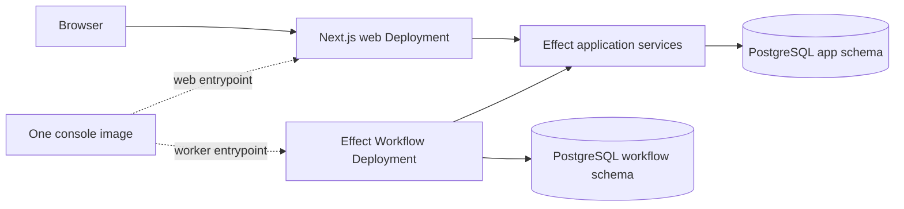

# Symphony Platform Console - Effect 4 Platform Supplement

## Purpose and Authority

This document fixes the selected Effect 4 implementation posture for the Symphony Platform console and supersedes the server-platform choices in `symphony-platform-console-implementation.md`. The Product Contract and the Symphony and Flux ownership boundaries in `symphony-platform-implementation-plan.md` remain authoritative.

Effect Schema, Effect SQL, Effect Workflow, and the Effect application-service model are selected. The disposable validation described below is a blocking implementation gate for the exact selected composition, not a comparison or partial-adoption exercise. Beta dependencies are permitted when pinned and proven by the complete gate. A failed or inconclusive load-bearing gate stops implementation and returns the stack to planning; it does not silently restore Kysely, remove Effect Workflow, or assemble an untested hybrid.

This selected supplement cannot move Symphony-owned polling, claims, retries, workspaces, tracker normalization, Codex sessions, or run state into the console. It cannot give the console Kubernetes credentials or move Kubernetes write authority from Flux into the console or the reusable source controller. It does not change the single private desired-state operation, ExternalArtifact topology, product-release OCI contract, or Symphony image ownership.

## Selected Decision Capsule

- `apps/console` remains ordinary Next.js App Router code: React UI, Server Components, Server Actions, Better Auth integration, Route Handlers at established protocol boundaries, and thin server-only adapters into application services.
- `packages/backend` becomes the server-only Effect 4 package for domain and application services, Effect Schema models and codecs, Effect SQL repositories and transactions, Effect Workflow definitions and activities, and managed web and worker runtimes.
- `packages/contracts` remains the language-neutral external-contract package. It owns the authored OpenAPI 3.1 desired-state contract and reproducibly generated Effect-facing wire contracts, not persistence models or internal domain types.
- Effect SQL is the product-owned database-access layer. Better Auth may retain its pinned internal Kysely-backed PostgreSQL adapter inside the authentication boundary; that dependency is not a second product persistence authority.
- Effect Workflow is the durable console workflow engine. Its first required product consumer is hosted export and per-data-class deletion orchestration, including retries and deletion receipts. No workflow may take over Symphony scheduling or Flux reconciliation.
- Atlas-managed PostgreSQL DDL remains the sole relational and production migration authority for console-owned schemas. Effect Workflow is a deliberately isolated exception: Workflow retains runtime DDL authority only for its own `workflow` schema under a dedicated role. Atlas provisions that schema and grants but does not define or migrate Workflow's internal tables.
- Exact beta versions are allowed when pinned and when the complete selected composition passes the implementation, security, portability, upgrade, rollback, and deletion gates.

This is a platform substitution inside the console boundary, not a product or control-plane redesign.

## Runtime and Package Boundaries

### `apps/console`

The console remains recognizable Next.js code:

- React UI and Client Components contain no Effect imports, Effect services, Effects, Layers, or managed runtimes.
- Server Components call thin server-only adapters that resolve request context and run application services.
- Server Actions remain explicit, hand-authored domain commands. Every action validates its input and independently derives tenant, role, installation, and authorization from the Better Auth server session.
- Better Auth retains its required Route Handler.
- OAuth callbacks and provider or Stripe webhooks remain narrow provider-protocol Route Handlers.
- The single cluster-private `GET /internal/v1/installations/{installationId}/desired-state` Route Handler remains the only product-owned machine API at launch.
- No general public API, generic model CRUD actions, browser-side HTTP data layer, or database-generated action surface is introduced.

Server-only adapters translate framework inputs into Effect application-service calls and translate typed failures into Next.js results. They do not contain domain rules or persistence logic. Package exports and `server-only` guards must make accidental Client Component imports fail during development and build.

### `packages/backend`

The selected server-only workspace owns:

- Domain services and application use cases.
- Effect Schema models, codecs, action-input schemas, workflow payloads, and repository boundary models.
- Effect SQL repositories, parameterized SQL, transactions, locking, and PostgreSQL adapters.
- Effect Workflow definitions, activities, retry policies, compatibility rules, and worker runtime.
- Managed runtime construction for the web and workflow processes.
- Context services for actor, tenant, installation, tracing, database connection, and transaction scope.

The package must not expose Effect runtime objects to Client Components. It must not own HTTP route selection, React rendering, Kubernetes resources, Flux reconciliation, Symphony work orchestration, or public wire contracts.

### `packages/contracts`

The contracts workspace continues to own external wire contracts only:

- The directly authored, language-neutral OpenAPI 3.1 desired-state document.
- Deterministically generated Effect HTTP schemas, server bindings, and client declarations selected by validation.
- Shared conformance fixtures for the console and reusable controller.
- Contract validation and generation-drift tests.

It does not own SQL DDL, database row models, repository internals, Server Action inputs, workflow persistence tables, provider-owned protocols, or authorization policy. TypeSpec and `openapi-typescript` are absent from the selected stack.

## Canonical Repository Shape

```text
apps/
└── console/
    ├── db/
    │   ├── atlas.hcl
    │   ├── schema.sql
    │   └── migrations/
    ├── src/
    │   ├── app/
    │   ├── adapters/
    │   │   ├── actions/
    │   │   ├── auth/
    │   │   └── http/
    │   ├── runtime/
    │   │   ├── web.ts
    │   │   └── workflow-worker.ts
    │   └── instrumentation.ts
    ├── tests/
    ├── Dockerfile
    └── package.json

packages/
├── backend/
│   ├── src/
│   │   ├── domain/
│   │   ├── application/
│   │   ├── persistence/
│   │   ├── workflows/
│   │   └── runtime/
│   ├── tests/
│   └── package.json
└── contracts/
    ├── openapi/
    │   └── desired-state.openapi.yaml
    ├── generated/
    ├── src/
    ├── tests/
    └── package.json
```

Both `packages/backend` and `packages/contracts` are real Turbo workspaces. Database files remain colocated with the console because the console product boundary owns the database contract. Shared integration fixtures remain under root `tests/fixtures`.

## Schema and Migration Authority

### Runtime schemas and database DDL have different meanings

Effect Schema does not define PostgreSQL DDL.

Effect Schema is authoritative for runtime data shapes and transformations:

- Domain and application values.
- Runtime codecs and validation.
- Server Action inputs and results.
- Workflow inputs, outputs, activity payloads, and versioned compatibility envelopes.
- Repository row, insert, update, and JSON boundary models.
- External wire bindings derived from the authored OpenAPI contract.

Atlas-managed PostgreSQL DDL is authoritative for physical and relational database behavior:

- Schemas, tables, columns, and PostgreSQL data types.
- Primary, unique, check, exclusion, and foreign-key constraints.
- Indexes, generated values, sequences, and identities.
- Row-level security, grants, functions, triggers, and extensions.
- Defaults enforced by the database and every other physical database property.

Effect models may eliminate duplicated hand-authored TypeScript row, insert, update, and JSON types. They do not erase the DDL/runtime boundary, replace catalog conformance tests, or make runtime schemas the source of physical database truth. An Effect-Schema-to-DDL compiler is explicitly outside launch scope.

### Logical PostgreSQL ownership

The selected database uses qualified logical ownership boundaries:

| PostgreSQL schema | Owner | Contents |
|---|---|---|
| `app` | Symphony console | Organizations, installations, lanes, accepted revisions, outbox records, usage, and other product state |
| `auth` | Better Auth contract, provisioned by Atlas | Better Auth tables, constraints, and indexes required by the pinned configuration |
| `workflow` | Effect Workflow contract, isolated by Atlas | Durable workflow engine state and migrations required by the pinned Effect Workflow version |

Atlas owns the database platform and the `app` and `auth` schemas. It creates the isolated `workflow` schema, its owner role, and narrowly scoped grants, but Effect Workflow owns the tables, indexes, migration bookkeeping, and runtime DDL within that schema. This is a conscious dual-authority boundary, not an Atlas desired-schema input.

Better Auth migration commands may run only against disposable validation databases to reveal their expected catalog. CI captures and normalizes that catalog, compares it with the Atlas desired state, and fails on drift; Better Auth migration paths are excluded from release images, startup commands, deployed workloads, and production CI execution.

Effect Workflow initialization runs in the dedicated worker process with a separate `workflow` runtime role that has DDL only in the `workflow` schema. Atlas pre-provisions the schema and grants, but Workflow creates and upgrades its own internal objects. Pin the exact Workflow version, test fresh initialization and upgrades against a disposable database, and prove that its role cannot create, alter, or drop objects in `app`, `auth`, `public`, or any other schema. Atlas must never rewrite, drop, or infer Workflow's internal tables.

At minimum, deployment uses separate roles:

- An Atlas migration role with the scoped DDL privileges needed by the committed migration job.
- A web runtime role with only the required DML and sequence privileges.
- A workflow runtime role that has DML and the narrowly scoped DDL privileges required only inside `workflow`.
- Optional read-only verification roles for catalog and drift checks.

The web runtime role receives no `CREATE`, `ALTER`, `DROP`, schema-owner, extension-owner, or database-owner authority. The workflow runtime role is the sole exception: its schema owner and DDL grants are restricted to `workflow`; it receives no authority in `app`, `auth`, `public`, extensions, or the database. A dependency requiring runtime DDL outside its dedicated internal schema stops implementation.

The hosted database topology must be decided before application DDL is accepted. If hosted tenants share `app` tables, tenant-owned tables use forced PostgreSQL row-level security, non-owner runtime roles without `BYPASSRLS`, transaction-local validated tenant or installation context, and connection-pool reset tests. A database-per-installation topology may replace row-level security only when the release and acceptance contracts explicitly prove the stronger physical boundary. Direct SQL without a tenant predicate, pooled-connection reuse, cross-tenant transactions, and role escalation are negative tests in either topology.

## Effect SQL Implementation Gate

Effect SQL replaces Kysely and `kysely-codegen` for product-owned repositories. The disposable validation must prove all of the following for the selected implementation:

- Representative CRUD and joined queries remain direct and reviewable.
- Parameterization is safe and visible.
- PostgreSQL JSONB, nullable values, UUIDs, timestamps, generated/defaulted columns, locking, `FOR UPDATE`, and tenant-scoped predicates are supported cleanly.
- Multi-statement transactions express application invariants without hidden transaction boundaries.
- Repository calls use the correct request or activity transaction and connection.
- Actor, tenant, installation, tracing, transaction, and connection context cannot leak across concurrent fibers, requests, or activities.
- Catalog drift between Atlas DDL and Effect repository models is detected reproducibly.
- Raw parameterized SQL remains available when a higher-level abstraction would obscure PostgreSQL behavior.

The gate does not build or score a parallel Kysely implementation. Failure to express the required workload safely stops implementation and returns the selected stack to planning.

## Effect Workflow Runtime

Effect Workflow is the selected durable console workflow engine. It runs from the same console image but through a distinct worker entrypoint and Kubernetes Deployment:



The web and worker processes share `packages/backend`, contracts, observability configuration, and the image digest, but have distinct commands, service accounts, database roles, resource limits, health checks, scaling policies, and failure domains. Secrets, environment variables, workload identities, and NetworkPolicies are mounted per Deployment. Executing the alternate entrypoint inside either Pod must not obtain the other runtime's database role, session secrets, provider credentials, or network access. Atlas migration credentials exist only in the pre-upgrade migration Job.

Next.js `after()` and Vercel `waitUntil()` are never durable-execution authorities. `after()` may be used only after durable state has committed, for a best-effort wakeup or ancillary work whose loss does not affect correctness. A request lifetime extension is not required for workflow enrollment, execution, recovery, or retries.

Activities that cause external effects require stable idempotency keys, persisted attempt/outcome evidence, and explicit retry classification. Workflow payloads require versioned envelopes plus an upgrade policy proving how in-flight workflows survive deploys, rollbacks, and schema changes.

### No-lost-work rule

Accepting application state and arranging its required durable workflow cannot rely on two unrecoverable commits.

The preferred mechanism is transactional workflow enrollment, but only if validation proves Effect Workflow can enroll through the caller's existing PostgreSQL transaction and does not silently commit through another connection.

Otherwise the console must use a transactional outbox:

1. The application transaction writes the accepted revision and a uniquely keyed `app.workflow_outbox` record together.
2. The transaction commits once.
3. The workflow worker claims pending records safely and starts each workflow using a stable idempotency key derived from the accepted revision and workflow purpose.
4. It records enrollment only after the durable workflow store acknowledges the start.
5. If the worker crashes after starting but before acknowledging, retrying the same key converges without creating a second logical workflow.
6. Wakeup hints may reduce latency, but polling and durable outbox state guarantee recovery.

Direct `commit application state; then start workflow` sequencing without a durable recovery record is forbidden.

### Workflow authority, retention, rollback, and reversal

Every workflow and outbox row is created server-side and bound by foreign keys or equivalent immutable constraints to its tenant, installation, accepted revision, and workflow purpose. Activities rehydrate authority from committed application state and validate a tenant-bound system capability before each external effect. Client-supplied actor, tenant, or installation context cannot grant authority. The product decision for each workflow states whether accepted work continues or stops when its initiating actor loses membership.

Workflow payloads and activity results are a named hosted data class. They cannot contain reusable credentials, source bodies, browser sessions, or unnecessary provider payloads. Export, retention, cancellation, tenant-scoped purge or tombstone behavior, deletion receipts, backup exclusion or inclusion, and restore non-resurrection are specified and tested for `app.workflow_outbox` and the dependency-owned `workflow` schema.

Upgrade validation starts concurrent workers, interrupts an internal Workflow migration, upgrades with in-flight work, and then rolls the complete image back to the prior pinned Workflow version without restoring PostgreSQL. Accepted work must converge without duplicated external effects. A post-adoption reversal freezes enrollment, runs the last known-good worker, drains or explicitly terminates in-flight work, reconciles every outbox row, records terminal evidence, and removes the worker and schema only after a zero-pending-state gate passes.

## Private HTTP Contract

Browser-to-console interactions continue to use Server Components and Server Actions. The selected platform does not introduce a general browser API.

The existing directly authored OpenAPI 3.1 document remains the sole authority for the cluster-private desired-state projection operation:

`GET /internal/v1/installations/{installationId}/desired-state`

The operation remains complete, unpaginated, installation-authenticated, size-bounded, conditionally retrievable by canonical-digest `ETag`, and excluded from public ingress. It continues to return projection-ready child Flux Kustomizations without secrets or Symphony runtime state.

The selected stack generates Effect schemas and handler/client bindings from that document using the selected official Effect OpenAPI tooling. Generation must be deterministic and warning-free, preserve every OpenAPI 3.1 constraint and extension required by the reusable controller, and introduce no second wire authority. Validation must identify the exact generator, supported direction, version, unsupported constructs, and runtime validation behavior.

Every generated server binding is wrapped by mandatory controller workload authentication before application execution. It rejects browser-session credentials, derives the authorized installation from the verified workload identity, and returns an authentication or authorization failure for a path-to-identity mismatch. Generated handlers cannot export an unguarded route or accept client-supplied tenant authority.

TypeSpec and `openapi-typescript` are absent from the selected stack.

## Console State and Information Architecture

The launch console has a fixed hierarchy:

1. Organization landing page with role-aware lane inventory and installation health.
2. Staged lane onboarding with resumable provider, repository, tracker, credential, and validation steps.
3. Accepted-revision review showing the complete proposed installation change before acceptance.
4. Lane deployment detail showing product-owned desired state, source, artifact, root, and child reconciliation evidence.
5. Role-appropriate remediation controls for retry, provider repair, binding-drift repair guidance, and revision rollback.
6. A clearly separate tenant- and lane-authorized link to Symphony's runtime dashboard; the console never labels Symphony run state as product deployment state.

The derived deployment model preserves raw source and Flux observations and uses the following precedence:

| Console state | Authoritative condition | User guidance |
|---|---|---|
| `accepted` | Database revision committed; source has not observed its digest | Wait; Admin may inspect or select another revision |
| `source-syncing` | Source observed the revision but no matching ready artifact exists | Wait or retry source access after the documented timeout |
| `artifact-ready` | Matching artifact is ready; root has not observed its digest | Wait; expose artifact evidence but no lane-success claim |
| `reconciling` | Root or any expected child is progressing or has not reached the expected revision | Wait or open the failing root or child evidence |
| `applied` | Source, artifact, root, and every expected child report the accepted revision ready | No remediation; link separately to Symphony runtime status |
| `action-required` | Authentication, source, artifact, binding, root, or child failure blocks convergence | Show the owning boundary, safe retry or repair action, and rollback option |

Any regression from `applied` is recomputed from current observations. Members may view evidence and guidance but cannot invoke Admin-only mutations. Missing or altered static bindings always become `action-required`; the console provides hosted reconciliation or signed-base reapplication guidance and never writes Kubernetes itself.

## Implementation Gates and Stop Conditions

Implementation requires executable evidence for the exact selected composition in every row:

| Area | Required evidence | Stop condition |
|---|---|---|
| Effect Schema | Representative database, domain, action, workflow, and external JSON shapes without unsafe casts | Required shapes need pervasive casts or duplicate model authorities |
| Effect SQL | Reviewable PostgreSQL CRUD, joins, transactions, locks, tenant isolation, and context isolation | The required workload cannot be expressed safely and directly |
| Next.js | Server Action authenticates with Better Auth and invokes a managed Effect service; Client Components remain Effect-free | Correctness requires Effect in the client or request-lifetime extensions |
| Better Auth | Starts and operates against Atlas-created `auth` schema with no runtime DDL privilege | Unavoidable migration or runtime DDL |
| Effect Workflow | Atlas-created `workflow` schema and grants, runtime DDL confined to that schema, durable retry/restart behavior, idempotent effects, payload evolution | DDL reaches another schema or durability/upgrade behavior is unproven |
| Atlas | Product-schema migration authority plus platform provisioning of the isolated Workflow schema and grants | Dependency database ownership cannot be isolated and audited |
| Dual write | Shared transaction or demonstrated transactional outbox under crash injection | Accepted state can exist permanently without recoverable workflow enrollment |
| OpenAPI | Deterministic, warning-free Effect generation preserving the existing contract | Generator changes or cannot express the required wire contract |
| Context | Concurrent request/activity isolation for actor, tenant, transaction, connection, and tracing | Cross-request, cross-tenant, or cross-activity leakage |
| Packaging | One image, independent web and worker entrypoints, identities, secrets, network policy, and scaling | Either entrypoint can obtain the other runtime's authority or requires request-lifetime coupling |
| Browser security | Deployed trusted-origin, CSRF, cookie, fixation, rotation, revocation, OAuth state, PKCE, and redirect-allowlist tests | Any cross-origin, fixed-session, stale-membership, or callback bypass succeeds |
| Private API authorization | Generated bindings preserve workload authentication and installation scoping before application execution | An unguarded route or cross-installation retrieval exists |
| Portability | Same-release hosted, self-hosted, and disconnected startup, initialization, backup, restore, rollback, and uninstall | The selected worker or schema requires a hosted callback or different product build |
| Retention and deletion | Tenant-scoped export, purge, receipts, and restore non-resurrection for outbox and Workflow storage | A hosted data class cannot be deleted or can reappear after restore |
| Telemetry | Canary values remain absent from logs, traces, failures, SQL diagnostics, workflow records, and crashes | A secret, source value, browser session, or cross-tenant value is emitted |

Beta status is not a stop condition by itself. Any actual stop condition returns the complete selected stack to planning; no partial-adoption or alternative-stack comparison runs inside this gate.

## Required Validation Evidence

The disposable validation task must record:

- Exact versions, source references, installation commands, and test commands.
- Pass, fail, or inconclusive status for every requested validation.
- The minimal topology actually exercised.
- Database DDL, roles, grants, expected schemas, drift results, and startup behavior.
- The selected shared-table or per-installation tenant-isolation topology and its hostile direct-SQL and pooled-connection results.
- Crash, retry, PostgreSQL interruption, restart, duplicate-effect, upgrade, migration-interruption, image-rollback, and post-adoption reversal results.
- Whether transactional enrollment is real; otherwise the complete outbox proof.
- Deterministic OpenAPI generation output and warnings.
- Workload-authenticated generated-handler tests, including browser-credential and path-to-identity denial.
- Concurrency and context-isolation results.
- Deployed browser-session, trusted-origin, CSRF, cookie, revocation, OAuth state, PKCE, and redirect tests.
- Canary-redaction results for actions, SQL, workflows, callbacks, traces, logs, failures, and crashes.
- Hosted, self-hosted, disconnected, backup, restore, deletion, receipt, and uninstall results for the web and workflow topology.
- Documented guarantees separately from behavior observed only in the spike.
- Operational and upgrade risks, required deviations, and a final pass, blocked, or return-to-planning result for the selected stack.
- Precise follow-up edits proposed for the canonical Symphony documents.

All scratch source, databases, generated files, logs, and evidence remain under `/private/tmp`. The validation task cannot modify Symphony source, tracked repository files, this supplement, or the canonical planning documents.

## Implementation Entry Procedure

1. Treat the full Effect platform in this document as the selected composition; do not build comparative Kysely or partial-adoption candidates.
2. Complete the disposable validation report against that exact composition.
3. Review every failed or inconclusive gate. A load-bearing failure blocks implementation and returns to planning.
4. Record exact dependency pins, database topology, generated-contract tooling, Workflow topology, and migration compatibility.
5. Update every affected implementation unit, file list, task, test, and completion condition before console scaffolding begins.
6. Remove superseded direct Kysely product dependencies, `kysely-codegen`, `openapi-typescript`, and no-workflow assumptions atomically. Retain only Better Auth's pinned internal Kysely-backed adapter inside the authentication boundary.

## Definition of Ready for Implementation

- Runtime-schema sharing and PostgreSQL DDL authority are explicitly distinct in evidence and implementation.
- Atlas is the only production DDL executor for `app` and `auth`; it provisions the `workflow` schema and grants.
- Better Auth operates with no runtime DDL authority. Effect Workflow's runtime DDL is restricted to its isolated `workflow` schema and dedicated role.
- Effect SQL expresses the representative product workload safely and directly; no parallel Kysely comparison is required.
- Effect Workflow durability, retries, idempotency, schema ownership, and payload evolution pass.
- Hosted deletion and per-data-class receipt collection are implemented as the first required Effect Workflow and cannot assume Symphony or Flux orchestration authority.
- Application acceptance cannot lose required durable workflow enrollment.
- `after()` and `waitUntil()` are proven non-authoritative optimizations.
- The private desired-state contract generates deterministically and without warnings while preserving the current wire contract.
- Generated bindings preserve workload authentication and deny browser and cross-installation access before application execution.
- Client Components have no Effect dependency.
- The web and workflow processes use one image but remain independently operable, isolated, and scalable even when the alternate entrypoint is invoked.
- Tenant isolation, browser-session integrity, telemetry redaction, workflow authorization, portability, rollback, reversal, deletion, and restore non-resurrection gates pass.
- The full selected composition passes together; partial-adoption variants are not evaluated.

## References

- `symphony-platform-console-implementation.md`
- `symphony-platform-implementation-plan.md`
- [Effect documentation](https://effect.website/docs/)
- [Effect SQL](https://effect.website/docs/sql/introduction/)
- [Effect Workflow](https://effect.website/docs/workflow/introduction/)
- [Next.js App Router](https://nextjs.org/docs/app)
- [Better Auth](https://www.better-auth.com/docs)
- [Atlas versioned migrations](https://atlasgo.io/concepts/declarative-vs-versioned)
- [OpenAPI Specification 3.1](https://spec.openapis.org/oas/v3.1.0)
